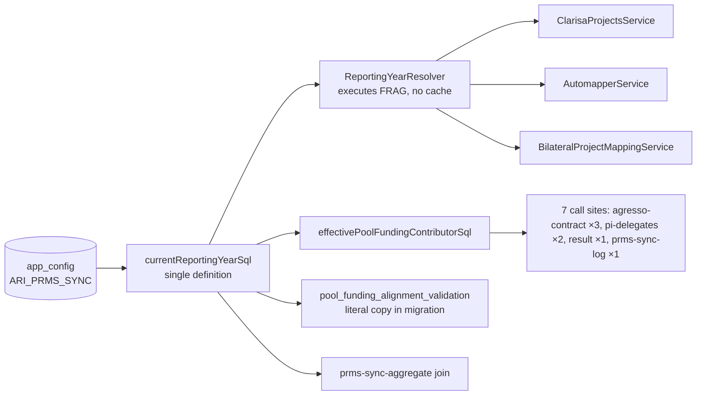

# Design — Bilateral / Annualized Project Mapping

- **Spec id:** 2026-10-annualized-project-mapping
- **Status:** approved by judgment-day (r3, `judgment.md` — JUDGMENT: APPROVED ✅); approved (Phase 2 gate, 2026-10-28 — Continue)
- **Depth:** Full
- **Implements:** `requirements.md` R-APM-001…011, NFR-APM-001…003
- **Verified at:** `317e2d79`
- **Last updated:** 2026-10-28
- **Naming note:** `Pn` in §14 are premises of **this** design. The proposal's re-map defect is cited as **"proposal P-7 (duplicate on re-map)"** (fixes judgment I-2).

---

## 1. Executive Summary

| # | Decision | Why |
| --- | --- | --- |
| DD-1 | `reporting_year INT NOT NULL`; `UNIQUE (agresso_agreement_id, reporting_year)` replaces the active-only generated key. Superseded duplicates found by the migration move to a history table | one row per contract per year, active or not (R-APM-001/005) |
| DD-2 | **One definition of "current year": an SQL fragment.** `ReportingYearResolver` executes it, and the contributor predicate and the DB function embed it | one rule, not a TS rule plus an SQL copy (K-005, staging) |
| DD-3 | TS code takes the year only from `ReportingYearResolver`; `MappingPhaseResolver` is deleted; the enum member stays `@deprecated` | R-APM-002; NFR-APM-002; keeps merged migration `1786738949211` compiling |
| DD-4 | Automapper classifies against the current-year row in **any** state, into five disjoint buckets; supersede is removed | R-APM-005; fixes proposal P-7 (duplicate on re-map) |
| DD-5 | Manual create = upsert on (agreement, current year), never writing `is_active` | R-APM-006 |
| DD-6 | `PATCH :id/activate`, mirror of deactivate, current-year rows only; also exposed in the `/admin` SSR page | R-APM-011 |
| DD-7 | `phase` removed from DTOs: POST bodies → `400` (existing `forbidNonWhitelisted`), GET queries → stripped | R-APM-003 |
| DD-8 | Coverage gains `inactive` + `reporting_year` with a fixed precedence; the page's year comes from the coverage response | R-APM-007/008/009 |
| DD-9 | The `ARI_CLARISA_PROJECTS_PHASE` row is deactivated by migration; the phases endpoint and modal selector are removed | R-APM-002/010 |
| DD-10 | Each operation resolves the year **once** and carries it | no mixed-year writes if the config flips mid-request (judgment I-5) |

**Budget:** §12.

---

## 2. Architecture Overview



## 3. Extended Directory Structure (fixes judgment W-6)

```
server/researchindicators/src/
├── db/migrations/
│   ├── <ts>-annualizeBilateralProjectMapping.ts          # NEW — DD-1 (+ history table)
│   ├── <ts>-scopePoolFundingValidationToReportingYear.ts # NEW — DD-2 (literal SQL)
│   └── <ts>-retireClarisaProjectsPhaseKey.ts             # NEW — DD-9
├── domain/shared/utils/
│   ├── reporting-year.resolver.ts   # exports currentReportingYearSql; resolve() executes it
│   ├── pool-funding.util.ts         # predicate gains the year clause
│   └── env.utils.ts                 # CLARISA_PROJECTS_PHASE removed
├── domain/entities/app-config/enum/app-config-key.enum.ts  # ARI_CLARISA_PROJECTS_PHASE kept, @deprecated (DD-3)
├── domain/tools/clarisa/projects/
│   ├── mapping-phase.resolver.ts (+ .spec.ts)      # DELETED
│   ├── clarisa-projects.module.ts                  # drop MappingPhaseResolver provider/export
│   ├── clarisa-projects.service.ts                 # year from resolver; getEligiblePhases removed
│   ├── clarisa-projects.controller.ts              # GET phases removed; `phase` query removed from GET bilateral
│   └── dto/clarisa-project-phase.types.ts          # DELETED
├── domain/entities/bilateral-project-mapping/
│   ├── entities/bilateral-project-mapping.entity.ts       # + reporting_year, + @Index uk_bpm_agreement_year
│   ├── entities/bilateral-project-mapping-history.entity.ts  # NEW (read-only archive, DD-1)
│   ├── automapper.service.ts / automapper.controller.ts   # DD-4, DD-7, DD-8, DD-10
│   ├── dto/automapper-run.dto.ts                          # RunRequestDto stays EMPTY; AutomapperCoverageQueryDto loses `phase`; response DTOs per §5 (`supersede`/`superseded` → `toUpdate`/`updated` + `inactive`)
│   ├── bilateral-project-mapping.service.ts / .controller.ts  # DD-5, DD-6
│   ├── bilateral-mapping-coverage.service.ts              # `phase` param removed; phase_used = resolver year
│   └── dto/coverage-report.query.dto.ts                   # `phase` removed
├── domain/entities/result-prms-sync/repositories/result-prms-sync-aggregate.repository.ts
└── admin/client/pages/BilateralProjectMappings.tsx       # Activate action + copy (DD-6)

client/research-indicators/src/app/
├── shared/services/{api.service.ts, bilateral-mapping.service.ts}
├── shared/interfaces/bilateral/bilateral-project-mapping.interface.ts  # incl. ClarisaProjectPhase* removed
├── testing/bilateral-project-mapping.fixture.ts                        # + reporting_year
├── shared/components/all-modals/modals-content/edit-environment-variable-modal/*  # CLARISA_PHASE_CONFIG_KEY removed
└── pages/platform/pages/administration/center-admin/bilateral-mapping/
    ├── bilateral-mapping.component.{ts,html}     # phase = signal(2026) (:305) replaced
    ├── components/bilateral-mapping-coverage/*
    └── components/automapper-dialog/*
```

Root `CLAUDE.md` §4.3 K-016 names `MappingPhaseResolver`. `/akili-archive` updates that sentence; this spec does not edit the guide.

## 4. Data Model (DD-1)

| Object | After |
| --- | --- |
| `bilateral_project_mapping.reporting_year` | `INT NOT NULL`, no DB default; the entity writes it explicitly |
| `active_agreement_id` + `uk_bpm_active_agreement` | dropped |
| `uk_bpm_agreement_year` | `UNIQUE (agresso_agreement_id, reporting_year)`, declared on the entity too, so `migration:generate` never proposes dropping it (judgment I-8) |
| `bilateral_project_mapping_history` | **new**. Same columns as the mapping table + `reporting_year`, `original_id`, `archived_at`, `archive_reason`. Written only by this migration; no API reads it |

### 4.1 `up` — order and rules (fixes judgment J-4)
1. **Survey** (logged, never fatal): row count, `created_at` range, and agreements with more than one row. The vacuous "older than the 2026 cycle" refusal is gone. The backfill year is the constant `2026`, matching `DEFAULT_REPORTING_YEAR` and `DEFAULT_CLARISA_MAPPING_PHASE`. P-7 states what remains unverifiable.
2. **Abort** only if an agreement has **more than one active** row. The old unique key makes this impossible, so an abort means the data is corrupt and needs a human.
3. Create the history table. For each agreement with more than one row, **keep one row**: the active one if present, otherwise the most recently updated one. **Move the rest** to history with `archive_reason = 'superseded-duplicate'`, then delete them from the main table. The rows survive in history, not lost (owner J-4 → a).
4. Add `reporting_year` nullable → backfill `2026` → `NOT NULL`.
5. Drop `uk_bpm_active_agreement`, then the generated column; add `uk_bpm_agreement_year`.

On Dev, step 3 moves **0** rows (P-6: 0 agreements with more than one row).

### 4.2 `down`
1. Refuse if any agreement has rows in more than one `reporting_year`, because collapsing years would break the old key (judgment I-8).
2. Drop `uk_bpm_agreement_year` **before** the column (judgment A-16), re-add the generated column + `uk_bpm_active_agreement`, then drop `reporting_year`.
3. Restore history rows (`original_id` as `id`), then drop the history table.

MySQL DDL auto-commits, so the pre-checks are what prevent a partial state. All migration SQL is a **literal** (never an imported TS constant, judgment I-7) and obeys the placeholder rule in §6.1.

## 5. API Design (fixes judgment J-5)

Routes are mounted unversioned under `/api` (root guide §4.1). Prefixes: `bilateral-project-mappings` (`main.routes.ts:434`) and `tools/clarisa/projects` (client `api.service.ts:930,940`). Roles are unchanged: class-level `CENTER_ADMIN, SYSTEM_ADMIN` (P-21).

**Preview and apply: a delta on the existing shape** (`automapper-run.dto.ts`; client `bilateral-project-mapping.interface.ts:119-150`). All existing keys are kept unless struck.

| Response | Added | Renamed / removed |
| --- | --- | --- |
| preview top level | `reporting_year: number`, `toUpdate: Entry[]`, `inactive: Entry[]` | `supersede[]` **removed** |
| preview `counts` | `toUpdate`, `inactive` | `supersede` **removed** |
| apply top level | `reporting_year` | — (`feedFetchedAt`, `counts`, `ambiguous[]`, `unresolved[]` kept) |
| apply `counts` | `updated`, `inactive` | `superseded` **removed** |
| `AutomapperReconciledEntry.action` (server + client) | `'toUpdate' \| 'inactive'` | `'supersede'` **removed** |
| inactive entries | carry `existingMappingId`, `existingClarisaProjectId`, `refreshed: boolean` (true when its CLARISA fields were rewritten) | — |

**Other endpoints:**

| Method + path | Change | `data` |
| --- | --- | --- |
| `GET /api/bilateral-project-mappings` | current-year rows only | row + `reporting_year` |
| `GET /:id`, `PATCH /:id`, `PATCH /:id/deactivate` | prior-year id → `404` | unchanged |
| `POST /api/bilateral-project-mappings` | upsert (DD-5); `409` removed | row + `outcome: 'created' \| 'updated'`; `201` / `200` |
| `PATCH /:id/activate` | **new** (DD-6). Gets a `ValidationPipe` for its optional `notes`; deactivate gets the same (judgment I-11) | row |
| `GET …/coverage` | `phase` stripped | `{ reporting_year, mapped, pending, inactive, reachable }` |
| `GET …/coverage-report` | `phase` stripped | unchanged; `phase_used` = resolver year |
| `GET /api/tools/clarisa/projects/bilateral` | `phase` query removed (no pipe today, P-24) | unchanged |
| `GET /api/tools/clarisa/projects/phases` | **removed** | — |

`AutomapperRunRequestDto` stays an **empty class**, so `forbidNonWhitelisted` keeps returning `400` for `{ phase }` (judgment A-16).

## 6. Backend Module Design

### 6.1 Year source (DD-2, DD-3, DD-10)
- **`currentReportingYearSql`** is the single rule, exported from `reporting-year.resolver.ts`. In words:
  - take the `simple_value` of the active `app_config` row whose `` `key` `` is `ARI_PRMS_SYNC` (a primary key, so at most one row — P-26);
  - turn `\t`, `\r`, `\n` into spaces and trim;
  - if the result is exactly 4 ASCII digits, cast it to an unsigned integer;
  - otherwise use `2026`.

  `key` is backticked. The fragment takes no input.
- **`ReportingYearResolver.resolve()` executes the fragment** (one `SELECT`, plus the raw value so it can keep logging the "unusable value" warning), so TS and SQL cannot drift. It keeps its DB-error fallback to `2026` with a warning; SQL readers cannot have that fallback, and that is accepted.
  - **Behavior change, accepted:** a value padded with NBSP or BOM, which JS `trim()` used to accept, now falls back to `2026` with the warning (judgment W-2).
- **Placeholder rule** (judgment W-3): `orm.config.ts:59` sets `namedPlaceholders: true`. The fragment, the re-created function body and every migration string must contain no `?` and no `:<word>`, comments included. The `[SPEC:` marker is also banned (`1786679227000` header, lines 47-65). A unit test asserts this on the exported fragment. `package.json`'s `migration:scan` points at a missing script, so it is **not** a gate.
- **Copy-drift test (RB-9):** a unit test reads the new function migration file and asserts its text contains the exported fragment, whitespace-normalised. The migration is a frozen literal, so this pins the copy at authoring time.
- **Fragment test:** an integration spec `test/reporting-year-sql.integration-spec.ts`. It follows the existing integration suites' connection (`PID_MYSQL_*`, `test/jest-integration.json`) and their TEMPORARY-table pattern (`pi-delegates-auth-sql.integration-spec.ts:22-24,90`). A TEMPORARY `app_config` shadows the real one on that connection. Cases: `2027`, `' 2027 '`, `'2027\n'`, `'\t2027'`, `'abc'`, `''`, inactive row, missing row. If `PID_MYSQL_*` is unavailable to the task, that is a recorded gap, never a pass.
- **DD-10:** `AutomapperService.resolve()` resolves the year once and returns it in the resolution. `classify`, `apply` and `coverage` use that value, and `ClarisaProjectsService.listBilateralProjects` accepts it, so the cohort and the writes share one year. SQL-fragment readers each read at their own query time. That is accepted, because each is a single statement.

### 6.2 Readers (fixes judgment J-1)

The P-10 command returns **35 lines**: **16 code** lines (table below), **1 Swagger description string** (`clarisa-projects.controller.ts:37`, no change) and **18 comment/doc** lines. Code lines by file:

| File | Code lines | Change |
| --- | --- | --- |
| `shared/utils/pool-funding.util.ts` | 19 | EXISTS + `AND bpm.reporting_year = <fragment>` — callers below need no edit |
| `agresso-contract.repository.ts` | 347, 399, 532 | via predicate |
| `pi-delegates.repository.ts` | 117, 538 | via predicate |
| `results/repositories/result.repository.ts` | 215 | via predicate |
| `result-prms-sync-log.repository.ts` | 165 | via predicate (163 calls the DB function) |
| `result-prms-sync-aggregate.repository.ts` | 209 | join + `bpm.reporting_year = <fragment>` |
| `bilateral.service.ts` | 211 | calls `findActiveByAgreementId`, which becomes year-scoped |
| `bilateral-project-mapping.service.ts` | 163, 184 | year-scoped lookup / upsert |
| `automapper.service.ts` | 224, 244, 334 | year-scoped classify/apply/coverage |
| `bilateral-project-mapping.entity.ts` | 19 | + column/index |

The grep cannot see the mapping service's injected `this.repo` used by `list`, `findById`, `update` and `deactivate`; those are year-scoped too. It also cannot see the DB function, whose callers are `green-checks.repository.ts:71` and `result-prms-sync-log.repository.ts:163` (P-10b). Comment lines need no change.

### 6.3 Automapper classification (fixes judgment W-1)

"Automation-owned" means **any `source` other than `MANUAL`** (`DERIVED`, `AI_SUGGESTED`, `AI_AUTO`), which matches today's supersede rule (`automapper.service.ts` classify). Each candidate lands in **exactly one** bucket:

| # | Current-year row | Bucket | Apply writes | `is_active` |
| --- | --- | --- | --- | --- |
| 1 | none | `toCreate` | insert DERIVED, year carried (DD-10) | `true` |
| 2 | active, same project | `alreadyMapped` | nothing | unchanged |
| 3 | active, different project, automation-owned | `toUpdate` | project id, short name, external code, `updated_by` | unchanged |
| 4 | any state, different project, MANUAL | `divergent` | nothing | unchanged |
| 5 | inactive, same project (any source) | `inactive` (`refreshed: false`) | nothing | `false` |
| 6 | inactive, different project, automation-owned | `inactive` (`refreshed: true`) | same fields as row 3 | `false` |

Apply never writes `is_active`, `deleted_at` or `source`. Every row 3/6 write logs old → new project id. Idempotency is unchanged: classification re-runs inside the transaction (R-CAM-002).

### 6.4 Coverage precedence (fixes judgment W-5)

Each eligible project is matched to current-year rows by project id **or** normalized external code, as today. When several rows match, **active wins over inactive, and inactive wins over none**. So the project is `mapped` if any matched row is active, else `inactive` if any matched row exists, else `pending`. This is what guarantees `mapped + pending + inactive = reachable`. A fixture covers the mixed case.

### 6.5 Mapping service (DD-5, DD-6, fixes judgment W-4, I-1)
- `create()`: inside a transaction, lock the current-year row for the agreement.
  - **Absent** → insert active with `source = MANUAL` (any submitted `source` is ignored; amended 2026-10-29), outcome `created`.
  - **Present** → write the submitted project fields, set `source = MANUAL` (any submitted `source` is ignored on this branch), leave `is_active` alone, outcome `updated`.
  - **Retry:** on `ER_DUP_ENTRY` (1062), `ER_LOCK_DEADLOCK` (1213) or `ER_LOCK_WAIT_TIMEOUT` (1205), retry **once** in a fresh transaction, which then takes the update branch. A second failure surfaces as an error, never a raw 500 message.
- **External code (I-1):** whenever create or PATCH changes `clarisa_project_id`, the service sets `clarisa_external_code` from the cached CLARISA feed entry for that id, or `null` if the feed lacks it. A stale code would otherwise mark the old project as mapped in coverage.
- **Ownership on human edit (I-1, RB-5; amended 2026-10-29):** **every** human write — create on the absent branch, create on the present branch, and every `PATCH :id` (project changed or not) — stores `source = MANUAL` and ignores a submitted `source`, so the next Apply leaves the row alone (bucket 4). *Amendment reason:* the DTO accepts `AI_AUTO`/`AI_SUGGESTED` (P-20), and §6.3 treats any non-MANUAL source as automation-owned, so a person could otherwise create a row that the next Apply overwrites (T-06 Reviewer A advisory; owner decision: "Force MANUAL on every human write").
- **CLARISA feed dependency (RB-6):** `clarisaProjectsService` stops being `@Optional()` in `BilateralProjectMappingService`, because the external-code refresh needs it. A feed error during the refresh sets the code to `null` and logs a warning; it never fails the write.
- `activate()`: mirrors `deactivate()` (P-19). It is idempotent, sets `is_active = true` and `deleted_at = null`, and records `updated_by` and optional `notes`.
- Every by-id method returns `404` for a row whose `reporting_year` is not the current year.

### 6.6 CLARISA (DD-3, DD-9)
- The year comes from the resolver, or from the caller's carried year (DD-10). `getEligiblePhases` and `GET phases` are deleted.
- `MappingPhaseResolver` (+ spec), `DEFAULT_CLARISA_MAPPING_PHASE`, `ENV.CLARISA_PROJECTS_PHASE` and the module provider/export are deleted.
- `AppConfigKey.ARI_CLARISA_PROJECTS_PHASE` is **kept** with `@deprecated — retained only so migration 1786738949211 compiles; read nowhere` (owner J-2 → a).
- The `.env.example` block is removed.

## 7. Frontend / UX Component Architecture (fixes judgment I-9)

| Component | Change | States |
| --- | --- | --- |
| `api.service.ts`, `bilateral-mapping.service.ts` | every `phase` arg removed; `GET_ClarisaProjectPhases` removed; `PATCH_ActivateBilateralMapping` added; `create` reads `outcome`. The "Pending" list (`:31-60`) still builds from preview `toCreate + ambiguous + unresolved`; `inactive` and `toUpdate` are intentionally excluded, because they already have rows | — |
| interfaces + `testing/bilateral-project-mapping.fixture.ts` | shapes per §5; `reporting_year` on the row; `ClarisaProjectPhase*` removed | — |
| `bilateral-mapping.component` | `phase = signal(2026)` (`:305`) becomes `reportingYear = signal<number \| null>(null)`, set from the coverage component's output when coverage loads. Header and help text show the year when it is known; before that, the text without a year (no literal fallback). **Year** column after *Last Updated*, sortable. **Activate** action on inactive rows in the deactivate slot, with confirmation. Created/updated toast | loading → no year; error → no year |
| `bilateral-mapping-coverage` | emits the loaded `reporting_year`; `inactive` figure; readiness note per R-APM-008 | loading · error · `reachable = 0` · `mapped = 0` · normal |
| `automapper-dialog` | phase line = `reporting_year`; buckets per §6.3; copy at `:375` replaced | existing |
| `edit-environment-variable-modal` | CLARISA-phase branch, `CLARISA_PHASE_CONFIG_KEY` (`:21`, not imported elsewhere), its signals and fetch removed | `ARI_PRMS_SYNC` = plain input |
| **`/admin` SSR** `BilateralProjectMappings.tsx` (fixes judgment J-3, RA-4) | create handles `outcome`; **Activate** button calling `PATCH /:id/activate` replaces `:439` "Already inactive"; copy replaced at `:425-429` ("Inactive — re-create instead") and `:534` ("Deactivate + re-create to change"); a **Year** column | existing |

Tokens: existing `.atc-*` / `var(--ac-*)` only.

## 8. Shared Contracts
Server DTOs and client interfaces change together (§5 ↔ §7). Compile gates are the server `npm run build` and the client `tsc -p tsconfig.app.json`. The client `tsconfig.spec.json` is also checked, because the build excludes specs (K-004).

## 9. Security & Authorization
Roles are unchanged; activate inherits the class-level roles. The fragment interpolates nothing user-supplied.

## 10. Observability
The automapper run summary gains `reporting_year`, `updated` and `inactive`. There is a per-row update log (§6.3), and the migration survey and archive counts are logged.

## 11. Rollout & Rollback (fixes judgment I-6)
- **Deploy order:** server and client ship in the **same merge** to `dev`. Until the new client is served, an open old client sends `{ phase }`, so preview and apply return `400`. The window is the gap between the two deploys; a page reload fixes it. This is an accepted risk.
- Rehearse with `up`/`down`/`up` on the TEST scratch schema (`npm run migration:test:bootstrap`) before merge. Jenkins then runs the migrations on the `dev` deploy (root guide §4.3).
- Rollback: revert the code first, then run `down` for the three migrations.

## 12. Budget (fixes judgment I-4)

| Measure | Estimate |
| --- | --- |
| Tasks | 10 |
| LOC (incl. tests) | ~1,500: server ~700, migrations ~400 (function body twice, up + down, ~230; annualize + history + retire ~170), client ~350, SSR ~50 |
| Review rounds | ~14 (10 + 4 margin) |

Depth: Full, which still matches.

## 13. Design Decisions

| ID | Decision | Rejected alternative | Lesson |
| --- | --- | --- | --- |
| DD-1 | one row per (agreement, year); duplicates archived | delete duplicates; abort and clean by hand | owner J-4 → a |
| DD-2 | resolver executes the SQL fragment | TS rule + SQL mirror + parity test | K-005 (staging): one definition, not two |
| DD-3 | resolver only; enum kept `@deprecated` | delete the enum member | owner J-2 → a; merged migrations are immutable |
| DD-4 | five disjoint buckets, in-place update | supersede | owner OQ-A |
| DD-5 | manual upsert with retry on 1062/1213/1205 | keep `409` | owner OQ-B |
| DD-6 | minimal activate, STAR + SSR | wait for AC-1797 | owner OQ-1(a) |
| DD-7 | `400` on POST, strip on GET | accept and ignore `phase` | an ignored input tells the caller nothing |
| DD-8 | 4-figure coverage with precedence | fold inactive into pending | R-APM-009; amends R-CAM-004 |
| DD-9 | deactivate the old config row | delete it | reversible |
| DD-10 | resolve once per operation | resolve per call | judgment I-5 |

### Reversion challenge (Step 2.3)
*Run inline by the author, then re-examined by both judges in round 1.*

| Reverted behavior | Breaks | Addressed by |
| --- | --- | --- |
| Supersede (deactivate + create) | in-year audit of the previous project id | per-row update log; prior years keep their rows |
| `409` on create | STAR and SSR "already mapped" handling | `outcome` in both (§7) |
| `phase` overrides | ad-hoc phase previews | accepted (owner rule) |
| `ARI_CLARISA_PROJECTS_PHASE` + ENV | local runs that set only the ENV; merged seed migration | `.env.example`; enum kept `@deprecated` |
| `GET …/phases` | the modal selector | removed together |
| "never a fourth coverage figure" | coverage specs and card | coverage tasks update them |
| Resolver's JS trim | NBSP/BOM-padded values | accepted (§6.1) |

## 14. Premise Ledger

**Count:** 29 verified · 1 `UNVERIFIED` (High 1, Low 0) — 30 rows incl. P-10b.
**Blast-radius triggers:** `live-path` (Apply, New mapping, Activate) · `shared-state` (shared predicate + DB function) · `consumer` (response shapes, removed endpoint, removed DTO fields, removed/deprecated symbols, SSR page).

| # | Claim | Class | Citation (as run) | Verified at | If false | Settled by |
| --- | --- | --- | --- | --- | --- | --- |
| P-1 | `ReportingYearResolver` reads active `ARI_PRMS_SYNC`, no cache, JS-trim + `/^\d{4}$/`, default 2026 | location | `domain/shared/utils/reporting-year.resolver.ts:19-56` | 317e2d79 | DD-2 rule — High | — |
| P-2 | Resolver provided by a `@Global` module | location | `global-utils.module.ts:11,21,31` | 317e2d79 | DI ban hit — High | — |
| P-3 | CLARISA fetch already sends the resolver year; cache keyed by phase | location | `clarisa-projects.service.ts:231-252` | 317e2d79 | cache change — Low | — |
| P-4 | Eligibility uses `MappingPhaseResolver` | location | `clarisa-projects.service.ts:86,189` | 317e2d79 | DD-3 scope — Low | — |
| P-5 | Dev: both keys = `2026`, active | data-env | `SELECT key,simple_value,is_active,updated_at FROM app_config WHERE key IN (…)` → 2026/1/2026-10-16; 2026/1/2026-08-20 | 317e2d79 | backfill year — High | — |
| P-6 | Dev: 198 rows, all DERIVED, created 2026-09-16, 197 active, 0 agreements with >1 row, 1 inactive (`A1697`) | data-env | `SELECT COUNT(*),MIN(created_at),MAX(created_at),SUM(is_active)` → 198/2026-09-16T00:41:13.511Z/…877Z/197; collision query → 0; source split → {1,DERIVED,197},{0,DERIVED,1} | 317e2d79 | history step non-trivial on Dev — Low | — |
| P-7 | In environments other than Dev, every row belongs to the 2026 cycle — i.e. no row was created under a `phase` override for another year | data-env | `UNVERIFIED — confirm at source before relying on it`. Judges' searches: the table dates from 2026-05-19 (`git log` on `1779190000011`); `created_at` cannot reveal a phase override | — | constant backfill mislabels such rows — High | the migration survey (§4.1 step 1) logs counts and the `created_at` range per environment; owner David Casañas reads that log on the first deploy to each environment and decides any relabel; the deploy is not blocked |
| P-8 | Uniqueness today = generated `active_agreement_id` + `uk_bpm_active_agreement` | existence | `db/migrations/1779190000011-createBilateralProjectMapping.ts:33-36` | 317e2d79 | DD-1 steps — Low | — |
| P-9 | **Live path of Apply:** `bilateral-mapping.service.ts:171` → `api.service.ts:924-926` → `automapper.controller.ts:111` → `resolve(body?.phase)` `:132` → `apply()` → `classifyAgainstExisting()` (`automapper.service.ts:~401` filters `is_active = true`; `:~260` supersede write) | live-path | as listed | 317e2d79 | DD-4 targets wrong code — High | — |
| P-10 | Mapping readers: the command returns **35** lines = 16 code (§6.2 table) + 1 Swagger string + 18 comment/doc. The reader set is complete; the grep cannot see `this.repo` or the DB function | shared-state | `cd server/researchindicators && grep -rnE '<P>' src test --include='*.ts' --include='*.tsx' \| grep -v '\.spec\.ts' \| grep -v db/migrations \| wc -l` → `35`, where `<P>` = `bilateral_project_mapping` OR `getRepository\(BilateralProjectMapping\)` OR `findActiveByAgreementId` OR `effectivePoolFundingContributorSql\(` joined with a plain `|` (the table escapes it) | 317e2d79 | a reader stays unscoped — High | — |
| P-10b | DB function callers | shared-state | `grep -rn "pool_funding_alignment_validation(" --include='*.ts' src \| grep -v "db/migrations\|\.spec\."` → `green-checks.repository.ts:71`, `result-prms-sync-log.repository.ts:163` | 317e2d79 | — High | — |
| P-11 | Latest definition of the DB function is `1786679227000` (EXISTS at `:100,219`); `baseline.sql:6457` embeds an older body, overwritten when migrations run after bootstrap | location | `grep -l 'CREATE FUNCTION' src/db/migrations/*.ts \| xargs grep -l pool_funding_alignment_validation` → 3 files, latest `1786679227000` (the migrations escape the backtick, so a literal-backtick pattern returns 0) | 317e2d79 | wrong body re-created — High | — |
| P-12 | `findActiveByAgreementId` has one production caller | consumer | `bilateral.service.ts:211` | 317e2d79 | — Low | — |
| P-13 | PRMS aggregate joins active mappings with no year | location | `result-prms-sync-aggregate.repository.ts:209-211` | 317e2d79 | — Low | — |
| P-14 | `GET …/phases`: one client caller (modal) | consumer | `api.service.ts:939-940`, modal `:131`, controller `:137` | 317e2d79 | — Low | — |
| P-15 | Client `phase` senders: `api.service.ts:912-915`, `bilateral-mapping.service.ts:31-172`, page `phase = signal(2026)` at `bilateral-mapping.component.ts:305`; the picker `:929-932` sends `search` only | consumer | as listed | 317e2d79 | more client edits — Low | — |
| P-16 | `/admin` SSR: `admin.service.ts:15` wraps `list`, **and** `BilateralProjectMappings.tsx` makes its own fetches: create `:213-250`, deactivate `:259-269`, "re-create instead" copy `:425-429`, no activate | consumer | files:lines as listed | 317e2d79 | SSR left inconsistent — High | — |
| P-17 | Test/fixture consumers. Server: `automapper.{service,controller}.spec.ts`, `mapping-phase.resolver.spec.ts`, `clarisa-projects.{service,controller}.spec.ts`, `project-selector.util.spec.ts`, `pool-funding.util.spec.ts:10-12`, `result.repository.spec.ts:704-720`, `pi-delegates.repository.spec.ts:163`, agresso-contract and green-checks repository specs, the testing modules (`Test.createTestingModule`) of `bilateral-project-mapping.service.spec.ts`, `automapper.service.spec.ts` and `clarisa-projects.service.spec.ts`, which must provide the new `ReportingYearResolver` dependency (no spec constructs these services with `new`). Client: the `automapper-dialog`, `bilateral-mapping`, `bilateral-mapping-coverage`, `bilateral-mapping.service` and `edit-environment-variable-modal` specs, plus `testing/bilateral-project-mapping.fixture.ts` | consumer | judges' unfiltered re-runs of `grep -rlE "MappingPhaseResolver\|ARI_CLARISA_PROJECTS_PHASE\|CLARISA_PROJECTS_PHASE\|supersede\|projects/phases\|getEligiblePhases" src test` + predicate-text greps | 317e2d79 | CI breaks — Low | each task re-runs its own Consumer Sweep |
| P-18 | No activate endpoint | existence | `@Patch(':id')` `:148`, `@Patch(':id/deactivate')` `:173` | 317e2d79 | — Low | — |
| P-19 | `deactivate()` shape | location | `bilateral-project-mapping.service.ts:246-263` | 317e2d79 | — Low | — |
| P-20 | `create()` throws `409` under `pessimistic_write`; never writes `clarisa_external_code`; the DTO rejects a submitted `DERIVED` source but accepts others | location | `bilateral-project-mapping.service.ts:176-216` (409 at `:197`); `dto/create-bilateral-project-mapping.dto.ts:58-60` | 317e2d79 | — Low | — |
| P-21 | Class-level `@Roles(CENTER_ADMIN, SYSTEM_ADMIN)` | location | `bilateral-project-mapping.controller.ts:54-55`; `automapper.controller.ts:74-75` | 317e2d79 | — Low | — |
| P-22 | TEST scratch schema exists (`ARI_TEST_MYSQL_*`, `migration:test:*`); integration suites use `PID_MYSQL_*` + TEMPORARY tables on one connection | data-env | `package.json:26,37-40`; `db/baseline/baseline.sql`; `test/pi-delegates-auth-sql.integration-spec.ts:22-24,43-57,90` | 317e2d79 | fragment test harness — High | — |
| P-23 | The PRMS push gate compares the result's `report_year` (from `results.report_year_id`) with `reporting_year` from the resolver | other | `entities/result-prms-sync/eligibility/sync-gate.ts:28-37,80-127` | 317e2d79 | R-APM-004 AC.3 — High | — |
| P-24 | No global `ValidationPipe`. Preview/apply: `whitelist + forbidNonWhitelisted`; coverage/coverage-report: `whitelist`; `GET clarisa/projects/bilateral` and `:id/deactivate`: no pipe | data-env | no hit in `main.ts`/`app.module.ts`; `automapper.controller.ts:95-99,117-121,191`; `bilateral-project-mapping.controller.ts:96,129-131,153-155` | 317e2d79 | R-APM-003 wording — Low | — |
| P-25 | Coverage-report (S1) does not read the mapping table | location | no table hit in `bilateral-mapping-coverage.service.ts`; `phase` at `:44-79` | 317e2d79 | — Low | — |
| P-26 | `app_config.key` is the PRIMARY KEY | data-env | `db/baseline/baseline.sql:1011-1018` | 317e2d79 | fragment could return 2 rows — High | — |
| P-27 | Merged migration `1786738949211-seedClarisaMappingPhase.ts` imports `AppConfigKey` and uses `ARI_CLARISA_PROJECTS_PHASE` in `up`/`down` | consumer | `:2` import; `:11,22` usages | 317e2d79 | enum deletion breaks build — High | — |
| P-28 | `orm.config.ts` sets `namedPlaceholders: true`; `?` / `:word` in SQL (even comments) break parameterless queries | other | `db/config/mysql/orm.config.ts:59`; `1786679227000` header `:47-65` | 317e2d79 | migrations fail at deploy — High | — |
| P-29 | Current preview/apply response shapes (§5 baseline) | consumer | client `bilateral-project-mapping.interface.ts:119-150`; server `dto/automapper-run.dto.ts` | 317e2d79 | §5 delta wrong — High | — |
