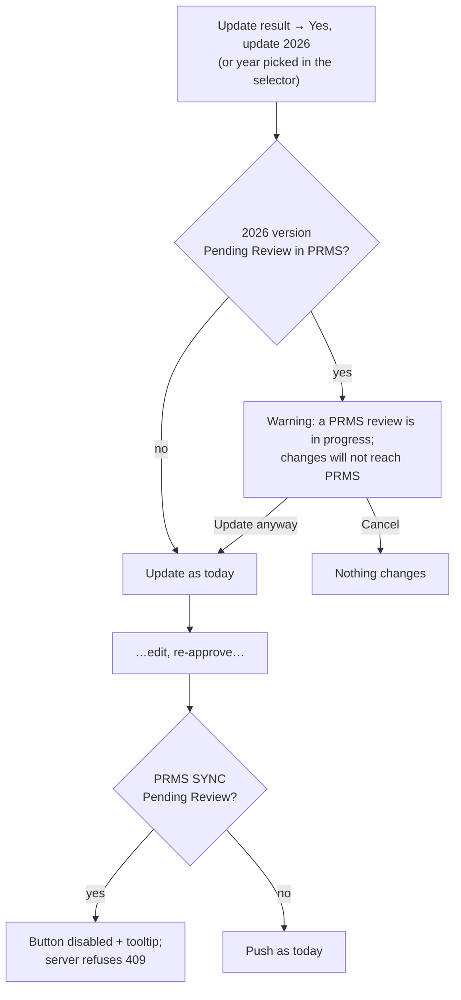

# Proposal — PRMS Pending Review Lock

## 1. Document Control

| Field | Value |
|---|---|
| Spec Path | `changes/prms-pending-review-lock` |
| Slug | `prms-pending-review-lock` — derived from free-text argument (chat brief, 2026-11-18) |
| Type | Change |
| Deliverable | software |
| Approval Mode | gated |
| Date | 2026-11-18 |
| Branch | `fix/prevent-prms-resubmission-during-active-review` |
| Requirement source | Owner chat brief + screenshot of the current *Confirm updating* alert. No Jira ticket supplied yet |
| Related family | `bilateral/prms-sync` (children 1 `sync-engine`, 5 `decision-webhook`, 6 `sync-status-panel`). **Not** registered as a family child: the family is a closed set and adding a row needs a HITL manifest edit (see OQ-4) |
| Depends on | none (builds on shipped code of children 1, 5, 6) |
| Parallel-safe | no — touches both packages and the same sync gate as `center-admin-resync` |

## 2. Intent

While PRMS is reviewing a pushed result (**Pending Review**), STAR must:

1. **Warn** the user who updates that year's version that PRMS will not see the new changes.
2. **Refuse** to push that year's version to PRMS again, because PRMS has no update operation and rejects a re-sync during review.

> **Terminology (owner, 2026-11-18).** *Pending Review* in this spec is the **PRMS push status** — the state of the push in PRMS — **never a STAR result status** (`result_status_id`). It is written as `event_source = 'STAR'`, `status = 'PENDING_REVIEW'` in `result_prms_sync_history` on every accepted push (`prms-webhook-delivery.repository.ts` `recordOutboundPendingReview`, `OUTBOUND_STATUS_PENDING_REVIEW`) and ends when PRMS delivers a decision (`event_source = 'PRMS'`, `decision` APPROVE/REJECT). The STAR result is **Approved** throughout.

## 3. Problem / Current Behavior

| # | Today | Evidence |
|---|---|---|
| P-1 | *Update result* asks only for a year. It never looks at PRMS state | `version-selector.component.ts` `updateResult()` → `showPrompt()` → `submitReportingCycle()`; no PRMS call |
| P-2 | The server reopens an Approved result with no PRMS check | `green-checks.service.ts` `newReportingCycle()` checks only `result_status_id = APPROVED` |
| P-3 | Re-approving the result recreates the year snapshot, and the new snapshot starts **un-synced** | `green-checks.repository.ts` `createSnapshot()` calls `SP_delete_result_version` then `SP_versioning`; the latest `SP_versioning` (`1791468452856-UpdateSPVersionDeletePRMSPhase.ts`) copies `prms_result_code` / `prms_phase_id` but **not** `is_synced_to_prms`, which defaults to `0` (`baseline.sql`, `results` table) |
| P-4 | So the sync gate lets the push through: `not_already_synced` reads the fresh `FALSE` | `sync-gate.ts` `SYNC_GATE_ENTRIES`; `claimInsideLock()` `already_synced` branch reads the same column |
| P-5 | PRMS rejects it with `409`. The user sees the failure modal | **Verified on the shared Dev DB, 2026-11-18** (read-only): `result_prms_sync_log` holds two such rows — refs `698` and `702`, `outcome = REJECTED_BY_PRMS`, `failure_reason` = *"HTTP 409: Conflict - … Result 10093 cannot be resubmitted: its status is pending review. Only rejected results can be resubmitted."* (10095 for `702`). See §3.1 |
| P-6 | The *PRMS SYNC* button enables on `status_id = 6` + green Pool Funding + `has_contribution`, plus `!is_synced_to_prms` — also blind to review state | `result-sidebar.component.ts` `canSyncPrms`, `prmsAlreadySynced` |

### 3.1 Evidence — the chain reproduced on Dev data (2026-11-18, read-only)

Queries run with `SET SESSION TRANSACTION READ ONLY` against `ARI_MYSQL_*` (shared Dev DB). Result `702` (STAR, 2026):

| When (UTC) | Source | What happened |
|---|---|---|
| 11-12 01:52 | `submission_history` 37205 | 2 → 6 (Approved); `sync_log` attempt 1 `ACCEPTED`; history `STAR / PENDING_REVIEW` |
| 11-13 21:47 | `submission_history` 37205 | 6 → 4 — *Update result* reopened it |
| 11-13 21:48 | `submission_history` 37205 | 4 → 2 → 6 — re-approved; snapshot re-created as `result_id 37217` with `is_synced_to_prms = 0` (P-3) |
| 11-13 21:48:58 | `sync_log` attempt 2 | `REJECTED_BY_PRMS`, HTTP 409 *"cannot be resubmitted: its status is pending review"* |
| now | history | still only the one `STAR / PENDING_REVIEW` row — PRMS never decided |

Ref `698` went further (corrected 2026-11-19, Dev history ids 339/344/345): its attempt-2 409 was followed by a PRMS `REJECT` (id 344), and a later push (id 345) was `ACCEPTED`, so 698 is Pending Review again today. Refs `627`, `631`, `647` show the **allowed** path: a PRMS `REJECT` arrived between the two pushes, and the second push was `ACCEPTED`.

Table totals today: `result_prms_sync_log` — 32 `ACCEPTED`, 36 `REJECTED_BY_PRMS`, 4 `UNKNOWN`, 2 `REFUSED_BY_STAR`; `result_prms_sync_history` — 109 `STAR/PENDING_REVIEW`, 80 `PRMS/APPROVE`, 8 `PRMS/REJECT`.

**The review state already exists — it is just not used as a rule.** PRMS history is keyed by `official_code + year + platform` (not by `result_id`), so it survives snapshot re-creation (`prms-sync-history.reader.ts` `EVENTS_SQL`). The sidebar card already shows **Pending Review** when the newest event is a STAR push with no later PRMS decision (`prms-sync-status.util.ts` `formatSyncStatus`; `prms-sync-card.component.ts` `status`).

## 4. Proposed Outcome



- **Warn, never block, the update** — the owner explicitly allows *"si deciden igual actualizar"*.
- **Block the push** — in the client (disabled + reason) **and** in the server gate, so an old tab or a direct API call cannot re-push.
- Pending Review is decided by **one** rule, computed on the server, for `code + year + platform`.

## 5. Scope

- **Server:** a single *pending review* predicate over `result_prms_sync_history`; a new sync gate entry that refuses while pending; the predicate exposed on an existing PRMS read (status or history) so the client does not re-derive it.
- **Client:** version selector — a PRMS check after the year is chosen and a warning alert before `PATCH_ReportingCycle`; result sidebar — `canSyncPrms` / tooltip honor pending review.
- Tests on both sides, including the regression chain P-3 → P-4 (re-created snapshot, still refused).

## 6. Non-Goals

- No PRMS *update* / `op: update` support.
- No change to how PRMS decisions are ingested (child 5) or how the card renders them (child 6).
- No block on editing; the update stays allowed after the warning.
- No change to the TIP or PRMS-platform **UI** path (*Edit in TIP/PRMS*). The server gate (R-4) still applies to the TIP sync cron, which already counts a `409` as not sent.
- No backfill or data repair.

## 7. Affected Users, Systems, And Specs

| Affected | How |
|---|---|
| Contributors / PIs updating an Approved result | New warning step |
| Anyone pressing PRMS SYNC | Button stays disabled during review, with a reason |
| `version-selector.component.ts`, `result-sidebar.component.ts` | Client changes |
| `sync-gate.ts`, `result-prms-sync-log.repository.ts` (`loadGateSnapshot`), a PRMS read DTO | Server changes |
| `bilateral/prms-sync/center-admin-resync` (pending) | Its re-sync action must respect the new gate — it reuses the same endpoint, so it inherits it |
| Pooled Funding Monitor *Ready to sync* | May list a pending-review result as ready (OQ-5) |

## 8. Visual Reference

- Source: screenshot of the current alert (owner, 2026-11-18)
- Location: [`mockup/current-confirm-updating-alert.png`](mockup/current-confirm-updating-alert.png)
- Notes: shows *CONFIRM UPDATING* — "Do you want to update the most recent version of this result (2026)?", info card `2026 VERSION · Latest reporting version · last updated 13 Nov 2026`, buttons *No, choose another year* / *Yes, update 2026*. The new warning should reuse the same `showGlobalAlert` shell (severity `warning`), so no new modal component. Copy proposal for review: **"PRMS review in progress"** — *"The 2026 version of this result was sent to PRMS and is still pending review. If you update it now, your changes will not be reflected in PRMS until the review is finished."* Buttons: *Cancel* / *Update anyway*.

## 9. Requirement Delta Preview

### ADDED Requirements

- **R-1** After the user confirms a year to update, if that year's version is Pending Review in PRMS, STAR shows a warning before updating. Cancel = no change; *Update anyway* = today's update.
- **R-2** The PRMS SYNC button is disabled while the result's version is Pending Review, with a tooltip saying why.
- **R-3** The server refuses `POST …/prms-sync` while the version is Pending Review (`409`), even when `is_synced_to_prms` is `FALSE` on a re-created snapshot.
- **R-4** One server predicate defines the PRMS push status *Pending Review*: newest active, non-duplicate history event for `code + year + platform` is a STAR push (`status = 'PENDING_REVIEW'`) with no later PRMS decision. It reads **only** the history table — never `result_status_id` and never `is_synced_to_prms` (which P-3 shows resets on a re-created snapshot).

### MODIFIED Requirements

- Version selector update flow gains one conditional step (R-1).
- Sync gate order gains one entry (R-3).

### REMOVED Requirements

- None.

## 10. Approach Options

| Option | What | Trade-off |
|---|---|---|
| A — Client only | Derive Pending Review from the history the sidebar already loads; warn + disable in the UI | Smallest. **Leaves the server open**: an old tab or direct API call still re-pushes and hits the PRMS error |
| **B — Server rule + client (recommended)** | Server predicate + gate entry; predicate exposed on an existing PRMS read; client consumes it for the warning and the button | One rule, two consumers; the server is the authority. Small, contained in modules that already own PRMS state |
| C — Block the update itself | Refuse *Update result* while pending | Contradicts the brief (*"si deciden igual actualizar"*) |

## 11. Recommended Approach

**Option B.** The defect is that two systems disagree about a state STAR already records. Putting the rule in the gate closes the hole for every caller (sidebar, future `center-admin-resync`); the UI changes are then just explanations of that rule. The warning reuses the existing global alert, and the predicate reuses the history key the reader already uses.

## 12. Risks, Dependencies, And Open Questions

| ID | Item |
|---|---|
| OQ-1 | **PRMS's own rule is narrower than "not pending review"**: *"Only rejected results can be resubmitted"* (verbatim, §3.1). So a push after **APPROVE** would also be refused by PRMS. **Owner decision:** (a) block only while *Pending Review* (the brief), or (b) mirror PRMS — allow a re-push only when there was no push yet or the latest PRMS decision is `REJECT`, and warn on update for *Approved in PRMS* too. Recommended: **(b)** for the server gate — otherwise the same 409 comes back one state later; the update warning text then covers both states |
| OQ-2 | Should the *No, choose another year* picker run the same check for the year picked there? Proposed: **yes** — the rule is about the year being updated, not the button |
| OQ-3 | If the PRMS check fails (network/500), what does the update do? Proposed: proceed without the warning and log it — the server gate still protects the push |
| OQ-4 | Register as child 8 of `bilateral/prms-sync` (needs HITL manifest edit) or keep under `changes/`? Proposed: keep under `changes/` |
| OQ-5 | **The PRMS push status is already derived two different ways.** The sidebar card reads the newest history event (`prms-sync-status.util.ts` `formatSyncStatus`); the monitor gates on `is_synced_to_prms` first (`pfm-derivation.ts` `derivePrmsStatus`: `!is_synced_to_prms → NOT_SENT`). After P-3 the monitor would show *Not sent / Ready to sync* for a result the card shows as *Pending Review*. Fix in this spec (reuse R-4's predicate) or log as a follow-up? Proposed: follow-up, recorded here |
| OQ-6 | Should the refusal write a `REFUSED_BY_STAR` log row (counts as an attempt) or not (like `not_already_synced`)? Proposed: **no row** — it is a state refusal, not a verdict on the result |
| R-1 | A stuck review (PRMS never answers / webhook lost) locks re-sync forever. Mitigation to decide at specify: admin override or rely on `decision-webhook` reliability |
| R-2 | ~~P-5 rests on the owner's account~~ — **resolved**: PRMS text captured in §3.1; the gate message can echo it |
| R-3 | **Event ordering is not safe across sources.** STAR rows' `occurred_at` is sometimes stored 5 h behind the matching `sync_log.created_at` (ref `698` attempt 1: log 21:43 UTC, history 16:43; ref `631`: both 17:55), while PRMS `decided_at` reads as UTC. For `698`, `ORDER BY COALESCE(decided_at, occurred_at)` therefore places the 19:42 UTC push **before** the 19:09 REJECT, the reverse of reality. Cause `UNVERIFIED — likely the writing server's local timezone (pushes made from a natively-run local server); confirm at source`. The R-4 predicate must not trust a cross-source timestamp sort — order by `id`, or compare against `sync_log`. Possibly also affects the sidebar card (child 6) |
| KZ-001 / KZ-017 | The predicate lives in SQL — assert it against real history rows (fixture), not on mocked call sequences |
| KZ-015 | The warning test must arrange the transition (prompt → confirm → PRMS check → warning), not an end state |

## 13. Success Criteria

- Updating a year whose version is Pending Review shows the warning; Cancel leaves the result untouched; *Update anyway* behaves as today.
- After update + re-approval, PRMS SYNC stays disabled with a reason, and `POST …/prms-sync` returns `409` — verified on a **re-created** snapshot (the P-3 chain).
- Once PRMS decides (per OQ-1), the button and the push work again with no manual step.
- Results never pushed, or not pending, see no change.

## 14. Next Step

```text
/akili-specify changes/prms-pending-review-lock
```
