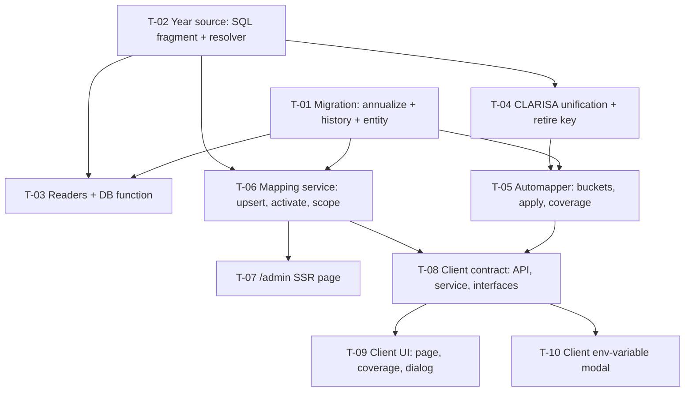

# Tasks — Bilateral / Annualized Project Mapping

- **Module:** bilateral
- **Spec id:** 2026-10-annualized-project-mapping
- **Status:** not-started — tasks approved (Phase 3 gate, 2026-10-28 — Continue)
- **Owner:** David Casañas
- **Linked requirements:** ./requirements.md · **Linked design:** ./design.md (judgment: `./judgment.md`, APPROVED)
- **Approval Mode:** `gated`
- **Last updated:** 2026-10-28

> **Red-run convention for this spec.** These tasks change **existing** code, so the Falsifiability item-8 greenfield exception does not apply. The expected reds below were **not executed at specify time**: they are derived from the cited code at `317e2d79`. Each task's **first step** is to write its behavioral test(s), run them against unchanged `HEAD`, and quote the red **verbatim** in `execution.md` before touching production code. A red that differs from the expected one is recorded as observed, and the Leader decides whether the test is falsifiable. *(Deviation from "observed before the tasks gate", surfaced at the Phase 3 gate.)*

---

## 1. Dependency Graph

**Parallelism:** server tasks run one at a time (same package). **T-07** (SSR) and the client tasks **T-08…T-10** edit different packages, so they may overlap server work. T-08 still waits for T-05/T-06 because it mirrors their contracts. *Measurement commands never run while a worker is active (root guide §4.3).*

## 2. Shared Verification Commands

| Package | Gate |
| --- | --- |
| server | `cd server/researchindicators && npm test -- --silent <spec paths>` · `npm run build` · `npx eslint <changed paths>` |
| server migrations | `npm run migration:test:bootstrap` → `npm run migration:test:revert` → `npm run migration:test:execute` (TEST scratch schema only — never Dev) |
| server SQL | `npm run test:integration -- <spec>` (needs `PID_MYSQL_*`; absent → recorded gap, never a pass) |
| client | `cd client/research-indicators && npm test -- --silent` · `npx tsc -p tsconfig.app.json --noEmit` · `npx tsc -p tsconfig.spec.json --noEmit` · `npm run lint -- --quiet` |

`npm run lint` (server) carries `--fix` and is **not** a gate (K-001). The full suites are re-run by the Leader after each worker reports.

---

## 3. Task List

### T-01 — Migration: annualize the table, archive superseded duplicates, entity column + index

- **Status:** done (PASS 2026-10-28) · **Size:** M · **Dependencies:** none
- **Requirements:** R-APM-001 (AC.1–3, scenario *backfill*: THEN / BUT / AND IT MUST), NFR-APM-001, NFR-APM-003 (index)
- **Design:** §4, §4.1, §4.2; DD-1; P-6, P-7, P-8, P-28
- **Scope:**
  - new migration `<ts>-annualizeBilateralProjectMapping.ts`:
    - `up` follows §4.1 steps 1–5: survey logged, abort only on more than one **active** row, history table + archive, column + backfill `2026` + `NOT NULL`, key swap;
    - `down` follows §4.2: refuse on multi-year agreements, drop the new key before the column, restore history.
  - new entity `bilateral-project-mapping-history.entity.ts` (read-only archive, no API).
  - `bilateral-project-mapping.entity.ts`: `reporting_year` column + `@Index('uk_bpm_agreement_year', …, { unique: true })`; update the header comment about the generated column.
  - all SQL literal; no `?`, no `:<word>`, no `[SPEC:` (P-28).
- **First step:** settles **P-7** for the TEST schema. Run the survey query read-only on Dev and quote counts plus the `created_at` range in `execution.md`. Its result for other environments stays with the owner's first-deploy read.
- **Tests:** migration rehearsal on the TEST scratch schema. A seeded fixture there holds one agreement with active + inactive rows, one with two inactive rows (different `updated_at`), and one single row; vary the source and the dates per agreement (KZ-004).
- **Falsifier:** remove the archive step (step 3) → `up` fails at the unique-key add with a duplicate-key error on the seeded agreement. Seed two **active** rows for one agreement → `up` aborts before any DDL, and `SHOW COLUMNS` still has no `reporting_year`.
- **Red run:** expected at baseline: none (new migration). Proven instead by executing the falsifier mutation and quoting the duplicate-key error.
- **Disqualifier:** a rehearsal on a schema with **no** duplicate agreements cannot show the archive works, so the fixture must contain them. A green rehearsal on shared Dev is forbidden, not evidence.
- **Consumers:** every `bilateral_project_mapping` writer must now set `reporting_year` (T-05, T-06). Specs that build entity rows: `automapper.service.spec.ts` (P-17).
- **Review:** `full`: correctness-critical migration on a shared DB.
- **Done:**
  - [x] `up`/`down`/`up` green on the TEST schema, output quoted.
  - [x] Post-`up` checks run: `SELECT COUNT(*) … WHERE reporting_year IS NULL` = 0; history holds exactly the seeded superseded rows; the kept rows' `id`/`is_active`/audit fields are unchanged.
  - [x] Both falsifiers executed and quoted.
  - [x] `npm run build` green.
- **Skills:** nestjs-expert, systematic-debugging (on any rehearsal failure)

### T-02 — Single year definition: `currentReportingYearSql`, resolver executes it

- **Status:** done (PASS 2026-10-28) · **Size:** M · **Dependencies:** none
- **Requirements:** R-APM-002 (scenario: THEN / BUT not wait / AND IT MUST NOT serve a stale feed — the resolver part), NFR-APM-002
- **Design:** §6.1; DD-2; P-1, P-2, P-26, P-28
- **Scope:**
  - `reporting-year.resolver.ts`:
    - export the fragment (backticked `` `key` ``, `\t\r\n` normalised to spaces, trim, 4 ASCII digits, else `2026`);
    - `resolve()` executes it in one `SELECT` that also returns the raw value for the existing warning;
    - keep the DB-error fallback;
    - no cache.
  - new `test/reporting-year-sql.integration-spec.ts`: TEMPORARY `app_config` on one connection, using the `PID_MYSQL_*` pattern (P-22).
  - unit test: the exported fragment contains no `?` and no `:\w` (P-28).
- **First step:** write the integration cases and run them against the **current** resolver logic reproduced in SQL. The case `'2027\n'` must show the old JS result (`2027`) differing from the new rule only if the rule changes; record the outcome.
- **Tests:** resolver unit spec (flip the value between two `resolve()` calls → second call returns the new year; NFR-APM-002). Integration cases: `2027`, `' 2027 '`, `'2027\n'`, `'\t2027'`, `'abc'`, `''`, inactive row, missing row.
- **Falsifier:** drop the `\t\r\n` normalisation → `'2027\n'` and `'\t2027'` return `2026`, so the case goes red. Make `resolve()` cache its result → the flip test returns the old year.
- **Red run:** to be observed in this task against `HEAD`. Expected: the flip test is **green** at `HEAD` (no cache today), so the cache mutation is the proof. The integration suite is red at `HEAD` because the fragment export does not exist (`… is not a function` or import error, counted as a setup red, not a behavioral red; the behavioral red is the normalisation mutation).
- **Disqualifier:** an integration run without `PID_MYSQL_*` is a **gap**, not a pass. Report it as such. String assertions on the fragment do not prove what it evaluates to (KZ-001).
- **Consumers:** `ReportingYearResolver` callers (`clarisa-projects.service.ts:59`, `bilateral.service.ts:169`, `pool-funding-mapping-apply.service.ts:459`, `result-prms-sync-log.repository.ts:110`) keep the same signature. Specs that mock `resolve()`: grep `ReportingYearResolver` over `src/**/*.spec.ts` and list the hits in `execution.md`.
- **Review:** `full`: shared rule used by every reader.
- **Done:**
  - [x] All 8 integration cases are green and quoted, or the gap is recorded.
  - [x] Both falsifiers executed.
  - [x] Placeholder unit test green; its mutation (`?` in a comment) goes red.
  - [x] Build and eslint green.
- **Skills:** nestjs-expert, tdd

### T-03 — Year-scope the shared readers and re-create the DB function

- **Status:** done (PASS 2026-10-28, attempt 2) · **Size:** M · **Dependencies:** T-01, T-02
- **Requirements:** R-APM-004 (AC.1, AC.3, AC.4; scenario *prior-year rows are invisible*: THEN / BUT must NOT alter / AND IT MUST still be there)
- **Design:** §6.2 table (rows `pool-funding.util.ts`, `result-prms-sync-aggregate.repository.ts`), §4.2 literal-SQL rule; P-10, P-10b, P-11, P-13, P-28
- **Scope:**
  - `effectivePoolFundingContributorSql` EXISTS gains `AND bpm.reporting_year = <fragment>`;
  - PRMS aggregate join gains the same;
  - new migration `<ts>-scopePoolFundingValidationToReportingYear.ts`: re-creates `pool_funding_alignment_validation` from the body of `1786679227000` + the year clause, `down` restores that body, literal SQL;
  - copy-drift unit test (the migration text contains the exported fragment, whitespace-normalised).
- **Tests:**
  - update the predicate-text specs `pool-funding.util.spec.ts:10-12`, `result.repository.spec.ts:704-720` and `pi-delegates.repository.spec.ts:163`, plus the agresso-contract and green-checks repository specs that pin the text (P-17).
  - one generated-SQL assertion per reader: the SQL string each repository sends contains the year clause, asserted on the real query string, not on a builder mock (KZ-001, KZ-017).
  - integration case on the TEMPORARY fixture: a contract with a 2026 row is a contributor when the year is 2026 and not when it is 2027.
- **Falsifier:** remove the year clause from the predicate → the 2027 integration case still reports contributor, so it goes red. Remove it from the function migration only → the copy-drift test goes red.
- **Red run:** to be observed against `HEAD`. Expected: the 2027 case reports `is_pool_funding_contributor = 1` (no year clause exists, `pool-funding.util.ts:15-23`).
- **Disqualifier:** a fixture whose only mapping row is for the year being tested cannot distinguish scoped from unscoped. The fixture must hold a row for the **other** year.
- **Consumers:** the 7 predicate call sites (design §6.2); DB-function callers `green-checks.repository.ts:71` and `result-prms-sync-log.repository.ts:163`; predicate-text specs above.
- **Review:** `full`: shared predicate, 7 call sites + a DB function.
- **Done:**
  - [x] Falsifiers executed.
  - [x] Migration `up`/`down`/`up` on the TEST schema.
  - [x] Pinned specs updated, with the diff listed.
  - [x] Build and eslint green.
- **Skills:** nestjs-expert, tdd

### T-04 — CLARISA unification: one year, retire the old key

- **Status:** done (PASS 2026-10-28, attempt 2) · **Size:** M · **Dependencies:** T-02
- **Requirements:** R-APM-002 (AC.1, AC.2, AC.3; scenario: AND IT MUST NOT serve a feed cached for another year), R-APM-003 (the `GET clarisa/projects/bilateral` part), R-APM-010 (server part)
- **Design:** §6.6, DD-3, DD-9, DD-10 (the `listBilateralProjects` accepts a carried year); P-3, P-4, P-14, P-27
- **Scope:**
  - `clarisa-projects.service.ts`: target year from the resolver or a carried year; delete `getEligiblePhases`.
  - `clarisa-projects.controller.ts`: delete `GET phases`; drop the `phase` query from `GET bilateral`.
  - delete `mapping-phase.resolver.ts` (+ spec), `dto/clarisa-project-phase.types.ts`, the module provider/export, `DEFAULT_CLARISA_MAPPING_PHASE` and `ENV.CLARISA_PROJECTS_PHASE`.
  - `AppConfigKey.ARI_CLARISA_PROJECTS_PHASE` kept, `@deprecated`.
  - `.env.example` block removed.
  - new migration `<ts>-retireClarisaProjectsPhaseKey.ts` (deactivate the row; `down` reactivates; backticked `key`).
  - `bilateral-mapping-coverage.service.ts` + `coverage-report.query.dto.ts`: `phase` removed, `phase_used` = resolver year.
- **Tests:** `clarisa-projects.service.spec.ts` (old key row = 2025, `ARI_PRMS_SYNC` = 2026 → cohort filtered to 2026); `clarisa-projects.controller.spec.ts` (no phases route); coverage-report spec.
- **Falsifier:** leave `listBilateralProjects` on `MappingPhaseResolver` → with the old key = 2025 the cohort is empty or 2025, so the 2026 assertion goes red.
- **Red run:** to be observed against `HEAD`. Expected: the cohort is filtered by the old key (`clarisa-projects.service.ts:86`), so the 2026 assertion fails.
- **Disqualifier:** a fixture where both keys hold the same year cannot discriminate. The keys must differ.
- **Consumers:** grep `MappingPhaseResolver|ARI_CLARISA_PROJECTS_PHASE|CLARISA_PROJECTS_PHASE|getEligiblePhases|projects/phases` over `server/researchindicators/{src,test}`. Expected remaining hits: migrations, docs, the `@deprecated` enum member. List all hits in `execution.md` (R-APM-002 AC.2). Client caller `GET_ClarisaProjectPhases` is removed in T-10.
- **Review:** `full`.
- **Done:**
  - [x] Falsifier executed.
  - [x] AC.2 grep quoted.
  - [x] Retire migration rehearsed on the TEST schema.
  - [x] `npm run build` green (proves migration `1786738949211` still compiles).
- **Skills:** nestjs-expert

### T-05 — Automapper: five disjoint buckets, in-place update, coverage with `inactive`

- **Status:** done (PASS 2026-10-28) · **Size:** L · **Dependencies:** T-01, T-04
- **Requirements:**
  - R-APM-005: AC.1–5, the table's 7 rows, scenario *A1697* (THEN one row / BUT must NOT create a second / AND IT MUST list under inactive).
  - R-APM-003: AC.1 (`400`), AC.2.
  - R-APM-009: AC.1.
  - R-APM-004: the preview/apply/coverage part of AC.2.
- **Design:** §5 (preview/apply delta), §6.3, §6.4, DD-4, DD-7, DD-8, DD-10; P-9, P-24, P-29
- **Scope:**
  - `automapper.service.ts`:
    - `resolve()` resolves the year once and returns it;
    - `classifyAgainstExisting` loads current-year rows with **no** `is_active` filter and applies §6.3 rows 1–6;
    - `apply()` inserts with the carried year and updates rows 3/6 by id, never writing `is_active`, `deleted_at` or `source`, with a per-row log;
    - `coverage()` uses the §6.4 precedence.
  - `automapper-run.dto.ts`: `RunRequestDto` stays empty; `AutomapperCoverageQueryDto` loses `phase`; response DTOs per §5.
  - `automapper.controller.ts`: no `phase`; summary log gains `reporting_year`, `updated`, `inactive`.
  - Swagger updated; update the DI-ban header comment (resolver added).
- **Tests (`automapper.service.spec.ts`, `automapper.controller.spec.ts`):**
  - one fixture row per §6.3 row, with sources varied (DERIVED, AI_AUTO, MANUAL);
  - A1697 fixture: Apply ×3 → one row, `is_active = false`, `deleted_at` untouched;
  - idempotency: second Apply writes 0;
  - mixed-match coverage fixture (active by id + inactive by code);
  - `{ phase: 2025 }` → 400.
- **Falsifier:**
  - restore `.andWhere('bpm.is_active = :isActive', …)` in classify → the A1697 fixture classifies `toCreate` and Apply inserts a second row, so the "one row" assertion goes red;
  - let apply write `is_active = true` on row 6 → the `is_active = false` assertion goes red.
- **Red run:** to be observed against `HEAD`. Expected: the A1697 fixture ends with **2** rows (the inactive original + a new active one), from `classifyAgainstExisting`'s active filter and `toCreate` insert (P-9).
- **Disqualifier:** a fixture where every row is DERIVED cannot test the MANUAL/automation split. A fixture where every inactive row has the same project cannot test row 6.
- **Consumers:** client interfaces and dialog (T-08/T-09); controller log line; `bilateral-mapping.service.ts` Pending list (reads `toCreate`, `ambiguous`, `unresolved`, unchanged keys).
- **Review:** `full`: core behavior change, owner-decided rules.
- **Done:**
  - [x] Every R-APM-005 table row has a passing case.
  - [x] Both falsifiers executed.
  - [x] The R-APM-009 AC.1 fixture `197 / 0 / 1 / 198` green.
  - [x] Build and eslint green; Swagger shows no `phase`.
- **Skills:** nestjs-expert, tdd, api-design-principles

### T-06 — Mapping service: year scope, upsert create, activate, ownership

- **Status:** done (PASS 2026-10-29) · **Size:** M · **Dependencies:** T-01, T-02
- **Requirements:**
  - R-APM-004: AC.2 (list), and the by-id 404s.
  - R-APM-006: AC.1–4.
  - R-APM-011: AC.1–5 and its scenario (THEN one active row / BUT must NOT be reactivated by Apply / AND IT MUST only by the explicit action). AC.5 and the Apply part of the scenario are asserted in T-05's suite against T-06's activate.
- **Design:** §5 (other endpoints), §6.5, DD-5, DD-6; P-12, P-18, P-19, P-20, P-21, P-24
- **Scope:**
  - `bilateral-project-mapping.service.ts`:
    - `list`/`findById`/`update`/`deactivate` scoped to the current year (404 otherwise); `findActiveByAgreementId` scoped (SP chain, `bilateral.service.ts:211`);
    - `create()` upserts with outcome and retries once on 1062/1213/1205;
    - the present branch forces `source = MANUAL` (submitted `source` ignored);
    - project change refreshes `clarisa_external_code` from the feed, `null` + warn on feed error;
    - `PATCH :id` project change forces `MANUAL`;
    - new `activate()`;
    - `clarisaProjectsService` no longer `@Optional()`.
  - `bilateral-project-mapping.controller.ts`: `PATCH :id/activate` with Swagger and a `ValidationPipe`; the same pipe on deactivate; `201`/`200` by outcome.
- **FB-1 note (judgment INFO):** the present branch forces `MANUAL` even when the same project is resubmitted, because a person submitted it. R-APM-006 AC.4 holds; the requirement wording ("change of project") is narrower, and this task's tests pin the broader design behavior.
- **Tests (`bilateral-project-mapping.service.spec.ts`, `.controller.spec.ts`):**
  - create on absent → 201 + created;
  - create on an inactive row → 200 + same id + still inactive;
  - concurrent-create retry (mock 1213 then success);
  - PATCH on DERIVED → MANUAL;
  - activate idempotent;
  - prior-year id → 404;
  - denied role → 403 for activate.
- **Falsifier:** remove the upsert branch (restore the `409` path) → "create on inactive row returns the same id" goes red. Let activate skip the year check → the prior-year 404 case goes red.
- **Red run:** to be observed against `HEAD`. Expected: create on an agreement whose only row is inactive **inserts a new row** (today's check filters `is_active = true`, `bilateral-project-mapping.service.ts:192-205`); `PATCH :id/activate` → 404 route not found (P-18).
- **Disqualifier:** a role test that mocks `RolesGuard` to always pass proves nothing about roles. Use the real guard with a denied role.
- **Consumers:** `bilateral.service.ts:211` (SP chain); `/admin` SSR page (T-07); client service (T-08). The service's testing modules must provide `ReportingYearResolver` and `ClarisaProjectsService` (P-17).
- **Review:** `full`.
- **Done:**
  - [x] Falsifiers executed.
  - [x] All listed tests green.
  - [x] Build and eslint green; Swagger shows `PATCH :id/activate`.
- **Skills:** nestjs-expert, tdd, api-design-principles, error-handling-patterns

### T-06b — Force MANUAL on every human write (owner amendment 2026-10-29)

- **Status:** todo · **Size:** S · **Dependencies:** T-06
- **Origin:** owner decision at the T-06 gate ("Force MANUAL on every human write"), resolving a spec tension between design §6.3 (automation-owned = any source other than MANUAL) and the create DTO accepting `AI_AUTO`/`AI_SUGGESTED` (P-20).
- **Requirements:** R-APM-006 AC.5 (amended 2026-10-29)
- **Design:** §6.5 *Ownership on human edit* (amended 2026-10-29); P-20
- **Scope:** `bilateral-project-mapping.service.ts`: the absent-branch insert and every `update()` (PATCH, project changed or not) store `source = MANUAL` and ignore a submitted `source`. The present branch already does this (T-06). No DTO or contract change: a submitted `source` stays accepted by validation and is ignored.
- **Tests (`bilateral-project-mapping.service.spec.ts`):** create on absent with `source: 'AI_AUTO'` → stored `MANUAL`; PATCH a MANUAL row with an unchanged project and `source: 'AI_SUGGESTED'` → stays `MANUAL`; PATCH a DERIVED row with an unchanged project → `MANUAL`.
- **Falsifier:** restore `dto.source ?? MANUAL` on the absent branch → the `AI_AUTO` case stores `AI_AUTO` and goes red.
- **Red run:** to be observed against `HEAD` (`cf524706`). Expected: the absent-branch case stores `AI_AUTO`.
- **Disqualifier:** a case that submits no `source` cannot tell "forced" from "defaulted". The cases must submit a non-MANUAL source.
- **Consumers:** the T-06 tests that assert a stored non-MANUAL source on create or PATCH (update them); `/admin` SSR and STAR client create forms (unchanged; they may still send `source`).
- **Review:** `full`.
- **Done:**
  - [ ] Falsifier executed.
  - [ ] Listed tests green.
  - [ ] Build and eslint green.
- **Skills:** nestjs-expert, tdd

### T-07 — `/admin` SSR page: Activate, Year column, upsert outcome, copy

- **Status:** todo · **Size:** S · **Dependencies:** T-06
- **Requirements:** R-APM-011 (SSR clause), R-APM-006 (outcome surfaced), R-APM-007 (Year column — SSR part)
- **Design:** §7 SSR row; P-16
- **Scope:** `src/admin/client/pages/BilateralProjectMappings.tsx`:
  - create handles `outcome`;
  - an Activate button calls `PATCH /:id/activate` in place of `:439` "Already inactive";
  - copy at `:425-429` and `:534` replaced;
  - a Year column.
- **Tests:** existing admin page tests, if any (grep `BilateralProjectMappings` under `src/admin` for a spec first; if none, record "no automated coverage" with the grep quoted). Manual check at the HITL pause.
- **Falsifier:** for the manual check, the inactive row must show Activate, and clicking it must turn the row active after reload.
- **Red run:** to be observed at `HEAD` manually. The inactive row shows the disabled "Already inactive" control (`:439`).
- **Disqualifier:** a check on a page with no inactive row is not evidence.
- **Consumers:** none beyond the page.
- **Review:** `checklist`: small copy/action change behind an already-tested endpoint.
- **Done:**
  - [ ] Build green.
  - [ ] Grep for stale "re-create" copy returns 0.
  - [ ] Owner's manual check quoted.
- **Skills:** react-doctor

### T-08 — Client contract: API methods, service, interfaces, fixture

- **Status:** todo · **Size:** M · **Dependencies:** T-05, T-06
- **Requirements:** R-APM-003 (AC.3), R-APM-006 (client side), R-APM-011 (client API)
- **Design:** §5, §7 (service row), §8; P-15, P-29
- **Scope:**
  - `api.service.ts`: `phase` removed from coverage/preview/apply; add `PATCH_ActivateBilateralMapping`; `create` reads `outcome`.
  - `bilateral-mapping.service.ts`: no `phase` parameter anywhere; Pending list unchanged (it excludes `inactive`/`toUpdate` by design).
  - interfaces per §5: `reporting_year`, `toUpdate`, `inactive`, `refreshed`, `counts` changes, `supersede` removed.
  - `testing/bilateral-project-mapping.fixture.ts` gains `reporting_year`.
- **Tests:** `bilateral-mapping.service.spec.ts`: request bodies carry no `phase`; activate calls the right URL; outcome mapping.
- **Falsifier:** leave `{ phase }` in the apply body → the "body is `{}`" assertion goes red. Assign an object with `supersede` to the preview interface → `tsc -p tsconfig.app.json` goes red (compile gate, Falsifiability #4).
- **Red run:** to be observed against `HEAD`. Expected: the apply body is `{ phase: 2026 }` (`bilateral-mapping.service.ts:171-172` with `phase = signal(2026)`).
- **Disqualifier:** a spec green under the jest runner alone does not prove the contract compiles. Both `tsc` gates must run.
- **Consumers:** grep `AutomapperPreviewResponse|AutomapperApplyResponse|AutomapperCoverage|supersede|GET_BilateralMappingCoverage|POST_Automapper` over `client/research-indicators/src` and list the hits.
- **Review:** `full`: contract mirror.
- **Done:**
  - [ ] Falsifiers executed.
  - [ ] Both `tsc` gates green.
  - [ ] Client tests green (flaky-suite rule: a failed suite with 0 failed tests is re-run first).
- **Skills:** angular-developer

### T-09 — Client UI: year from coverage, Year column, Activate, readiness note, dialog

- **Status:** todo · **Size:** M · **Dependencies:** T-08
- **Requirements:**
  - R-APM-007: AC.1, AC.2.
  - R-APM-008: AC.1, all five states.
  - R-APM-009: AC.2.
  - R-APM-011: the client Activate action.
  - R-APM-006: created/updated toast.
- **Design:** §7; DD-8
- **Scope:**
  - `bilateral-mapping.component.{ts,html}`:
    - `phase = signal(2026)` → `reportingYear` signal fed by the coverage output;
    - header and help text show the year only when known;
    - Year column, sortable;
    - Activate action with confirmation;
    - toast.
  - `bilateral-mapping-coverage`: emits the year; `inactive` figure; readiness note (5 states).
  - `automapper-dialog`: phase line = `reporting_year`; buckets per §6.3; copy at `:375` replaced.
  - tokens only (`.atc-*` / `var(--ac-*)`).
- **Tests:** coverage component spec, one case per R-APM-008 state; page spec (year rendered from the emitted value, never a literal); dialog spec (no `supersede` bucket). KZ-015: arrange the **transition** (coverage loads after first render), not the end state.
- **Falsifier:** hard-code `2026` in the header → the case with emitted `2027` goes red. Drop the `reachable = 0` branch → its state test goes red.
- **Red run:** to be observed against `HEAD`. Expected: the header renders the literal "Phase 2026" (`bilateral-mapping.component.html:26`) regardless of the emitted year.
- **Disqualifier:** jsdom cannot measure layout. Column fit, truncation and the Activate icon position are a **human check at the HITL pause** (and that check precedes any commit, per the owner's visual-approval rule).
- **Consumers:** `bilateral-mapping.component.spec.ts`, `bilateral-mapping-coverage.component.spec.ts`, `automapper-dialog.component.spec.ts`.
- **Review:** `full`.
- **Done:**
  - [ ] Falsifiers executed.
  - [ ] `grep -nE "20[0-9]{2}"` over the three templates returns 0 literal years (R-APM-007 AC.2).
  - [ ] Both `tsc` gates and lint green.
  - [ ] Owner's visual check quoted.
- **Skills:** angular-developer, ui-ux-pro-max

### T-10 — Client env-variable modal: remove the CLARISA-phase selector

- **Status:** todo · **Size:** S · **Dependencies:** T-08
- **Requirements:** R-APM-010 (AC.1), R-APM-008 (AC.2)
- **Design:** §7 modal row; P-14
- **Scope:** `edit-environment-variable-modal.component.{ts,html}`: remove the `CLARISA_PHASE_CONFIG_KEY` branch, its signals, the `GET_ClarisaProjectPhases` call and the `ClarisaProjectPhase*` imports. In `api.service.ts`, remove `GET_ClarisaProjectPhases`.
- **Tests:** modal spec: `ARI_PRMS_SYNC` renders a plain input; no request to `tools/clarisa/projects/phases` is made for any key.
- **Falsifier:** keep the `isClarisaPhaseKey` branch keyed to `ARI_PRMS_SYNC` → the plain-input assertion goes red.
- **Red run:** to be observed against `HEAD`. Expected: green for `ARI_PRMS_SYNC` today (the selector is keyed to the old key), so the proof is the mutation above.
- **Disqualifier:** asserting only that the selector is absent for the old key proves nothing, because that key disappears from the list.
- **Consumers:** `edit-environment-variable-modal.component.spec.ts`; grep `clarisa-phase-select|CLARISA_PHASE_CONFIG_KEY|GET_ClarisaProjectPhases` over `client/` returns 0 after the change.
- **Review:** `checklist`: removal only.
- **Done:**
  - [ ] Falsifier executed.
  - [ ] Grep = 0.
  - [ ] Both `tsc` gates green.
- **Skills:** angular-developer

---

## 4. Coverage — every scenario and clause has an owner

| Requirement | Clause / scenario | Owner |
| --- | --- | --- |
| R-APM-001 | AC.1, AC.2, AC.3 | T-01 |
| R-APM-001 | *backfill* — THEN rows read 2026, unchanged | T-01 |
| R-APM-001 | *backfill* — BUT must NOT lose any row (archive) | T-01 |
| R-APM-001 | *backfill* — AND IT MUST abort only on more than one active row | T-01 |
| R-APM-002 | AC.1 (cohort follows `ARI_PRMS_SYNC`) | T-04 |
| R-APM-002 | AC.2 (grep) | T-04 |
| R-APM-002 | AC.3 (row deactivated) | T-04 |
| R-APM-002 | scenario — THEN computed for the new year | T-02 (resolver), T-05 (coverage/preview) |
| R-APM-002 | scenario — BUT must NOT wait for a TTL | T-02 |
| R-APM-002 | scenario — AND IT MUST NOT serve another year's feed | T-04 (feed cache keyed by the year) |
| R-APM-003 | AC.1 (`400`), AC.2 (strip) | T-05 |
| R-APM-003 | `GET clarisa/projects/bilateral` without `phase` | T-04 |
| R-APM-003 | AC.3 (client sends none) | T-08 |
| R-APM-004 | AC.1 (tag by year) | T-03 |
| R-APM-004 | AC.2 (list, `reporting_year` on rows) | T-06 (list), T-05 (preview/coverage) |
| R-APM-004 | AC.3 (PRMS payload) | T-03 |
| R-APM-004 | AC.4 (generated SQL) | T-03 |
| R-APM-004 | scenario — THEN empty table + `mapped 0` | T-05 (coverage), T-06 (list) |
| R-APM-004 | scenario — BUT must NOT alter 2026 rows | T-03 (readers), T-05 (sync writes only the carried year) |
| R-APM-004 | scenario — AND IT MUST show 2026 rows on switching back | T-03 |
| R-APM-005 | AC.1–5, table rows 1–7 | T-05 |
| R-APM-005 | *A1697* — THEN one row, inactive | T-05 |
| R-APM-005 | *A1697* — BUT must NOT create a second row | T-05 |
| R-APM-005 | *A1697* — AND IT MUST list under *inactive* | T-05 |
| R-APM-006 | AC.1–4 | T-06 |
| R-APM-006 | AC.5 (every human write is MANUAL; amended 2026-10-29) | T-06b |
| R-APM-006 | outcome surfaced in STAR | T-09 |
| R-APM-006 | outcome surfaced in SSR | T-07 |
| R-APM-007 | AC.1, AC.2 (STAR) | T-09 |
| R-APM-007 | Year column (SSR) | T-07 |
| R-APM-008 | AC.1 (5 states) | T-09 |
| R-APM-008 | AC.2 (plain modal field) | T-10 |
| R-APM-009 | AC.1 (fixture) | T-05 |
| R-APM-009 | AC.2 (card) | T-09 |
| R-APM-010 | AC.1 (client) | T-10 |
| R-APM-010 | server endpoint removal | T-04 |
| R-APM-011 | AC.1–4 | T-06 |
| R-APM-011 | AC.5 / scenario Apply part | T-05 (suite) + T-06 (activate) |
| R-APM-011 | scenario — BUT must NOT be reactivated by Apply | T-05 |
| R-APM-011 | scenario — AND IT MUST only by the explicit action | T-06 |
| R-APM-011 | STAR action | T-09 |
| R-APM-011 | SSR action | T-07 |
| NFR-APM-001 | reversible, pre-checked migrations | T-01, T-03, T-04 |
| NFR-APM-002 | no year cache | T-02 |
| NFR-APM-003 | index; `EXPLAIN` on the contract list | T-01 (index), T-03 (`EXPLAIN` quoted); load benchmark = accepted gap |

## 5. Review Intensity

No task is `skip-eligible`. `checklist`: T-07, T-10. `full`: all others.

## 6. Risks & Blockers Log

| # | Date | Risk / Blocker | Mitigation | Owner | Status |
| --- | --- | --- | --- | --- | --- |
| RB-1 | 2026-10-28 | P-7: rows outside Dev may not belong to the 2026 cycle | migration survey; owner reads it on each first deploy | David Casañas | open |
| RB-2 | 2026-10-28 | `PID_MYSQL_*` may be unavailable to workers, so the SQL fragment would be untested | recorded gap → owner runs `npm run test:integration` locally | David Casañas | open |
| RB-3 | 2026-10-28 | AC-1797 edits the same screen/service | sequence the branches | David Casañas | open |
| RB-4 | 2026-10-28 | Old open client → `400` on preview/apply during deploy | same-merge deploy; reload | — | accepted |

## 7. Done Definition

- [ ] T-01…T-10 `done` with Reviewer PASS recorded in `execution.md`.
- [ ] The owner exercised the feature in the running app **before** `/akili-validate`: year switch, Auto-map ×3 over a deactivated row, Activate, Year column.
- [ ] Every requirement AC is checked; Swagger shows activate and no `phase`.
- [ ] Migrations rehearsed `up`/`down`/`up` on the TEST schema; none applied out of band to Dev.
