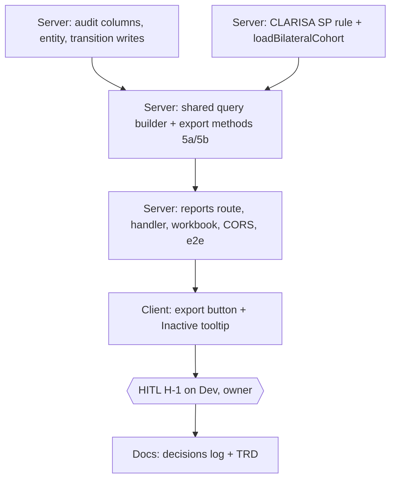

# Tasks — Bilateral / Mapping filtered export

- **Module:** bilateral (server `reports` + `bilateral-project-mapping` + `clarisa/projects`; client `administration/center-admin/bilateral-mapping`)
- **Spec id:** 2026-11-mapping-filtered-export
- **Status:** not-started
- **Owner:** David Casañas
- **Linked requirements:** ./requirements.md
- **Linked design:** ./design.md (judgment: ./judgment.md — APPROVED)
- **Approval Mode:** gated
- **Last updated:** 2026-11-17

**Baseline observed at `a70e1e8a` (2026-11-12, before any change):**
- server: `npx jest src/domain/entities/bilateral-project-mapping src/domain/tools/clarisa/projects src/domain/entities/reports/reports.controller.spec.ts src/domain/entities/reports/reports-generation.service.spec.ts src/domain/entities/reports/reports.module.spec.ts --coverage=false` → 14 suites, 295 tests, all passed.
- client: `npx jest bilateral-mapping.component bilateral-mapping.service http-error.interceptor to-promise.service --coverage=false` → 4 suites, 230 tests, all passed.

**Consumers already swept (re-run before relying on them):**
- `listBilateralProjects`: `automapper.service.spec`, `bilateral-project-mapping.service.spec`, `clarisa-projects.controller.spec`, `clarisa-projects.service.spec`.
- `getBlob`: `to-promise.service.spec`.
- `sourceLabel` and `status_justification`: the component spec.
- Integration specs that touch the table: `bilateral-primary-contributing-sp`, `pool-funding-contributor-year`, `impersonation.e2e`. They run under `test:integration` / `test:e2e`, which `npm test` never reaches (KZ-017).

---

## Dependency graph

- T-01 to T-04 are all in the server package, so they run one after another (root `CLAUDE.md` §4.3, concurrency).
- T-05 needs T-04's route and headers. It can start editing once T-04's contract is fixed, but its tests run after T-04 reports.
- **H-1 runs only after the owner merges to `dev`** (design §11). It settles P-18, P-19 and P-24, and it is the only gate for the two defect classes with no automated gate.

---

## Task list

### T-01 — Server: status audit columns, entity, and writes on real transitions

- **Status:** done · **Size:** M · **Dependencies:** none
- **Requirements covered:** R-MFE-007 (AC.1–AC.5), R-MFE-008 (AC.1–AC.3)
- **Design references:** §3, §5 "Status audit", DD-6, DD-16, P-4, P-5, P-6, P-17
- **Files touched (intended):**
  - `server/researchindicators/src/db/migrations/<timestamp>-addStatusAuditToBilateralProjectMapping.ts` (new)
  - `server/researchindicators/src/domain/entities/bilateral-project-mapping/entities/bilateral-project-mapping.entity.ts`
  - `server/researchindicators/src/domain/entities/bilateral-project-mapping/bilateral-project-mapping.service.ts`
  - `server/researchindicators/src/domain/entities/bilateral-project-mapping/bilateral-project-mapping.service.spec.ts`
- **Scope:**
  1. **First step: settle P-17.** Run a read-only count of Inactive rows with `deleted_at` NULL on `ARI_MYSQL_*` (read-only rule). If the host still times out, ask the owner to run it or give the number. Record the count in `execution.md`.
  2. Migration up: add `status_changed_by` (bigint, nullable, no FK) and `status_changed_at` (timestamp, nullable). Then backfill `status_changed_at = deleted_at` where `is_active = 0 AND deleted_at IS NOT NULL`, with `updated_at = updated_at` in the same `SET`, so that `ON UPDATE CURRENT_TIMESTAMP` does not fire (P-6).
  3. Migration down: drop both columns. Do not touch `1793389030636`.
  4. Entity: two nullable columns. No `@OpenSearchProperty`.
  5. `deactivate()`: inside the transition branch, after the idempotent branch, set `status_changed_by` from the acting user and set `status_changed_at` to the same instant as `deleted_at`.
  6. `activate()`: inside the transition branch, set the user and a new instant.
  7. `update()`, the idempotent branches and the automapper refresh do not write either field.
- **Tests (added/updated):**
  - Service tests:
    - deactivate on an active row stores the user and the date, and `status_changed_at` equals `deleted_at` (AC.1).
    - activate on an inactive row stores the user and the date (AC.1).
    - An idempotent deactivate with notes leaves both fields unchanged (AC.2).
    - An idempotent activate leaves both fields unchanged (AC.2).
    - `update()` with notes leaves both fields unchanged (AC.2).
    - `update()` with a project leaves both fields unchanged (AC.2).
  - Fixture rule: give each fixture row a pre-set `status_changed_at` with a distinct sentinel date and a distinct `status_changed_by`, so "unchanged" cannot pass by accident.
  - Migration, by hand on the scratch table in the compose:test container (the harness is broken at `CreatePiDelegates1787600000000`):
    - Seed one Inactive row with `deleted_at` set and one Mapped row.
    - Record `updated_at` for both rows, run up, and compare.
    - Run down, then confirm with `SHOW CREATE TABLE` that only the two columns are gone.
- **Verification:**
  - Run from `server/researchindicators/`.
  - `npx jest src/domain/entities/bilateral-project-mapping --coverage=false`
  - `npx eslint src/domain/entities/bilateral-project-mapping src/db/migrations/<file>`
  - `npm run build`
  - Paste the migration session (up, down and the selects) verbatim into `execution.md`.
- **Falsifier:** each of these must make a test go red.
  - (a) Write the audit on every `save()` in the service. The AC.2 cases go red.
  - (b) Move the write before the idempotent early return. The idempotent cases go red.
  - (c) Drop `updated_at = updated_at` from the backfill. The hand-run shows `updated_at` moved on the Inactive row.
- **Disqualifier:**
  - A service test whose fixture row already has `status_changed_by` equal to the acting user cannot show the write.
  - A migration run against `ARI_MYSQL_*` or Dev is forbidden and is not evidence.
- **Consumers:**
  - `automapper.service.spec.ts`: it deactivates an active row, and it must stay green.
  - The three integration specs listed in the header. They build entities of this table, so run `npm run test:integration` once, or record why it cannot run.
- **Review:** `full` — migration and status-workflow write.
- **Effort:** `max` (migration, data).
- **Done criteria:**
  - [x] P-17 count recorded (step 1) — settled 2026-11-17 after T-01 (execution.md, Premise settlement)
  - [x] AC.1–AC.5 of R-MFE-007 each owned by a passing test; falsifiers (a)–(b) observed red
  - [x] R-MFE-008 AC.1–AC.3 shown on the scratch table with `updated_at` unchanged; falsifier (c) observed
  - [x] folder suite green; eslint clean; build green
- **Skills:** `nestjs-expert`, `tdd`

### T-02 — Server: Science Programs rule and `loadBilateralCohort` in `ClarisaProjectsService`

- **Status:** done · **Size:** M · **Dependencies:** none
- **Requirements covered:** R-MFE-004 (the allocations rule), R-MFE-011 (AC.1 loader half, AC.2), R-MFE-006 (the `list()` half)
- **Design references:** §2.1 row 6, §5 "CLARISA notice", DD-3, DD-7, DD-11, DD-12, P-7, P-8, P-15, P-21, P-22
- **Files touched (intended):**
  - `server/researchindicators/src/domain/tools/clarisa/projects/clarisa-projects.service.ts`
  - `server/researchindicators/src/domain/tools/clarisa/projects/clarisa-projects.service.spec.ts`
  - `server/researchindicators/src/domain/tools/clarisa/projects/clarisa-projects.controller.ts`
  - `server/researchindicators/src/domain/tools/clarisa/projects/clarisa-projects.controller.spec.ts`
  - `server/researchindicators/src/domain/entities/bilateral-project-mapping/bilateral-project-mapping.service.ts`
  - `server/researchindicators/src/domain/entities/bilateral-project-mapping/bilateral-project-mapping.service.spec.ts`
- **Scope:**
  1. Move the Science Programs filter from `clarisa-projects.controller.ts:104-117` into a public service method. The controller calls the method. No behavior change.
  2. Leave the independent `hasSciencePrograms` readers in P-15 untouched.
  3. Add `loadBilateralCohort(phase, limitMs?)`, which returns `{ projects, available }`:
     - It catches every error, including a malformed feed (a non-array 200), and reports `available: false`.
     - With `limitMs`, a timer races only the CLARISA load.
     - When the timer fires and the cache holds a feed for the same phase, it returns that stale feed with `available: true`.
     - An empty cohort reports `available: true`.
     - No call deduplication.
  4. `list()` switches to `loadBilateralCohort(phase)`, with no limit, and ignores `available`. The rows and names it returns must stay the same (P-21).
- **Tests (added/updated):**
  - Picker rule: the existing controller cases stay green unchanged, and service cases cover the moved rule, including the `ENV.BILATERAL_ACCEPTED_SP_STATUSES` statuses.
  - Loader, one case per stub:

    | Stub | Expected |
    | --- | --- |
    | Healthy | `available: true` with the projects |
    | Empty | `available: true` with `[]` |
    | Failing, cold cache | `available: false` |
    | Malformed 200 (an object) | `available: false` |
    | Never-resolving with `limitMs`, no cache | `available: false` within the limit |
    | Never-resolving with `limitMs`, same-phase cache | Stale feed with `available: true` |
    | Never-resolving with `limitMs`, cache for another phase only | `available: false` |

  - Use fake timers so the never-resolving cases finish fast.
  - `list()`: the existing `bilateral-project-mapping.service.spec` cases stay green with no expectation changed (R-MFE-006 AC.2). One new case: CLARISA fails and `list()` still returns the rows.
- **Verification:**
  - `npx jest src/domain/tools/clarisa/projects src/domain/entities/bilateral-project-mapping --coverage=false`
  - `npx eslint` on both folders
  - `npm run build`
- **Falsifier:** each of these must make a test go red.
  - (a) Catch only `ServiceUnavailableException`. The malformed case goes red.
  - (b) Return `available: false` on timeout even with a cache. The stale case goes red.
  - (c) Accept a cache from another phase. The other-phase case goes red.
- **Disqualifier:** a stale-cache test whose cache was filled by the same never-resolving call cannot show the rule. Fill the cache from an earlier healthy call.
- **Consumers:**
  - The four `listBilateralProjects` specs in the header.
  - `clarisa-projects.controller.ts`, the picker. It must keep the same response.
- **Review:** `full` — shared integration rule, timeout and cache semantics.
- **Effort:** `xhigh` (concurrency and timeout).
- **Done criteria:**
  - [x] picker response unchanged (existing controller tests green, unchanged)
  - [x] every loader row above owned by a passing test; falsifiers (a)–(c) observed red
  - [x] `list()` expectations unchanged
  - [x] suites green; eslint clean; build green
- **Skills:** `nestjs-expert`, `error-handling-patterns`, `tdd`

### T-03 — Server: shared query builder with the user join, and the export methods 5a and 5b

- **Status:** done · **Size:** L · **Dependencies:** T-01, T-02
- **Requirements covered:** R-MFE-002 (AC.1–AC.3), R-MFE-003 (AC.1–AC.3), R-MFE-006 (AC.1, AC.2), R-MFE-010 (AC.3), R-MFE-011 (data half)
- **Design references:** §2.1 rows 5a and 5b, §4 "List and detail responses", §5 "Row source", DD-3, DD-4, DD-8, P-3, P-16, P-18, P-20
- **Files touched (intended):**
  - `server/researchindicators/src/domain/entities/bilateral-project-mapping/bilateral-project-mapping.service.ts`
  - `server/researchindicators/src/domain/entities/bilateral-project-mapping/bilateral-project-mapping.service.spec.ts`
  - `server/researchindicators/src/domain/entities/bilateral-project-mapping/automapper.service.ts`
  - `server/researchindicators/src/domain/entities/bilateral-project-mapping/automapper.service.spec.ts`
- **Scope:**
  1. **First step: settle P-18.** Count, read-only, the Dev rows for the current reporting year, all statuses. Record the count in `execution.md`. If it is in the tens of thousands, **stop and report**: streaming or an async export changes the plan.
  2. Extract `list()`'s filters into one private query builder.
     - Add a left join to `sec_users` by table name on `status_changed_by` (DD-8).
     - Select `status_changed_by_name` from the non-blank first and last name.
     - Only the paged query adds the primary-key tie-break.
  3. Add a new public export method for Mapped and Inactive (5a):
     - It resolves the reporting year once.
     - It runs the shared builder without paging and calls `loadBilateralCohort(phase, 10_000)`.
     - It returns `{ reportingYear, rows (with Science Programs by project id), clarisaAvailable }`.
     - The year comes back even with zero rows.
  4. In `AutomapperService`, split `resolve()` into a step that takes a cohort, and have `resolve()` call that step.
  5. Add a new public Pending export method (5b):
     - It loads the cohort once through `loadBilateralCohort` under the limit and classifies that cohort. Classification runs outside the limit.
     - It applies the NFR-CAM-001 guard (422) unchanged.
     - It applies the client's Search rule over the same three fields.
     - It throws 503 when the cohort is unavailable and no feed for the year is cached (R-MFE-003 AC.3).
     - It returns the same result shape as 5a.
- **Tests (added/updated):**
  - SQL (R-MFE-006 AC.1):
    - Assert on `getQuery()` from a **real** TypeORM query builder, not a mock (KZ-017).
    - The search condition stays grouped inside its parentheses when it is combined with `status` and `source`.
    - **Red input:** the search with its brackets removed.
  - Parity (R-MFE-002 AC.1):
    - Run one fixture through `list()` and through 5a, and compare the rows as sets, for each combination of Search, Source and Status other than Pending.
    - Vary at least one discriminating field per row (KZ-004).
  - Volume (R-MFE-002 AC.2): 201 matching rows all come back from 5a.
  - Empty (R-MFE-002 AC.3 and R-MFE-005 AC.3): zero rows still returns the year.
  - Pending parity (R-MFE-003 AC.1 and AC.2): one fixture against the client's rules (`bilateral-mapping.service.ts:31-50`). The order is to-create, ambiguous, unresolved.
  - Pending cohort:
    - `listBilateralProjects` is called once per Pending export.
    - `resolve()`'s preview output is unchanged for the same stub (K-019, a fixed-input old-vs-new comparison).
  - Pending errors (R-MFE-003 AC.3):
    - Failing stub, no cache: 503.
    - Failing stub, cached feed: rows.
    - Guard tripped: 422.
  - List response (R-MFE-010 AC.3): `list()` rows carry `status_changed_by`, `status_changed_at` and `status_changed_by_name`.
- **Verification:**
  - `npx jest src/domain/entities/bilateral-project-mapping src/domain/tools/clarisa/projects --coverage=false`
  - `npx eslint src/domain/entities/bilateral-project-mapping`
  - `npm run build`
- **Falsifier:** each of these must make a test go red.
  - (a) Remove the brackets around the search. The SQL test goes red.
  - (b) Keep paging in 5a. The 201-row case goes red.
  - (c) Make 5b call `resolve()`, which loads the cohort a second time. The once-per-export count goes red.
- **Disqualifier:**
  - A parity test on identical default rows cannot tell a filter from no filter.
  - A mocked query builder cannot show operator precedence.
- **Consumers:**
  - `automapper.controller.ts`, the preview. It must keep the same output.
  - `admin.service.ts:18`, which reads `list()`.
  - `bilateral-mapping.service.ts:78` (client), which gains additive fields.
  - P-16 notes `pool-funding.util.ts:26` (EXISTS), which is untouched.
- **Review:** `full` — shared query and the automapper split.
- **Effort:** `xhigh`.
- **Done criteria:**
  - [x] P-18 count recorded (step 1), and the plan holds
  - [x] each test above passes; falsifiers (a)–(c) observed red
  - [x] existing list and preview tests green with no expectation changed
  - [x] suites green; eslint clean; build green
- **Skills:** `nestjs-expert`, `tdd`

### T-04 — Server: reports route, workbook handler, file name, CORS, Swagger, boot and e2e

- **Status:** done (attempt 2) · **Size:** L · **Dependencies:** T-03
- **Requirements covered:** R-MFE-001 (AC.1–AC.3), R-MFE-004 (AC.1–AC.3), R-MFE-005 (AC.1 server half, AC.3), R-MFE-011 (AC.1 workbook half), NFR-MFE-002
- **Design references:** §2.1 rows 2–4, §4, §5 "Cell rules" and "CLARISA notice" table, §9, DD-1, DD-2, DD-5, DD-9, DD-13, DD-14, DD-15, P-1, P-10, P-11, P-13, P-25
- **Files touched (intended):**
  - `server/researchindicators/src/domain/entities/reports/reports.controller.ts`
  - `server/researchindicators/src/domain/entities/reports/reports.controller.spec.ts`
  - `server/researchindicators/src/domain/entities/reports/reports-generation.service.ts`
  - `server/researchindicators/src/domain/entities/reports/reports-generation.service.spec.ts`
  - `server/researchindicators/src/domain/entities/reports/handlers/bilateral-mapping-workbook.handler.ts` (new)
  - `server/researchindicators/src/domain/entities/reports/handlers/bilateral-mapping-workbook.handler.spec.ts` (new)
  - `server/researchindicators/src/domain/entities/reports/reports.module.ts`
  - `server/researchindicators/src/domain/entities/reports/reports.module.spec.ts`
  - `server/researchindicators/src/main.ts` (CORS `exposedHeaders`)
  - `server/researchindicators/test/bilateral-mapping-export.e2e-spec.ts` (new, precedent `test/pi-delegates.e2e-spec.ts`)
- **Scope:**
  1. Route `GET bilateralMapping/xlsx` on `ReportsController`:
     - `@Roles(CENTER_ADMIN, SYSTEM_ADMIN)` on the method.
     - A method-level `ValidationPipe({ whitelist: true, transform: true })` over a query DTO picking `search`, `status` and `source` from the list DTO.
     - `@ApiOperation` and one `@ApiQuery` per param.
     - The attachment response follows `pi-delegates.controller.ts:74-99`.
  2. A new method on `ReportsGenerationService` returns `{ buffer, fileName }`. `buildWorkbookXlsxBuffer` is untouched.
  3. `BilateralMappingWorkbookHandler`:
     - Picks the row source per the design's §5 table.
     - Builds the 12 columns per the cell rules, with the source labels in the handler.
     - Writes `bannerNotice` when `clarisaAvailable` is false or the cohort is empty.
     - The subtitle lists the filters and says dates are in UTC.
     - No logo.
     - The file name is `Bilateral_Mapping_<year>_<yyyymmdd>.xlsx`, in UTC.
     - One `LoggerUtil` line per export: status, row count and the notice flag. No user data.
  4. `ReportsModule` imports `BilateralProjectMappingModule` only (P-11).
  5. In `main.ts:23`, add `Content-Disposition` to `exposedHeaders`.
  6. Boot the server once: start the app and confirm the route mounts in the route table. Mocks cannot show missing DI.
- **Tests (added/updated):**
  - Role metadata on the real handler (pattern `bilateral-project-mapping.controller.spec.ts:60`), plus the real `RolesGuard` with a user without the role → 403 (R-MFE-001 AC.2 and NFR-MFE-002).
  - Controller tests:
    - The disposition carries the server's name.
    - The query validation rejects an unknown param with 400.
  - Workbook tests parse the **real buffer** with ExcelJS:
    - 12 headers in order. The header row is 4, or 5 with a notice (R-MFE-004 AC.1).
    - A known row holds the expected value in each cell, including a multi-Science-Program `SP01 (40%); SP02 (60%)` and a non-numeric allocation (AC.2).
    - Absent values are blank, never `null` or `undefined` (AC.3).
    - A Pending row has blank columns 2 and 8–12.
  - Source-label parity: the five values against the client's `sourceLabel()` strings, listed in the test.
  - CLARISA, through the real workbook (R-MFE-011 AC.1):

    | Stub | Expected |
    | --- | --- |
    | Failing | Notice |
    | Never-resolving | Notice |
    | Malformed | Notice |
    | Empty | Notice |
    | Never-resolving with a same-phase stale cache | No notice |
    | Healthy | No notice |

    Run these on All, and run the Pending ones to show 503 / file per R-MFE-003 AC.3.
  - Empty export: valid file, named with the year (R-MFE-005 AC.3).
  - e2e, one file:
    - A Center Admin gets 200 with the xlsx content type.
    - A user without the role gets 403.
    - With no token, 401.
- **Verification:**
  - `npx jest src/domain/entities/reports src/domain/entities/bilateral-project-mapping --coverage=false`
  - `npm run test:e2e -- bilateral-mapping-export`. If the harness cannot run, record why.
  - `npx eslint src/domain/entities/reports src/main.ts`
  - `npm run build`
  - The boot log line showing the route mapped, quoted.
  - `/swagger` lists the route under Reports (R-MFE-001 AC.3).
- **Falsifier:** each of these must make a test go red.
  - (a) Remove `@Roles`. The metadata test and the guard test go red.
  - (b) Skip `bannerNotice` on an empty cohort. The empty case goes red.
  - (c) Build the name from the first row's year. The empty-export name case goes red.
- **Disqualifier:**
  - A workbook test that asserts on the handler's intermediate array, not the parsed buffer, is not evidence for R-MFE-004.
  - A 403 caused by a missing route (404 → mapped differently) is not evidence for AC.2. Assert the status and that the handler was not called.
- **Consumers:**
  - `reports.controller.spec.ts` and `reports.module.spec.ts`, whose provider lists grow.
  - `:resultCode/pdf` cannot capture the route (`results.util.ts:157`). Keep one test that proves it.
- **Review:** `full` — new public route and authorization.
- **Effort:** `high`.
- **Done criteria:**
  - [x] every test above passes; falsifiers (a)–(c) observed red
  - [x] boot observed with the route mapped; Swagger shows it
  - [x] e2e green or its blocker recorded — 403/401 green; 200 blocked until the migration reaches the shared DB (H-1)
  - [x] suites green; eslint clean; build green
- **Skills:** `nestjs-expert`, `api-design-principles`, `error-handling-patterns`, `tdd`

### T-05 — Client: export button, download, single error toast, Inactive tooltip

- **Status:** todo · **Size:** M · **Dependencies:** T-04
- **Requirements covered:** R-MFE-009 (AC.1–AC.3), R-MFE-010 (AC.1, AC.2), R-MFE-005 (AC.1 and AC.2 client half), NFR-MFE-001 (loading), NFR-MFE-003
- **Design references:** §6, DD-5, DD-10, P-9, P-12, P-23, P-26
- **Files touched (intended):**
  - `client/research-indicators/src/app/shared/services/to-promise.service.ts` (+ spec)
  - `client/research-indicators/src/app/shared/services/api.service.ts` (+ spec if one covers the reports prefix)
  - `client/research-indicators/src/app/shared/services/bilateral-mapping.service.ts` (+ spec)
  - `client/research-indicators/src/app/shared/interceptors/http-error.interceptor.ts` (+ spec)
  - `client/research-indicators/src/app/shared/interfaces/bilateral/bilateral-project-mapping.interface.ts`
  - `client/research-indicators/src/app/pages/platform/pages/administration/center-admin/bilateral-mapping/bilateral-mapping.component.ts` (+ spec)
  - `client/research-indicators/src/app/pages/platform/pages/administration/center-admin/bilateral-mapping/bilateral-mapping.component.html`
- **Scope:**
  1. `TP.getBlobResponse` returns the Blob and the headers. `getBlob` is unchanged.
  2. `ApiService.GET_BilateralMappingXlsx(filters)` targets `reports/bilateralMapping/xlsx`.
  3. `BilateralMappingService` wraps the call with its `MappingMutationResult` contract:
     - On error, parse the Blob body as the server envelope and use `errors`, a string as is or an array joined. Never use `description` (P-26).
     - Use a fixed fallback message when the body is not JSON or `errors` is empty.
     - Treat an empty Blob as a failure.
  4. `httpErrorInterceptor` exempts this route, like `isPrmsSyncError`, so the component's toast is the only one.
  5. Component:
     - The button has `label="Export to Excel"`, is outlined, sits left of Auto-map and has `data-testid="header-export-btn"`.
     - An `exporting` signal drives `[loading]` and `[disabled]`, with an early return while it is set.
     - The filters are read from the signals at press time. `all` is omitted.
     - The file name comes from `Content-Disposition`. When the header is unreadable, use `Bilateral_Mapping_<reportingYear()>_<yyyymmdd>.xlsx` in UTC.
     - Download through `downloadBlob` from its current file (DD-10).
  6. "?" icon inside the Inactive badge cell:
     - A focusable element with `pi pi-question-circle`, an `aria-label`, `pTooltip` and `tooltipEvent="both"`.
     - The text comes from a method and lists only the values that exist.
     - `escape` stays on.
     - Tokens only, no hex.
  7. The interface gains the three optional fields.
- **Tests (added/updated):**
  - Filter transition (R-MFE-009 AC.1, KZ-015):
    - On a constructed component, change Search, Status and Source, then press export.
    - The request carries the new values, and `all` sends no param.
  - Double press (AC.2): two presses while the first is pending → one request.
  - Toasts (AC.3):
    - Interceptor test on the route: no toast.
    - Component test counting toasts: exactly one, with `errors` from a **real Blob** in the server's envelope (a string case and an array case).
    - A non-JSON body gives the fallback.
    - The button resets.
  - File name: a header present → the server's name. Header absent → the fallback, with the year. Year null → the fallback without the year.
  - Tooltip (R-MFE-010 AC.1, AC.2):
    - The icon renders only on Inactive rows.
    - It has `tabindex` and an `aria-label`.
    - With full data the text lists every value, and with partial data only the present ones.
- **Verification:**
  - Run from `client/research-indicators/`.
  - `npx jest bilateral-mapping.component bilateral-mapping.service http-error.interceptor to-promise.service --coverage=false`
  - `npx tsc -p tsconfig.spec.json --noEmit`. First prove it can fail by planting one type error and observing red (K-004).
  - `npm run lint -- --quiet`
  - `npm run build`, within budgets.
- **Falsifier:** each of these must make a test go red.
  - (a) Remove the interceptor exemption. The toast count becomes 2.
  - (b) Show `description`. The toast text test goes red.
  - (c) Read the filters at construction. The transition test goes red.
- **Disqualifier:**
  - A test that sets signals before the first `detectChanges()` instead of changing them on a built component is not evidence for the transition (KZ-015).
  - A JSON error body that is not wrapped in a Blob cannot show the parsing.
- **Consumers:** the `getBlob` callers stay on `getBlob`, and `to-promise.service.spec` stays green.
- **HITL rows (owner, at H-1):** the button and tooltip look right in light and dark; the downloaded name is the server's (P-19).
- **Review:** `full`.
- **Effort:** `medium`.
- **Done criteria:**
  - [ ] every test above passes; falsifiers (a)–(c) observed red
  - [ ] `tsc -p tsconfig.spec.json` proven able to fail, then green
  - [ ] lint clean; build within budgets
- **Skills:** `angular-developer`, `ui-ux-pro-max`, `error-handling-patterns`, `tdd`

### H-1 — HITL on Dev (owner), after the merge to `dev`

- **Status:** todo · **Dependencies:** T-01–T-05 merged by the owner (the agent never pushes)
- **Settles:** P-24, P-19, P-18, and the defect classes with no automated gate
- **Checks.** Quote what the owner observed for each one (KZ-002).
  - [ ] **P-24:** the deploy console shows the migration applied, and the list loads after the deploy.
  - [ ] **R-MFE-008:** on Dev, Inactive rows show a status date and a blank user, and Mapped rows show both blank.
  - [ ] **R-MFE-007:** inactivate one row, then reactivate it. Each step updates the tooltip's user and date. A notes edit does not change them.
  - [ ] **P-19 / R-MFE-005 AC.1:** the downloaded name equals `Bilateral_Mapping_<year>_<yyyymmdd>.xlsx` from the server, not the fallback.
  - [ ] **NFR-MFE-001 / P-18:** All, unfiltered: record the row count and the seconds in `execution.md`. The target is ≤ 15 s.
  - [ ] **Excel rendering:** the owner opens the file in Excel. Columns, dates, banner and subtitle read correctly, and any notice row shows.
  - [ ] **Filters:** export once with Search + Inactive and once with Pending. The rows match the screen.
  - [ ] **Look:** button and "?" tooltip in light and dark, keyboard reach to the icon.
  - [ ] **K-016:** the owner is told that allocations can lag CLARISA by the five-minute cache.

### T-06 — Docs: decisions log and TRD

- **Status:** todo · **Size:** S · **Dependencies:** H-1
- **Requirements covered:** none directly (baseline sync)
- **Files touched (intended):**
  - `docs/ux-ui/design.md` (decisions log: export button, Inactive tooltip)
  - `docs/trd/trd.md` (the new reports route, the two columns, `loadBilateralCohort` and its 10 s export-only limit)
- **Scope:**
  - Add one entry per baseline change.
  - Sweep both docs for the stale claims this spec retires: "status changes are not stored" and the picker owning the Science Programs rule.
  - Record the H-1 outcomes for P-18, P-19 and P-24 in the design ledger's "Settled by" cells.
- **Done criteria:**
  - [ ] both docs carry the entries
  - [ ] ledger rows P-17, P-18, P-19 and P-24 are settled or carried forward with a reason
- **Skills:** `cognitive-doc-design`

---

## Coverage (scenario and clause level)

| Requirement clause | Owner |
| --- | --- |
| R-MFE-001 AC.1 (allowed roles get the file) | T-04 (controller + e2e) |
| R-MFE-001 AC.2 (other roles forbidden, real guard + metadata) | T-04 |
| R-MFE-001 AC.3 (Swagger under Reports) | T-04 |
| R-MFE-002 AC.1 (set parity per filter combination) | T-03 |
| R-MFE-002 AC.2 (> 200 rows) | T-03 |
| R-MFE-002 AC.3 (empty result → valid file) | T-03 (year) + T-04 (file) |
| R-MFE-003 AC.1, AC.2 (Pending parity, Search fields) | T-03 |
| R-MFE-003 AC.3 (error/timeout no cache → error; cached → rows; guard → 422) | T-02 (loader) + T-03 (503/422) + T-04 (no file) |
| R-MFE-003 Scenario: Pending with Source (Source ignored) | T-03 |
| R-MFE-004 AC.1–AC.3 (columns, values, blanks) | T-04 |
| R-MFE-004 Science Programs rule shared with the picker | T-02 |
| R-MFE-005 AC.1 (name with export's year and date) | T-04 (server) + T-05 (header read) + H-1 (P-19) |
| R-MFE-005 AC.2 (year without the coverage strip) | T-04 (server names it) + T-05 (fallback only when unreadable) |
| R-MFE-005 AC.3 (name independent of rows) | T-03 + T-04 |
| R-MFE-006 AC.1 (SQL grouping) | T-03 |
| R-MFE-006 AC.2 (list tests unchanged) | T-02 + T-03 |
| R-MFE-007 AC.1–AC.5 | T-01 (+ H-1 observation) |
| R-MFE-008 AC.1–AC.3 | T-01 (scratch table) + H-1 (Dev) |
| R-MFE-009 AC.1–AC.3 | T-05 |
| R-MFE-010 AC.1, AC.2 | T-05 |
| R-MFE-010 AC.3 (list carries tooltip data) | T-03 |
| R-MFE-011 AC.1 (notice rules) | T-02 (availability) + T-04 (workbook) |
| R-MFE-011 AC.2 (limit on export only) | T-02 + T-03 |
| NFR-MFE-001 (single request, ≤ 15 s) | T-05 (loading) + H-1 (timing) |
| NFR-MFE-002 (handler-level roles) | T-04 |
| NFR-MFE-003 (a11y, tokens) | T-05 + H-1 |
| §8 defect class: spreadsheet renders badly | H-1 |
| §8 defect class: tooltip and button look wrong | H-1 |
| §8 defect class: module wiring at boot | T-04 (boot) |
| §8 defect class: compile-only defects in specs | T-05 (`tsc -p tsconfig.spec.json`, proven to fail); server specs compile through jest's ts-jest |

No `skip-eligible` task.

## Estimate & PR strategy

| Measure | Estimate |
| --- | --- |
| Production LOC | ~450 (server ~330, client ~120) |
| Test LOC | ~600 |
| Review rounds | 8 (budget, design §14) |

**One branch, one PR** on the current AC-1797 branch, because the migration and the code that reads it must deploy together (design §11, DD-16). Production code is above the ~400 LOC split threshold. The reason not to split is the order rule: a server-only PR would ship the columns with no reader, and a client-only PR would call a route that does not exist yet.

## Risks & blockers log

| # | Date | Risk / Blocker | Mitigation | Owner | Status |
| --- | --- | --- | --- | --- | --- |
| RB-1 | 2026-11-17 | P-18: Dev volume too large for an in-memory workbook | T-03 step 1 stops the plan before code | Leader | open |
| RB-2 | 2026-11-17 | P-19: the proxy strips `Content-Disposition` | Fallback name ships anyway; H-1 reopens DD-5 if it fires | Owner | open |
| RB-3 | 2026-11-17 | P-24 / DD-16: the start-to-migration window on Dev | Accepted on Dev; H-1 reads the deploy console | Owner | accepted |
| RB-4 | 2026-11-17 | The migration harness is broken at `CreatePiDelegates1787600000000` | Hand run on the scratch table in T-01 | Leader | open |
