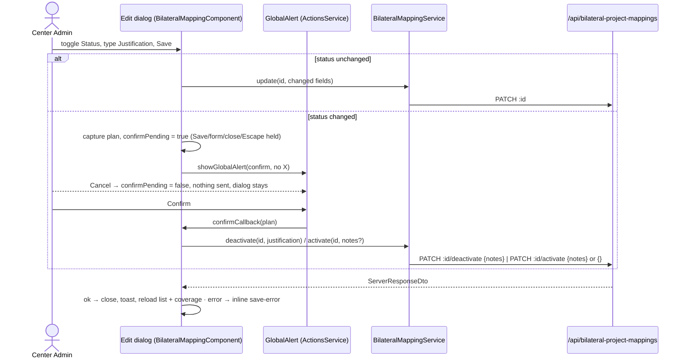

# Design — Bilateral / Mapping status in the Edit modal

- **Module:** bilateral
- **Spec id:** 2026-10-mapping-status-in-edit-modal
- **Status:** draft
- **Owner:** David Casañas
- **Linked requirements:** ./requirements.md
- **Linked detailed design:** ../../../trd/trd.md (§ Administration / Center Admin; §6.2 versioning)
- **Last updated:** 2026-10-30

---

## Executive Summary

Client-heavy change on one page plus one server validation rule. The table's Actions cell drops the Deactivate/Activate buttons; the Edit `p-dialog` gains a `p-toggleswitch` Status control; Save with a status change opens the existing `showGlobalAlert` confirm and, on confirm, calls the **existing** `PATCH …/deactivate` (with the justification as `notes`) or `PATCH …/activate`. The server makes `notes` required (trimmed, 1–500) on deactivate only. No schema change, no new endpoint, no new token.

## 1. Goals & non-goals

- **Goals:** R-MSE-001 (one row action) · R-MSE-002 (Status in modal) · R-MSE-003 (justification) · R-MSE-004 (second confirmation) · R-MSE-005 (server rule).
- **Non-goals:** justification history; export of the filtered list; changing the create / "+ Map" flows; changing `PATCH :id`; the `/admin` SSR page UI.

## 2. Architecture Overview



## 3. Extended Directory Structure (touched files)

```
server/researchindicators/src/domain/entities/bilateral-project-mapping/
├── bilateral-project-mapping.controller.ts        # deactivate body DTO: notes required
├── bilateral-project-mapping.controller.spec.ts   # rule + pipe tests
├── bilateral-project-mapping.service.ts           # DD-8: idempotent deactivate/activate writes supplied notes
└── bilateral-project-mapping.service.spec.ts      # new idempotent-with-notes cases (deactivate + activate)
client/research-indicators/src/app/
├── shared/services/api.service.ts                 # deactivate/activate accept optional body
├── shared/services/bilateral-mapping.service.ts   # deactivate(id, justification, notes?) / activate(id, { notes?, clarisa_project_id? }) (A-2)
├── shared/services/bilateral-mapping.service.spec.ts
└── pages/platform/pages/administration/center-admin/bilateral-mapping/
    ├── bilateral-mapping.component.ts             # status state, canSave, save branch, confirm
    ├── bilateral-mapping.component.html           # row actions, Status control, Justification field
    └── bilateral-mapping.component.spec.ts        # retire old row-action tests, add new ones
docs/ux-ui/design.md                                # decisions-log entry
```

## 4. Data Model

No data model changes. `bilateral_project_mapping.notes` (`text`, nullable) receives the justification and is overwritten (owner decision, 2026-10-30).

## 5. API Design

### PATCH /api/bilateral-project-mappings/:id/deactivate (changed)

- **Controller:** `bilateral-project-mapping.controller.ts` — unversioned (no `@Version`; class at `:61-63`, route mount `main.routes.ts:434`).
- **Roles:** unchanged — `@Roles(CENTER_ADMIN, SYSTEM_ADMIN)` + `RolesGuard` (`:61-62`).
- **Body DTO:** a new deactivate-specific DTO (module-local, beside `BilateralProjectMappingNotesDto` at `:41`): `notes` required string, trimmed by a `@Transform` (repo precedent `impersonation/dto/search-users.dto.ts:19`), non-empty after trim, max 500.
- **Response:** unchanged (`data` = mapping, description "Bilateral project mapping deactivated").
- **Swagger:** `@ApiBody({ type: <deactivate DTO>, required: true })`; `@ApiOperation` summary mentions the required justification.
- **Errors:** `400` for missing / blank / >500 `notes` (validation pipe already `whitelist + forbidNonWhitelisted + transform`, `:207-213`); `404` unchanged (prior-year or unknown id).

### PATCH …/activate and PATCH …/:id — unchanged on the server.

Activate keeps `BilateralProjectMappingNotesDto` (optional notes).

## 6. Backend Module Design

- The controller's deactivate DTO changes (§5). `BilateralProjectMappingService.deactivate` keeps its signature (`notes?: string`) — the service is also called by `automapper.service.spec.ts:1567` with a note, and making the parameter required there buys nothing because the HTTP edge is the only production caller (P-6).
- **Idempotent early return writes the note (J-3).** Today an already-inactive row returns before the notes write (`service.ts:265-268`; activate mirrors it at `:284-286`). A stale client (another admin inactivated first) would get `200` while its justification is dropped. New rule in both methods: when the row is already in the target state and `notes` is supplied, write `notes` and `updated_by`, save, and return; `is_active` and `deleted_at` are not touched. With no `notes`, the early return stays as is.

## 7. Frontend / UX Component Architecture

### 7.1 State (component, signals)

| Signal / field | Purpose |
| --- | --- |
| `statusActive` (signal<boolean>) | Status control value; set from `row.is_active` in `openEditDialog` |
| `initialActive` (signal<boolean \| null>) | the row's `is_active` at open; `null` outside edit mode. **The only source** of the initial status — `editSnapshot` does not carry it (J-5) |
| `justification` (signal<string>) | reset to `''` on every open **and every time the toggle enters Inactive** (J-14: "empty on entry"); clipped at 500 like notes |
| `pickedProjectId` (number \| null \| undefined, plain field) | the admin's CLARISA pick stashed when the toggle leaves the initial status; restored when it returns (J-4). `undefined` means "nothing stashed" — restore only when it is not `undefined`, then reset it to `undefined` (B2-4); `null` is a real stashed value (picker cleared) |
| `confirmPending` (signal<boolean>) | true from the moment the confirmation opens until Confirm or Cancel runs (J-1, J-2) |
| `statusChanged` (computed) | `dialogMode()==='edit' && initialActive() !== null && statusActive() !== initialActive()` |
| `isInactivating` (computed) | `statusChanged() && !statusActive()` |

`editSnapshot` stays a plain field (`component.ts:143`) holding project and notes only; status logic never reads it, so `closeDialog()` nulling it cannot break `statusChanged`. Every status input is a signal so the computeds re-evaluate on reopen (KZ-015: tests must open the dialog the way production does — construct closed, then call `openEditDialog`).

**Reset on every open (B2-3):** `openEditDialog`, `openCreateDialog` and `openMapDialogForPending` all reset `confirmPending` to `false`, `pickedProjectId` to `undefined` and `justification` to `''`; create paths also set `initialActive` to `null`.

**Toggle handler `onStatusToggle(value)`:** sets `statusActive`. Leaving the initial status → stash `selectedProjectId()` in `pickedProjectId`, set `selectedProjectId` to the snapshot project, and if the new value is Inactive reset `justification` to `''`. Returning to the initial status → restore `selectedProjectId` from `pickedProjectId`.

### 7.2 `canSave`

| Mode / state | Savable when |
| --- | --- |
| create | unchanged |
| edit, no status change | unchanged (project or notes differ from snapshot) — the existing `!snap` guard applies only to this row |
| edit, inactivating | `justification().trim().length > 0` |
| edit, activating | always (the status change itself is the change) |
| any | `!saving() && !confirmPending()` |

### 7.3 `onSave` branch

0. **Re-entry guard (J-1):** if `confirmPending()` or `saving()`, return immediately — a keyboard Enter/Space on the still-focused Save opens nothing.
1. No status change → existing `handleUpdate()` (no confirmation).
2. Status change → capture a **plan** `{ id, agreementId, target: 'activate' | 'deactivate', notes }` from the current signals (J-10: confirm acts on what the alert describes, not on values read later), set `confirmPending(true)`, blur the focused element, then `showGlobalAlert({ severity: 'confirm', summary, detail, hideCloseButton: true, confirmCallback: { label, event: () => void this.applyStatusChange(plan) }, cancelCallback: { label: 'Cancel', event: () => this.confirmPending.set(false) } })`. `hideCloseButton` (P-10) removes the X that closes without either callback, so `confirmPending` always clears through Confirm or Cancel.
3. `applyStatusChange(plan)` sets `confirmPending(false)` and `saving(true)`, calls `service.deactivate(plan.id, plan.justification, plan.notes)` or `service.activate(plan.id, { notes, clarisa_project_id })` (A-2: `notes` / `clarisa_project_id` only when they differ from the snapshot); on `ok` → `closeDialog()`, toast, `load()`, `coverageComponent()?.loadCoverage()`, Clarity event (`bilateral.mapping.deactivated` / `.activated`, existing names kept); on error → `saveError.set(message || fallback)` in the still-open dialog; finally `saving.set(false)`.

**While `confirmPending()` (J-2, J-12, round 2 A2-1/B2-1):**
- **The hide path is gated, not the Escape input.** PrimeNG reads `closeOnEscape` only when the dialog shows and its Escape handler and header X both end in `close()` → `visibleChange.emit(false)` (P-9), so binding `closeOnEscape` later changes nothing. The dialog therefore drops the two-way `[(visible)]` and binds `[visible]="dialogOpen()"` with `(visibleChange)="onDialogVisibleChange($event)"`, which ignores `false` while `confirmPending()`; `closeDialog()` also returns early while pending, so `(onHide)` cannot reset the form under the alert. `[closable]="!confirmPending()"` hides the header X as well.
- `[focusTrap]="!confirmPending()"` (default true, P-9; the trap toggles live through `pFocusTrapDisabled`) so Tab can leave the dialog for the alert's buttons.
- Every form control (Status, picker, Notes/Justification) and the dialog's Cancel are `[disabled]`, so nothing changes behind the alert.
- Whether focus actually reaches Confirm/Cancel by keyboard is a HITL check (P-9 runtime half).

| Status change | Confirm summary | Confirm detail | Confirm button | Toast |
| --- | --- | --- | --- | --- |
| → Inactive | Inactivate mapping | The mapping for agreement `<id>` will be inactivated. Continue? | Inactivate | Mapping inactivated |
| → Active | Activate mapping | The mapping for agreement `<id>` will be activated. Continue? | Activate | Mapping activated |

### 7.4 Template

- **Actions cell:** the non-Pending branch keeps only the Edit button (`edit-btn`); the `@if (row.is_active)` deactivate/activate block is removed.
- **Status control** (edit mode only), placed after the AGRESSO read-only field: visible label "Status" (`<label for>` the `inputId`), `p-toggleswitch` (`ToggleSwitchModule`, precedent `shared/components/all-modals/modals-content/edit-environment-variable-modal/edit-environment-variable-modal.component.html:66`; that precedent binds string `trueValue`/`falseValue`, this one binds the boolean default) with `[ngModel]="statusActive()"` `(ngModelChange)="onStatusToggle($event)"`, a text "Active" / "Inactive" next to it, and the **`[ariaLabel]` input** (not a host `aria-label`, which PrimeNG does not forward — J-11) set to "Mapping status: Active|Inactive"; `data-testid="status-toggle"`.
- **CLARISA picker:** `[disabled]="isInactivating() || confirmPending() || saving()"` (A-2, DD-10); the toggle handler swaps its value only in the inactivating direction.
- **Notes / Justification:** `@if (isInactivating())` renders a Justification textarea (`data-testid="justification-input"`, label "Justification" + red `*`, `aria-required="true"`, placeholder "Why is this mapping being inactivated?", counter `n/500`); *(A-2, DD-9: it renders directly under the Status toggle and the Notes textarea is always rendered.)*
- Tokens: existing `atc-*` / `var(--ac-*)` utilities only; no new SCSS beyond spacing if needed.

## 8. Shared Contracts or Package Extensions

- `ApiService.PATCH_BilateralProjectMappingDeactivate(id, body: { notes: string })` sends `body` *(A-2: `{ justification, notes? }`)*; `PATCH_ActivateBilateralMapping(id, body?: { notes?: string })` *(A-2: `{ notes?, clarisa_project_id? }`)* sends `body ?? {}` so an activate without notes keeps the empty body AC.5 relies on (`api.service.ts:905-915`, J-7).
- *(A-2)* `BilateralMappingService.deactivate(id, justification, notes?)` sends `{ justification, notes? }`; `activate(id, opts?)` sends only the keys that are set, `{}` when none.
- Existing assertions that change (J-7): `bilateral-mapping.service.spec.ts:322` and `:334` (`toHaveBeenCalledWith(11)`); the `{}` activate-body assertion at `:553` must stay green.

## 9. Design Decisions

| # | Decision | Rationale / rejected alternative |
| --- | --- | --- |
| DD-1 | Reuse the existing `/activate` and `/deactivate` endpoints; no `is_active` on `PATCH :id` | Zero contract change; rejected: adding `is_active` to the update DTO (duplicates the status path, two ways to deactivate) |
| DD-2 | Confirmation via `ActionsService.showGlobalAlert` (`severity: 'confirm'`) | Same mechanism the row actions use today (`component.ts:501-509`); global alert `z-index: 1200` (`global-alert.component.scss:15`) above PrimeNG modal base `1100` (P-5) |
| DD-3 *(narrowed by DD-10)* | A status change locks the CLARISA picker to the initial project; one save = one request. The admin's pick is stashed and restored when the status returns to its initial value (J-4) | Avoids a two-request save that can half-fail (project updated, status not). Rejected: chain `PATCH :id` + status call. Owner may overrule |
| DD-7 | `confirmPending` guard + captured plan + `hideCloseButton` + the dialog's hide path gated in `onDialogVisibleChange`/`closeDialog` and `focusTrap` off while pending (J-1, J-2, J-10, J-12; wording aligned with §7.3 on 2026-10-30 — `closeOnEscape` is not toggled, judgment R2-3) | Keeps the fix local to this page (narrow blast radius); rejected: changing the shared `GlobalAlertComponent` to manage focus or to always call `cancelCallback` from its X, which every alert in STAR would inherit |
| DD-8 | Server writes `notes` on an idempotent deactivate/activate when supplied (J-3) | A stale client's justification is not lost behind a `200`. Rejected: client-side comparison of the response (still loses the text) |
| DD-4 *(superseded in part by DD-9)* | Justification is a separate field that replaces Notes while inactivating, empty on entry | Forces a fresh reason each time (owner: "se reescribe cada que se agrega"); one sink (`notes`) so no field competes for the column |
| DD-5 | Server enforces the justification on deactivate only | Makes "mandatory" hold for every client; activate stays optional. The only other caller (`/admin` SSR) already sends a note (P-4) |
| DD-6 | After a status change the list reloads (instead of the in-place row patch deactivate used) | Same as the current activate path; also refreshes the coverage strip, which the old in-place deactivate did not |
| DD-9 *(A-2, 2026-10-30)* | Justification gets its own nullable `text` column `status_justification`; deactivate body `{ justification, notes? }`; Justification renders directly under the Status toggle and Notes stays visible. **Supersedes DD-4's "replaces Notes" and its single-sink rationale** | Owner at the T-03 HITL: notes may be used for other things; the justification is only for the status. Rejected: a status-history table (more scope; the owner chose last-value only) |
| DD-10 *(A-2)* | The CLARISA picker locks only while inactivating; `PATCH :id/activate` accepts optional `clarisa_project_id`, applied with `update()`'s project-change rules inside the same call. **Narrows DD-3** (one save = one request still holds) | Owner: reactivating may need another project. Rejected: chaining `PATCH :id` + `activate` (two requests, can half-fail) |
| DD-11 *(A-2)* | Activate keeps `status_justification` (no clear) | Keeps the last reason an admin gave; nothing renders it on an active row. Leader default, owner may overrule |
| DD-12 *(A-3, 2026-10-30)* | Justification renders for any status change; required only when inactivating; activate takes optional `justification` → `status_justification` (overwrite only when supplied). Narrows DD-11 | Owner: "required when inactivating doesn't mean I can't add one when activating" |
| DD-13 *(A-3)* | Inactivate confirmation `severity: 'secondary'` (amber triangle, amber button) instead of `confirm` (green pencil); activate keeps `confirm` | Owner asked for a warning/amber look. `warning` was rejected because its icon is `pi-history` (a clock), which does not read as a warning; `secondary` is the shared alert's amber triangle. No change to the shared component |

### Reversion challenge (Step 2.3)

DD-1/R-MSE-001 removes the delivered Deactivate and Activate row actions (Activate shipped days ago in R-APM-011); DD-5 removes "notes optional" on deactivate. Challenge run inline (one question: *what does removing this break?*):

| Removed | Breaks | Addressed by |
| --- | --- | --- |
| Row Deactivate/Activate buttons, `requestDeactivate`/`confirmDeactivate`/`requestActivate`/`confirmActivate` | Their tests in `bilateral-mapping.component.spec.ts` (only consumer, P-3); Clarity events `bilateral.mapping.deactivated/activated` would vanish | T-03 retires those tests and rewrites them against the modal; event names kept in `applyStatusChange` |
| In-place row update on deactivate | Nothing user-visible — replaced by reload (DD-6) | — |
| Optional notes on deactivate | `controller.spec.ts` case calling `deactivate(reqUser, 5)` without body (`:293-298`) and the pipe test at `:381` | T-01 updates both; `/admin` SSR already sends a note |
| Idempotent deactivate/activate returning without any write (DD-8, round-1 fix) | Nothing existing: the idempotent case `'is idempotent when the row is already inactive'` in `describe('deactivate (R-BIL-080)')` (`service.spec.ts:324-362`) passes **no** notes and asserts no `save`, which stays true; the automapper scenario `automapper.service.spec.ts:1520-1567` deactivates an **active** row | T-01 adds new idempotent-with-notes cases for deactivate and activate; the existing case stays unchanged |
| R-APM-011's "Activate sits in the deactivate slot" | The archived spec's statement becomes historical | T-04 decisions-log entry records the supersession |

No unaddressed breakage.

## 10. Observability

Existing Clarity events reused (`bilateral.mapping.deactivated`, `bilateral.mapping.activated`, `bilateral.mapping.updated`). No new server logs.

## 11. Rollout

Client and server deploy together on `dev`. The new client always sends `notes` on deactivate, so it works against the old server; the new server rejects only empty-body deactivates, which the new client never sends. **Window (J-8):** a browser tab still running the previous bundle sends deactivate with `{}` and gets `400`; its existing error toast shows the server message and a reload fixes it — accepted, recorded in requirements §9. Backout: revert the commits; no migration.

## 12. Budget (tripwire for `/akili-execute`)

| Expected tasks | Expected LOC (incl. tests) | Expected review rounds |
| --- | --- | --- |
| 4 | ~450 (server ~80, client service ~40, component+template ~150, specs ~170, docs ~10) | 5 |

## 13. Premise Ledger

**Count:** 8 verified (P-1..P-7, P-10) · 3 `UNVERIFIED` in whole or part (P-8, P-9 reachability, P-11 combined) — 3 Low, 0 High. *(Round-1 judgment fixes: P-5 restated, P-9..P-11 added.)*
**Blast-radius triggers:** `live-path` (user action "Save in Edit modal") → P-1 · `consumer` (DOM hooks `deactivate-btn`/`activate-btn`, exported API methods, deactivate request contract) → P-3, P-4 · `shared-state` — none apply: the touched state (`dialogMode`, `editSnapshot`, form signals) is private to `BilateralMappingComponent`; the shared `ActionsService` is called, not changed.

| # | Claim | Class | Citation (as run) | Verified at | If false | Settled by |
|---|---|---|---|---|---|---|
| P-1 | The Edit pencil opens `openEditDialog(row)` and the dialog Save calls `onSave()` → `handleUpdate()` in edit mode | live-path | `bilateral-mapping.component.html:323` `(click)="openEditDialog(row)"` → `:575` `(click)="onSave()"` → `component.ts:447-451` branch on `dialogMode()` | 43dd6341 | DD-3/§7.3 attach to the wrong handler; T-03 changes | — |
| P-2 | Server deactivate/activate accept optional `notes` and overwrite `row.notes`; deactivate on an inactive row returns early without writing *(the early-return half is the behavior DD-8 changes)* | existence | `bilateral-project-mapping.service.ts:265-268`, `:272-274`, `:290-292`; controller DTO `controller.ts:41-48` | 43dd6341 | R-MSE-003 needs a server write path; T-01 grows | — |
| P-3 | The row-action DOM hooks and handler names are read only by the component and its spec | consumer | `grep -rn --include='*.ts' --include='*.tsx' --include='*.js' --include='*.cy.*' -l -e deactivate-btn -e activate-btn -e requestDeactivate -e requestActivate -e confirmDeactivate -e confirmActivate -e edit-btn client/research-indicators server/researchindicators` (node_modules excluded) → 2 files: `bilateral-mapping.component.ts`, `bilateral-mapping.component.spec.ts` | 43dd6341 | an E2E/other suite breaks silently; T-03 Consumers grows | — |
| P-4 | The only callers of `PATCH …/deactivate` are this page (via `ApiService`) and the `/admin` SSR page, which sends `{ notes: 'Deactivated via admin panel' }` | consumer | `grep -rn --include='*.ts' --include='*.tsx' -e "\.deactivate(" -e "/deactivate" server/researchindicators/src client/research-indicators/src` (non-spec) → `admin/client/pages/BilateralProjectMappings.tsx:281` (body `:286`), `controller.ts:203,219`, `api.service.ts:906`, `bilateral-mapping.component.ts:518` | 43dd6341 | DD-5 breaks a caller; scope adds that caller | — |
| P-5 | PrimeNG z-index is stack-based: the dialog is set with key `modal` at `baseZIndex + 1100` (`primeng-dialog.mjs:1102`) and `generateZIndex` returns `last.value + (last.key === key ? 0 : base) + 2` (`primeng-utils.mjs:285-287`), so with an empty stack the dialog sits at ~1102, under the global alert's `z-index: 1200` (`global-alert.component.scss:15`) | data-env | as cited (PrimeNG 19 in `client/research-indicators/node_modules`) | 43dd6341 | DD-2 needs a different confirm surface | — |
| P-6 | `BilateralProjectMappingService.deactivate` has no production caller other than the controller | consumer | same grep as P-4: only `controller.ts:219` (non-spec); spec caller `automapper.service.spec.ts:1567` passes a note | 43dd6341 | service-level enforcement would be needed | — |
| P-7 | `p-toggleswitch` is already used in the client with `ngModel` | existence | `edit-environment-variable-modal.component.html:66-72` | 43dd6341 | pick another control; T-03 adjusts | — |
| P-8 | At runtime the confirmation renders above the open Edit dialog (no leaked `overlay`-keyed stack entry, e.g. a body-appended `p-select` panel, pushes the dialog past 1200) | data-env | `UNVERIFIED — confirm at source before relying on it` (static half settled by P-5; the leaked-entry case is runtime only) | — | Low — fallback: set the dialog's `[autoZIndex]="false"` with an explicit `baseZIndex` under 1200; T-03 adjusts | HITL pause after T-03 (owner, running app) |
| P-9 | `p-dialog`'s Escape listener is bound once at show (only if `closeOnEscape && closable` then), and Escape and the header X both call `close()`, which only emits `visibleChange(false)` — so gating `visibleChange` holds the dialog open, while toggling `closeOnEscape` later does nothing. `focusTrap` toggles live. With the trap off, keyboard focus can reach the alert's Confirm/Cancel | data-env | defaults `primeng-dialog.mjs:610` `closeOnEscape = true`, `:722` `focusTrap = true`; listener bound `:1240-1250` from show at `:1334`; Escape handler `:1300-1307`; `close()` `:1051-1054`; trap toggle `:1472` + `primeng-focustrap.mjs:27-36` (judges A, B, round 1). Reachability: `UNVERIFIED — confirm at source before relying on it` | 43dd6341 (static) | Low — DD-7 also needs a programmatic focus move to the alert; T-03 adjusts | static half verified; reachability: HITL keyboard pass after T-03 (owner) |
| P-10 | `GlobalAlert` supports `hideCloseButton`, which removes the X that closes without calling either callback | existence | `global-alert.interface.ts:27` `hideCloseButton?: boolean`; `global-alert.component.html:5` `@if (!alert.hideCloseButton)` | 43dd6341 | `confirmPending` can stick; DD-7 needs another clearing path | — |
| P-11 | `@Transform(trim)` + `@IsString` + `@IsNotEmpty` + `@MaxLength(500)` run under the deactivate `ValidationPipe({ whitelist, forbidNonWhitelisted, transform })` so `"   "` is rejected and `" x "` is stored as `"x"` | other | pipe options `controller.ts:207-213`; `@Transform` trim precedent `impersonation/dto/search-users.dto.ts:19`. Combined behavior: `UNVERIFIED — confirm at source before relying on it`, settled by T-01's supertest cases (`{}`, `"   "`, 501 chars, padded value) | 43dd6341 (parts) | Low — T-01 adjusts decorators | T-01 first step |

## 14. Open questions

None.

## 15. References

- `docs/specs/archive/2026-10-30-bilateral--annualized-project-mapping` (R-APM-011)
- Kaizen: KZ-002 (surface by what renders), KZ-015 (transition fixtures), K-002/K-004 client gates
