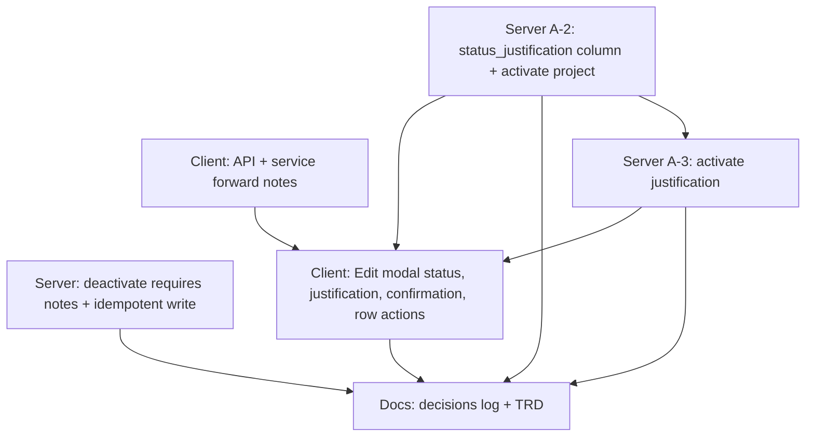

# Tasks — Bilateral / Mapping status in the Edit modal

- **Module:** bilateral
- **Spec id:** 2026-10-mapping-status-in-edit-modal
- **Status:** done
- **Owner:** David Casañas
- **Linked requirements:** ./requirements.md
- **Linked design:** ./design.md (judgment: ./judgment.md — APPROVED)
- **Last updated:** 2026-10-30

**Baseline observed at `43dd6341` (2026-10-30, before any change):**
- server `npx jest src/domain/entities/bilateral-project-mapping/bilateral-project-mapping.controller.spec.ts src/domain/entities/bilateral-project-mapping/bilateral-project-mapping.service.spec.ts --coverage=false` → `Tests: 53 passed, 53 total`
- client `npx jest src/app/pages/platform/pages/administration/center-admin/bilateral-mapping/bilateral-mapping.component.spec.ts src/app/shared/services/bilateral-mapping.service.spec.ts --coverage=false` → `Tests: 123 passed, 123 total`

---

## Dependency graph

T-01 and T-02 are parallel-safe (different packages). T-03 needs T-02's service signatures. **HITL pause after T-03** (owner, running app) settles P-8 and P-9 before T-04.

---

## Task list

### T-01 — Server: deactivate requires a trimmed justification; idempotent calls write supplied notes

- **Status:** done · **Size:** S · **Dependencies:** none
- **Requirements covered:** R-MSE-005 (AC.1–AC.6), R-MSE-003 ("Justification overwrites notes" — server half)
- **Design references:** §5, §6, DD-5, DD-8, P-2, P-4, P-6, P-11
- **Files touched (intended):**
  - `server/researchindicators/src/domain/entities/bilateral-project-mapping/bilateral-project-mapping.controller.ts`
  - `server/researchindicators/src/domain/entities/bilateral-project-mapping/bilateral-project-mapping.service.ts`
  - `server/researchindicators/src/domain/entities/bilateral-project-mapping/bilateral-project-mapping.controller.spec.ts`
  - `server/researchindicators/src/domain/entities/bilateral-project-mapping/bilateral-project-mapping.service.spec.ts`
- **Scope:**
  1. **First step — settle P-11:** write the supertest pipe cases below against the new DTO before touching the service; record in `execution.md` that `{}` and `"   "` are rejected and `" x "` is stored as `"x"`.
  2. New module-local deactivate body DTO: `notes` with `@Transform` trim (`typeof` guard, precedent `impersonation/dto/search-users.dto.ts:19`), `@IsString`, `@IsNotEmpty`, `@MaxLength(500)`. `@ApiBody({ type, required: true })`; `@ApiOperation` summary names the required justification. `@Body()` no longer optional on deactivate. Activate keeps `BilateralProjectMappingNotesDto` unchanged.
  3. Service `deactivate` / `activate`: when the row is already in the target state **and** `notes !== undefined`, set `notes` + `updated_by`, save, return; do not touch `is_active` / `deleted_at`. With no notes, the early return is unchanged.
  4. Update the controller unit case that calls `deactivate(reqUser, 5)` with no body (`controller.spec.ts:293-298`) to pass notes.
- **Tests (added/updated):**
  - controller (supertest, real `ValidationPipe`, pattern at `controller.spec.ts:381`): `{}` → 400 and service not called (AC.1); `{ notes: "   " }` → 400 (AC.1); 501-char notes → 400 (AC.3); `{ notes: " Contract closed " }` → service called with `"Contract closed"` (AC.2); `{ notes: 'Deactivated via admin panel' }` → 200 (AC.4); activate with empty body → 200 (AC.5, existing case stays green).
  - service: deactivate on `is_active=false` with `"Late reason"` → `save` called, `notes="Late reason"`, `is_active` false, `deleted_at` unchanged (AC.6); same shape for activate on an already-active row with notes; existing `'is idempotent when the row is already inactive'` (no notes, no save) stays green.
- **Verification:** from `server/researchindicators/`: `npx jest src/domain/entities/bilateral-project-mapping --coverage=false` · `npx eslint src/domain/entities/bilateral-project-mapping` · `npm run build`.
- **Falsifier:** (a) remove `@IsNotEmpty` → the `"   "` case returns 200 (red); (b) remove the `@Transform` → the padded case receives `" Contract closed "` (red); (c) restore the early `return row` before the notes write → AC.6 case sees no `save` (red).
- **Red run:** baseline reading observed: the controller case `deactivate(reqUser as never, 5)` with no body passes at `43dd6341` and asserts `service.deactivate` called with `(5, fakeUser, undefined)` (`controller.spec.ts:297-298`) — today an empty-body deactivate succeeds; the service case `✓ is idempotent when the row is already inactive` passes, asserting no `save`. The new AC.1 / AC.6 assertions negate these; their assertion-level red is observed against the pre-change code and quoted in `execution.md` before the fix.
- **Disqualifier:** a 400 caused by the non-whitelisted guard (`forbidNonWhitelisted`) or a missing route, not by the `notes` rule, is not evidence for AC.1 — assert the error payload names `notes`. A service test whose fixture row is already `notes="Late reason"` cannot show the write.
- **Consumers:** `controller.spec.ts` (`:273-298`, `:381-390`), `service.spec.ts` (`describe('deactivate (R-BIL-080)')`, `describe('activate (R-APM-011)')`), `automapper.service.spec.ts:1520-1567` (deactivates an active row with a note — must stay green), `admin/client/pages/BilateralProjectMappings.tsx:281-286` (sends a note — AC.4), client `api.service.ts:906` (T-02).
- **Review:** `full` — changes a write contract other clients call and an idempotency rule.
- **Done criteria:**
  - [x] P-11 settled and recorded as step 1
  - [x] AC.1–AC.6 each owned by a passing test; falsifiers (a)–(c) observed red
  - [x] server suite for the folder green; eslint clean; build green
- **Skills:** `nestjs-expert`, `api-design-principles`, `tdd`

### T-02 — Client: API and service forward the justification / notes

- **Status:** done · **Size:** S · **Dependencies:** none
- **Requirements covered:** R-MSE-004 (request bodies: "deactivate with the justification", "activate with notes if edited"), R-MSE-005 AC.5 (empty activate body kept)
- **Design references:** §8, J-7
- **Files touched (intended):**
  - `client/research-indicators/src/app/shared/services/api.service.ts`
  - `client/research-indicators/src/app/shared/services/bilateral-mapping.service.ts`
  - `client/research-indicators/src/app/shared/services/bilateral-mapping.service.spec.ts`
- **Scope:** `PATCH_BilateralProjectMappingDeactivate(id, body: { notes: string })` sends `body`; `PATCH_ActivateBilateralMapping(id, body?)` sends `body ?? {}`. `BilateralMappingService.deactivate(id, notes)` → `{ notes }`; `activate(id, notes?)` passes `{ notes }` only when `notes !== undefined`. The existing component call sites (`component.ts:518`, `:564`) are replaced in T-03; keep the tree compiling (pass the row's notes or adjust the call temporarily — no behavior claim rides on it).
- **Tests:** update `bilateral-mapping.service.spec.ts:322` (deactivate → `toHaveBeenCalledWith(11, { notes: 'x' })`) and `:334` (activate without notes → `toHaveBeenCalledWith(11)`; add activate with notes → `(11, { notes: 'n' })`); `:553` (`patch(..., {}, ...)` for activate without body) must stay green; add the deactivate URL/body assertion through `ApiService`.
- **Verification:** from `client/research-indicators/`: `npx jest src/app/shared/services/bilateral-mapping.service.spec.ts --coverage=false` · `npm run lint -- --quiet` · `npm run build` · spec type-check set compare for `bilateral-mapping.service.spec.ts` (client guide K-002: `npx tsc -p tsconfig.spec.json --noEmit 2>&1 | grep -E 'bilateral-mapping.service.spec' | sed -E 's/\([0-9]+,[0-9]+\)//' | sort` before vs after — identical or fewer).
- **Falsifier:** change `body ?? {}` to `body` → `:553` fails (`undefined` vs `{}`); drop the body in the deactivate API → the new deactivate body assertion fails.
- **Red run:** baseline observed: `✓ patches bilateral-project-mappings/:id/activate with an empty body` passes and `toHaveBeenCalledWith(11)` passes for deactivate at `43dd6341`; the new deactivate-with-notes assertion's red is observed and quoted in `execution.md` before the change.
- **Disqualifier:** a green run with `--coverage` on is not used (single-file runs exit 1 on coverage floors — K-020); only `--coverage=false` exit codes count.
- **Consumers:** `bilateral-mapping.service.spec.ts`, `bilateral-mapping.component.ts` (caller, T-03), `bilateral-mapping.component.spec.ts` (mocks the service — T-03).
- **Review:** `checklist` — two signature changes with tests.
- **Done criteria:**
  - [x] both methods forward bodies; activate without notes sends `{}`
  - [x] falsifiers observed red; suite green; lint, build and spec type-check clean for the file
- **Skills:** `angular-developer`

### T-03 — Client: Status control, justification, second confirmation, one row action

- **Status:** done (owner HITL approved 2026-10-30 after A-2/A-3/A-3b) · **Size:** M · **Dependencies:** T-02, T-05
- **Requirements covered:** R-MSE-001, R-MSE-002, R-MSE-003 (client), R-MSE-004, NFR-MSE-001 (automatable half), NFR-MSE-002
- **Design references:** §7.1–§7.4, DD-2, DD-3, DD-4, DD-6, DD-7, reversion table, P-1, P-3, P-7, P-10; judgment R2-1..R2-4
- **Files touched (intended):**
  - `client/research-indicators/src/app/pages/platform/pages/administration/center-admin/bilateral-mapping/bilateral-mapping.component.ts`
  - `client/research-indicators/src/app/pages/platform/pages/administration/center-admin/bilateral-mapping/bilateral-mapping.component.html`
  - `client/research-indicators/src/app/pages/platform/pages/administration/center-admin/bilateral-mapping/bilateral-mapping.component.spec.ts`
- **Scope:**
  1. **Row actions (R-MSE-001):** remove the Deactivate/Activate block; non-Pending rows render only `edit-btn`; Pending/UNMAPPED unchanged. Remove `requestDeactivate`, `confirmDeactivate`, `requestActivate`, `confirmActivate`.
  2. **State (§7.1):** `statusActive`, `initialActive`, `justification`, `pickedProjectId` (`undefined` sentinel), `confirmPending`, `statusChanged`, `isInactivating`; reset on every open path; `onStatusToggle` stash/restore + justification reset on entering Inactive.
  3. **canSave (§7.2)** incl. `!confirmPending()`; the `!snap` guard applies only to the no-status-change row.
  4. **Save (§7.3):** re-entry guard; captured plan; `showGlobalAlert` with `hideCloseButton: true`, the summary/detail/button/toast strings from the §7.3 table; cancel clears `confirmPending`; `applyStatusChange(plan)`: one request, success → close + toast + `load()` + `loadCoverage()` + Clarity `bilateral.mapping.deactivated|activated`; failure → inline `saveError`.
  5. **Dialog close gate (§7.3, R2-1, R2-2):** `[visible]="dialogOpen()"` + `(visibleChange)="onDialogVisibleChange($event)"`: `false` while `confirmPending() || saving()` is ignored; `false` otherwise calls `closeDialog()`. `closeDialog()` returns early while `confirmPending() || saving()`. `[closable]="!(confirmPending() || saving())"`, `[focusTrap]="!confirmPending()"`. Form controls and dialog Cancel disabled while pending. Optional (R2-4): refocus Save after Cancel / failure.
  6. **Template (§7.4):** Status `p-toggleswitch` (import `ToggleSwitchModule`) with `<label for>`, `[ariaLabel]`, Active/Inactive text, `data-testid="status-toggle"`, edit mode only; CLARISA picker `[disabled]="statusChanged() || confirmPending()"` *(A-2: `isInactivating()`)*; Justification textarea (`justification-input`, label + red `*`, `aria-required="true"`, placeholder, `n/500`) replacing Notes while inactivating *(A-2: under the toggle; Notes always rendered)*. Token utilities only — no hex, no new tokens.
- **Rework scope (Amendment A-2, R-MSE-006/007, DD-9/DD-10; owner HITL 2026-10-30):**
  7. API + service (`api.service.ts`, `bilateral-mapping.service.ts` + spec): deactivate sends `{ justification, notes? }`; activate sends `{ notes?, clarisa_project_id? }`, each key only when set.
  8. Justification field directly below the Status toggle; Notes always rendered, optional, independent; inactivating may also save an edited Notes in the same deactivate request.
  9. CLARISA picker `[disabled]` only while inactivating (`isInactivating()`), not on activation; stash/restore applies to the inactivating direction only; the activate plan carries `clarisa_project_id` when it differs from the snapshot; Save requires a project when activating.
  11. *(A-3, R-MSE-008, DD-12/13)* Justification renders for any status change (required + red `*` when inactivating; "(optional)" + activation placeholder when activating); the activate plan carries `justification` when non-blank; inactivate confirmation `severity: 'secondary'`, activate stays `confirm`.
  10. Diagnose and fix: an inactive mapping opened in Edit shows an empty CLARISA picker (value set, option missing from `clarisaOptions`). Red test first.
- **Tests (component spec; construct closed, then `openEditDialog` — KZ-015):**
  - retire the row-action tests (`requestDeactivate — confirmation gate`, `confirmDeactivate — success/failure`, `Deactivate button visibility`, `Activate action (R-APM-011)`) and replace with:
  - DOM: active and inactive rows render `edit-btn` and no `deactivate-btn` / `activate-btn`; Pending row renders only `pending-map-btn` (R-MSE-001).
  - Status toggle present in edit, absent in create and "+ Map"; reads Active for an active row; toggling alone enables Save for Inactive → Active, and for Active → Inactive once a justification is typed (R-MSE-002 as amended 2026-10-30).
  - Project round trip: pick project B, toggle Inactive (picker disabled, shows snapshot project A), toggle back → picker enabled showing B; the deactivate plan carries no project (R-MSE-002).
  - Inactivating: Justification appears *(A-2: Notes stays)*, empty on entry and on re-entry; Save disabled for `''` and `'   '`; no service call (R-MSE-003).
  - Confirmation: Save opens exactly one alert with `hideCloseButton: true` and the §7.3 strings, zero service calls before `confirmCallback.event()`; second `onSave()` while pending → still one alert, zero calls; `onDialogVisibleChange(false)` and `closeDialog()` while pending → `dialogOpen()` still true and values kept; cancel → zero calls, dialog open, `confirmPending` false (R-MSE-004).
  - Confirm deactivate → exactly one `deactivate(id, 'Contract closed')` with the trimmed text captured at Save even if the signal changes afterwards; success → dialog closed, toast "Mapping inactivated", `load` + `loadCoverage` called. Confirm activate with edited notes → `activate(id, notes)`; unedited → `activate(id)`. *(A-2: `activate(id, { notes })` / `activate(id, { clarisa_project_id })` / `activate(id)`.)*
  - Failure → dialog open, `save-error` shows the message, no success toast; `onDialogVisibleChange(false)` while `saving()` ignored.
  - Not pending: `onDialogVisibleChange(false)` closes the dialog (R2-1).
  - Plain notes edit → no alert, one `update` call (R-MSE-004 "not double-confirmed").
  - a11y attributes: toggle `ariaLabel` text, label `for`, Justification `aria-required` (NFR-MSE-001).
- **Verification:** from `client/research-indicators/`: `npx jest src/app/pages/platform/pages/administration/center-admin/bilateral-mapping --coverage=false` · `npm run lint -- --quiet` · `npm run build` · spec type-check set compare for `bilateral-mapping.component.spec.ts` (as T-02) · then the **full client suite** `npm test -- --silent` (Leader, after the worker reports).
- **Falsifier:** (a) drop the `confirmPending` check in `onSave` → the double-Save test sees two alerts (red); (b) make `onDialogVisibleChange` always close → the pending-close test sees `dialogOpen()` false (red); (c) read `justification()` inside `applyStatusChange` instead of the plan → the "captured at Save" test sends the changed text (red); (d) restore the `@if (row.is_active)` block → the DOM test finds `deactivate-btn` (red).
- **Red run:** baseline observed at `43dd6341`: `✓ renders the Deactivate button only for active rows` and `✓ renders Activate on inactive rows and Deactivate on active rows` pass — the row-action assertions of this task are their negation; the new modal tests target members that do not exist yet: `predicted — greenfield artifact (observed in T-03)` — the worker observes each new test red against the pre-change component (assertion-level, not a compile/undefined error) and quotes it in `execution.md` before implementing.
- **Disqualifier:** a test that sets `dialogOpen`/signals before the first `detectChanges()` instead of calling `openEditDialog` on a constructed-closed component is not evidence (KZ-015). A test that stubs `showGlobalAlert` without invoking `confirmCallback.event` / `cancelCallback.event` cannot prove "no request before confirm". jsdom cannot prove z-order or keyboard reach — those are the HITL rows, not this gate.
- **Consumers:** `bilateral-mapping.component.spec.ts` — the only file pinning the removed hooks/handlers (P-3, grep over `client/research-indicators` and `server/researchindicators`: 2 files, component `.ts` + spec). `ActionsService.showGlobalAlert` is called, not changed.
- **Review:** `full` — UI state machine with a double-submit and close-path guard.
- **Done criteria:**
  - [x] every listed test passes and falsifiers (a)–(d) observed red
  - [x] lint, build, spec type-check clean; full client suite green (Leader re-measure)
  - [x] **HITL (owner, running app):** confirmation renders above the modal (P-8); Tab reaches Confirm/Cancel and Escape does not close the modal while pending (P-9); toggle looks right in light and dark; header X disappearing while pending is acceptable (R2-5). Quote what the owner observed.
- **Skills:** `angular-developer`, `ui-ux-pro-max`, `tdd`

### T-05 — Server: `status_justification` column; deactivate `{ justification, notes? }`; activate accepts a project (Amendment A-2)

- **Status:** done · **Size:** M · **Dependencies:** T-01
- **Requirements covered:** R-MSE-006, R-MSE-007 (server), R-MSE-005 as amended
- **Design references:** DD-9, DD-10, DD-11, DD-8
- **Files touched (intended):** `server/researchindicators/src/domain/entities/bilateral-project-mapping/{entities/bilateral-project-mapping.entity.ts, bilateral-project-mapping.controller.ts, bilateral-project-mapping.service.ts, *.spec.ts}`, one new migration under `server/researchindicators/src/db/migrations/`, `server/researchindicators/src/admin/client/pages/BilateralProjectMappings.tsx` (body key only)
- **Scope:** add the column (entity + hand-written additive migration, `up` adds / `down` drops); deactivate DTO `justification` (required, trim, 1–500) + optional `notes` (trim, ≤500); service writes `status_justification`, never `notes` from the justification, on both the transition and the idempotent path; activate DTO adds optional `clarisa_project_id` (int) reusing `update()`'s project-change logic (snapshot name, external code) in the same save, on both paths; activate leaves `status_justification` alone; SSR page sends `{ justification: … }`; Swagger updated.
- **Verification:** from `server/researchindicators/`: the two bilateral specs `--coverage=false`, `npx eslint <touched>`, `npm run build`, then full `npm test -- --silent` (Leader). Migration not applied by the worker (shared Dev DB — owner step).
- **Falsifier:** write the justification to `notes` → "notes untouched" test red; drop `clarisa_project_id` handling in activate → "reactivate onto B" test red.
- **Review:** `full` — contract change + migration.
- **Done criteria:**
  - [x] tests for R-MSE-006 scenario, AC.1–AC.6 re-keyed to `justification`, activate-with-project (transition + idempotent), notes untouched; falsifiers observed red
  - [x] lint, build, full server suite green
- **Skills:** `nestjs-expert`, `api-design-principles`, `tdd`

### T-06 — Server: activate accepts an optional justification (Amendment A-3)

- **Status:** done · **Size:** S · **Dependencies:** T-05
- **Requirements covered:** R-MSE-008 (server)
- **Design references:** DD-12
- **Files touched (intended):** bilateral-project-mapping `controller.ts`, `service.ts`, `controller.spec.ts`, `service.spec.ts`
- **Scope:** activate DTO adds optional `justification` (trim, `@IsString`, `@MaxLength(500)`); service writes `status_justification` when it is supplied and non-blank, on both the transition and the idempotent path; when it is absent, leave the column untouched. Swagger updated.
- **Verification:** bilateral folder jest `--coverage=false`, `npx eslint <touched>`, `npm run build`; full suite (Leader).
- **Falsifier:** drop the write → "activate with justification" test red.
- **Review:** `full`.
- **Done criteria:**
  - [x] tests (transition, idempotent, absent → untouched, 501 → 400) pass; falsifier observed red
  - [x] lint, build, full server suite green
- **Skills:** `nestjs-expert`, `tdd`

### T-04 — Docs: decisions log and TRD

- **Status:** done · **Size:** S · **Dependencies:** T-01, T-03 (and the T-03 HITL)
- **Requirements covered:** traceability for R-MSE-001 (supersedes R-APM-011's row Activate) and R-MSE-005 (API contract)
- **Design references:** reversion table, §5
- **Files touched (intended):** `docs/ux-ui/design.md` (decisions log entry), `docs/trd/trd.md` (one sentence in the Center Admin / bilateral mapping API line)
- **Scope:** decisions-log entry dated on completion: status change moved into the Edit modal with a second confirmation; justification required on inactivate, stored in `status_justification` (overwritten, notes untouched — A-2); CLARISA editable on activation; supersedes the R-APM-011 row action. TRD: `PATCH …/:id/deactivate` requires `justification` (trimmed 1–500, `400` otherwise) and accepts `notes`; `PATCH …/:id/activate` accepts `notes` and `clarisa_project_id`; new column `status_justification`.
- **Verification:** `grep -n "mapping-status-in-edit-modal" docs/ux-ui/design.md docs/trd/trd.md` → ≥ 1 hit each; correction sweep: `grep -rn "Deactivate button\|row Activate\|activate-btn" docs/ux-ui docs/trd` reviewed and each hit updated or recorded as historical.
- **Falsifier:** an entry that cites the wrong path → the first grep returns 0 hits for that file.
- **Red run:** baseline observed: `grep -n "mapping-status-in-edit-modal" docs/ux-ui/design.md docs/trd/trd.md` → no hits at `43dd6341` (spec created after).
- **Disqualifier:** a grep hit inside an unrelated paragraph is not an entry — read the line.
- **Consumers:** none (documentation).
- **Review:** `checklist` — baseline docs other agents read.
- **Done criteria:**
  - [x] both docs carry the entry; sweep hits resolved
- **Skills:** `cognitive-doc-design`

---

## Coverage (scenario and clause level)

| Requirement clause | Owner |
| --- | --- |
| R-MSE-001 Scenario: only Edit on active and inactive rows; BUT no Deactivate/Activate; AND IT MUST keep "+ Map" | T-03 (DOM tests) |
| R-MSE-002 Scenario: Edit an active mapping (reads Active; AND IT MUST enable Save on toggle alone) | T-03 |
| R-MSE-002 Scenario: Create flow unchanged; BUT no activate/deactivate from create | T-03 |
| R-MSE-002 Scenario: project pick survives a round trip; BUT no project sent while Inactive | T-03 |
| R-MSE-003 Scenario: inactivate without justification → Save disabled; BUT no request | T-03 |
| R-MSE-003 Scenario: justification overwrites notes; AND IT MUST NOT keep the old note | T-01 (server write) + T-03 (client sends trimmed justification) |
| R-MSE-003 bullet: activate needs no justification; edited notes saved with activation | T-02 + T-03 |
| R-MSE-004 Scenario: confirm inactivation; AND IT MUST send no request before confirm; exactly one request; close + toast + row Inactive | T-03 (+ T-02 body) |
| R-MSE-004 Scenario: cancel → no request, modal open with values | T-03 |
| R-MSE-004 Scenario: Save pressed twice / Escape; AND IT MUST send exactly one request | T-03 (automated) + T-03 HITL (Escape in a real browser) |
| R-MSE-004 Scenario: plain edit not double-confirmed | T-03 |
| R-MSE-004 Scenario: request fails; BUT no success toast | T-03 |
| R-MSE-004 bullet: confirmation has no close icon; values captured at Save | T-03 |
| R-MSE-005 AC.1–AC.6 | T-01 |
| NFR-MSE-001 attributes | T-03 (tests); keyboard reach → T-03 HITL |
| NFR-MSE-002 no hex / tokens | T-03 (review + lint) |
| §8 defect class: z-order | T-03 HITL |

No `skip-eligible` task.

## Estimate & PR strategy

~450 LOC including tests (server ~80, client service ~40, component + template ~150, specs ~170, docs ~10). **One PR** on the current AC-1797 branch: under the ~400 LOC split threshold for production code (~280 non-test), and the server and client halves are order-safe to deploy together (design §11).

## Risks & blockers log

| # | Date | Risk / Blocker | Mitigation | Owner | Status |
| --- | --- | --- | --- | --- | --- |
| RB-1 | 2026-10-30 | Confirmation behind the modal or unreachable by keyboard in a real browser (P-8, P-9) | T-03 HITL; fallbacks in design P-8/P-9 | Owner | open |
| RB-2 | 2026-10-30 | Stale SPA tabs get `400` on deactivate after deploy | Accepted (requirements §9) | — | accepted |
