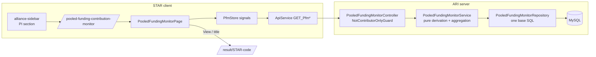

# Design — Bilateral / Pooled Funding Contribution Monitor

- **Module:** bilateral — new server module `pooled-funding-monitor` + new STAR page
- **Spec id:** 2026-10-pooled-funding-monitor
- **Status:** approved
- **Owner:** Daniela Pino / ARI
- **Linked requirements:** [./requirements.md](./requirements.md)
- **Linked detailed design:** [`docs/trd/trd.md`](../../../../trd/trd.md) §7.1 (result lifecycle), §9.1 (integrations)
- **Visual source:** [./mockup/](./mockup/) — logic reference: `mockup/mockup-logic.extracted.js`
- **Last updated:** 2026-10-08

---

## 0. Summary

**One server module** builds the monitored result set with **one parameterized SQL query** per request. The service turns those rows into derived states with **pure functions** and aggregates them for three GET endpoints.

**One lazy-loaded standalone Angular page:**
- renders the two tabs exactly as the mockup;
- uses Tailwind utilities with `--ac-*` tokens;
- its only outbound action is a router link to the result.

No schema change. No write path.

## 1. Goals & non-goals

| Goal | Requirements |
|---|---|
| G1. A server-side derivation that every count and row is built from | R-PFM-003, R-PFM-004, NFR-PFM-006 |
| G2. Scope and access enforced by the server | R-PFM-001, R-PFM-002, NFR-PFM-001 |
| G3. Coverage tab (KPIs, pipeline, SP coverage, monthly) | R-PFM-005…008 |
| G4. Results queue (filters, chips, lazy groups, rows, View) | R-PFM-009…013, R-PFM-015 |
| G5. Mockup fidelity with Tailwind + tokens; loading, empty and error states | R-PFM-014, R-PFM-016, NFR-PFM-003…005 |

**Non-goals:**
- Any sync or write action.
- The drawer.
- A version diff.
- The TOC and Log tabs.
- Changing the sync engine, the webhook, or child 4.
- Applying the pending local migrations (a human decision; see §11).

> **KZ-016 cross-check done.** Read back against every `AND IT MUST` / `BUT it must NOT` clause and against the modules touched. Two constraints shaped this design:
> - `pool_funding_alignment_validation` is a **visual-only** check. Using it here to display state is within its stated purpose.
> - `effectivePoolFundingContributorSql` takes a **trusted alias literal only**, never request input.

---

## 2. Architecture

### 2.1 Composition — server (`server/researchindicators/src/domain/entities/pooled-funding-monitor/`)

| File | Responsibility |
|---|---|
| `pooled-funding-monitor.module.ts` | Nest module. Registered in **`entities.module.ts` and `main.routes.ts`** (path `pooled-funding-monitor`) — KZ-017: registering only the route 404'd `pi-delegates` in production |
| `pooled-funding-monitor.controller.ts` | 3 GET handlers, Swagger, `ResponseUtils.format` envelope |
| `pooled-funding-monitor.service.ts` | Calls the repository, applies derivation, filters, chips and aggregates |
| `derivation/pfm-derivation.ts` | **Pure** functions: STAR label, PI line, mapping state + note, PRMS status + hint, `isOutOfScope`, `isReady`, `needsAttention`, row rank, chip match, status-filter match |
| `derivation/pfm-aggregation.ts` | **Pure**: KPIs, pipeline stages, SP coverage, monthly series, project groups + counts + ordering |
| `repositories/pooled-funding-monitor.repository.ts` | Base SQL (§3.2), monthly-sync SQL, contributing-project count, filter options |
| `guards/not-contributor-only.guard.ts` | Denies users whose roles are empty or all `CONTRIBUTOR (3)` |
| `dto/pfm-query.dto.ts` | `scope`, `project`, `sp`, `status`, `type`, `chip` (class-validator, enums) |
| `dto/pfm-*.response.dto.ts` | Swagger response shapes (§4) |
| `enum/pfm-*.enum.ts` | Scope, STAR label, mapping state, PRMS status, status filter, chip |
| sibling `*.spec.ts` | One for controller, service, derivation, aggregation, guard, repository |

### 2.2 Composition — client (`client/research-indicators/src/app/pages/platform/pages/pooled-funding-monitor/`)

| File | Responsibility |
|---|---|
| `pooled-funding-monitor.component.{ts,html}` | Page shell: title, subtitle, scope toggle, KPI cards, tab strip, tab outlet |
| `services/pfm-store.service.ts` | Signals: `scope`, `tab`, `filters`, `chip`, `summary`, `queue`, `groupRows` (map), `openGroups` (set), per-section load/error state. Calls `ApiService`. `scope` and `tab` mirror `?scope=&tab=` |
| `components/pfm-kpi-cards/` | 4 cards (R-PFM-005) |
| `components/pfm-coverage-tab/` | Hosts the three coverage cards |
| `components/pfm-pipeline-card/` | Stacked bar + 3 summary figures + 7 stage tiles (R-PFM-006) |
| `components/pfm-sp-coverage-card/` | SP rows with dual bar (R-PFM-007) |
| `components/pfm-sync-activity-card/` | 6 monthly bars + footer (R-PFM-008) |
| `components/pfm-queue-tab/` | Filters row, chips row, group list, footer + legend (R-PFM-009/010/015) |
| `components/pfm-project-group/` | Collapsible header + lazy rows (R-PFM-011) |
| `components/pfm-result-row/` | One row + View link (R-PFM-012/013) |
| ~~`components/pfm-status-badge/`~~ | **Removed in HITL r22 (DD-PFM-19).** The status cells now use the house `shared/components/custom-tag` (`app-custom-tag`), coloured with the `--ac-pfm-*` tokens |
| `pfm.interfaces.ts` | Wire types matching §4 |
| `guards/pooled-funding-monitor.guard.ts` (in `shared/guards/`) | Client mirror of the access rule + feature flag; redirects to `/home` |
| `shared/services/api.service.ts` | `GET_PfmSummary`, `GET_PfmQueue`, `GET_PfmProjectResults` |
| `app.routes.ts` | Lazy `loadComponent` route `pooled-funding-contribution-monitor`, `canMatch: [rolesGuard, pooledFundingMonitorGuard]` |
| `alliance-sidebar.component.{ts,html}` | PI section shows when `piOptions().length > 0`; the monitor item sits under *My PI Delegates* (owner, 2026-10-08) |
| `roles.service.ts` | New computed `canAccessPooledFundingMonitor` |

### 2.3 Reuse

| Reused | For |
|---|---|
| `effectivePoolFundingContributorSql` (`shared/utils/pool-funding.util.ts:16`) | Contributing-project predicate |
| SQL function `pool_funding_alignment_validation(result_id)` (migration `1786679227000`) | Mapping *Complete* vs *Incomplete*: the **same** rule the sidebar green check shows, so the monitor and the result page cannot disagree |
| PI predicate from My Projects (`agresso-contract.repository.ts:430-450`, minus the `created_by` branch) | PI scope |
| `result-prms-sync-status.reader.ts` filters (`CORRELATED`, `duplicate_of_id IS NULL`) | Latest PRMS decision, applied in bulk |
| `ResponseUtils.format`, `RolesGuard`, `LoggerUtil` | Envelope, auth, logging |
| Results Center `getResultRouteArray` / `getResultHref` (`results-center-table.component.ts:302-321`) | View link rule. **Extract to a shared util** rather than duplicate (**T-08** in `tasks.md`) |
| `poolFundingFlags` service (client) | OQ-6 flag gating |

---

## 3. Data model

**No data model changes.** No entity, column, index or migration.

### 3.1 Sources (verified against local DB 2026-10-08 unless noted)

| Source | Columns used |
|---|---|
| `results` | `result_id`, `result_official_code`, `report_year_id`, `title`, `indicator_id`, `result_status_id`, `platform_code`, `is_snapshot`, `is_active`, `updated_at`, `is_synced_to_prms` |
| `result_contracts` | `contract_id`, `is_primary=1`, `is_active=1` |
| `agresso_contracts` | `agreement_id`, `short_title` (or `description`), `donor`, `projectLeadId`, `project_lead_description` (199 contributing contracts locally; all have donor and lead filled) |
| `pi_delegates` | Active delegate rows (PI scope) |
| `result_pool_funding_alignment` (+ `_sp`) | `has_contribution`; `sp_code`, `sp_role` PRIMARY / CONTRIBUTING / **NULL** (34 legacy NULL-role rows locally) |
| `clarisa_science_programs` | `official_code`, `name`, **`category`** (Science programs / Scaling programs / Accelerators), `color` — resolves OQ-8 |
| `submission_history` | `to_status_id=6`, `custom_date` → approval date (D-4) |
| `result_prms_sync_history` | Latest `status` + `justification`. **Absent on the local DB** (migration `1790086170692` pending) |
| `result_prms_sync_log` | `outcome='ACCEPTED'` + `created_at` → monthly series (empty locally) |

### 3.2 Base query (conceptual — written in T-02)

One row per monitored result, for one scope:

1. **Filter:**
   - `results` current rows (`is_snapshot=0`, `is_active=1`, `platform_code='STAR'`);
   - `indicator_id IN (1,2,3,4,6)` (OICR = 5 excluded);
   - joined to their primary active contract;
   - kept when that contract is a contributing project.
2. **PI scope** adds the PI predicate (lead carnet of the authenticated user, or an active delegate row). Portfolio scope omits it.
3. **Projected per row:**
   - ids, title, type, status, `updated_at`;
   - project code, name, donor, lead;
   - `has_alignment`, `has_contribution`, `mapping_complete` (the SQL function);
   - primary SP (`PRIMARY` row; else the **only** active SP when exactly one exists; else none — DD-PFM-7);
   - contributing SP names;
   - latest approval date;
   - `is_synced_to_prms`;
   - latest PRMS status + justification.
4. **Version-safe keys:** history tables are joined on `(result_official_code, report_year_id)`, never on `result_id`, which differs per version.

Filters and chips are applied **in the service**, on the derived rows, so one derivation feeds every number (NFR-PFM-006).

---

## 4. API surface

Common to all three endpoints:
- unversioned (no `@Version` — root guide §4.1);
- class-level `@UseGuards(NotContributorOnlyGuard)`;
- Swagger: `@ApiTags('Pooled Funding Monitor')`, `@ApiBearerAuth()`, `@ApiOperation`, `@ApiQuery` per param.

Errors:
- 401 (middleware);
- 403 for contributor-only users or machine tokens;
- 400 for invalid enum values (class-validator).

### GET `/api/pooled-funding-monitor/summary`

- **Query:** `scope=mine|all` (default `mine`).
- **Data:** `{ scope, is_pi_of_any, kpis:{projects, projects_total, monitored, need_attention, synced, in_prms_scope}, pipeline:{total, in_scope, not_synced, in_prms, out_of_scope, stages:[{key, group, value}]}, sp_coverage:[{code, name, synced, total}], monthly:[{month:'YYYY-MM', synced}], synced_this_year }`

### GET `/api/pooled-funding-monitor/queue`

- **Query:** `scope`, `project?`, `sp?`, `status?` (enum of the 7 options), `type?` (indicator id), `chip?` (enum of the 7 chips).
- **Data:** `{ filter_options:{projects:[{code, name}], science_programs:[{category, items:[{code, name}]}], types:[{id, name}]}, chip_counts:{all, attention, mapping, ready, pending, prms_rejected, synced}, groups:[{code, name, lead_pi, donor, result_count, attention, counts:{approved, pending, rejected, out_of_scope, not_sent}}], totals:{results, projects, monitored_total} }`
- `filter_options` are computed from the **scope**, not the filtered set.
- `chip_counts` are computed from the filtered set **before** the chip is applied.
- `groups` are computed **after** the chip is applied, already sorted (R-PFM-011).

### GET `/api/pooled-funding-monitor/queue/projects/:projectCode/results`

- **Query:** same as `/queue`.
- **Data:** `[{ result_code, platform_code, official_code, report_year, snapshot_years:[...], title, type, star_label, star_status_id, pi_line, mapping_state, mapping_note, sp_line, primary_sp:{code, name, color}|null, contributing:[...], prms_status, prms_hint, updated_at }]`, rows already ranked.
- **404** when the project is not in the viewer's scope. It must not reveal whether the project exists.

`snapshot_years` + `star_status_id` let the client build the same link as the Results Center (DD-PFM-9).

---

## 5. Workflows & business rules

1. The request passes `JwtMiddleware` and then `NotContributorOnlyGuard`. The guard:
   - rejects machine tokens by **`request.credential === 'machine'`** (set by `JwtMiddleware` on every branch). A machine token is *not* identifiable by a missing `sec_user_id`: `AppSecretsService.validation` gives it the responsible human's integer `sec_user_id` and roles (corrected 2026-10-08, T-04 review);
   - rejects users whose role list is empty or contains only role 3.
2. The service resolves scope. For `mine`, the PI predicate uses the **authenticated** user's carnet and user id, never request input (NFR-PFM-001).
3. The repository runs the base query. The service maps each row through `pfm-derivation`, applying the D-3/D-4 tables from R-PFM-004.
4. Derivation rules, in order:
   - **out of scope:** `has_contribution = false`;
   - **mapping state:** Not started when there is no alignment; Complete when `mapping_complete = 1`; otherwise Incomplete;
   - **PRMS status:** Not sent unless `is_synced_to_prms`. When synced, use the latest history `status`, and **Pending Review when no history row exists** (R-F1: accepted ≠ decided).
5. The service applies filters, then computes chip counts, applies the chip, then groups, sorts and aggregates.
6. Nothing is written. No audit, socket, queue, OpenSearch or `sync_process_log` side effects. No transactions.

---

## 6. Frontend / UX component architecture

### 6.1 Layout (mockup → components)

| Mockup region | Component | Notes |
|---|---|---|
| Title, subtitle, scope segmented control | page | Segmented control = two `button`s with `aria-pressed`. "PRMS sync: today…" and *Sync now* **omitted** (R-PFM-014) |
| 4 KPI cards (left accent border) | `pfm-kpi-cards` | Accent per card via token class; numbers use `tabular-nums` |
| Tabs *Portfolio coverage* / *Results queue* | page | `role="tablist"`, arrow-key navigation; only 2 tabs |
| Result pipeline | `pfm-pipeline-card` | Flex segments sized by `flex-grow` = value; group labels In STAR / In PRMS / Out of scope |
| Coverage by Science Program | `pfm-sp-coverage-card` | Outer bar = total / max total; inner = synced / total |
| Sync activity | `pfm-sync-activity-card` | 6 bars, height ∝ value / max; month labels always visible |
| Filters + Reset | `pfm-queue-tab` | PrimeNG `p-select`; SP select uses grouped options by `category`; Reset is a text button |
| Quick views chips | `pfm-queue-tab` | `button`s with `aria-pressed` + count badge |
| Project group | `pfm-project-group` | Header is a `button` with `aria-expanded`/`aria-controls`; caret ▸/▾; stacked bar with `title` per segment; attention flag |
| Row grid | `pfm-result-row` | CSS grid; columns per R-PFM-012; inside a card with `overflow-x-auto` (NFR-PFM-005) |
| View | `pfm-result-row` | `<a [routerLink] [queryParams]>` styled as a secondary button — a real link (open-in-new-tab works) |
| Legend + count line | `pfm-queue-tab` | Copy per R-PFM-015 |

### 6.2 Design tokens

The mockup's hex palette maps to **semantic tokens**. Existing `--ac-*` tokens are reused where an equivalent exists. Missing ones are added to the **existing** global token stylesheet: no new `.scss` file is created; the existing file gets new custom properties, with light and dark values.

| Token family | Use | Mockup source |
|---|---|---|
| `--ac-pfm-success-bg/fg` | STAR Approved, mapping Complete, flag *All clear* | `#e6f2ea / #1d6b3e` |
| `--ac-pfm-info-bg/fg` | STAR Submitted, primary accent, selected chip | `#e7eefa / #0f4c9a` |
| `--ac-pfm-review-bg/fg` | STAR Under review | `#efe9f7 / #5b3d96` |
| `--ac-pfm-neutral-bg/fg` | STAR Draft, mapping Not started, unselected chip count | `#eef1f5 / #6b7a89` |
| `--ac-pfm-danger-bg/fg` | STAR Returned, PRMS Rejected | `#fdeceb / #b4443a` |
| `--ac-pfm-warning-bg/fg/border` | mapping Incomplete, PRMS Pending Review, attention flag, *Need attention* card | `#fdf0d5 / #8a5a08 / #e9cf9e` |
| `--ac-pfm-outscope-fg` | No SP contribution segments | `#2f7cc4` |
| `--ac-pfm-seg-*` | Pipeline / group bar segments (7) | mockup `PL_A/PL_B/PL_C` colors |

- **SP badges** use the **DB `clarisa_science_programs.color`**. It is bound at runtime as a CSS variable, with the background derived by `color-mix` (DD-PFM-8). No hard-coded SP palette.
- **Typography:** STAR's existing type scale (`fs-*`). The mockup's IBM Plex is **not** imported (DD-PFM-10); figures use `tabular-nums`.

### 6.3 States

| State | Rendering |
|---|---|
| Loading | Tailwind `animate-pulse` blocks in card, chart and group shapes. Toggle and tabs stay enabled |
| Error per section | Inline card: message + **Retry**. Other sections stay rendered (R-PFM-016) |
| Empty PI scope | Message + "View whole portfolio" button that sets scope (R-PFM-002) |
| Empty filtered | "No results match these filters" + Reset |
| Group rows loading | 3 skeleton rows inside the expanded group |

### 6.4 Client state rules

- Changing scope **keeps** the filters, chip and tab. It refetches summary and queue, and clears the cached group rows and `openGroups` (the groups belong to the old scope).
- Changing a filter resets the chip to `null` (mockup `setF`), refetches the queue, and clears the cached group rows.
- Expanding a group fetches its rows once per (scope, filters, chip) key.

---

## 7. Integration impact

None. No CLARISA, AGRESSO, PRMS, socket, queue or cron involvement. Reads only tables already populated by other features.

## 8. Security & authorization

| Item | Decision |
|---|---|
| Who can call | Any user with at least one role ≠ `CONTRIBUTOR (3)`, `SYSTEM_ADMIN` included (DD-PFM-2); or a Contributor-only user who is PI or active delegate of ≥ 1 project, on *mine* only: `scope=all` is 403 for them (DD-PFM-20; widened by DD-PFM-26, narrowed back by DD-PFM-29) |
| Machine token | Refused (403): data is user-scoped. Detected by `request.credential === 'machine'`, never by user fields — the machine path carries its responsible user's identity (T-04 correction) |
| Scope isolation | PI scope derived only from `request.user`. The project-results endpoint 404s for projects outside scope |
| SQL safety | All request values are bound parameters. `effectivePoolFundingContributorSql` is called with a literal alias only |
| PII | Names of PIs and titles are already visible to these roles elsewhere (My Projects, Results Center). Nothing new is exposed |

## 9. Observability

- `LoggerUtil` debug line per request: scope, filter keys, row count, duration in ms. No user identifiers beyond the id.
- No new `sync_process_log` types.

## 10. Testing strategy

| Layer | Tests | Disqualifier |
|---|---|---|
| Derivation (pure) | Table-driven: every STAR id → label, every alignment combination → mapping, PRMS combinations incl. *synced without history → Pending Review*, chip and status matches | Fixtures where every row shares the same values cannot prove per-row logic — **vary at least one discriminating field per row** (KZ-004) |
| Aggregation (pure) | KPIs / pipeline / SP / groups ordering on a 12-row varied fixture; asserts that the partition sums | — |
| Repository | **e2e against a real DB with seeded rows** (KZ-017: a mocked query builder cannot represent SQL precedence). Compares to an independent hand-written count query | Running on a DB without `result_prms_sync_history` makes the PRMS branch untested → report **inconclusive**, not pass |
| Guard | contributor-only → 403; contributor + center admin → pass; empty roles → 403; machine token → 403 | — |
| Controller e2e | Boot the app and hit the real URL (KZ-017); 401 / 403 / 200; PI isolation with two seeded PIs | — |
| Client | Store logic; components assert **rendered DOM text** of KPI values and chip counts (KZ-001); group toggle `aria-expanded`; View `href`; no element with sync wording (R-PFM-014); sidebar shows the item for allowed roles and hides it for contributor-only. Fixtures arrange the **transition** (load → data) per KZ-015 | A test that sets the final state before the first `detectChanges()` is not evidence |
| Visual | **No automated gate**: side-by-side review against the mockup at the HITL pause; dark mode checked by a human | — |

## 11. Rollout

| Item | Plan |
|---|---|
| Schema | None. **Precondition:** the target DB has migration `1790086170692` (`result_prms_sync_history`). Dev applies migrations on deploy; the **local DB is missing it**. Applying locally is a human decision (RB-1) |
| Feature flag | Page and nav hidden when `POOL_FUNDING_SECTION_ENABLED` is off (OQ-6 default accepted) |
| Backout | Revert the PR. No data to roll back |
| Comms | PIs / Center Admins via the usual release note |

## 12. Design decisions log

| # | Date | Decision | Rationale |
|---|---|---|---|
| DD-PFM-1 | 2026-10-08 | **One base SQL + pure TS derivation/aggregation**, rather than many aggregate SQL queries | One derivation feeds every number (NFR-PFM-006); pure functions are unit-testable without DB mocks (KZ-001). Volume (156 STAR rows locally; low thousands portfolio-wide) fits in memory. Rejected: SQL `GROUP BY` per card (7 queries that could disagree) |
| DD-PFM-2 | 2026-10-08 | New `NotContributorOnlyGuard` (deny-list), not `@Roles` (allow-list) | D-2 is phrased as a deny rule; a future role would otherwise be silently locked out. `RolesGuard` has no deny semantics |
| DD-PFM-3 | 2026-10-08 | Mapping completeness = existing SQL function `pool_funding_alignment_validation` | Same rule as the sidebar green check; no second definition to drift. Cost: one function call per row — acceptable at this volume, measured in **T-05** (NFR-PFM-002) |
| DD-PFM-4 | 2026-10-08 | **Lazy group rows** through a 3rd endpoint | The portfolio view would otherwise ship every row up front; the mockup only shows rows on expand |
| DD-PFM-5 | 2026-10-08 | Platform restricted to `STAR` | Measured: 750 of the 906 candidate rows were TIP/AICCRA and can never reach PRMS |
| DD-PFM-6 | 2026-10-08 | Results whose mapping is *Complete* but that are not yet Approved in STAR and not in PRMS (mapping finished before PI approval) are counted under **Mapping not started**, whose note reads "Waiting on PI approval or on the team to begin". In rows they still show mapping *Complete* | Keeps the 7 stages an exact partition (R-PFM-006) and matches the mockup note. They cannot be *Ready to sync* (not Approved) and are not *Incomplete*. Flag at HITL if the owner prefers a different home |
| DD-PFM-7 | 2026-10-08 | Primary SP = `PRIMARY` row; if none, the single active SP; else none | 34 legacy NULL-role rows exist locally; the SQL function treats "no PRIMARY" as "all SPs", so a single SP is unambiguous |
| DD-PFM-8 | 2026-10-08 | SP badge color from DB `color`, background via `color-mix` | Avoids hard-coding 13 SP colors (no hex in components); stays correct if CLARISA adds a program |
| DD-PFM-9 | 2026-10-08 | Extract the Results Center result-link builder to a shared util and reuse it | R-PFM-013 requires the same link rule; duplicating it would drift |
| DD-PFM-10 | 2026-10-08 | STAR typography instead of IBM Plex | Platform consistency; budgets (`angular.json` initial ≤ 3 MB) |
| DD-PFM-11 | 2026-10-08 | Sidebar PI section renders when `piOptions().length > 0`; each item keeps its own visibility rule | A Center Admin who is PI of nothing must still reach the monitor; *My PI Delegates* keeps its backend check |
| DD-PFM-12 | 2026-10-08 | OQ-6 → page gated by `POOL_FUNDING_SECTION_ENABLED`; OQ-7 → all reporting years, no year filter | Defaults accepted with the requirements |
| DD-PFM-13 | 2026-10-09 | HITL visual rework: the coverage tab follows the owner's target screenshot. Cards get their own surface (`--ac-pfm-surface`/`-surface-border`); the month ramp uses `--ac-pfm-month-1..6`; stage notes are not visible text (tooltip + sr-only) | Owner (Daniela Pino): "debe ser como la primera foto". Amends R-PFM-006 note clause |
| DD-PFM-14 | 2026-10-09 | HITL: the page header (title + description) reuses My PI Delegates' exact markup and house classes `atc-primary-blue-600` / `atc-grey-600` | Owner: "mismo margenes, padding, tamano y color de texto de pi delagtes". **Accepted deviation from NFR-PFM-004:** these house tokens have no dark-mode values (h1 ≈ 1.05:1 in dark) and `atc-grey-600` is ≈ 3.1:1 in light; same defect as My PI Delegates, to be fixed house-wide, not per page |
| DD-PFM-15 | 2026-10-09 | HITL r16: the queue's result links (title + View) carry `?from=pfm-monitor` on top of the unchanged `buildResultLink` rule (DD-PFM-9). The result breadcrumb becomes *Pooled Funding Contribution Monitor › Result <id>*, and the first item opens the monitor on `?tab=queue`. The shared result-entry-source whitelist (sidebar, version selector, innovation-use evidence) is centralised in `isKnownResultEntrySource` and widened to `pfm-monitor` | Owner: "si redireccion al resultado desde queue el breadcrumb debe salir desde monitor queue". **Scope (HITL r17):** the store remembers the last effective scope in `sessionStorage` (`ari.pfm.lastScope`, last scope viewed in this tab, read through try/catch and validated). The breadcrumb reopens that scope (`?tab=queue&scope=…`). A fresh sidebar entry still defaults to *mine* (R-PFM-002). Filters are not carried. If storage is blocked, or the result opens in a new tab, the scope is omitted and the default applies. OICR results are never linked from the monitor (R-PFM-003), so the OICR resolver redirect is unreachable from it |
| DD-PFM-16 | 2026-10-09 | HITL r18: result rows reuse the Results Center layout and typography. The columns are Code (split platform · number chip, number padded to 3 digits) · Result (title link, `line-clamp-3`, full title in `title=`) · Indicator · STAR status · Mapping · PRMS · Updated · Action. The row grid has a minimum width of 84rem and scrolls inside the card. R-PFM-012 was amended to match | Owner: "quiero que sea mismo diseño tamaño y tipografía, pon una columna para code y indicador". **Accepted deviation from NFR-PFM-003/004:** the code chip uses the Results Center colours from the shared `PLATFORM_COLOR_MAP` (STAR `#1689CA` on `#E6F2FF`, ≈ 3.4:1, with no dark variant). This is the same defect as the Results Center, and it should be fixed house-wide (for example with a shared result-code-chip component and tokens), not per page **HITL r19:** the title adopts the Results Center clamp. Creator and Science Programs are split into their own columns. The row minimum width is 106rem, with horizontal scroll inside the card (NFR-PFM-005). The server adds `LEFT JOIN sec_users cu ON cu.sec_user_id = r.created_by` (PK join, so no row multiplication) and projects `NULLIF(TRIM(CONCAT_WS(' ', first_name, last_name)), '') AS creator_name`, exposed as nullable `creator` |
| DD-PFM-17 | 2026-10-09 | HITL r20, five changes. (1) The STAR status cell reuses the Results Center `app-custom-tag`. The server adds `star_status_config` (nullable object; `rs.config` from the existing `result_status` join, already parsed by mysql2, normalised defensively) so colours and icon match; a null config falls back to the tag default. (2) The row grid is rebalanced to `min-w-[70rem]` with `gap-x-2` (62.5rem of column minimums + 4.5rem of gaps + 3rem of padding), so there is no horizontal scroll when the card's content width is ≥ 70rem (not a viewport figure; to be confirmed at the HITL in a browser); `overflow-x-auto` stays as the fallback. The Code track is 7.2rem so codes of 4–5 digits fit. The tag text is the raw status name (`star_status_name`); a null config falls back to the tag's own `STATUS_COLOR_MAP` (the Results Center would bind empty colours). (3) Administrators (`RolesService.isAdmin()`) see **Whole portfolio** first and as the default, via `store.init({ defaultScope })`; an explicit `?scope=` wins. (4) The PI-empty notice moved out of the header band into the content area. (5) R-PFM-002 and R-PFM-012 were amended | Owner: "cuando el usuario sea administrador, lo primero en el viewing que debe salir es el portafolio"; "que sea igual" (status as in Results Center); "no quiero que haya necesidad de hacer scroll en esta tabla"; warning "debajo, no dentro del header" |
| DD-PFM-18 | 2026-10-09 | HITL r21, **supersedes DD-PFM-12's OQ-7 "all years"**. The whole monitor counts only results of report year **2026**: queue, chips, groups, KPIs, coverage, pipeline, monthly series, synced-this-year and filter options. Implementation: a single bound `PFM_REPORT_YEAR = 2026` with a `TODO(pfm)` to read it from `app_config`, applied in the shared `monitoredWhere` as `r.report_year_id = ?`. The newest-row dedupe is now scoped to the same year. OICR (indicator 5) stays excluded via `PFM_MONITORED_INDICATOR_IDS` and is now covered by tests. The project-based queries (`countContributingProjects` for the "of N in portfolio" denominator, and `isPiOfAnyContributingProject`) stay year-agnostic | Owner: "todo lo que sea en monitor debe ser del 2026 … y no se debe tomar en cuenta resultados de tipo OICR (indicador 5)" **Known limit while the TODO is open:** "Synced this year" and the 6-month series still use the calendar year of `now`. From 2027-01-01, with the constant still at 2026, they would count only 2027 syncs of 2026 results. Move the constant to `app_config` before then, or derive the sync window from the configured year. A PI whose projects have no 2026 results sees an empty *mine* scope, not the "not PI" notice, which would be false for them |
| DD-PFM-19 | 2026-10-13 | HITL r22: the STAR status, Pool funding mapping, Science Programs and PRMS cells all use the house `app-custom-tag`. Descriptions move from visible lines into the tag tooltip (Leader decision on the owner's "úsalas, mismo diseño"), with the same text duplicated as `sr-only` for screen readers. STAR shows only "Approved {date}" below the tag. Science Programs show code tags; the full name is in the tooltip; the primary has a ring and sr-only "(primary)"; tag text uses a neutral token, and the DB colour is used only for border, icon and ring. The PRMS Not-sent dash keeps the hint as tooltip and accessible name. New server fields: `star_status_description` (`rs.description`), `star_approved_label`, `science_programs[{code,name,primary,color}]`. `pi_line`, `sp_line`, `primary_sp` and `contributing` are kept on the wire for compatibility. `PfmStatusBadgeComponent` is removed. **Accepted deviation:** the house `custom-tag` puts its tooltip on a non-focusable `<i>`, so sighted keyboard users cannot open it. This is the same as the Results Center. Follow-up: make the house tooltip trigger focusable | Owner: "los status deben tener el mismo diseño visual que star status … en star status no inventes descripción abajo … las descripciones de pool funding y prms sí úsalas … en science programs debe salir así SP06 y el tooltip debe ser el nombre completo" |
| DD-PFM-20 | 2026-10-20 | Owner change request, six changes. (1) **Rename:** every user-visible "Pool(ed) funding" in the monitor becomes **CGIAR Portfolio** (*CGIAR Portfolio Contribution Monitor*; the project tag *Contributing to CGIAR Portfolio* everywhere it renders). The page URL is now `/cgiar-portfolio-contribution-monitor`; the old `/pooled-funding-contribution-monitor` redirects. The API path `/api/pooled-funding-monitor`, the code identifiers, the custom-tag `statusId="pool-funding"` and the `POOL_FUNDING_*` flags are unchanged (internal names, no wire break). (2) **Need attention** = nothing in PRMS (`prmsStatus = Not sent`), out-of-scope rows included; the row rank keeps out-of-scope rows after the actionable ones. (3) **Ready to sync** = mapping `Complete`, no STAR-status or PRMS condition; the pipeline still puts any row already in PRMS in its In-PRMS stage first. (4) Mapping state **Not started → Pending** (wire value `Pending`; pipeline stage key `mapping_not_started` unchanged, label *Mapping pending*). (5) The **Status** filter and the **Awaiting PI** chip are removed (`status` query param and `chip_counts.pending` gone; an unknown `status` is stripped by the whitelist pipe). (6) **Access:** a Contributor-only user who is PI or active delegate of at least one project gets the monitor, the same rule as My PI Delegates (`PfmAccessGuard` replaces `NotContributorOnlyGuard`; `managesAnyProject` reuses the *mine* predicate). Such a user gets the *mine* scope only: the server refuses `scope=all` (403) and the client shows no *Whole portfolio* toggle or switch. Measured on the local DB 2026-10-20: 299 of 2,665 Contributor-only users, identical to the My PI Delegates rule (0 disagreements) | Owner: "ahora todo tiene que llamarse CGIAR portfolio"; "need attention … los que no tienen nada en PRMS"; "not started debe cambiar a pending"; "elimina el filtro de status … el awaiting PI también"; "ready to sync … los que ya tienen complete el mapeo"; "si eres delegado o eres principal pues te sale … lo mismo debe ser con el de monitor". **Leader assumption, to confirm:** a Contributor PI sees only their own scope, not the whole portfolio |
| DD-PFM-21 | 2026-10-20 | Bug fix (owner report on STAR-627: *Approved* in STAR, *Pending* mapping and no PRMS status in the monitor, while the result page showed the section filled and *Pending Review* in PRMS). Approving a result runs the versioning SP, which creates a snapshot of the same year and **moves** the pool-funding alignment (SPs, ToC, indicator mapping) onto it, deactivating it on the live row; the PRMS push flags the snapshot (`is_synced_to_prms`). The monitor read both from the live row only. Now the alignment is the newest active one across **every active row of the same code + platform + year** (live or snapshot), `mapping_complete` runs `pool_funding_alignment_validation` (the section's green check) on the row that owns it, and `is_synced_to_prms` is true if any of those rows is synced. The SP filter options use the same alignment. The listed row is still the live one. Measured on the local DB: STAR-627 went from *Pending / Not sent* to *Complete / Pending Review / SP13*. Covered by integration tests that fail against the previous query (3 of 5 observed red) | Owner: "si la sección de pool funding está sin el green check … sale pending. Si ya está con el green check y está marcado yes, debe salir complete … marcado no, debe decir no SP contribution"; "ya tenemos estatus de pending review" |
| DD-PFM-22 | 2026-10-20 | Two changes. (1) **Ready to sync** = mapping `Complete` **and** nothing in PRMS (`Not sent`); amends DD-PFM-20 (3), which counted complete rows already in PRMS. (2) **One colour per status.** The monitor's *Pending Review* (`--ac-pfm-warning-fg` #8A5A08) differed from the result sidebar PRMS sync pill (`--ac-warning-1` #E69F00), and mapping *Complete* and *No SP contribution* shared one dark green. New tokens `--ac-status-prms-{pending,approved,rejected}` (the sidebar's house palette) and `--ac-status-mapping-{pending,incomplete,complete,no-sp}` (Complete is now a brighter green #1F9D55, distinct from Pending and No SP), light + dark, read through `shared/constants/pfm-status-colors.ts`. The monitor cells, the pipeline inks, the `--ac-pfm-seg-*` status bars and the sidebar card / history modal (`SYNC_TAG_COLOR`) all use them; a parity spec pins monitor = sidebar. Recorded as a binding rule in the client `CLAUDE.md` / `AGENTS.md`. **Accepted deviation (unchanged house palette):** #E69F00 and #7CB580 text on white are below 4.5:1, as already in the sidebar and the Results Center (cf. DD-PFM-16) | Owner: "me sale el pending review de un color diferente al pending review que tenemos en la tabla"; "el complete maneja otro verde … que se note más"; "ready to sync … tiene que estar en complete y no tiene que tener PRMS status"; "agrégalo a las reglas de Claude" |
| DD-PFM-23 | 2026-10-20 | Amends DD-PFM-19: the STAR cell no longer prints *Approved {date}* under the tag. The date joins the status description in the tag tooltip (`description · Approved dd Mon yyyy`, or the date alone) and in the sr-only text. Root cause of the owner's "info icons look too low on large screens": the extra line made the STAR cell two lines tall, so with `items-center` its tag sat above every single-line tag of the row. Measured in headless Chrome with the app stylesheet: tag centres 26.3 (STAR) vs 37.3 px (others) before, all 108.0 px after; inside a tag the icon is within 1 px of the text centre, so the house `custom-tag` is unchanged. `star_approved_label` stays on the wire | Owner: "la fecha de approved … ponla dentro del tooltip"; "cuando la pantalla es muy grande, los iconos de información aparecen como muy abajo" |
| DD-PFM-24 | 2026-10-21 | Coverage tab redesign (owner change request, five changes). **(1)** The multi-number pipeline card is replaced by ONE progress bar, first on the tab: done = in PRMS (any review status) + out of scope, over all monitored results; green on an empty grey; "{done} of {total} results completed — {left} left to finish" and the percentage (floored, so it never reads 100% while anything is pending); at 100% "All caught up — 0 pending". **(2)** Two charts side by side: *Our side (Alliance)* (mapping pending / incomplete / mapped not synced / synced / out of scope, started vs. not-started projects, the 5 projects furthest behind with their Lead PI to contact) and *PRMS side* (pending review / approved / rejected, rejection reasons, projects with rejections and their Lead PI). New summary fields `project_progress[]` (remaining desc) and `prms_rejection_reasons[]` (count desc; blank = 'No reason given'), optional on the client so a client deployed before the server still renders. **(3)** *Coverage by Science Program*: the fixed-width grey track behind each bar is removed (it read as a third state); a bar is as long as its own total and its two segments add up to it; a how-to-read line is added. **(4)** One palette `--ac-state-*` (one hue per state, green = done, red = need attention / rejected, WCAG-checked: text >= 5.0:1, fills >= 3.19:1, light and dark), applied to badges, quick-view dots, KPI cards, group flags, legends, sync-activity bars and the result sidebar. **(5)** Plain-language tooltips (`pfm-help.ts`) on every quick view, KPI card, term (out of scope, PRMS scope, completed) and chart state. **Open point:** the owner's copy says *Mapping incomplete* applies once a result is *submitted*; the rule (and the tooltip) still say *approved* | Owner: change request CAMBIO 1–5 (2026-10-21) |
| DD-PFM-25 | 2026-10-21 | Every project group of the Results queue becomes a PrimeNG `p-table` with the Results Center recipe (`p-datatable-gridlines table-custom-styles p-datatable-hoverable-rows`, `pSortableColumn` + `p-sortIcon`, paginator 5/10/25/50 with "Showing {first} to {last} of {totalRecords} results"), plus the shared `app-search-export-controls` with Clear and **without** Apply Filters (`showApply=false`). Columns and cell content unchanged; the row is now `tr[app-pfm-result-row]` with one `<td>` per column (`PFM_ROW_GRID` removed). Search is client-side over the group's loaded rows: every word must appear (AND) in code, title, type, creator, STAR status, mapping, PRMS status or SP code/name; a search returns to page 1; Clear empties it and resets sort and page. Sorting runs on row fields (`title_sort`, `star_sort`, `sp_sort`, `updated_sort`), and Updated sorts by the new server field `updated_at_iso` (the label `dd Mon, HH:mm` does not sort chronologically); the field is optional on the client for an older server. Default order stays the server ranking (R-PFM-012) | Owner: "implementa el mismo diseño … de Result Center … su search, su clear y su sort icon por columna … paginarlo … no aplican filtros" |
| DD-PFM-26 | 2026-10-21 | **Reverses DD-PFM-20's Leader assumption** (a Contributor PI gets *mine* only). Owner bug report: a simulated PI/delegate saw only *Only my results as PI* and the notice "You are not PI of any project contributing to CGIAR Portfolio" although they lead projects. Measured on the local DB: m.lundy (Contributor) leads **52** projects, **0** contributing, so the access rule (any project, as My PI Delegates) let them in while `is_pi_of_any` (contributing projects only) was false and the portfolio was refused: true but contradictory, and a dead end. Now every user who reaches the page sees both scopes (non-admins *mine* first, admins *all* first); `PfmAccessGuard` no longer refuses `scope=all`. The summary adds `manages_any_project` (PI/delegate of any project), and the empty PI scope says *"None of your projects contributes to the CGIAR Portfolio…"* when it is true, *"You are not PI or delegate of any project contributing…"* otherwise, always with *View whole portfolio* | Owner: "debe salirle también el whole portafolio … primero le sale Only My Results as PI … él sí tiene proyectos, y me está diciendo que You are not a PI … está contradictorio" |
| DD-PFM-27 | 2026-10-21 | **Supersedes the DD-PFM-24 coverage charts** (owner: too much information, no clear action, numbers that do not match anything you can click). Every number on the coverage tab is now a quick view and a click opens the Results queue on it (`store.openQueue`: filters cleared, quick view or SP applied, queue tab). To make that possible the quick views partition the work: **Need attention = Mapping incomplete + Ready to sync + Rejected** (in PRMS scope with nothing in PRMS, or returned by PRMS; out of scope needs nothing — amends DD-PFM-20 (2)); *Mapping incomplete* drops the Approved gate and covers any unfinished mapping; the *Synced* KPI uses the Synced quick-view rule; and Need attention + Synced = the PRMS scope. The summary carries the scope's `chip_counts`. Layout: (1) *Reported to PRMS*: one percentage = Synced / (Synced + Need attention), the bar, and two buttons "N in PRMS →" / "N need action →" (+ out of scope as a muted note); (2) *What to do next*: Finish the mapping / Send to PRMS / Fix and send again, each a button to its quick view (disabled at 0); (3) Coverage by Science Program, each row opening the queue filtered by that SP; (4) Sync activity. The *Our side* / *PRMS side* cards and `pfm-state-bar` are removed (`project_progress` / `prms_rejection_reasons` stay on the wire, unused by the client). Local DB, PI scope: 15% in PRMS, 21 in PRMS, 113 need action = 70 + 36 + 7 | Owner: "quiero unas gráficas sencillas … que me digan qué debo hacer … mapping incomplete también debe ser clicable … 61 de 168 … eso debe ser clicable y llevarme al results queue con un filtro" |
| DD-PFM-28 | 2026-10-21 | Three changes on the owner's review: (1) the CGIAR Portfolio mapping has **three states**: *Pending* (not started, or started but unfinished: the note says which), *Complete*, *No SP contribution*; *Incomplete* is folded into Pending and the *Mapping incomplete* pipeline stage into *Mapping pending*. The quick view keeps its wire key `mapping_incomplete` but is labelled **Mapping pending**. (2) **Rejected by PRMS** is no longer a quick view; *Fix and send again* still opens it, shown as a removable "Showing: Rejected by PRMS" tag. (3) Coverage by Science Program bars are all full length (each program's 100%) and fill in the section navy; Sync activity bars use the navy month scale by intensity with the STAR `pTooltip` | Owner: "incomplete no, eso sería pending"; "quita el reject" (quick views); "todas deben tener el mismo tamaño … azul oscuro"; "el tooltip ni siquiera es el tooltip que manejamos en STAR" |
| DD-PFM-29 | 2026-10-21 | **Reverses the scope half of DD-PFM-26.** A Contributor-only PI or delegate gets **only** *Only my results as PI*: the scope toggle shows just that option, a `?scope=all` in the URL is ignored (`allowedScopes`), the empty-PI notice no longer offers *View whole portfolio*, and `PfmAccessGuard` answers 403 to `scope=all` for them. The rest of DD-PFM-26 stands: they still reach the page when they manage any project, and `manages_any_project` still picks the empty-scope message. Users with any other role are unchanged | Owner: "a los PIs o PIs delegate no les debe salir la opción whole" |
| DD-PFM-30 | 2026-10-21 | **Status colours, app-wide.** STAR status colours (`result_status.config`) are never touched; the palette moves around them. (1) CGIAR Portfolio mapping *Complete* gets its own token `--ac-state-complete-*`, aliased to the green of done (`#15803d` / fill `#16a34a`), replacing the indigo-blue it shared with Ready to sync (read as purple; **no purple for a status**). (2) **PRMS *Approved* = the STAR *Approved* tag**: text `#7CB580`, outline `#A8CEAB` (new `--ac-state-approved-*`, `--ac-status-prms-approved[-border]`, same in both themes as STAR's config), in the monitor table, the PRMS status chart slice, and the result sidebar sync card + history modal (`PRMS_STATUS_BORDER`, `SYNC_TAG_BORDER`). Pending (yellow) and Rejected (red) are unchanged and match nothing in STAR. (3) *No SP contribution* (`out`) becomes aquamarine `#0e7490` / `#0891b2` (dark `#67e8f9` / `#22d3ee`), a blue-green that reads as neither green; the donut slice and quick-view dot follow. (4) *Pending* (`todo`) becomes a lighter grey `#7b8798` / `#a9b3c1` so it no longer reads as STAR Submitted navy — below the 4.5:1 text floor, accepted by the owner, the state is named in the tag. (5) Ready to sync / *Send to PRMS* move from the bright royal blue `#2563eb` / `#1d4ed8` (read as purple) to the Sync activity steel blue `#234a94` / `#3f74b8` (dark `#8bbcf0` / `#5b8dc7`): no purple, indigo or royal blue anywhere. (6) The quick views read All, Mapping pending, Ready to sync, Synced with PRMS, **Need attention last**, beside Synced. the *done* progress bars keep the green. `pfm-status-colors.spec.ts` asserts the rules against `colors.scss` | Owner: "no utilices morado … el pending un gris más claro … SP contribution como un azul verdoso, agua marina … al CGIAR portfolio mapping complete colócale el color del PRMS status approved, y el PRMS status approved déjalo del mismo color de STAR status"; "deja de utilizar morado … cámbialo a un azulito, similar a Sync activity … need attention al final, al lado de synced with PRMS" |
| DD-PFM-31 | 2026-10-22 | **One colour for every pending.** CGIAR Portfolio mapping *Pending* (was light grey) and PRMS *Pending Review* (was the bilateral yellow) both take the orange of the *Mapping pending* quick view and the *Finish the mapping* card (`--ac-state-progress-*`, `#c2410c` / fill `#ea580c`). It applies wherever they appear: the monitor table, the PRMS status chart slice (`--ac-pfm-seg-pending`), and the result sidebar PRMS sync card + history modal, through `--ac-status-{mapping,prms}-pending`. Only *Pending approval by the PI* keeps the yellow (`waiting`). Amends DD-PFM-30 (4). `pfm-status-colors.spec.ts` asserts the three pendings share one token | Owner: "el pending review sea del mismo color del pending CGIAR portfolio mapping, y ese el mismo del filtro mapping pending o del finish the mapping … deben manejar los mismos colores esas tres partes" |
| DD-PFM-32 | 2026-10-22 | **One colour per state, set globally.** Each state had two tones, `-fg` for text and `-fill` for bars and dots, so the same status looked different on two surfaces: the *Finish the mapping* card and the PRMS status chart used `#ea580c` while the table tag used `#c2410c`. Now `colors.scss` holds one `--ac-state-<state>` value per state, and `-fg` / `-fill` are aliases of it, in light and dark. The value is the one the table tag shows: progress `#c2410c`, done `#15803d`, alert `#b91c1c`, out `#0e7490`, ready `#3f74b8`, waiting `#e69f00`, approved `#7cb580`, todo `#7b8798`. No component changed: every consumer already read the tokens. Supersedes the `-fg` ≥ 4.5:1 / `-fill` ≥ 3:1 split of DD-PFM-30 and DD-PFM-31. `pfm-status-colors.spec.ts` asserts `-fg` equals `-fill` for every state | Owner: "usa el mismo naranja que tienes en CGIAR Portfolio Mapping Pending para Portfolio Coverage … PRMS status Pending review debe actualizarse … los colores se manejan iguales. No hagas cambios archivo por archivo. Genera los globales" |
| DD-PFM-33 | 2026-10-22 | **Need attention is no longer a quick view.** The quick views are All results, Mapping pending, Ready to sync, Synced with PRMS (amends DD-PFM-30 (6)). The `need_attention` view still exists on the wire, so an old `?chip=need_attention` link opens it as a removable "Showing: Need attention" tag, never as an invisible filter. The project groups' "N need attention" flag stays | Owner: "elimina el filtro de need attention, pues no es necesario" |
| DD-PFM-34 | 2026-10-22 | **Status colours are a parameter, read by status.** The PRMS status chart picked a palette tone per slice by hand (`state: 'progress'`), separate from the table's status colour, so a status recoloured in the table did not reach the chart. The *Finish the mapping* card and the *Mapping pending* dot did the same. Now `statusColor({ mapping: … })` / `statusColor({ prms: … })` in `pfm-status-colors.ts`, keyed by the wire label, is the one way to colour anything that stands for a status: the table tags, every chart slice and legend dot (Approved, Pending Review, Rejected, No SP contribution), the Finish the mapping card, and the Mapping pending dot. The `--ac-pfm-seg-*` bar tokens alias the `--ac-status-*` tokens. `PFM_STATE` is kept only for non-status colours. `pfm-status-parity.spec.ts` asserts each surface equals the table tag of its status, and it fails against the hand-picked chart | Owner: "todos los statuses CGIAR portfolio mapping, todos los de PRMS status, y su relación en los gráficos … deben ser un parámetro, no debemos venir manualmente a colocar en PRMS status cuál es el status que definimos en la tabla" |
| DD-PFM-35 | 2026-10-22 | **PRMS Pending Review is light grey.** Corrects DD-PFM-31, which made it orange by misreading the request. `--ac-status-prms-pending` now aliases `--ac-state-todo` (`#7b8798`; dark `#8c99aa`), so it reads as "waiting on PRMS, nothing for us to do". Through DD-PFM-34's parameter, the one line in `colors.scss` reaches the monitor table, the PRMS status chart slice and legend, and the result sidebar sync card + history modal. CGIAR Portfolio mapping *Pending*, *Mapping pending* and *Finish the mapping* stay orange | Owner: "el PRMS status que dice pending review debe ser grisecito claro, y está naranjita" |
| DD-PFM-36 | 2026-10-22 | **Dates follow the platform date-format configuration, date only in tables.** The monitor's *Updated* column showed the server label "dd Mon, HH:mm", and the Results Center *Creation Date* used the browser locale (`toLocaleDateString`). Both now use the `date-format` app_config through `DateFormatConfigService`, as My Latest Result does, but without the time: `formatUtcDateWithConfig` / `formatDate: null : 'date'` (today `dd/mm/yyyy`, Europe/Paris; with no configuration, `dd/mm/yyyy` UTC). This covers All Results and My Results. The monitor reads `updated_at_iso`, and a missing date shows "—". Sorting still uses the instant. Test fixture: `testing/date-format-config.mock.ts` | Owner: "el updated la fecha no se está manejando igual que en toda la plataforma … My Latest Result … viene de una configuración … actualiza el creation date en all results y my results … en la tabla de monitor no es necesario que pongas hora, solo fechas" |
| DD-PFM-37 | 2026-10-22 | **Back from a result, the queue is where the user left it.** Before the navigation to a result opened from the monitor (its URL carries `?from=pfm-monitor`), the page saves a snapshot in `sessionStorage` (`pfm-return-state.ts`, the same idea as the Results Center view state). The snapshot holds the scope, tab, filters, quick view, open projects, and each project table's page, rows per page, search and sort (`PfmStoreService.groupViews`). Coming back by the breadcrumb or browser Back restores the snapshot, reloads the open projects' rows and scrolls the opened result's row into view (`data-result-code`). The snapshot is read once and ignored after 2 h, so opening the monitor any other way starts fresh. Also fixed a test-only leak: the failed-summary page test rejected its mock synchronously, and zone.js reported the error in whichever later test waited | Owner: "cuando entro a un resultado desde la tabla, al darle volver ya sea con el breadcrumb también, se debe volver a abrir el accordion del proyecto y ubicarme donde estaba antes, ya sea que el paginador estaba con una selección diferente al default o el usuario estaba en la página x de x" |

**Reversion challenge (Step 2.3).** No decision removes delivered behavior. DD-PFM-11 *widens* when the PI section header renders. Challenge — "what does showing the header without *My PI Delegates* break?":
- The `piDelegatesGuard` route check is unchanged.
- The collapsed-sidebar branch iterates the same `piOptions()`.
- **One concrete risk:** the existing sidebar spec may assert the section is hidden when `has_access=false`. That test must be updated to "hidden when no PI option is visible", not deleted (owned by **T-10** in `tasks.md`).

## 13. Budget (tripwire for `/akili-execute`)

| Measure | Expected |
|---|---|
| Tasks | **13** (raised from 12 at Phase 3: the queue tab split into T-12 / T-13 for size) |
| LOC (incl. tests) | **≈ 2,400**: server ≈ 950 (≈ 450 tests), client ≈ 1,450 (≈ 550 tests) |
| Review rounds | **≤ 2 per task**, ≈ 18 total |

Depth check: the size matches **Standard** at the upper end. The work splits naturally into 2 PRs (server / client) — see `tasks.md`.

## 14. Open questions

None blocking. RB-1 (local migration) is an environment precondition, not a design question.

## 15. References

- Proposal D-1…D-5; family [`../family.md`](../family.md) R-F1, R-F3, R-F4.
- `result-prms-sync-status.reader.ts`, `green-checks.repository.ts:70`, migration `1786679227000`.
- Kaizen: KZ-001, KZ-002, KZ-004, KZ-015, KZ-016, KZ-017.
