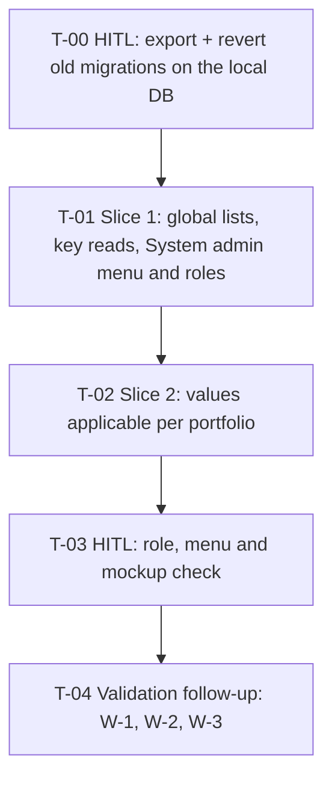

# Tasks — Changes / Control Lists: global lists read by key, values applicable per portfolio

- **Module:** control-lists — server + client
- **Spec id:** 2026-10-control-lists-global-scope
- **Status:** executed (T-00…T-03 done, 2026-10-14)
- **Owner:** Hector F. Tobón (requester); implementers assigned by `/akili-execute`
- **Linked requirements:** [`./requirements.md`](requirements.md)
- **Linked design:** [`./design.md`](design.md) (judgment: [`./judgment.md`](judgment.md) — ESCALATED; R3-1/R3-2 corrected by requester decision, §10)
- **Branch:** `institutional-kpis`
- **Jira:** epic AC-1773 — sub-tasks `<TO CONFIRM>`
- **Last updated:** 2026-10-13

> **Legend.** *Falsifier* = the concrete input or mutation that must turn the gate red. *Red run* = what must be observed failing, and on which assertion. *Disqualifier* = what makes a green reading worthless. *Consumers* = existing files that pin a symbol the task changes. An absent value reads `n/a`, never blank.

> **Slice rule (as D-CTL-16).** T-01 and T-02 each deliver database + server + screen, executed as one server dispatch and one client dispatch in parallel (cross-package editing is safe — root `CLAUDE.md` §4.3). The client codes against design §4 with a mocked `ApiService`. One Reviewer audits the combined diff; the Leader re-measures both full suites after both workers report. A task closes only when both halves pass.

> **Evidence database.** `server/researchindicators/.env` → `ARI_MYSQL_*` and `ARI_TEST_MYSQL_*` both resolve to the requester's local DB `127.0.0.1:3306/stardb` (checked 2026-10-13; a restored STAR backup). Rules carried from the archive: verify the **resolved** host before each run; **never** run `migration:test:bootstrap` or `baseline:test:load`; tests clean up every row they create and never touch seeded rows (ids ≤ 2 / ≤ 6 / ≤ 23); the shared Dev DB is never evidence.

---

## 1. Dependency graph and PR plan

| PR | Task | What a user can do after it |
| --- | --- | --- |
| — | T-00 | Nothing visible; the local DB is ready for the rewritten migrations |
| **PR 1** | T-01 | Admin / Technical Support open *System admin › Control Lists*, see every list without a portfolio, keys shown alone; Center Admin no longer sees it |
| **PR 2** | T-02 | Restrict a value to portfolios, see *Applies to*, filter by portfolio; consumers read values for a portfolio |
| — | T-03 | Human check; no code |

T-02 depends on T-01 (same files, the link migration `…003` follows `…002`). Both PRs may also ship as one PR (design §14) if the requester prefers; the task boundary stays.

---

## 2. Task list

### T-00 — HITL: prepare the local database

- **Status:** done (2026-10-13 — see `execution.md` T-00) · **Size:** S · **Dependencies:** none · **Owner:** requester (human decision — root `CLAUDE.md` §4.3)
- **Requirements covered:** R-CLG-006 *Old local schema* (the revert half), the "export first" rule of requirements §11
- **Design refs:** §3.1 (revert by name, one local DB)
- **Scope:** no code. Run **before** the migration files are rewritten, so each `down` matches what the DB recorded.
  1. Check `server/researchindicators/.env`: `ARI_MYSQL_HOST` and `ARI_TEST_MYSQL_HOST` = `127.0.0.1`, name `stardb`. If either is not local, stop.
  2. Export any hand-made control-list rows to keep (page *Export .xlsx*, or `SELECT * FROM control_list_values WHERE id > 23` and the same for lists > 6 and categories > 2).
  3. From `server/researchindicators`: `npm run migration:revert`, repeated **until** `1790900000000-createControlListCategories` is reported reverted (read each output's reverted name; expect `…002`, `…001`, `…000`).
  4. Check: `SHOW TABLES LIKE 'control_list%'` → empty; `npm run typeorm migration:show -- -d ./src/db/config/mysql/orm.config.ts` lists the three as pending (ANSI stripped — K-014).
- **Falsifier:** stopping after two reverts → `SHOW TABLES` still lists `control_list_categories`.
- **Disqualifier:** a revert output that names any migration other than the three control-list ones means the order is not what was assumed — stop and report; reading "0 pending" from an unstripped `migration:show` is not evidence (K-014).
- **Consumers:** n/a
- **Review:** none (human step); the requester pastes the four outputs into `execution.md`.
- **Done criteria:**
  - [x] Hosts confirmed local (quoted, host/name only).
  - [x] Export done or "nothing hand-made" stated.
  - [x] Three reverts quoted by name; `SHOW TABLES` empty; `migration:show` pending ×3. *(Actual: four reverts — `CreatePrmsWebhookDeliveryTable` (id 369, 0 rows) sat between `…001` and `…000` by id; pending ×4. Requester-approved — `execution.md` T-00 D-EX-1.)*

### T-01 — Slice 1: global lists, reads by key, System admin menu and roles

- **Status:** done (2026-10-13 — see `execution.md` T-01) · **Size:** L · **Dependencies:** T-00
- **Requirements covered:**
  - R-CLG-001 — *One set of lists for everyone* (incl. **BUT** must NOT require or accept a portfolio on A1); *Stale caller* (incl. **AND IT MUST NOT** create or change any row); AC.1, AC.2 (A1, A3, A4, A6, A7).
  - R-CLG-002 — *Duplicate name in any letter case* (incl. **AND IT MUST** be enforced by a DB unique index); AC.1.
  - R-CLG-003 — *Duplicate key* (**BUT** must NOT create; **AND IT MUST** DB index); *Reference shown* (**BUT** must NOT show `P<id> ·` anywhere); *Move to any category*; AC.1, AC.2.
  - R-CLG-004 — *Read by key* (**AND IT MUST NOT** need a portfolio); *Value from another list* (**BUT** must NOT pass because of a shared former portfolio); AC.1 (without the portfolio filter — T-02 adds it), AC.2.
  - R-CLG-005 — *Opening the page* (**BUT** no selector or *(not configured)*); *Empty module*; AC.1, AC.2 (selector absent; the *Applies to* portfolios load arrives in T-02).
  - R-CLG-006 — *Fresh run* (categories, lists, values; **AND IT MUST** leave no `portfolio_id`); *Run twice*; *Old local schema* (rerun half); AC.1, AC.2 (link table part in T-02).
  - R-CLG-007 — *Removed endpoint*; AC.1.
  - R-CLG-008 — *Menu placement* (**BUT** not under Portfolio Management; **AND IT MUST NOT** change other items); *Technical Support allowed*; *Center Admin denied* (**BUT** must NOT change data); *Consumer read stays open*; AC.1–AC.3.
  - NFR-CLG-001, 002, 003.
- **Design refs:** §2.1 (all rows except the *Applies to* ones), §3 (categories, lists, values; seed; order), §3.1 (rerun), §4 A1–A8, A12, A13 without filter, §5 rules 1–3, §6 (header, list header, list modal), §8, §10, D-CLG-1…8, 11, P-1…P-10
- **Scope — database:** rewrite `src/db/migrations/1790900000000…002` (no portfolio; `uq_control_list_categories_name`, `uq_control_lists_key`); new `src/db/seeds/control-lists.seed.ts` (three exported seed functions, `FROM DUAL WHERE NOT EXISTS`, explicit ids, `AUTO_INCREMENT` resets); migration files export only their class. Then `npm run migration:test:execute` on the local DB.
- **Scope — server:** entities (drop `portfolio_id`); DTOs (drop `portfolioId`; empty `GetCategoriesQueryDto`; A13 DTO keeps only `activeOnly` in this slice); `control-lists.types.ts`; service (remove summaries, portfolio checks, `PortfoliosService`; module-wide duplicates; keep 1062 mapping); lookup `assertValueInList(valueId, listKey)`; controller (remove A2; roles `SYSTEM_ADMIN, TECHNICAL_SUPPORT` on A1, A3–A12; header comment `:40-44`); module (drop `PortfoliosModule`); `package.json` `collectCoverageFrom` += `!**/db/seeds/**`; delete `test/control-lists-isolation.integration-spec.ts`; rewrite the four other integration suites (no portfolio fixtures, no hand-wired portfolio providers, rows above seeded ids); new `test/control-lists-seed.integration-spec.ts`; kaizen consumer-guide text (`docs/specs/kaizen/institutional-performance--control-lists.md:106,136`).
- **Scope — screen:** move the page folder to `pages/platform/pages/administration/configuration/control-lists/`; component (remove `portfolioSummaries`, `selectedPortfolioId`, `portfolioOptions`, `selectPortfolio`, `resolveDefaultPortfolioId`, `refreshPortfolioSummaries` and the A2 call); template (no `p-select`; `Key: <key>`; key hint); `control-lists.interface.ts` (drop `portfolioId`, `ControlListPortfolioSummary`); `api.service.ts` (`GET_ControlListCategories()`, delete `GET_ControlListPortfolioSummaries`); `alliance-sidebar.component.ts` (item under *System admin* after *Prompt Manager*; remove `children` from Portfolio Management); `app.routes.ts` (`administration/configuration/control-lists`, `appConfigurationGuard`; old route removed); specs: page, sidebar (synthetic nested group), `app.routes.spec.ts`, guard with real `RolesService`.
- **Tests:**
  - **Server unit (real `ValidationPipe`):** A1 with no params passes; `portfolioId` → 400 on A1 query and A3, A4, A6, A7 bodies, with no repository write; duplicate category name / list key (other letter case) → 409 via pre-check, and with the pre-check stubbed → 409 via simulated errno 1062; lookup pass / other list 400 / unknown 404; controller roles metadata `[SYSTEM_ADMIN, TECHNICAL_SUPPORT]` on A1, A3–A12 (iterate every handler), none on A13; route inventory without A2; `GlobalExceptions` envelope for the new 400/409.
  - **Server integration (local DB):** `migration:show` lists the three control-list migrations with no loader error after the refactor; `SHOW COLUMNS … LIKE 'portfolio_id'` empty on both tables; `SHOW INDEX` → `Non_unique = 0` for both unique indexes; raw duplicate `INSERT` → errno 1062; seed suite: call the seed functions again → 0 affected rows, ids 1–2 / 1–6 / 1–23 with their keys and codes; A13 by key without portfolio → ordered values; a Technical Support token → 201 on A10; a Center Admin token → 403 on A3 and nothing written.
  - **Client unit:** no selector and no `P<n> ·` text rendered; A2 never called; categories load with one call; 409 on key shown inline; four UI states; sidebar: item only under *System admin* (expanded and flyout), exact arrays of the other items unchanged; nested rendering covered with a synthetic group; `app.routes.spec.ts`: new path with `appConfigurationGuard`, old path absent; guard with real `RolesService`: `[1]` and `[7]` admitted, `[9]` (focus 1) denied.
  - **Sweeps:** `grep -rniE "portfolio"` over the server module, `src/db/migrations/17909000000{00,01,02}*`, `src/db/seeds/control-lists.seed.ts`, `test/control-lists-*`, the client page folder, `control-lists.interface.ts`, the control-list methods of `api.service.ts` → each hit listed and justified (expected: none in this slice); `grep -rn "center-admin/control-lists" client/research-indicators/src` → 0.
- **Falsifier:**
  1. Export a `seed…` function from a migration file → `migration:show` fails with "migration name is wrong".
  2. Remove `WHERE NOT EXISTS` from one seed → the seed suite sees affected rows > 0.
  3. Drop `uq_control_lists_key` in the migration → raw duplicate insert succeeds; `SHOW INDEX` empty.
  4. Delete the empty `GetCategoriesQueryDto` from A1 → the `portfolioId` → 400 test passes the request through (fails).
  5. Leave `CENTER_ADMIN` on one handler → roles-metadata test fails.
  6. Keep the old route → `app.routes.spec.ts` old-path assertion fails.
  7. Render the Control Lists item in both groups → sidebar exact-array test fails.
- **Red run:** each falsifier observed failing on its own assertion (loader error, affected-row count, errno, status, roles array, route list, DOM array) — not on setup — then reverted.
- **Disqualifier:** any run against a non-local host; a `migration:show` count read with ANSI codes or from a failed command (K-014); an HTTP duplicate used as the uniqueness proof (it only proves the pre-check); a guard test with a boolean-mocked `RolesService`; `arrayContaining` for sidebar order; `npm test` green without `ng build` (moved folder, imports).
- **Consumers:** `alliance-sidebar.component.spec.ts:301-366` (nested tests use Control Lists today); `app.routes.spec.ts:88-122`; `control-lists.component.spec.ts`; `testing/mock-services.mock.ts` (grep `ControlList`); `entities.module.spec.ts:83-86`, `main.routes.spec.ts:41-48` (re-run only); every `test/control-lists-*.integration-spec.ts`.
- **Review:** `full` — authorization change, schema rewrite, shared sidebar and routes.
- **Skills:** nestjs-expert, api-design-principles, error-handling-patterns (server); angular-developer, ui-ux-pro-max (client); systematic-debugging on any failure.
- **Done criteria:**
  - [x] `migration:test:execute` output quoted; schema checks (columns, indexes) quoted; seed suite green.
  - [x] Server: `npm test -- --silent`, `npm run test:integration -- control-lists`, `npx eslint src/domain/entities/control-lists src/db/seeds`, `npm run build`. Client: `npm test -- --silent`, `npm run lint -- --quiet`, `ng build`. *(Server full suite: 3 failures = archive baseline.)*
  - [x] Falsifiers 1–7 each observed red, then reverted. *(F2 red was a PK-duplicate rejection, not an affected-row count — execution.md T-01.)*
  - [x] A1, A3–A13 in `/swagger` with the new roles and without `portfolioId` on A1 (local boot; quote what was seen). *(Reduced boot: real controller with `main.ts` Swagger config; full `main.ts` would consume the shared RabbitMQ queue — D-EX-4.)*
  - [x] Sweeps quoted with their hit lists. *(`center-admin/control-lists` = 5 spec-only negative assertions, not 0 — D-EX-3.)*

### T-02 — Slice 2: values applicable per portfolio

- **Status:** done (2026-10-14 — see `execution.md` T-02) · **Size:** L · **Dependencies:** T-01
- **Requirements covered:**
  - R-CLG-009 — *Value for one portfolio only* (**BUT** must NOT return the restricted value for Portfolio 1); *No filter*; *Restricting a value already in use* (**AND IT MUST** keep those records valid); *Unknown portfolio*; *Portfolio deactivated after linking* (**AND IT MUST NOT** be returned for any portfolio nor shown as "all"); *Partial save impossible*; AC.1–AC.5.
  - R-CLG-004 AC.1 — the optional `portfolioId` filter on A13.
  - R-CLG-005 AC.2 — portfolios loaded only for *Applies to*.
  - R-CLG-006 AC.2 — the link-table part (table exists).
- **Design refs:** §2.1 *Applies to* rows (link entity/repository, value DTOs incl. update `@ValidateIf` — R3-1, service validators, A13 DTO/controller), §3 link table and soft-delete rules, §4 A9–A11, A13, §5 rules 4–5, §6 values table / value modal / load, §10, D-CLG-9, 10, 12, 13, 14
- **Scope — database:** new `src/db/migrations/1790900000003-createControlListValuePortfolios.ts` (link table, CASCADE to values, RESTRICT to portfolios, PK pair, portfolio index); `migration:test:execute`.
- **Scope — server:** link entity + repository; create DTO `portfolioIds` with `@ValidateIf` (no `@IsOptional`); update DTO `'portfolioIds'` in `PickType` **and** its own `@ValidateIf`; A13 DTO optional `portfolioId`; types `appliesTo`/`appliesToAll`; service: `DataSource` injected, `assertPortfolioIdsValid` (400, active ids), `assertFilterPortfolio` (404), transactional value write + link replace, A9 batch link load (active only), A13 `QueryBuilder` with `Brackets`, `Number()` coercion; controller A13 `@ApiQuery required:false` + summary; module registers the link entity and a read-only portfolio lookup.
- **Scope — screen:** load active portfolios in parallel with A1 (failure disables the field); values table **Applies to** column (*All* / names / *No active portfolio*) and *Show values for* filter (same rule as A13); value modal **Applies to** checkbox group, sending `portfolioIds` (`[]` when none); export includes the column; interfaces gain `appliesTo`, `appliesToAll`, `portfolioIds`.
- **Tests:**
  - **Server unit (real `ValidationPipe`):** `portfolioIds` `null`, `[1,1]`, `["a"]`, `[0]` → 400 on **A10 and A11**; omitted and `[]` accepted on both; inactive / unknown id → 400 naming `portfolioIds`; A13 unknown or inactive portfolio → 404; create / replace / clear / omitted-unchanged link behavior; a links-only A11 stamps the value's audit fields.
  - **Server integration (local DB):** `SHOW TABLES LIKE 'control_list_value_portfolios'` → 1; *Value for one portfolio only* fixture on real SQL — `portfolioId=1`, `=2`, none, each with `activeOnly` true/false; deleting a restricted value removes its links; atomicity — force the link insert to fail inside the transaction → value row unchanged; deactivate a linked portfolio (`is_active = 0`, restored after) → A9 omits it, `appliesToAll = false`, A13 for it → 404.
  - **Client unit:** column labels for all / restricted / no-active; filter result equals the A13 rule on a shared fixture; modal sends `portfolioIds` (`[]` when none ticked) and pre-ticks on edit; portfolios-call failure disables field and filter with the note; export rows include *Applies to*.
- **Falsifier:**
  1. Write the A13 condition without `Brackets` (`… AND activeOnly OR link`) → the P1 + `activeOnly=false` case returns an inactive restricted value.
  2. Add `@IsOptional` to the create DTO → `null` on A10 passes.
  3. Remove the update DTO's own `@ValidateIf` → `null` on A11 passes.
  4. Save value and links outside the transaction → atomicity test finds the value changed.
  5. Treat "no active links" as "all" → the deactivated-portfolio test returns the value for P1.
- **Red run:** each falsifier observed failing on its own assertion (row set, status, value row, filtered list), then reverted.
- **Disqualifier:** a filter test on a mocked `QueryBuilder` (cannot show operator precedence — KZ-001, KZ-017); a fixture where every value is unrestricted (cannot tell filter from no filter); a portfolio left inactive after the test; any non-local host.
- **Consumers:** the T-01 versions of the service, controller, DTOs, page and their specs; `portfolios` table (read-only).
- **Review:** `full` — new table, transaction, filter semantics.
- **Skills:** nestjs-expert, api-design-principles, error-handling-patterns (server); angular-developer, ui-ux-pro-max (client); systematic-debugging on any failure.
- **Done criteria:**
  - [x] `migration:test:execute` output and `SHOW CREATE TABLE control_list_value_portfolios` quoted.
  - [x] Same command set as T-01, all green; falsifiers 1–5 observed red, then reverted. *(Server full suite: 3 failures = archive baseline. F1 failed on a different case than predicted — the prediction was wrong; see execution.md T-02.)*
  - [x] A9–A11, A13 in `/swagger` with `portfolioIds` / optional `portfolioId`. *(Reduced boot as D-EX-4; full-app `/swagger` owed at T-03.)*
  - [x] Final leftover sweep: only *Applies to* / filter hits, each listed.

### T-03 — HITL: roles, menu and mockup

- **Status:** done (2026-10-14 — see `execution.md` T-03) · **Size:** S · **Dependencies:** T-02 · **Owner:** requester
- **Requirements covered:** R-CLG-008 *Center Admin denied* / *Technical Support allowed* in a real browser; R-CLG-005 / R-CLG-009 UI against the mockup; requirements §10 *Mockup drift*
- **Design refs:** §6, §10 *Manual*
- **Scope:** local app (`docker compose` or native, pointing at the local DB):
  1. As a user with only Center Admin: *System admin* group absent; `/administration/configuration/control-lists` redirects; old `/administration/center-admin/control-lists` does not open the page.
  2. As Technical Support (or Admin): item under *System admin* after *Prompt Manager*; lists load; `Key:` shown; create a list with a duplicate key → inline 409.
  3. On `kpi.direction`: restrict *Maintain within range* to Portfolio 2; *Show values for* P1 hides it, P2 shows it; column shows *P2 only*; export contains the column; then set it back to all.
  4. Side-by-side with artboard 1 (https://claude.ai/artifact/EPtLbFVhaEQb3Vgq7kuyRP).
- **Falsifier:** n/a (human observation).
- **Disqualifier:** a check done as Admin for step 1 (Admin bypasses); quoting "it works" without saying which step and which user (KZ-002 — quote what was observed).
- **Done criteria:**
  - [x] Each step quoted with the user role used and what was seen.
  - [x] Mockup differences listed (or "none"). *(Requester: minor differences, accepted, not itemized — execution.md T-03.)*

### T-04 — Validation follow-up: W-1, W-2, W-3

- **Status:** todo · **Size:** S · **Dependencies:** T-03 · **Origin:** `validation-report.md` §11, requester decision 2026-10-14 ("1 — fix all")
- **Requirements covered:** R-CLG-009 AC.2 ("empty means all") for a value linked only to inactive portfolios (W-1); R-CLG-009 *Restricting a value already in use* "THEN the change is saved (200)" + "AND IT MUST keep those records valid" (W-2); design §10 *Migration loading* "lists the four control-list migrations" (W-3).
- **Design refs:** §6 *Value modal* (2026-10-14 sub-bullet), §10, D-EX-5.
- **Scope — client (W-1):** in the value modal, when editing a value with `appliesToAll = false` and `appliesTo = []`:
  - show a state-specific hint, and no "none ticked = all" text;
  - add an explicit **Apply to all portfolios** action that sends `portfolioIds: []`;
  - keep the D-EX-5 omission when the selection is untouched.
  - Specs assert on rendered DOM: the hint text in that state; the action → PATCH body `portfolioIds: []`; untouched save → key omitted (existing test kept); ticking a portfolio → that set. No change to other states.
- **Scope — server (W-2, W-3):**
  - **W-2:** one integration test in `test/control-lists-usage.integration-spec.ts`. On a value with `inUse > 0` from the registered provider, PATCH `portfolioIds` → 200, links replaced, and `assertValueInList` still passes for that value.
  - **W-3:** widen the migration-loader test in `test/control-lists-seed.integration-spec.ts` to `…000–…003`, with an expected list of four, and fix its header/comment (including T-01 A-ADV-4: both error forms named).
- **Falsifier:**
  1. Restore the W-1 omission for the explicit action (send nothing) → the `[]` body test fails.
  2. Show the generic hint in the inactive-only state → the hint test fails.
  3. Make `updateValue` reject an in-use value's `portfolioIds` (temporary 409) → the W-2 test fails.
  4. Drop `…003` from the expected loader list while the glob includes it → the loader test fails.
- **Red run:** each falsifier observed failing on its own assertion, then reverted.
- **Disqualifier:** a component-instance assertion instead of DOM/payload (KZ-001); a W-2 fixture whose value is not actually in use (`inUse = 0`); any non-local DB host.
- **Consumers:** `control-lists.component.spec.ts` (`applies to (R-CLG-009)` block), `test/control-lists-usage.integration-spec.ts`, `test/control-lists-seed.integration-spec.ts`.
- **Review:** `light` — one Reviewer over the combined diff.
- **Skills:** angular-developer, ui-ux-pro-max (client); nestjs-expert (server); systematic-debugging on failure.
- **Done criteria:**
  - [ ] Client targeted specs + `npm run lint -- --quiet` + `ng build` green; falsifiers 1–2 red then reverted.
  - [ ] Server `npm run test:integration -- control-lists` + eslint green; falsifiers 3–4 red then reverted.
  - [ ] Leader full suites (server, client) match the baseline.

---

## 3. Coverage closure (scenario and clause level)

| Requirement · scenario / clause | Task |
| --- | --- |
| R-CLG-001 *One set of lists* · BUT no portfolio on A1 | T-01 |
| R-CLG-001 *Stale caller* · AND IT MUST NOT write | T-01 |
| R-CLG-002 *Duplicate name* · AND IT MUST DB index | T-01 |
| R-CLG-003 *Duplicate key* · BUT not created · AND IT MUST DB index | T-01 |
| R-CLG-003 *Reference shown* · BUT no `P<id> ·` | T-01, T-03 |
| R-CLG-003 *Move to any category* | T-01 |
| R-CLG-004 *Read by key* · AND IT MUST NOT need a portfolio | T-01 |
| R-CLG-004 *Value from another list* · BUT not via former portfolio | T-01 |
| R-CLG-004 AC.1 optional filter | T-02 |
| R-CLG-005 *Opening the page* · BUT no selector | T-01, T-03 |
| R-CLG-005 *Empty module* | T-01 |
| R-CLG-005 AC.2 portfolios only for *Applies to* | T-02 |
| R-CLG-006 *Fresh run* · AND IT MUST no `portfolio_id` | T-01 (+ link table T-02) |
| R-CLG-006 *Run twice* | T-01 |
| R-CLG-006 *Old local schema* · BUT skipped revert detected | T-00 (revert), T-01 (checks) |
| R-CLG-007 *Removed endpoint* | T-01 |
| R-CLG-008 *Menu placement* · BUT not under PM · AND IT MUST NOT change others | T-01, T-03 |
| R-CLG-008 *Technical Support allowed* | T-01, T-03 |
| R-CLG-008 *Center Admin denied* · BUT no data change | T-01, T-03 |
| R-CLG-008 *Consumer read stays open* | T-01 |
| R-CLG-009 *Value for one portfolio only* · BUT not for P1 | T-02, T-03 |
| R-CLG-009 *No filter* | T-02 |
| R-CLG-009 *Restricting a value already in use* · AND IT MUST keep records valid | T-02 |
| R-CLG-009 *Unknown portfolio* | T-02 |
| R-CLG-009 *Portfolio deactivated after linking* · AND IT MUST NOT be offered or shown as all | T-02 |
| R-CLG-009 *Partial save impossible* | T-02 |
| NFR-CLG-001 (DB uniqueness) | T-01 |
| NFR-CLG-002 (regression) | T-01, T-02 (full suites) |
| NFR-CLG-003 (Swagger) | T-01, T-02 |

---

## 4. Risks & blockers log

| # | Date | Risk / Blocker | Mitigation | Owner | Status |
| --- | --- | --- | --- | --- | --- |
| RB-1 | 2026-10-13 | Judgment Day ended ESCALATED; R3-1/R3-2 corrected by requester decision without a third judgment | T-02 falsifiers 2–3 make the `null` rule observable red | Leader | closed 2026-10-14 — T-02 falsifiers 2–3 observed red |
| RB-2 | 2026-10-13 | `migration:show` loader gate reasoned from TypeORM source, red not observed (K-004) | T-01 falsifier 1 | Leader | closed 2026-10-13 — T-01 falsifier 1 observed red |
| RB-3 | 2026-10-13 | `organizational-structure` waits on this spec | After T-03: update its design (Q-1, D-ORG-3, R-ORG-011, P-2, P-12) and resume it | Leader | open |

## 5. Done definition

- [x] T-00…T-03 done.
- [x] T-03 human check done **before** `/akili-validate` (KZ-007).
- [ ] Every row of §3 closed with evidence in `execution.md`.
- [x] Coverage thresholds green; Swagger updated. *(validation-report.md §5: server 90.49% stmts; Swagger seen at T-03.)*
- [ ] RB-3 follow-up done.
