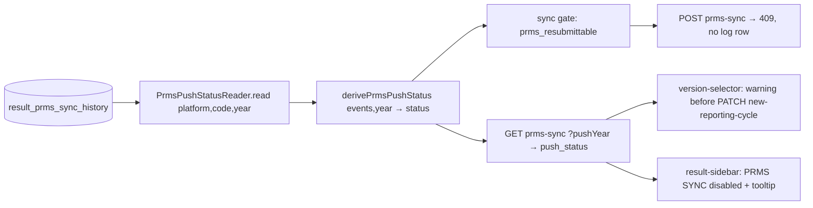

# Design — PRMS / Pending-review lock

- **Module:** result-prms-sync (server) · version-selector + result-sidebar (client)
- **Spec id:** 2026-11-prms-pending-review-lock
- **Status:** draft — Judgment Day round 1 corrections applied (see `judgment.md`)
- **Depth:** Standard · **Approval Mode:** gated
- **Linked requirements:** ./requirements.md · **Linked proposal:** ./proposal.md · **Review:** ./judgment.md
- **Linked TRD:** ../../../trd/trd.md (result-prms-sync, prms-webhook)
- **Verified at:** `3e5f2b85c` (code) · shared Dev DB, read-only, 2026-11-19 (data)
- **Last updated:** 2026-11-19

## 0. Executive summary

There is **one pure rule**, `derivePrmsPushStatus`. It takes the history events of one result (platform + code) and a target year. It returns `never_pushed | pending_review | approved | rejected`. The flag `resubmittable` is true only for `never_pushed` and `rejected`.

Three choices make the rule hold against the real data:

1. **Each event carries the year it belongs to.**
   - A push uses the year STAR pushed.
   - A PRMS decision uses the **phase year PRMS reports in its callback** (`data.obj_version.phase_year`).
   - The decision does **not** take the year the correlator copied from the live row, which moves when the result is updated (JD-S1).
2. **Order is by `id`, with imported rows always first.** Rows re-written by the PRMS as-STAR import can never outrank a real push or a real callback (JD-C1).
3. **The last relevant event decides.**

Three surfaces consume the rule, and none of them re-derives it:

1. **Server gate.** A new entry, `prms_resubmittable`, sits right after `not_already_synced`. It returns 409 and writes no log row. It is the authority (R-PRL-002).
2. **Read surface.** The existing `GET results/:code/prms-sync` gains an optional `pushYear` query parameter and a `push_status` response block (R-PRL-003).
3. **Client:**
   - The version selector reads that block after a year is chosen and warns when the year is held (R-PRL-004).
   - The sidebar disables PRMS SYNC with a tooltip (R-PRL-005).

There is no schema change and no migration.

## 1. Goals & non-goals

- **Goals:** R-PRL-001 … R-PRL-005 (S-1 … S-27), NFR-PRL-001 … 004.
- **Non-goals:**
  - Unlocking a stuck review.
  - The Pooled Funding Monitor's `derivePrmsStatus` (R-3).
  - The sidebar card and history modal ordering (R-2).
  - Any change to `is_synced_to_prms` writes, to `SP_versioning`, to the correlator, or to the import.
  - The TIP / PRMS-platform **UI** path. The server gate does reach the TIP cron (§5.2).

## 2. Architecture

### 2.1 Composition

| File | New/changed | Responsibility |
|---|---|---|
| `server/.../result-prms-sync/eligibility/prms-push-status.ts` | **new** | The pure rule `derivePrmsPushStatus(events, year)`, the `PrmsPushEvent` type and the `PrmsPushStatus` type. No I/O |
| `server/.../result-prms-sync/prms-push-status.reader.ts` | **new** | One SQL read of a result's history events (§5.1.5), then the rule. Injected into the log repository (gate) and into the status reader (read surface) |
| `server/.../result-prms-sync/eligibility/sync-gate.ts` | changed | `SyncGateSnapshot.prms_push_status` and the new entry `prms_resubmittable` |
| `server/.../result-prms-sync/repositories/result-prms-sync-log.repository.ts` | changed | `loadGateSnapshot` fills `prms_push_status` for the resolved row's key |
| `server/.../result-prms-sync/result-prms-sync-status.reader.ts` + controller `getStatus` | changed | Optional `pushYear` query parameter and the `push_status` response block |
| `server/.../result-prms-sync/result-prms-sync.service.ts` | changed | A gate refusal is thrown as a typed `PrmsSyncNoRowRefusalException(status, description, entryId)` instead of the plain exception from `throwHttp`, so the entry id survives to the controller (§5.2) |
| `server/.../result-prms-sync/result-prms-sync.controller.ts` | changed | Reads `entryId` from that exception; `noRowRefusalData` gains an optional `gate_entry_id` (§5.2) |
| `server/.../result-prms-sync/dto/prms-sync.dto.ts` | changed | `PrmsPushStatusDto`, `push_status` on the status DTO, and `gate_entry_id` on the response data |
| `server/.../result-prms-sync/result-prms-sync.module.ts` | changed | Provides the new reader |
| `client/.../shared/interfaces/prms-push-status.interface.ts` | **new** | Client shape of `push_status` |
| `client/.../shared/services/api.service.ts` | changed | `GET_PrmsPushStatus(resultCode, year?)` with `noCache` |
| `client/.../pages/result/components/version-selector/version-selector.component.{ts,html}` | changed | Read status → warning or submit; busy state |
| `client/.../shared/components/result-sidebar/result-sidebar.component.{ts,html}` | changed | Push-status fetch, `prmsHeldByPrms`, tooltip and disabled state, 409 handling |

### 2.2 Reuse

Reused unchanged:
- `ResultsUtil`, `@GetResultVersion()`, `RolesGuard`, `ResultOwnerGuard`, `SetUpInterceptor`, `ResponseUtils.format`.
- The controller's `isNoRowRefusalStatus`, which already maps 409 to the no-row envelope.
- `ActionsService.showGlobalAlert` with `severity: 'warning'`.
- The sidebar's existing failure modal.

## 3. Data model

No data model changes. The design reads `result_prms_sync_history`, which **three** writers fill (D-1, corrected):

| Writer | Rows | How a row is told apart (P-9) | Year it stores |
|---|---|---|---|
| sync-engine `recordOutboundPendingReview` | STAR `PENDING_REVIEW` on every ACCEPTED push | `event_source='STAR'`, `raw_headers IS NULL` | The pushed version's year (correct) |
| decision-webhook (callback + detached correlator) | PRMS `APPROVE`/`REJECT` | `raw_headers` holds the allowlisted callback headers (non-empty). `delivery_id` is usually set but is null when PRMS omits the header | The live row's year when the correlator runs (**can be wrong**, P-3). The callback's own `raw_body.data.obj_version.phase_year` is correct |
| PRMS as-STAR import `replaceImportedHistory` | STAR `PENDING_REVIEW` + PRMS decision, rewritten on each run | `delivery_id IS NULL AND raw_headers = JSON_OBJECT()` | The imported result/year (its own key) |

## 4. API surface

### GET /api/results/:result-code/prms-sync (existing, extended)

- **Controller:** `getStatus`. Roles, `ResultOwnerGuard`, `@GetResultVersion()` and `SetUpInterceptor` are unchanged (R-PRL-003).
- **New query parameter:** `pushYear`.
  - Optional integer, camelCase like `reportYear`, declared with `@ApiQuery`.
  - It is parsed inside the handler's existing `try`, so a bad value returns a 400 **inside the standard envelope**.
  - It is valid only if it is an integer from 1901 to 2155, the MySQL `YEAR` range.
  - It is distinct from `reportYear`:
    - `reportYear` still resolves *which row* passes the guards;
    - `pushYear` only names *which year's push status* to compute (P-4, DD-5).
- **Response:** the existing status DTO plus `push_status: { year: number; status: 'never_pushed' | 'pending_review' | 'approved' | 'rejected'; resubmittable: boolean }`.
  - Platform and code come from the resolved row. The platform is `COALESCE(results.platform_code,'STAR')`, the same as `LAST_DECISION_SQL`.
  - Year is `pushYear`, else the resolved row's `report_year_id`.
- **Errors:**
  - A bad `pushYear` returns 400.
  - A year with no history returns 200 with `never_pushed` (S-12).
  - A failed history read returns 500 through the existing catch.
- **Non-breaking:** the change is additive, and the endpoint has no client consumer today (P-5).

### POST /api/results/:result-code/prms-sync (existing, behaviour change)

- When the resolved row's key is not resubmittable, the response is 409 with the description from §5.2.
- `data` is `noRowRefusalData(description, entryId)`. The service throws gate refusals as `PrmsSyncNoRowRefusalException` carrying `gate.entryId` (today `throwHttp` drops it, and five different refusals share 409). The controller copies it into `gate_entry_id`. Refusals that are not gate entries (claim collision, already synced inside the lock) leave it `null`.
- *Amended 2026-11-19 (T-02, execute-time):* every no-row gate refusal now throws `PrmsSyncNoRowRefusalException`, not only the 409s, so each carries its own `gate_entry_id`. The 404 `result_exists` refusal keeps its status and text. The 503 `feature_enabled` refusal keeps its status and text, and also gains `noRowRefusalData` in `data`, which it did not have before. This is additive. TIP still counts these refusals as `notSent`.
- Nothing is written to `result_prms_sync_log`, and the Normalizer is not called (S-7).

## 5. Workflows & business rules

### 5.1 The rule (R-PRL-001)

1. **Event shape and contract.** The reader yields one event per relevant row:
   - `{ kind: 'push' | 'decision', decision: 'APPROVE' | 'REJECT' | null, year: number, imported: boolean }`.
   - *Amended 2026-11-19 (T-01, execute-time):* the rule's input type widens `decision` to `string | null`, so the "unknown verb" unit test (S-6) can feed a verb the rule must ignore. The reader still emits only `'APPROVE' | 'REJECT' | null`.
   - The input array is **already in `id` ascending order**, the order the SQL returns. The rule never compares ids. Unit tests feed sequences in `id` order and include one whose timestamps disagree (698).
2. **Event year:**
   - A push uses `result_year`.
   - A decision uses `raw_body.data.obj_version.phase_year`, falling back to `result_year` only when the callback has none (imported rows have `raw_body = {}`).
   - This settles S-26: a REJECT for 2026 that arrives after the live row moved to 2027 still counts for 2026.
3. **Relevant rows:**
   - A push is `event_source='STAR' AND status='PENDING_REVIEW'`.
   - A decision is `event_source='PRMS' AND decision IN ('APPROVE','REJECT')`. These are the only verbs any writer stores (P-11); `APPROVED`/`REJECTED` are `status` badges (S-6).
   - Every other row is ignored.
4. **Order and result:**
   - Keep the events whose year equals the target year.
   - Sort them by `(imported DESC, id ASC)`: every imported row comes before every real row, and inside each group the order is `id` order (P-1, P-9). This settles S-5 and S-27.
   - The **last** event decides:
     - none → `never_pushed`;
     - a push → `pending_review`;
     - APPROVE → `approved`;
     - REJECT → `rejected`.
   - A push after a REJECT re-locks the year (S-3).
   - **Resubmittable** is `never_pushed` or `rejected`.
5. **SQL (`PUSH_EVENTS_SQL`):**
   - Flat ANDs, no OR (KZ-017):
     - `h.platform_code = ?` (strict; the value is bound from the resolved row);
     - `h.result_official_code = ?` (bound as a **string**, P-6);
     - `h.is_active = TRUE`, `h.duplicate_of_id IS NULL`, `h.correlation_outcome = 'CORRELATED'`.
   - It projects `event_source`, `status`, `decision`, `result_year`, and:
     - `phase_year` = `CAST(JSON_UNQUOTE(JSON_EXTRACT(raw_body,'$.data.obj_version.phase_year')) AS UNSIGNED)`, so a year PRMS sends as a string still compares as a number (PRMS sends `obj_version.id` as a string);
     - `imported` = `(delivery_id IS NULL AND raw_headers IS NOT NULL AND raw_headers = JSON_OBJECT())`. This is never NULL: a push (`raw_headers` NULL) gives 0.
   - The reader coerces both with `Number()`. The fixture asserts `imported = 0` for a push.
   - It returns **every year** for the result. The year is filtered in the pure rule, because a decision's year is not a column.
   - `ORDER BY id ASC` runs in SQL, and nothing else does: no SQL `ORDER BY imported`. `id` is a `bigint`, which mysql2 returns as a string, so JavaScript never compares ids. The reader keeps the SQL order and stable-sorts only on `imported` (`Array.prototype.sort` is stable) (P-12).
   - It does not read `result_status_id`, `is_synced_to_prms` or `result_prms_sync_log` (S-6).
6. **Accepted limitation (re-import never unlocks).** Imported rows always rank below real ones. So if a real push's callback is lost (proposal R-1) and a later import brings PRMS's REJECT, the year stays `pending_review`. Letting the import win would need a cross-source timestamp comparison, which S-5 forbids. This is consistent with the owner's no-unlock decision. A stuck year is the same accepted risk as R-1.
7. **Not counted:** a callback that never correlated (`MALFORMED`, `NO_REFERENCE`, `UNKNOWN_REFERENCE`) is not counted. Such a callback has no STAR result to lock, so the filter is intended.

### 5.2 Gate entry (R-PRL-002)

- **Position:** after `not_already_synced` and before `reporting_year` (S-10). `not_already_synced` keeps precedence.
- **Properties:**
  - `httpStatus` 409, `persistsRow: false`.
  - `fails` = `prms_push_status` is present and `!resubmittable`. An absent value passes, which keeps old snapshot literals compiling (JD-12 pattern).
- **Descriptions:**
  - Pending: *"This result cannot be resubmitted to PRMS: its PRMS status is Pending Review. Only results rejected in PRMS can be resubmitted."*
  - Approved: the same sentence with *Approved*.
- **Read failure: fail-closed.** `loadGateSnapshot` does **not** catch the history read. An error propagates as a 500, and no PRMS call runs. The server gate is the authority (NFR-PRL-003), so it never passes on a read it could not do.
  - The read runs only when the snapshot found a row. Even so, while the history table is unreadable, a request that `feature_enabled` would have refused with 503 also gets a 500, and TIP counts it under `errors` rather than `notSent`. This is accepted, because an unreadable history table is an outage.
- **Scope:** every role, and `origin: 'TIP_SYNC'`. TIP counts an `HttpException` as `notSent` and logs a warning (P-7).
- **Concurrency:** the entry runs before the claim lock, like every other gate entry (P-10). Two pushes racing within milliseconds are still stopped by the existing in-flight collision plus `is_synced_to_prms`, and PRMS itself refuses the second one. This is accepted, not re-checked inside the lock.

### 5.3 Client — update flow (R-PRL-004)

1. **One path.** Both confirm events call one private method, `checkThenSubmit(year)`:
   - `showPrompt`'s *Yes, update {year}*;
   - `pickerAlert`'s *Confirm*.
2. **Busy state (S-20).** The global alert closes itself right after the confirm event runs (P-13), so there is no confirming button left to disable.
   - `checkThenSubmit` sets `checkingPrms` and returns early if it is already set.
   - `updateResult()` also returns early while `checkingPrms()` is set.
   - The *Update result* control is a `` today, with no disabled or loading state (`version-selector.component.html`, the *Update result* span). While `updating() || checkingPrms()` it gets:
     - `aria-disabled="true"` and `aria-busy="true"`;
     - the existing spinner icon in place of its icon;
     - a muted token class.
   - Its handler ignores clicks and Enter while busy. This is the S-20 busy state and is mapped under NFR-PRL-002.
   - Result: one GET and at most one PATCH per confirmed choice.
3. **One read.** `GET_PrmsPushStatus(code, year)`, with `noCache`.
4. **Outcomes:**
   - **Resubmittable:** `submitReportingCycle(year)`, exactly as today (S-18).
   - **Held:** `showGlobalAlert` with `severity: 'warning'`. Title and copy depend on the status:
     - Pending: *PRMS review in progress* (S-13);
     - Approved: *Already approved in PRMS* (S-15).

     *Cancel* sends nothing (S-16). *Update anyway* calls `submitReportingCycle(year)` and never blocks (S-17).
   - **Read failure** (not `successfulRequest`, or a throw): `console.error`, then `submitReportingCycle(year)`. This fails open, and the server gate still protects (S-19, DD-6).
   - `checkingPrms` clears in a `finally`.
5. **Year source.** The year is the one the user chose, never the URL's `version` (S-11). The request still uses `useResultInterceptor`.
6. **Accessibility (NFR-PRL-002).** The warning reuses the global alert, which already traps focus, closes on Esc, and shows its text before its actions. No new focusable surface is added.

### 5.4 Client — sidebar (R-PRL-005)

1. **Fetch.** `prmsHistoryEffect` also calls `GET_PrmsPushStatus(code)` with no `pushYear`, so the year is the viewed version's.
   - It uses `noCache` and its own generation counter (the `prmsHistoryFetchGen` pattern).
   - On every version change, it first sets the status signal to `null`, so one year's state never shows on another year (JD-W4).
2. **Signals:**
   - `prmsPushStatusLoading`;
   - `prmsHeldByPrms` = the read succeeded AND `!resubmittable`.
   - A failed read leaves the button as it is today; the server gate covers it.
3. **Button:**
   - Disabled while `prmsPushStatusLoading()` (no click before the answer) or `prmsHeldByPrms()`.
   - `onPrmsSync` returns early on either.
4. **Tooltip order (S-23).** The held text goes **inside the `canSyncPrms()` true branch, right before `return ''`**:
   1. already synced (unchanged);
   2. `canSyncPrms()` true and held → *Pending Review* or *Approved* copy (S-21, S-22);
   3. `canSyncPrms()` true and not held → `''`;
   4. `has_contribution === false` (unchanged);
   5. default "will become available" (unchanged).

   Every existing text keeps its conditions (JD-P1).
5. **After a sync attempt.** The status is re-fetched together with the history:
   - after a success;
   - after a 409 whose `data.gate_entry_id === 'prms_resubmittable'`, so the button turns disabled.
6. **Stale tab (S-25).** On that same 409, the failure modal shows `errorDetail.description` (escaped) instead of the generic copy. The match uses the machine field, never a prose prefix. Every other failure keeps today's copy and PRMS-rejection list.

## 6. Admin SSR panel

No impact.

## 7. Security & authorization

- No new route and no new guard. GET and POST keep `@Roles(CONTRIBUTOR, CENTER_ADMIN, SYSTEM_ADMIN)` and `ResultOwnerGuard`.
  - Admins skip the owner check.
  - `setup()` runs in `SetUpInterceptor` for everyone (P-4).
- The gate applies to **every** role, `SYSTEM_ADMIN` included (S-7). There is no override (owner decision).
- `push_status` reveals only what the caller already sees in the history modal.

## 8. Design decisions

| ID | Decision | Rejected alternative | Why |
|---|---|---|---|
| DD-1 | Order by `(imported, id)`, not by timestamps | `ORDER BY COALESCE(decided_at, occurred_at)` | Timestamps are skewed about 5 h across sources. For 698 the timestamp order is push 345 (14:42) before REJECT 344 (19:09), the reverse of reality. `id` order is right (P-1, measured). Imported rows go first because a re-import gives them new, higher ids (P-9) |
| DD-2 | The rule is pure, and SQL only selects rows | One SQL query with `ORDER BY … LIMIT 1` | Unit-testable over the 627/631/698/702 and S-26/S-27 sequences. SQL is pinned separately on a fixture (KZ-001, KZ-017) |
| DD-3 | Gate entry, `persistsRow: false`, 409 | Let PRMS answer 409 (today) | No Normalizer call and no log noise (S-7) |
| DD-4 | Extend the existing GET status | New endpoint; add to `history` | R-PRL-003 requires an existing guarded endpoint. GET status has no client consumer (P-5) |
| DD-5 | `pushYear` separate from `reportYear` | Reuse `reportYear` | `reportYear` without a snapshot makes `resultId` throw (P-4), which breaks S-12 |
| DD-6 | The client fails open on a read failure | Block the update | The owner allows the update in every case. The server gate is authoritative (NFR-PRL-003) |
| DD-7 | Show the gate 409 description in the sidebar failure modal, matched on `gate_entry_id` | Generic copy; match a prose prefix | S-25 needs the reason. A machine field does not couple the client to server wording |
| DD-8 | Decision year from the callback's `phase_year`, read at query time | Fix the correlator to write the right year; key on `prms_result_code` | PRMS keeps **one code per result across years** (owner, 2026-11-19), so the code cannot tell years apart. Changing the correlator touches a shared writer and the history UI (out of scope). Reading the phase year needs no write. 12 of 12 real callbacks carry it (P-3) |
| DD-9 | The server gate fails closed on a read error | Treat a failed read as "absent" (passes) | A silent pass would make the authoritative gate depend on a read that can fail (JD-W2) |

**Reversion challenge (Step 2.3):** none of these decisions removes, disables or inverts delivered behaviour. DD-7 narrows the generic copy only for the new 409. Nothing to run.

**KZ-016 cross-check.** Every `BUT it must NOT` clause was mapped:

| Clause | Covered by |
|---|---|
| S-5: no timestamps | DD-1 |
| S-6: no status, flag or log reads | §5.1.5 |
| S-7: no log row and no attempt-count change | DD-3 |
| S-11: no dependence on `version` | DD-5, §5.3.5 |
| S-17: never blocks | DD-6 |
| S-26: not the live row's year | DD-8 |
| S-27: imported rows never outrank real ones | DD-1 |

Module constraints were also checked: the history reader's flat-predicate note, the controller's no-row mapping, TIP's `HttpException` handling, and the global alert lifecycle. No contradiction remains.

## 9. Premise Ledger

**Count:** 13 rows: 13 verified, 0 `UNVERIFIED`. Round-2 re-judgment corrected the wording of P-9 and §3 (callback marker) and added no row.

**Blast-radius triggers:**
- `live-path` fires: *Yes, update*, *Confirm*, PRMS SYNC.
- `consumer` fires: the GET status shape, the POST refusal data, the new gate entry.
- `shared-state` does not fire. No shared service, base class or signal changes. The gate list is read only by `evaluateSyncGate`.

| # | Claim | Class | Citation (as run) | Verified at | If false | Settled by |
|---|---|---|---|---|---|---|
| P-1 | `id` order equals the real order of real events for one key; timestamps do not | data-env | Dev, read-only: `SELECT id, … FROM result_prms_sync_history WHERE result_official_code IN ('698','702') AND is_active=1 ORDER BY result_official_code, id` → 698: 339 push (occurred 11-11 16:43), 344 REJECT (11-13 19:09), 345 push (11-13 14:42). `id` order is right and `occurred_at` order is wrong | Dev 2026-11-19 | High: DD-1 falls | — |
| P-2 | Each ACCEPTED push writes **at most one** STAR `PENDING_REVIEW` row, `CORRELATED`, with the pushed year. The write is swallowed on failure | location | `prms-webhook-delivery.repository.ts` `recordOutboundPendingReview` (binds `CORRELATED`, `EVENT_SOURCE_OUTBOUND`, `OUTBOUND_STATUS_PENDING_REVIEW`, `input.resultYear`); `result-prms-sync.service.ts` `recordOutboundHistory` try/catch → log only. Requirements A-2 accepts the lost-row case | 3e5f2b85c | Low: a lost row reads as the previous state; the PRMS 409 remains the backstop | — |
| P-3 | A callback decision's `result_year` comes from the **live** row when the correlator runs, and `raw_body.data.obj_version.phase_year` carries the year PRMS decided | data-env | Code: `delivery-correlator.service.ts` `LIVE_ROW_SQL … is_snapshot = FALSE`, `resultYear = Number(rows[0].report_year_id)`; `green-checks.service.ts` `newReportingCycle` moves the live year. Dev: `SELECT COUNT(*), SUM(JSON_EXTRACT(raw_body,'$.data.obj_version.phase_year') IS NULL), SUM(… <> result_year), SUM(delivery_id IS NULL) FROM result_prms_sync_history WHERE event_source='PRMS'` → 89 / 77 / 0 / 77. All 12 callback rows carry `phase_year`; the 77 without it are the imported rows. Sample id 344: `"obj_version": {"id": "36", "phase_name": "Reporting 2026", "phase_year": 2026}` | 3e5f2b85c · Dev 2026-11-19 | High: DD-8 falls back to `result_year` and S-26 is unmet | — |
| P-4 | `reportYear` with no snapshot makes `resultId` throw `BadRequestException('Result not found')` | live-path | `results.util.ts` `setup()` (`reportYear` branch → `is_snapshot = true` → `findOne`), `resultId` getter. Non-admin path: `result-owner.guard.ts` `canActivate` → `setup()`. Admins return early in the guard and `setup.interceptor.ts` calls `setup()` | 3e5f2b85c | High: DD-5 unnecessary (harmless) | — |
| P-5 | GET status has no client consumer today | consumer | `grep -rn "prms-sync" client/research-indicators/src/app` (non-spec) → `api.service.ts:1114` (POST), `:1119` (history), `http-error.interceptor.ts:114` (URL match). `ResultPrmsSyncStatusReader` is injected only by the controller | 3e5f2b85c | Low: additive field | — |
| P-6 | `result_official_code` in the history is a varchar | data-env | `prms-webhook-delivery.entity.ts` column `result_official_code` (`varchar`, 191) | 3e5f2b85c | Low: bind type | — |
| P-7 | TIP survives a new 409 | consumer | `tip-integration.service.ts` `pushOneCandidate`: `PrmsSyncPersistedRefusalException` → refused; other `HttpException` → `tally.notSent += 1` + `logger.warn` | 3e5f2b85c | Low | — |
| P-8 | Live paths: *Update result* → `updateResult` → `showPrompt` (confirm → `submitReportingCycle(String(year))`; cancel → `pickerAlert` → confirm → `submitReportingCycle(selected)`) → `PATCH_ReportingCycle`. PRMS SYNC → `onPrmsSync` → `POST_PrmsSync` → `sync()` → `loadGateSnapshot` → `evaluateSyncGate` | live-path | `pages/result/components/version-selector/version-selector.component.ts` `updateResult`/`showPrompt`/`pickerAlert`/`submitReportingCycle`; `result-sidebar.component.ts` `onPrmsSync`; `result-prms-sync.service.ts` `sync()` | 3e5f2b85c | High: insertion points move | — |
| P-9 | Imported rows are told apart by `delivery_id IS NULL AND raw_headers = JSON_OBJECT()` (the import writes `'{}'` headers and body; a push writes NULL headers; a callback writes its allowlisted headers, `prms-webhook-callback.controller.ts`). A re-import deletes and re-inserts them with new, higher ids | location | `prms-webhook-delivery.repository.ts` `replaceImportedHistory` (doc comment: "the only ones with no `delivery_id` and `raw_headers = {}` … a STAR push stores NULL headers") and its `DELETE … AND raw_headers = JSON_OBJECT()`; callers `prms.opensearch.service.ts` `recordImportedHistory` | 3e5f2b85c | High: S-27 unmet | — |
| P-10 | Gate entries run before the claim lock; the lock re-checks only `is_synced_to_prms` | location | `result-prms-sync.service.ts` `sync()`: `loadGateSnapshot` → `evaluateSyncGate` before `claimInsideLock`; `result-prms-sync-log.repository.ts` `claimInsideLock` | 3e5f2b85c | Low: accepted race (§5.2) | — |
| P-11 | The `decision` column holds only `APPROVE`/`REJECT` | location | `prms-webhook-delivery.service.ts` `VERBATIM_DECISIONS = new Set(['APPROVE','REJECT'])`; the import writes the same verbs | 3e5f2b85c | Low | — |
| P-12 | History `id` is `bigint AUTO_INCREMENT`, which mysql2 returns as a string | data-env | Migration `1790086170692-createPrmsWebhookDeliveryTable.ts` (`id` bigint auto-increment) | 3e5f2b85c | Low: order stays in SQL anyway | — |
| P-13 | The global alert runs the confirm event and then closes itself at once | live-path | `global-alert.component.html` confirm button: `confirmCallback.event?.(…); closeAlert($index)` | 3e5f2b85c | Medium: S-20 mechanism changes | — |

**Consumers handed to tasks:**
- P-5 and P-7 go to the server tasks.
- `noRowRefusalData` callers go to T-02.
- Test-file consumers are swept per task in Phase 3: `sync-gate.spec.ts`, `result-prms-sync.service.spec.ts`, `result-prms-sync-status.reader.spec.ts`, `result-prms-sync.controller.spec.ts`, `result-prms-sync-log.repository.spec.ts`, and the two client component specs.

## 10. Testing strategy

| Defect class | Gate |
|---|---|
| Rule logic | Unit tests over `derivePrmsPushStatus`: 627/631 (REJECT → resubmittable → push re-locks), 698 (`id` order beats timestamps), 702, S-26 (cross-year decision), S-27 (imported rows first), and unknown verbs |
| SQL (year attribution, imported marker, filters) | `*.fixture-spec.ts` on the disposable TEST schema. It seeds a callback with `raw_body` phase year ≠ `result_year`, an imported pair, a duplicate and an inactive row, and asserts on the **rows returned** (KZ-017). It reserves the next free `result_official_code` band (FP-45) and uses no DDL (FP-51) |
| Gate | `sync-gate.spec.ts` (position, 409, no row, absent passes); service spec (read error propagates, no Normalizer call) |
| API | Controller spec: `pushYear` 400, in range, absent; `gate_entry_id` on the 409 |
| Client | Component specs: one GET per choice, busy state, both titles, Cancel / Update anyway, fail-open; sidebar disabled while loading or held, tooltip order, reset on version change, refetch after the gate 409 |
| Live behaviour | HITL on Dev (T-05) against a result with a real pending push |

## 11. Rollout, observability & rollback

- **Rollout:** a normal merge to `dev`. No migration and no config.
- **Observability:**
  - A gate refusal is not an attempt (by design); the envelope carries the description and `gate_entry_id`.
  - TIP logs `NOT_SENT … status=409`.
  - The client logs a failed status read with `console.error`.
- **Rollback:** revert the commits. The gate entry is one list element, so it can be removed alone if PRMS changes its rule (A-1).

## 12. Budget (Step 2.4)

| Measure | Estimate | Change from the draft |
|---|---|---|
| Tasks | **5**: T-01 rule + reader + fixture · T-02 gate + snapshot + `gate_entry_id` · T-03 GET status `pushYear` · T-04 version-selector · T-05 sidebar (+ HITL/live Dev check) | unchanged |
| LOC (prod + tests) | about 300 prod, about 550 tests | +50 / +100: event year, imported ordering, busy state, sidebar states |
| Review rounds | about 7 (one per task, plus 2 margin) | unchanged |

Still Standard depth.

## 13. Open questions

None blocking.

| ID | Note | Owner |
|---|---|---|
| OQ-1 | The correlator still stores the live row's year on decision rows. Other readers (the history modal, the monitor) inherit that skew. Out of scope here; worth a follow-up spec | Product owner |

## 14. References

- `docs/specs/bilateral/prms-sync/decision-webhook/` (writer of PRMS rows, correlator)
- `docs/specs/bilateral/prms-sync/sync-engine/` (gate, writer of STAR rows)
- `docs/specs/bilateral/prms-sync/sync-status-panel/` (history read surface)
- `./judgment.md` (round-1 findings and their disposition)
