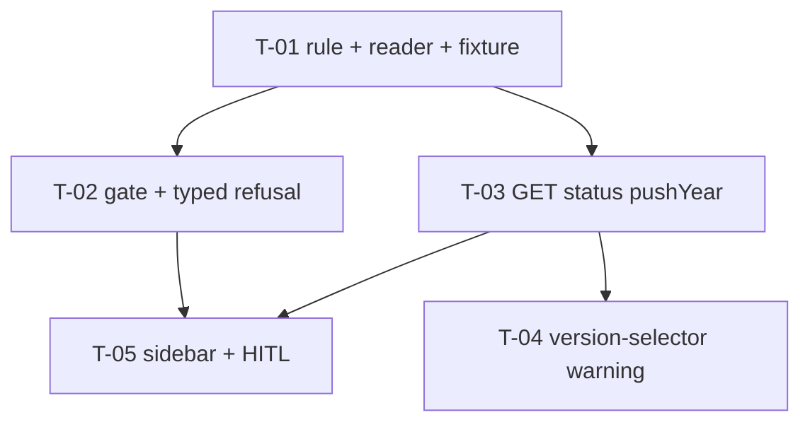

# Tasks — PRMS / Pending-review lock

- **Module:** result-prms-sync (server) · version-selector + result-sidebar (client)
- **Spec id:** 2026-11-prms-pending-review-lock
- **Status:** not-started
- **Owner:** owner + delegated workers (all code goes to a worker; Claude briefs and reviews)
- **Linked requirements:** ./requirements.md · **Linked design:** ./design.md · **Review:** ./judgment.md
- **Branch:** `fix/prevent-prms-resubmission-during-active-review`
- **Budget (design §12, a tripwire and not a cap):** 5 tasks · about 300 production LOC + 550 test LOC · about 7 review rounds
- **Last updated:** 2026-11-19

## 1. Dependency graph

- T-02 and T-03 both touch `result-prms-sync`, so they run **in sequence**, never in parallel (same package).
- T-04 is client-only and can be edited at the same time as T-02. No full-suite runs while two workers are active.

## 2. Coverage map (scenario and clause level)

| Scenario / clause | Owner task | Verified by |
|---|---|---|
| S-1 Pending | T-01 | rule unit test |
| S-2 Approved | T-01 | rule unit test |
| S-3 Rejected, then pushed again; the further push re-locks | T-01 | rule unit test (627/631 sequence) |
| S-4 Never pushed (no rows; no version) | T-01 (no rows), T-03 (no version) | rule unit test; controller spec |
| S-5 `id` order, **BUT must NOT** order by `occurred_at`/`decided_at` | T-01 | rule unit test (698) + fixture (SQL has no timestamp in `ORDER BY`) |
| S-6 ignores inactive and duplicate rows | T-01 | fixture |
| S-6 ignores other platforms and other years | T-01 | fixture |
| S-6 **BUT must NOT** read `result_status_id`/`is_synced_to_prms`/the log | T-01 | static read of `PUSH_EVENTS_SQL` in the reader spec |
| S-6 unknown verbs count as no decision | T-01 | rule unit test |
| S-26 the decision counts for the phase year; **BUT must NOT** use the live row's year | T-01 | fixture (callback with `phase_year` ≠ `result_year`) + rule unit test |
| S-27 a re-import does not reorder; **BUT must NOT** let an imported row outrank a real one | T-01 | fixture (imported rows with a higher `id` than the real push) + rule unit test |
| S-7 (702 replay) refused with 409 | T-02 | service spec |
| S-7 **BUT** no log row, attempt count unchanged, no Normalizer call | T-02 | service spec |
| S-7 **AND IT MUST** apply to every role, `SYSTEM_ADMIN` included | T-02 | service spec (admin user) |
| S-7 **AND IT MUST** apply to the TIP sync origin | T-02 | service spec (`origin: 'TIP_SYNC'`) |
| S-8 Approved refused | T-02 | sync-gate spec |
| S-9 Rejected / never pushed passes | T-02 | sync-gate spec |
| S-10 refusal order | T-02 | sync-gate spec (position between `not_already_synced` and `reporting_year`) |
| R-PRL-003 S-11 the year is `pushYear`, not `version` | T-03 | controller spec |
| R-PRL-003 S-12 a year with no version → 200 `never_pushed` | T-03 | controller spec |
| R-PRL-003, other S-11…S-12 clauses (roles, guard, envelope) | T-03 | controller spec |
| S-13 Pending warning, direct path | T-04 | component spec |
| S-14 picker path | T-04 | component spec |
| S-15 Approved title | T-04 | component spec |
| S-16 Cancel sends nothing | T-04 | component spec |
| S-17 Update anyway; **BUT must NOT** block | T-04 | component spec |
| S-18 resubmittable year: no extra modal | T-04 | component spec |
| S-19 read fails → proceeds and logs | T-04 | component spec |
| S-20 busy state; one GET, at most one PATCH | T-04 | component spec (deferred timing) |
| S-21 Pending disables PRMS SYNC + tooltip | T-05 | component spec + HITL |
| S-22 Approved tooltip | T-05 | component spec |
| S-23 precedence; other tooltips unchanged | T-05 | component spec |
| S-24 Rejected stays enabled | T-05 | component spec |
| S-25 open-tab race → 409 reason shown, button re-reads | T-05 | component spec |
| NFR-PRL-001 at most one GET in the update flow | T-04 | component spec counts calls |
| NFR-PRL-002 a11y | T-04 (busy state, alert reuse), T-05 (tooltip on a disabled button) | component specs + HITL keyboard check |
| NFR-PRL-003 the client cannot override the gate (stale tab, direct API call) | T-02 | service + controller specs (held → 409 whatever the caller; read error → 500, no PRMS call) |
| NFR-PRL-004 one rule implementation on the server; the client never re-derives status from raw events | T-01 (single rule), T-04 + T-05 (consume `push_status` only) | Reviewer checklist on T-04/T-05: `git grep -n "event_source\|decision" -- client/research-indicators/src/app/pages/platform/pages/result/components/version-selector client/research-indicators/src/app/shared/components/result-sidebar` shows no new hit |

## 3. Tasks

### T-01 — Pure rule, history reader, and SQL fixture

- **Status:** todo · **Size:** M · **Dependencies:** none
- **Requirements:** R-PRL-001. Scenarios: S-1…S-6, S-26, S-27 (S-4 "no rows" half)
- **Design:** §3, §5.1, DD-1, DD-2, DD-8, P-1, P-3, P-9, P-11, P-12
- **Files:**
  - new `server/researchindicators/src/domain/entities/result-prms-sync/eligibility/prms-push-status.ts` (+ `.spec.ts`)
  - new `server/researchindicators/src/domain/entities/result-prms-sync/prms-push-status.reader.ts` (+ `.spec.ts`)
  - `result-prms-sync.module.ts` (provider)
  - new `server/researchindicators/test/fixtures/prms-push-status.fixture-spec.ts`
- **Scope:**
  - **The rule.** `derivePrmsPushStatus(events, year)`.
    - Its input is already in `id` ascending order and it never compares ids.
    - It filters to the target year, stable-sorts by `imported` first, and lets the last event decide.
    - It returns `{ year, status, resubmittable }`.
  - **The reader.** `PrmsPushStatusReader.read({ platformCode, resultOfficialCode, year })`, built on `PUSH_EVENTS_SQL` as specified in design §5.1.5:
    - flat ANDs;
    - the code bound as a string;
    - `phase_year` read through `CAST(JSON_UNQUOTE(JSON_EXTRACT(…)) AS UNSIGNED)`;
    - `imported` built to be never NULL;
    - `ORDER BY id ASC` only;
    - `Number()` coercion on both projected fields.
  - **Fixture.** `result_official_code` band **`901000`–`901009`**; the next free band after `900_920`, checked by a grep of every `*.fixture-spec.ts` header on 2026-11-19. It inserts only into `result_prms_sync_history` and runs no DDL (FP-51). Rows seeded:
    - 698-like: push, then a callback REJECT, then a push, with skewed `occurred_at`;
    - a callback REJECT with `raw_body.data.obj_version.phase_year = 2026` and `result_year = 2027`;
    - a callback where `phase_year` is a **string** `"2026"`;
    - an imported pair (`delivery_id` NULL, `raw_headers = '{}'`, `raw_body = '{}'`) with ids **above** a real push;
    - inactive, duplicate, other-platform and other-year rows.
- **Tests:**
  - **Rule unit:**
    - 627/631: push → REJECT → resubmittable; then a push → pending.
    - 698: events in `id` order whose timestamps disagree → `pending_review`.
    - 702: push only → pending.
    - Approved.
    - Never pushed.
    - Unknown verb.
    - S-26: decision year 2026 while the target is 2027 → 2027 is `never_pushed`.
    - S-27: imported REJECT placed after a real push in the array → `pending_review`.
  - **Reader spec:** a static read of `PUSH_EVENTS_SQL`. It asserts that the SQL contains no `result_status_id`, no `is_synced_to_prms`, no `result_prms_sync_log`, no `OR`, no `occurred_at`/`decided_at` in `ORDER BY`, and no `ORDER BY imported`.
  - **Fixture:** asserts on the **rows returned and the derived status**, never on the call sequence (KZ-017):
    - `imported = 0` for a push and `1` for the imported pair;
    - `phase_year = 2026` for the string case;
    - the status of each seeded year.
- **Falsifier:**
  - **(a) Rule.** Replace the stable sort with a sort on `occurred_at`. The 698 case should flip to `rejected`.
  - **(b) Reader.** Change the `phase_year` projection to `h.result_year`. The S-26 fixture case should read 2027 as `rejected` instead of `never_pushed`.
  - **(c) Reader.** Drop `raw_headers IS NOT NULL` from `imported`. The fixture should read `imported` as NULL (not 0) for a push.
  - **(d) Reader.** Drop the `CAST`. The string-year case should fail its `phase_year = 2026` assertion.
- **Red run:** predicted, greenfield artifact (observed in T-01). Every falsifier target is created by this task. The Implementer applies each of (a)–(d) after the green run and quotes each red verbatim in `execution.md`.
- **Disqualifier:**
  - A fixture where the callback's `phase_year` equals its `result_year` cannot tell (b) apart. The cross-year row is mandatory.
  - A fixture where imported ids are **lower** than the real push cannot test S-27.
  - A fixture run while another worker runs `test:fixtures` or `test:integration` is not evidence. Re-run it alone.
- **Consumers:** new symbols, no consumers yet. Sweep `git grep -n "PrmsPushStatusReader\|derivePrmsPushStatus" -- server` (expected: 0 hits before the task).
- **Verification:**
  - `npm test -- --silent prms-push-status`
  - `npm run compose:test:up` (the TEST schema already bootstrapped; FP-49: bootstrap only once per container)
  - `npm run test:fixtures -- prms-push-status`
  - `npx eslint <changed files>`
  - `npm run build`
- **Review:** full. This is the core rule; SQL semantics cannot be seen by mocked tests.
- **Skills:** `nestjs-expert`, `tdd`
- **Done:**
  - [ ] rule and reader specs green
  - [ ] fixture green against the TEST schema
  - [ ] falsifiers (a)–(d) each observed red, quoted in `execution.md`
  - [ ] `npm run build` clean; eslint clean
  - [ ] no write to any table outside `result_prms_sync_history` in the fixture

### T-02 — Gate entry `prms_resubmittable` and the typed refusal

- **Status:** todo · **Size:** M · **Dependencies:** T-01
- **Requirements:** R-PRL-002 (S-7…S-10), NFR-PRL-003
- **Design:** §4 POST, §5.2, DD-3, DD-7 (server half), DD-9, P-7, P-10
- **Files:**
  - `eligibility/sync-gate.ts` (+ spec)
  - `repositories/result-prms-sync-log.repository.ts` `loadGateSnapshot` (+ spec)
  - `result-prms-sync.service.ts` (`throwHttp` call site for gate refusals; + spec)
  - `result-prms-sync.controller.ts` (`noRowRefusalData(description, entryId?)`; + spec)
  - `dto/prms-sync.dto.ts` (`gate_entry_id`)
  - new typed exception `PrmsSyncNoRowRefusalException`, defined in `result-prms-sync.service.ts` next to the existing `PrmsSyncPersistedRefusalException`
- **Scope:**
  - **Snapshot.** Add `prms_push_status?` to `SyncGateSnapshot`.
    - `loadGateSnapshot` fills it from the reader, only when the row exists.
    - Platform: `COALESCE(platform_code,'STAR')` of the resolved row. Year: its `report_year_id`.
    - The read error is **not caught**.
  - **Entry.** Add it after `not_already_synced`: 409, `persistsRow: false`, with the two descriptions from design §5.2. An absent value passes.
  - **Typed refusal.** Gate refusals with `persistsRow: false` throw `PrmsSyncNoRowRefusalException(status, description, entryId)`.
    - The controller's catch reads `entryId` into `gate_entry_id`.
    - Claim collision and already-synced inside the lock keep `null`.
- **Tests:**
  - **sync-gate spec:**
    - the entry's position;
    - Pending fails with 409 and the Pending text;
    - Approved fails with 409 and the Approved text;
    - Rejected and never pushed pass;
    - an absent value passes;
    - `not_already_synced` still wins over the new entry.
  - **service spec:**
    - a held key → 409;
    - the log repository's `recordInsideLock` is **not called**, the Normalizer is **not called**, and the attempt count is unchanged;
    - the same result for a `SYSTEM_ADMIN` user and for `origin: 'TIP_SYNC'`;
    - a reader throw → the error propagates and the Normalizer is not called.
  - **controller spec:**
    - 409 from the new entry → `data.gate_entry_id === 'prms_resubmittable'`;
    - 409 from `not_already_synced` → `gate_entry_id` equals that entry's id;
    - claim collision → `null`.
- **Falsifier:**
  - **(a)** Remove the entry from `SYNC_GATE_ENTRIES`. The service "held → 409" test should go red, with the Normalizer mock called.
  - **(b)** Wrap the reader call in a `try/catch` that returns `undefined`. The fail-closed test should go red.
  - **(c)** Throw a plain `ConflictException` for gate refusals, as `throwHttp` does today. The `gate_entry_id` test should read `null`.
- **Red run:**
  - (a) and (c) target code that exists at specify time: `SYNC_GATE_ENTRIES` and `throwHttp` at `3e5f2b85c`. The new tests are written **first** and observed red on the current code, before the entry and the exception exist.
  - (b) is predicted, greenfield (the snapshot field is created here); observed in T-02.
  - Each red is quoted verbatim in `execution.md`.
- **Disqualifier:**
  - A service test whose mocked reader returns `resubmittable: false` for every key cannot separate "the entry fired" from "something else refused". Assert the entry id, not only the status.
  - A red caused by a missing provider or a DI error is setup, not the assertion.
- **Consumers:** `git grep -n "SYNC_GATE_ENTRIES\|evaluateSyncGate\|noRowRefusalData\|SyncGateSnapshot\|throwHttp" -- server/researchindicators/src server/researchindicators/test`. Every hit is listed in `execution.md` and re-run. It includes `tip-integration.service.ts` (P-7) and its spec.
- **Verification:**
  - `npm test -- --silent result-prms-sync tip-integration`
  - `npx eslint <changed files>`
  - `npm run build` (compile gate: `SyncGateSnapshot` is a typed contract)
- **Review:** full. It changes a refusal on the push path for every role and TIP.
- **Skills:** `nestjs-expert`, `error-handling-patterns`, `tdd`
- **Done:**
  - [ ] specs green, including the TIP spec
  - [ ] falsifiers (a)–(c) observed red and quoted
  - [ ] build + eslint clean
  - [ ] Swagger: the 409 response documents `gate_entry_id`

### T-03 — `GET …/prms-sync` gains `pushYear` and `push_status`

- **Status:** todo · **Size:** S · **Dependencies:** T-01 (runs after T-02, same package)
- **Requirements:** R-PRL-003 (S-11, S-12, S-4 "no version" half)
- **Design:** §4 GET, DD-4, DD-5, P-4, P-5
- **Files:**
  - `result-prms-sync.controller.ts` `getStatus` (+ spec)
  - `result-prms-sync-status.reader.ts` (+ spec)
  - `dto/prms-sync.dto.ts` (`PrmsPushStatusDto`, `push_status`)
- **Scope:**
  - `@ApiQuery({ name: 'pushYear', required: false })`.
  - Parsed inside the existing `try`. A non-integer or out-of-range value (outside 1901–2155) throws `BadRequestException`, which becomes the 400 envelope.
  - `push_status` is computed for: the resolved row's platform and code, and `pushYear ?? report_year_id`.
  - Guards and roles are unchanged.
- **Tests (controller and reader specs):**
  - absent `pushYear` → the resolved row's year;
  - `pushYear=2025` while the URL version is 2026 → year 2025 (S-11);
  - a year with no history → 200 `never_pushed` (S-12);
  - `pushYear=abc` → 400 envelope;
  - `pushYear=1800` → 400 envelope;
  - the existing status fields are unchanged.
- **Falsifier:** compute the year from `report_year_id` and ignore `pushYear`. The S-11 test should read 2026.
- **Red run:** `getStatus` exists at `3e5f2b85c`. The S-11 and 400 tests are written first and observed red on the current code (no `push_status` field / no 400), then quoted.
- **Disqualifier:** a test where `pushYear` equals the resolved row's year cannot detect the falsifier. The years must differ.
- **Consumers:**
  - Client: none (P-5). Re-run `git grep -n "prms-sync" -- client/research-indicators/src/app ':!*.spec.ts'`; expected hits `api.service.ts` (POST, history) and `http-error.interceptor.ts`.
  - Server: `git grep -n "ResultPrmsSyncStatusReader\|getStatus" -- server/researchindicators/src`.
- **Verification:**
  - `npm test -- --silent result-prms-sync`
  - `npx eslint <changed files>`
  - `npm run build`
  - Swagger shows `pushYear`.
- **Review:** checklist. An additive field on an endpoint with no consumer.
- **Skills:** `nestjs-expert`, `api-design-principles`
- **Done:**
  - [ ] specs green, with reds quoted
  - [ ] build + eslint clean
  - [ ] Swagger shows `pushYear` and `push_status`

### T-04 — Version selector: status check, warning, busy state

- **Status:** todo · **Size:** M · **Dependencies:** T-03 (API contract). It can be edited while T-02 runs.
- **Requirements:** R-PRL-004 (S-13…S-20), NFR-PRL-001, NFR-PRL-002
- **Design:** §5.3, DD-6, P-8, P-13
- **Files:**
  - `client/research-indicators/src/app/shared/services/api.service.ts` `GET_PrmsPushStatus(resultCode, year?)` with `useResultInterceptor` and `noCache` (+ spec)
  - new `client/.../shared/interfaces/prms-push-status.interface.ts`
  - `client/.../pages/platform/pages/result/components/version-selector/version-selector.component.{ts,html}` (+ spec)
- **Scope:**
  - **Routing.** `checkThenSubmit(year)` is called from `showPrompt`'s confirm and `pickerAlert`'s confirm. It uses the `checkingPrms` signal and clears it in a `finally`.
  - **Warning.** Shown with `severity: 'warning'`:
    - Pending: *PRMS review in progress*;
    - Approved: *Already approved in PRMS*;
    - actions: *Cancel* and *Update anyway*.
  - **Fail-open.** A read failure logs `console.error` and then submits.
  - **Busy state.** The *Update result* span gets `aria-disabled`, `aria-busy`, the spinner icon and a muted token class while `updating() || checkingPrms()`. Its handler ignores clicks and Enter while busy.
  - **Styling.** Tokens only, no hex values.
- **Tests (component spec):**
  - S-13: direct path + Pending → warning with the Pending title; no PATCH.
  - S-14: picker path + 2025 held → warning for 2025.
  - S-15: Approved title.
  - S-16: Cancel → no PATCH.
  - S-17: Update anyway → one PATCH with the chosen year.
  - S-18: resubmittable → PATCH, no warning.
  - S-19: GET rejects → `console.error` + PATCH.
  - S-20:
    - with a **deferred** GET (a promise resolved manually), a second confirm and a click on *Update result* during the wait send no second GET and no PATCH;
    - after resolving, exactly 1 GET and ≤ 1 PATCH;
    - the span carries `aria-busy="true"` during the wait.
  - S-11: the GET is called with the chosen year, not the URL's `version`.
- **Falsifier:**
  - **(a)** Remove the `checkingPrms` guard. The S-20 deferred test should see 2 GETs.
  - **(b)** Send `version` instead of the chosen year. The S-14 test should see 2026.
- **Red run:** the version selector exists at `3e5f2b85c`. The S-13 and S-20 tests are written first and observed red on the current code: no GET, and the PATCH is called straight away. Quote them.
- **Disqualifier:**
  - S-20 under a synchronously resolved mock is not evidence: the race never opens. Deferred timing is mandatory.
  - "Failed suites with zero failed tests" is the flaky runner. Re-run before reading it.
- **Consumers:** `git grep -n "submitReportingCycle\|showPrompt\|pickerAlert\|updateResult" -- client/research-indicators/src`, and `git grep -n "GET_PrmsPushStatus" -- client` (new; 0 hits expected).
- **Verification:**
  - `npm test -- --silent version-selector api.service`
  - `npm run lint -- --quiet`
  - `npx tsc -p tsconfig.app.json --noEmit` + `npx tsc -p tsconfig.spec.json --noEmit` on the touched files' error set (compile gate, K-002)
- **Review:** full. It is on the live path of every update.
- **Skills:** `angular-developer`, `ui-ux-pro-max`, `tdd`
- **Done:**
  - [ ] specs green, with reds and falsifiers quoted
  - [ ] lint + type-check clean
  - [ ] **no commit before the owner sees it working** (HITL with T-05)

### T-05 — Sidebar: PRMS SYNC disabled while held, plus the live Dev check

- **Status:** todo · **Size:** M · **Dependencies:** T-02, T-03 (T-04 for the shared API method)
- **Requirements:** R-PRL-005 (S-21…S-25), NFR-PRL-002, NFR-PRL-004 (client half)
- **Design:** §5.4, DD-7 (client half)
- **Files:** `client/.../shared/components/result-sidebar/result-sidebar.component.{ts,html}` (+ spec)
- **Scope:**
  - **Fetch.** `prmsHistoryEffect` also fetches push status. It uses its own generation counter and resets to `null` on a version change.
  - **Signals.** `prmsPushStatusLoading` and `prmsHeldByPrms`.
  - **Button.** Disabled while loading or held; `onPrmsSync` returns early on either.
  - **Tooltip.** The held text goes inside the `canSyncPrms()` true branch, before `return ''`.
  - **Re-fetch.** After a success, and after a 409 with `gate_entry_id === 'prms_resubmittable'`.
  - **409 modal.** For that same 409, the failure modal shows `errorDetail.description`, escaped.
- **Tests (component spec):**
  - S-21: Pending + all conditions met → disabled + Pending text.
  - S-22: Approved text.
  - S-23 precedence:
    - already synced → the already-synced text;
    - not approved + held → the existing "will become available" text;
    - `has_contribution=false` + held → the existing text.
  - S-24: Rejected → enabled.
  - Loading → disabled.
  - Version change: the previous held value is not shown while the new read is pending.
  - S-25: 409 with `gate_entry_id` → modal shows the description + one re-fetch; 409 without it → generic copy.
- **Falsifier:**
  - **(a)** Put the held branch before `if (this.canSyncPrms())`. The S-23 "not approved + held" test should show the Pending text.
  - **(b)** Drop the reset on version change. The stale-value test should show the old year held.
- **Red run:** the sidebar exists at `3e5f2b85c`. The S-21 and S-25 tests are written first and observed red on the current code (button enabled; generic copy). Quote them.
- **Disqualifier:** a precedence test where the result is approved and contributing cannot detect (a); it needs the not-approved case.
- **Consumers:** `git grep -n "prmsSyncTooltip\|canSyncPrms\|onPrmsSync\|prmsHistoryEffect" -- client/research-indicators/src` (all spec files listed in `execution.md`).
- **Verification:**
  - `npm test -- --silent result-sidebar`
  - `npm run lint -- --quiet`
  - `npx tsc -p tsconfig.app.json --noEmit` + `npx tsc -p tsconfig.spec.json --noEmit` (touched files' error set, K-002)
- **HITL (owner, Dev, the app run natively):**
  1. Open ref `698` or `702` (Pending Review on Dev) → PRMS SYNC is disabled and the tooltip reads Pending.
  2. *Update result* → *Yes, update 2026* → the Pending warning shows → *Cancel*: nothing changes.
  3. Repeat, then pick another year through the picker → the warning shows for a held year only.
  4. Keyboard: Tab to the warning, Esc closes it, Enter on *Update anyway*.
  5. Optional, owner's call because it writes to the shared Dev DB: *Update anyway* → re-approve → PRMS SYNC still refused, with the gate's reason.

  Quote what the owner actually observed against each step. A step not observed stays unticked (KZ-002).
- **Review:** full, plus the HITL. This is the user-facing lock.
- **Skills:** `angular-developer`, `ui-ux-pro-max`
- **Done:**
  - [ ] specs green, with reds and falsifiers quoted
  - [ ] lint + type-check clean
  - [ ] HITL steps 1–4 observed and quoted (step 5 only if the owner chooses)
  - [ ] the owner approves visually → only then commit the client tasks

## 4. Review intensity

| Task | Review | Why |
|---|---|---|
| T-01 | full | Core rule; SQL semantics |
| T-02 | full | Refusal on the push path, every role and TIP |
| T-03 | checklist | Additive field, no consumer |
| T-04 | full | Live update path |
| T-05 | full | User-facing lock + HITL |

No task is `skip-eligible`.

## 5. PR strategy

The estimate is about 850 LOC including tests, which is over 400. Recommended split:

| PR | Contents | Review first | Out of scope |
|---|---|---|---|
| 1 server | T-01, T-02, T-03 | `prms-push-status.ts` and the fixture, then the gate entry | client |
| 2 client | T-04, T-05 | `checkThenSubmit`, then the sidebar tooltip | server (merged in PR 1) |

PR 2's description links PR 1. Pushing and merging are the owner's call.

## 6. Risks & blockers log

| # | Date | Risk / blocker | Mitigation | Owner | Status |
|---|---|---|---|---|---|
| RB-1 | 2026-11-19 | A lost PRMS callback leaves a year locked; there is no unlock (design §5.1.6) | Accepted by the owner (no-unlock decision) | Owner | open (accepted) |
| RB-2 | 2026-11-19 | The correlator still books decisions to the live row's year, so the history modal and monitor are affected (design OQ-1) | Follow-up spec | Owner | open |
