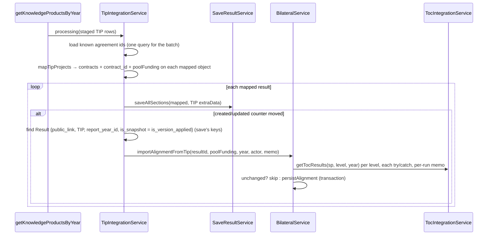

# Design — TIP Integration / Knowledge-product projects and pool funding

- **Module:** tip-integration (server) + bilateral (pool funding) + results (contracts, read only)
- **Spec id:** 2026-10-tip-kp-project-pool-funding
- **Status:** draft — judgment-day round 1 fixes applied (`./judgment.md`)
- **Owner:** David Casañas
- **Linked requirements:** ./requirements.md
- **Linked detailed design:** ../../../trd/trd.md (integrations — TIP; Pool Funding)
- **Depth:** Standard
- **Last updated:** 2026-10-20

---

## 1. Executive summary

Three server changes, no migration, no client change:

1. **TIP mapping** — `processing()` turns the whole `project[]` into alignment contracts (R-TIP-001/002) and attaches the primary project's `toc_mapping` **to each mapped result object**, so the mapping can never cross years or rows.
2. **Per-result save + import** — the TIP service saves each mapped result with `saveAllSections` (what `bulkSaveAllSections` already loops over) and, only when that call **created or updated** the result, finds the row by the save's own keys and calls a new **gate-free** `BilateralService.importAlignmentFromTip`, a sibling of `importAlignmentFromPrms` that writes through the same `persistAlignment`.
3. **Read rule** — `buildAlignment` treats a non-eligible **TIP** result with an active alignment as `display_only`.

**Budget (tripwire for `/akili-execute`):** 4 tasks · ~560 LOC (≈ 200 production, 360 tests) · 7 review rounds.

## 2. Goals & non-goals

**Goals**

- G-1 Save all TIP projects with TIP's primary flag → R-TIP-001, R-TIP-002.
- G-2 Save the primary `toc_mapping` as pool funding without STAR gates → R-TIP-003, R-TIP-004, R-TIP-005, R-TIP-007.
- G-3 Show it read-only on TIP results that STAR does not deem eligible → R-TIP-006.

**Non-goals**

- No change to `updateAlignment`, `validateTocAlignments`, `toc-level-rules.util.ts`, or `importAlignmentFromPrms`.
- No storage for `aow_compose_code`, `toc_internal_id`, `result_indicator_type_name` (no column).
- No change to `SaveResultService` (shared by PRMS, TIP, AICCRA) or `ResultsService.createResult`.
- No change to the IPR export (`tipIntegrationMapper`, R-0).
- No client change.

## 3. Architecture overview



## 4. Extended directory structure

```
server/researchindicators/src/domain/
├── tools/tip-integration/
│   ├── dto/response-year-tip.dto.ts            # + TipTocMappingDto, TipProjectDto flags; TipMappedResult (ExternalMappersDto + poolFunding)
│   ├── mapper/tip-projects.mapper.ts           # NEW pure: project[] → contracts + contract_id + poolFunding
│   ├── mapper/tip-projects.mapper.spec.ts      # NEW
│   ├── tip-integration.service.ts              # processing() uses mapper; per-result save + import step calling importAlignmentFromTip
│   ├── tip-integration.service.spec.ts         # updated
│   └── tip-integration.module.ts               # + BilateralModule import
└── entities/bilateral/
    ├── bilateral.service.ts                    # + importAlignmentFromTip; display_only TIP clause
    ├── bilateral.service.importAlignmentFromTip.spec.ts   # NEW
    └── bilateral.service.spec.ts               # + display_only cases
```

## 5. Data model

**No data model changes.** Writes go to existing tables: `result_contracts` (via `updateResultAlignment`), `result_pool_funding_alignment`, `result_pool_funding_alignment_sp`, `result_pool_funding_toc_alignment` (via `persistAlignment`).

Field mapping of the ToC row is the R-TIP-003 table. `target_value` uses the same `resolveLiveTargetValue(indicator, year)` the user path uses; `target_year = year` only when an indicator matched. `quantitative_contribution = Number(target_contribution)`, NaN or absent → null; the `decimal(18,2)` column rounds to 2 decimals.

## 6. API design

No new endpoint. One response-field rule changes on the existing pool-funding alignment read (`BilateralController` GET):

| Field | Before | After |
| --- | --- | --- |
| `display_only` | `!eligible && (is_snapshot \|\| is_synced_to_prms \|\| prms_result_code != null)` | same **OR** `!eligible && platform_code = 'TIP' && active alignment exists` |
| `is_read_only` | derived from `display_only` | unchanged formula — becomes `true` for those TIP results |

An **eligible** TIP result keeps `display_only: false` / `is_read_only: false` on the wire; it is read-only only through the client's `isExternalResult()` (`client/research-indicators/src/app/shared/services/bilateral.service.ts:97`) — unchanged, and the server write gate (`assertNonPrmsExternalSourceWritable`) still blocks it.

The TIP integration HTTP endpoint that triggers the sync keeps its contract.

## 7. Backend module design

### 7.1 DTOs

`TipProjectDto` adds optional `is_primary?: boolean`, `is_contributing_to_pool_funding?: boolean`, `toc_mapping?: TipTocMappingDto | null`. `TipTocMappingDto` mirrors TIP's object verbatim (`toc_result_indicator_id: string`, `toc_result_id: number`, `target_contribution: number | string | null`, …). Optional, because older staged rows and the single-object form carry none of them. The mapped result is `ExternalMappersDto` plus a TIP-local `poolFunding: TipTocMappingDto | null`; `SaveResultService` ignores the extra field.

### 7.2 `mapTipProjects` (pure mapper)

Input: `project` (object | array | null) and the `Set` of known agreement ids. Output: `{ contracts: {contract_id, is_primary}[], createContractId: string | null, poolFunding: TipTocMappingDto | null }`.

Rules, in order:
1. Normalise to an array; drop items with empty `agreement_id`; dedupe by `agreement_id` (first wins).
2. If any item has `is_primary === true`: candidate = the first flagged one. If it is unknown → `warn`, candidate = none (no promotion).
3. If no item is flagged: candidate = the first **known** item.
4. Drop unknown items (each → `warn`). The candidate (if any) is the only `is_primary: true`.
5. `createContractId` = candidate's id; else the first known item's id; else null.
6. `poolFunding` = candidate's `toc_mapping` only when there is a candidate, it has `is_contributing_to_pool_funding === true`, and `toc_mapping.science_program_id` is non-empty; else null (R-TIP-005).

### 7.3 `TipIntegrationService`

- `processing()` collects every `agreement_id` across the batch, loads the known ones with **one** `AgressoContract` query (`In(ids)`, `agreement_id` only, no `is_active` filter — the FK does not filter either), and calls `mapTipProjects` per result: `createResult.contract_id = createContractId`, `alignments.contracts = contracts`, `poolFunding` on the object.
- `getKnowledgeProductsByYear()` replaces the single `bulkSaveAllSections` call with the same loop it performs (`for … saveAllSections(result, extraData)`, P-19) followed, per result, by the import step. `extraData` is the same object as today.
- Import step per result: it runs only when `counters.createdRecords + counters.updatedRecords` grew across that `saveAllSections` call — an omitted duplicate returns before any counter moves and a failure moves `errorRecords` (P-20). Then `findOne(Result, { public_link, platform_code: TIP, report_year_id: createResult.year, is_snapshot: mapped.is_version_applied })` — the exact where-clause `saveAllSections` builds once `extraData.findOptions` also carries `is_snapshot: 'is_version_applied'` (P-18), so it returns the row the save wrote — and `importAlignmentFromTip`. **Amended 2026-10-20 (execute, owner-approved, P-18 refuted on Dev; first amendment superseded by Pivot T-03):** the save writes `is_snapshot = is_version_applied` on create and update, and a no-year TIP run marks every earlier year as a version, so both sides key on that same flag — the PRMS precedent (`prms.opensearch.service.ts` `findOptions: { …, is_snapshot: 'is_version_applied' }`). The flag is a boolean on every mapped object (`data.is_version ?? false`), never `undefined` (P-21). `SaveResultService` and TIP versioning are unchanged. Each import in its own try/catch → `error` log with the TIP id; counters untouched (R-TIP-007).
- Actor: `mapped.userData?.sec_user_id ?? null`, as the PRMS precedent (`prms.opensearch.service.ts:650-654`).
- A per-run `Map<'year:sp:level', TocResult[] | null>` memo is created in `getKnowledgeProductsByYear` and passed down (NFR-TIP-001).

### 7.4 `BilateralService.importAlignmentFromTip`

Signature (conceptual): `(resultId, mapping, year, actorUserId, memo?)`.

1. Catalog lookup: for each level in `OUTPUT`, `OUTCOME`, `EOI`, `getTocResults(sp, level, year)` in its **own** try/catch (memoised; a throw memoises `null` for that key). The first level whose list holds `toc_result_id` gives `level`; within that result the first indicator whose `toc_result_indicator_id` equals TIP's UUID gives `indicator_id`, `unit_messurament`, `target_value`. More than one match → first wins + `warn`; miss → nulls + `warn`. The lookup reports **failed** separately from **no match**: when the level that would decide failed and the active ToC row has the same `toc_result_id`, the upsert keeps that row's `level`, `indicator_id`, `unit_messurament`, `target_value`, `target_year` (R-TIP-003, judgment RA-1/RB-2).
2. Build one SP (`PRIMARY`) and one ToC upsert from the R-TIP-003 table (TIP's `result_title` / `result_indicator_description` are the snapshot texts, never the catalog's).
3. Read active alignment + active ToC. If the active alignment has `has_contribution = true`, exactly the SP set `{sp}` with that SP primary, and its ToC row equals the upsert on every written column → return without writing (R-TIP-003 idempotency). Equality normalises both sides: decimals as `Number()` with the incoming value rounded to 2 places (the driver returns `decimal(18,2)` as a string), varchars trimmed, null ≡ undefined.
4. Otherwise deactivate the ToC of SPs no longer kept and `persistAlignment` in one transaction with `hasContribution: true` — the same steps the PRMS method takes, written out again rather than shared (D-3).
5. No history entry, no socket emit, no gate (R-TIP-004).

### 7.5 `buildAlignment` display-only clause

Adds the TIP term from §6; `eligible` stays the raw contract fact. Nothing else in the read changes. The tab is not hidden by the client's year rule for these results: `has_pool_funding_data` is true whenever `has_contribution` is non-null (P-22).

### 7.6 Module wiring

`TipIntegrationModule` imports `BilateralModule` (exports `BilateralService`). No cycle (P-12).

### 7.7 Transactions

Contracts and other sections are written by `saveAllSections` outside the alignment transaction; the alignment write is its own transaction. A failed alignment import therefore leaves the result's other sections saved — the isolation R-TIP-007 asks for.

## 8. Frontend / UX

No client change. The sidebar shows the tab when `eligible || display_only` (`result-sidebar.component.ts:125`), and the section is read-only for any non-STAR result on the client (`client/.../shared/services/bilateral.service.ts:97`).

## 9. Shared contracts

`display_only` semantics widen for TIP only; the client interface (`pool-funding-alignment.interface.ts`) keeps its type.

## 10. Design decisions

| # | Decision | Rationale | Rejected alternative |
| --- | --- | --- | --- |
| D-1 | Project mapping lives in a **pure mapper** with the known-id set passed in | Every R-TIP-001/002 rule is unit-testable without DB mocks | Inline in `processing()` (already 200 lines) |
| D-2 | The TIP service runs `saveAllSections` per result itself and imports right after a create/update, on the save's own row | The mapping travels on the object (no cross-year key), and the counter delta tells which results the save processed — without changing `SaveResultService`, which three platforms share | Post-batch pass keyed by `public_link` (judgment C-1/C-2: wrong row across years; imports onto skipped duplicates); hook inside `saveAllSections` (shared module needs BilateralService) |
| D-3 | New sibling `importAlignmentFromTip`, not a refactor of `importAlignmentFromPrms` | PRMS method resolves ToC by **title**; TIP gives ids. Sharing would change a QA'd PRMS path for ~20 lines of reuse | Generalise `importAlignmentFromPrms` input |
| D-4 | Catalog year = the **result's** `report_year_id` (TIP's publication year), not the app reporting year | The TIP mapping and `target_contribution` belong to that year's ToC; the read-back uses only the stored snapshot, so the year only affects lookup quality | `reportingYearResolver` like PRMS — would match 2021 results against the current year's catalog |
| D-5 | Known-agreement check is one batch query, existence only | FK is existence-only; one query avoids N lookups. An inactive agresso contract is saved but reads `eligible: false` (the read joins `ac.is_active`) — the display-only clause still shows imported data | Per-result lookup; filtering `is_active` (would drop contracts the FK accepts) |
| D-6 | Several flagged primaries → keep the first | `unsetMultiplesPrimary` would otherwise leave **no** primary and hide pool funding | Send both and let the rule decide |
| D-7 | Display-only widened by platform, not by a flag column | No schema change; TIP-only scope is greppable (`ReportingPlatformEnum.TIP` in `buildAlignment`) | New `is_imported` column on the alignment |
| D-8 | `createResult.contract_id` falls back to the first known contract when there is no primary | `createResult` runs `findOne({agreement_id})` and `linkUserToContract` with whatever it gets; a null id makes TypeORM 0.3 drop the condition (P-21) and copy an arbitrary contract's SDGs. The final contract set is still set by `updateResultAlignment` | Pass null (today's behavior for empty `project[]`, kept only when nothing is known — accepted residual, `warn`; the submitter's CONTRIBUTOR link goes to the fallback contract, which may be non-primary); change `createResult` (out of scope, shared) |
| D-9 | Per-level catalog calls with a per-run memo, not `getTocResultsForSps` | `getTocResultsForSps` is `Promise.all` — one failing level discards the others (P-8); the 5-min cache does not span a multi-year run (P-9) | Reuse `getTocResultsForSps` |
| D-10 | Skip the write when the active alignment already equals the incoming one | `persistAlignment` deactivates and re-inserts every run; a nightly sync would churn one alignment row per KP | Always rewrite (correct but noisy history) |

**Reversion challenge (Step 2.3):** one DD removes delivered behavior: `processing()` no longer sends every TIP result's first project as primary unconditionally (unknown ids dropped, R-TIP-002; flagged primary wins, R-TIP-001). *What does removing this break?* — A result whose only project is unknown today **fails and is rolled back**; after the change it is saved with no contract (and `createResult` runs with null, as today for an empty `project[]` — P-21). Consumers of the primary contract: `findPoolFundingAlignmentContext` LEFT JOINs (P-11); `tipIntegrationMapper` reads `result_contracts[0]` and renders `NotProvided` when absent (P-23), but with several contracts `[0]` may be non-primary — accepted as R-0. No breakage of a requirement found.

## 11. Premise Ledger

Verified: 20 · Refuted: 1 (P-18, If-false applied) · UNVERIFIED: 2 (High 1, Low 1)
Blast-radius triggers: `live-path` (sync trigger → changed code, P-13), `shared-state` (`display_only` readers, P-14), `consumer` (`TipProjectDto`, `processing()` / `getKnowledgeProductsByYear`, P-15).

| # | Claim | Class | Citation (as run) | Verified at | If false | Settled by |
| --- | --- | --- | --- | --- | --- | --- |
| P-1 | `processing()` saves only the first project, always primary | location | `tools/tip-integration/tip-integration.service.ts:231-238, 316-321` | 3ee449e41 | R-TIP-001 unnecessary (High) | — |
| P-2 | Two primaries in one save → none primary | existence | `entities/result-contracts/result-contracts.service.ts:63-71` → `shared/global-dto/base-service.ts:266-276` | 3ee449e41 | D-6 unnecessary (Low) | — |
| P-3 | Alignment contracts are replaced as a whole on save; a re-sent id is reactivated with its new flag | data-env | `entities/results/portfolio-handlers/sections/alignment/shared/result-alignment-operations.service.ts:125-133` + `shared/global-dto/base-service.ts:175-189` | 3ee449e41 | Stale contracts / primary flip fail; T-02 test (Low) | — |
| P-4 | `result_contracts.contract_id` FK → `agresso_contracts.agreement_id`, NOT NULL | data-env | `db/baseline/baseline.sql:2936` | 3ee449e41 | R-TIP-002 filter unnecessary (Low) | — |
| P-5 | A failing section rolls a new TIP result back and counts `ERROR` | location | `shared/services/save-all-sections.service.ts:262-276` | 3ee449e41 | R-TIP-002 rationale weakens (Low) | — |
| P-6 | `importAlignmentFromPrms` writes via `persistAlignment` without gates | location | `entities/bilateral/bilateral.service.ts:941-998`; `persistAlignment` `:1031` | 3ee449e41 | D-3 must add its own writer (High) | — |
| P-7 | KP has no allowed ToC level, so the user path rejects any level | existence | `entities/bilateral/utils/toc-level-rules.util.ts:46-53` (no `knowledge_product` key) | 3ee449e41 | R-TIP-004 KP scenario moot (Low) | — |
| P-8 | Catalog carries `toc_result_indicator_id: string` and int `indicator_id`; level is only the fetch key; `getTocResultsForSps` is `Promise.all` | data-env | `tools/toc-integration/dto/toc-integration.types.ts` (`TocIndicator`, `TocResult`); `tools/toc-integration/toc-integration.service.ts:126-145` | 3ee449e41 | §7.4 lookup redesign (High) | — |
| P-9 | Catalog is TTL-cached 5 min per `year:sp:level` | data-env | `tools/toc-integration/toc-integration.service.ts:39, 47` | 3ee449e41 | D-9 memo unnecessary (Low) | — |
| P-10 | Read-back ToC rows come only from the stored snapshot | location | `entities/bilateral/bilateral.service.ts:633-638` + `toc_alignments` `:701` | 3ee449e41 | D-4 year choice would affect display (Low) | — |
| P-11 | `findPoolFundingAlignmentContext` LEFT JOINs the primary contract (no primary → row, not 404) | location | `entities/results/repositories/result.repository.ts:197-232` | 3ee449e41 | No-primary results would 404 on read (High) | — |
| P-12 | `BilateralModule` exports `BilateralService` and imports nothing from TIP; `PrmsOpenSearchModule` (imported by TIP) already imports it | location | `entities/bilateral/bilateral.module.ts:1-38, 79-93`; `tools/open-search/prms/prms.opensearch.module.ts:15, 51` | 3ee449e41 | §7.6 needs `forwardRef` (Low) | — |
| P-13 | **live-path:** controller → `getKnowledgeProductsByYear` → `processing` → `bulkSaveAllSections` (TIP, `findOptions {public_link}`, `manageOfficialCode`) | live-path | `tools/tip-integration/tip-integration.controller.ts:41, 96, 107` → `tip-integration.service.ts:176` → `:197` | 3ee449e41 | Import attached to the wrong path (High) | — |
| P-14 | **shared-state:** `display_only` readers — server `buildAlignment` (`:653-658`, feeds `is_read_only`, `visibleAlignment`, `toc_alignments`) and `dto/update-pool-funding-alignment.dto.ts`; client `result-sidebar.component.ts`, `pool-funding-alignment.component.ts`, `pool-funding-alignment.interface.ts`; specs `bilateral.service.spec.ts`, `bilateral.controller.spec.ts`, `result-sidebar.component.spec.ts`, `pool-funding-alignment.component.spec.ts` | shared-state | `grep -rln "display_only" server/researchindicators/src server/researchindicators/test client/research-indicators/src --include='*.ts'` → 9 files (incl. `bilateral.service.ts` and the dto) | 3ee449e41 | A reader mis-handles TIP display-only (Low — client handles any display_only) | — |
| P-15 | **consumer:** `TipProjectDto` used only in `response-year-tip.dto.ts:9, 41`; `processing()` / `getKnowledgeProductsByYear` used in the TIP controller, its spec, the service and its spec; `test/` has none | consumer | `grep -rn "TipProjectDto" server/researchindicators/src client/research-indicators/src --include='*.ts'` → 2 hits; `grep -rln "getKnowledgeProductsByYear\|\.processing(" server/researchindicators/src server/researchindicators/test --include='*.ts'` → 4 files | 3ee449e41 | Missed consumer breaks (Low) | — |
| P-19 | `bulkSaveAllSections` is only a sequential loop over `saveAllSections(result, extraData)` | location | `shared/services/save-all-sections.service.ts:67-74` (`:72` `await this.saveAllSections(result, extraData)` inside the `for`) | 3ee449e41 | D-2 changes behavior (High) | — |
| P-20 | `saveAllSections` returns before any counter on omit, increments `counters[CREATED\|UPDATED]` on success and `ERROR` on failure | location | `shared/services/save-all-sections.service.ts:131-136` (omit `return`), `:171` CREATED / `:180` UPDATED, `:276` ERROR, `:280` `extraData.counters[typeCounter]++` | 3ee449e41 | D-2 gate wrong (High) | — |
| P-21 | `createResult` calls `_agressoContractService.findOne(contract_id)` and `linkUserToContract(…, contract_id)` unconditionally; `findOne` is `where: { agreement_id }`; typeorm `^0.3.20` | location | `entities/results/results.service.ts:437-458`; `entities/agresso-contract/agresso-contract.service.ts:59-64`; `package.json:88` | 3ee449e41 | D-8 unnecessary (Low) | — |
| P-22 | `has_pool_funding_data` is true when `has_contribution` is non-null; `toSelectedSciencePrograms` falls back to the SP code when no name resolves | location | `entities/bilateral/bilateral.service.ts:696-699` (`has_pool_funding_data`); `:744`, `:756` `name: match?.name ?? sp_code` | 3ee449e41 | Tab hidden / SP blank for TIP (Low) | — |
| P-23 | `tipIntegrationMapper` reads `result_contracts?.[0]` | consumer | `tools/tip-integration/mapper/tip-integration.mapper.ts:36-42` | 3ee449e41 | R-0 moot (Low) | — |
| P-16 | TIP `science_program_id` codes equal STAR/lambda-toc SP codes and `toc_result_id` is lambda-toc's id | data-env | `UNVERIFIED — confirm at source before relying on it` (repo has SP01…SP03 seeded in `1779190000010-createClarisaScienceProgramsAndSeed.ts`; nothing links TIP ids to lambda-toc) | — | `level` / `indicator_id` always null (**High** — data saved but incomplete) | user-stated (sample payload); HITL Dev run in T-04 |
| P-17 | lambda-toc serves the TIP publication years (2021+) for SP codes | data-env | `UNVERIFIED — confirm at source before relying on it` | — | Older results get `level null` (Low — D-4 alternative) | T-04 HITL Dev run |
| P-18 | The import's `findOne` on `{public_link, TIP, report_year_id}` returns the row the save just wrote — no two TIP rows (e.g. live + snapshot) share link and year | data-env | **REFUTED 2026-10-20** — Dev query (T-03 first step) returned 3 live+snapshot pairs (official codes 21156, 21780, 21870, year 2025); *If false* branch applied: `is_snapshot` on both sides, valued from `is_version_applied` (§7.3; the literal-`false` variant was wrong — Pivot T-03) | T-03 | Mapping lands on a sibling row; add `is_snapshot` to both sides (Low) | T-03 first step: `SELECT public_link, report_year_id, COUNT(*) FROM results WHERE platform_code='TIP' AND is_active=1 GROUP BY 1,2 HAVING COUNT(*)>1` on Dev (read-only) |

## 12. Observability

- `warn`: `TIP <id>: agreement <x> not found in agresso_contracts, contract skipped`.
- `warn`: `TIP <id>: flagged primary <x> unknown, no primary contract`.
- `warn`: `TIP result <resultId>: ToC result <id> / indicator <uuid> not found (or multiple matches) in catalog <sp> <year>`.
- `error`: `Error importing TIP pool funding for TIP <id> <public_link> (<year>): <message>` (TIP id added 2026-10-20, Pivot T-03, so the line meets R-TIP-007).
- No new `sync_process_log` fields.

## 13. Testing strategy

| Suite | What |
| --- | --- |
| `mapper/tip-projects.mapper.spec.ts` (new) | Every §7.2 rule; fixtures vary flags **per project** (KZ-004), incl. `[unknown, known]` unflagged, unknown flagged primary, two flagged, object form |
| `tip-integration.service.spec.ts` | `processing` contracts + `poolFunding` per object; one batch query for known ids; per-result save; import only on created/updated counter delta (omit and error → no import); two years of one link → two calls with their own mapping; actor null when no user; import throw isolated |
| `bilateral.service.importAlignmentFromTip.spec.ts` (new) | Catalog hit (UUID → int distinct from every other number in the fixture), one level throws but another matches, all levels throw on a fresh row (nulls) and on a resolved row (kept), fractional `target_contribution` `1.234` vs stored `'1.23'` → no rewrite, multiple matches, unchanged → no write, changed → deactivate + insert, KP at OUTPUT persisted, `target_contribution` string / NaN, no history/socket |
| `bilateral.service.spec.ts` | display_only: TIP+alignment+not eligible → true; TIP no alignment → false; STAR+alignment+not eligible → unchanged |
| existing `bilateral.service.updateAlignment.*.spec.ts`, `importAlignmentFromPrms.spec.ts`, `sourceReadOnlyGate.spec.ts`, `save-all-sections.service.spec.ts` | Unchanged and green (STAR, PRMS and shared save intact) |
| `npm run build` | Type gate for the DTO/UUID fields |

## 14. Rollout

- Code only; no migration, no flag. Merging to `dev` deploys; effect appears on the next TIP sync run.
- Backout: revert the commits; imported alignments remain as data (harmless, read-only).
- Comms: tell MEL that TIP KPs now carry all projects and the pool-funding mapping.
