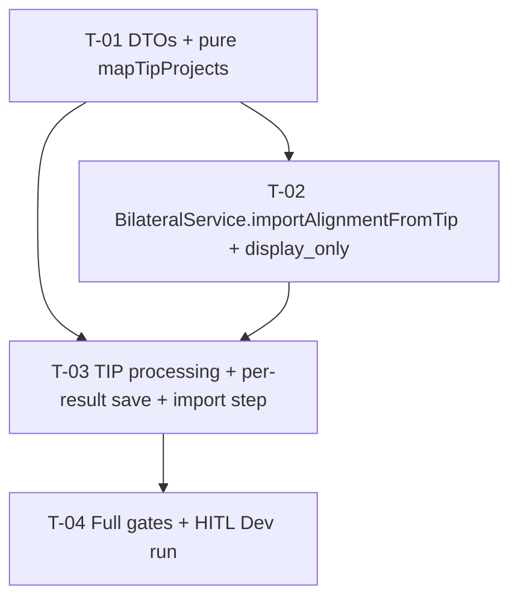

# Tasks — TIP Integration / Knowledge-product projects and pool funding

- **Module:** tip-integration (server) + bilateral
- **Spec id:** 2026-10-tip-kp-project-pool-funding
- **Status:** in-progress
- **Owner:** David Casañas
- **Linked requirements:** ./requirements.md
- **Linked design:** ./design.md (judgment: ./judgment.md — APPROVED)
- **Budget:** 4 tasks · ~560 LOC · 7 review rounds (design §1)
- **Last updated:** 2026-10-20

All commands run from `server/researchindicators/`. No client task. No migration.

---

## 1. Dependency graph

T-02 and T-03 touch the same package: run sequentially (root `CLAUDE.md` §4.3 concurrency).

**Falsifier note (honest state):** the expected reds below are **not pre-observed** at spec time — T-01 and T-02 create new code (red = missing module / failing assertion), and T-03's reds need T-01/T-02 in place. Each Implementer MUST execute its falsifier and quote the observed red verbatim in `execution.md`; a predicted red is not evidence (KZ-014).

---

## 2. Task list

### T-01 — DTOs and pure `mapTipProjects` mapper

- [x] **Status:** done (2026-10-20, PASS attempt 1 — see `execution.md`) · **Size:** S · **Dependencies:** none
- **Requirements covered:**
  - R-TIP-001 — scenarios *Three projects, one primary* (mapper half), *Two projects flagged primary* incl. AND IT MUST (one primary, never zero), *Legacy payload without flags*, *Legacy payload whose first project is unknown*; clauses "`createResult.contract_id` SHALL be …" and "Repeated `agreement_id`s SHALL be saved once".
  - R-TIP-002 — scenario *One unknown non-primary project* (contract dropped + warn naming `ZZ999`), scenario *Unknown primary* (`A171` non-primary, `createResult.contract_id = A171`, `poolFunding = null`), clause "When **no** project is known … a `warn` names the TIP id".
  - R-TIP-005 — the four null conditions (contributing not `true`, `toc_mapping` null, no `science_program_id`, no primary) → `poolFunding = null`.
  - NFR-TIP-002 — the two contract `warn` lines.
- **Design refs:** §7.1, §7.2, D-1, D-6, D-8, §12.
- **Scope (files):**
  - `src/domain/tools/tip-integration/dto/response-year-tip.dto.ts` — `TipTocMappingDto`; `TipProjectDto` optional `is_primary`, `is_contributing_to_pool_funding`, `toc_mapping`; mapped-result type (`ExternalMappersDto` + `poolFunding`).
  - `src/domain/tools/tip-integration/mapper/tip-projects.mapper.ts` (new) — pure function per §7.2 rules 1–6; takes a logger (or returns warnings) so it stays pure.
  - `src/domain/tools/tip-integration/mapper/tip-projects.mapper.spec.ts` (new).
- **Tests:** one case per §7.2 rule; fixtures vary `is_primary` / `is_contributing_to_pool_funding` / known-ness **per project** (KZ-004): `[A132 P, A171, A1824]`; `[A171 P, A132 P]`; object form; `[ZZ999, A171]` unflagged; `[ZZ999 P, A171]`; `[A132 P, A132]` duplicate; `[]`/null; all unknown; primary with `toc_mapping` but `is_contributing false`; primary contributing with `toc_mapping: null`; mapping without `science_program_id`.
- **Verification:** `npx jest src/domain/tools/tip-integration/mapper --silent` · `npx eslint src/domain/tools/tip-integration` · `npm run build`.
- **Falsifier:** mutate rule 2 to "every flagged project stays primary" → *Two projects flagged primary* goes red on the "exactly one `is_primary: true`" assertion; mutate rule 3 to "first item" (not first known) → `[ZZ999, A171]` case red. Build falsifier: type `toc_result_indicator_id` as `number` and assign the sample UUID in the spec fixture → `npm run build` red while jest (transpile-only) may stay green.
- **Red run:** each mutation above observed red on the behavioral assertion (not on import/compile) and quoted.
- **Disqualifier:** a fixture where all projects share the same flags, or where the first project is always the primary and known, cannot tell rule 2 from rule 3 — such a suite is not evidence for R-TIP-001.
- **Consumers:** `TipProjectDto` — `response-year-tip.dto.ts:9, 41` only (design P-15). No test file pins it.
- **Review:** `full` — the mapper encodes every primary/unknown rule the rest depends on.
- **Done criteria:**
  - [x] All listed fixtures green; both mutations observed red and reverted.
  - [x] `npm run build` green; build falsifier observed red and reverted.
  - [x] `npx eslint` clean on the folder.
- **Skills:** `nestjs-expert`, `tdd`.

---

### T-02 — `BilateralService.importAlignmentFromTip` and TIP display-only

- [x] **Status:** done (2026-10-20, PASS attempt 3 — see `execution.md`) · **Size:** M · **Dependencies:** T-01 (`TipTocMappingDto`)
- **Requirements covered:**
  - R-TIP-003 — scenarios *Primary with full mapping*, *Catalog unavailable*, *Catalog down on a later sync* incl. BUT (never overwrite with null), *Re-sync is idempotent* incl. AND (no row deactivated/inserted); the field table (every row, incl. `target_contribution` numeric-string / NaN / 2-decimal); clauses "first match … `warn`", "failure on one level SHALL NOT discard a match on another", "catalog **fails** … SHALL be kept".
  - R-TIP-004 — scenario *Knowledge product imported at a level STAR forbids* incl. BUT (no `level_not_allowed`); clause "no review-history entry and no socket event"; scenario *STAR rules unchanged* (both THEN and AND: STAR KP `level_not_allowed`; TIP `PATCH` still rejected by the external-source gate).
  - R-TIP-006 — scenario *TIP flag says contributing, STAR contract not eligible*; scenario *Boundaries of the widening* (STAR unchanged; TIP without alignment stays `display_only: false`).
  - NFR-TIP-001 — memo: at most one fetch per `(sp, level, year)` when the memo is shared.
  - NFR-TIP-002 — catalog-miss `warn`.
- **Design refs:** §5, §6, §7.4, §7.5, D-3, D-4, D-7, D-9, D-10, P-6, P-7, P-8, P-10, P-14.
- **Scope (files):**
  - `src/domain/entities/bilateral/bilateral.service.ts` — new public `importAlignmentFromTip(resultId, mapping, year, actorUserId, memo?)` per §7.4 steps 1–5 (per-level `getTocResults` in its own try/catch; failed ≠ no-match; equality skip with normalisation; `persistAlignment` in a transaction); `buildAlignment` `displayOnly` gains the TIP term from §6. `importAlignmentFromPrms`, `updateAlignment`, `persistAlignment` bodies untouched.
  - `src/domain/entities/bilateral/bilateral.service.importAlignmentFromTip.spec.ts` (new).
  - `src/domain/entities/bilateral/bilateral.service.spec.ts` — display-only cases.
- **Tests:** catalog fixture where TIP's UUID maps to integer indicator `4711` (distinct from every other number in the fixture) under `SP01:OUTPUT`, a decoy UUID under `OUTCOME`; `OUTPUT` throws but `OUTCOME` holds the id; all levels throw on a fresh result (nulls) and on a resolved row with same `toc_result_id` (kept); two matches → first + warn; unchanged row (stored `'1.23'`, incoming `1.234`) → `persistAlignment` not called; changed SP → previous deactivated; KP (`indicator_id` = KP) at `OUTPUT` persisted; `target_contribution` `'2'` → 2, `'x'` → null; history repo and `serverGateway` never called; memo shared across two calls → one `getTocResults` per key. Display-only: TIP+alignment+not eligible → `display_only: true`, `is_read_only: true`, alignment + ToC rows returned; TIP no alignment → `false`; STAR+alignment+not eligible (no snapshot/sync/PRMS code) → `false`. One STAR-KP `updateAlignment` assertion → `level_not_allowed`.
- **Verification:** `npx jest src/domain/entities/bilateral --silent` (includes the existing `updateAlignment.*`, `importAlignmentFromPrms`, `sourceReadOnlyGate` suites — must stay green unchanged) · `npx eslint src/domain/entities/bilateral` · `npm run build`.
- **Falsifier:**
  - Replace the per-level try/catch with `getTocResultsForSps` (`Promise.all`) → *OUTPUT throws, OUTCOME holds* case red on `level === 'OUTCOME'`.
  - Drop the failed≠miss branch → *catalog down on resolved row* red on `indicator_id === 4711`.
  - Remove the `Number()`/rounding from the equality → unchanged-row case red on "`persistAlignment` not called".
  - Remove the `platform_code === TIP` guard from the display-only term → STAR boundary case red.
- **Red run:** each mutation observed red on its behavioral assertion and quoted; the existing bilateral suites observed green with the change in place.
- **Disqualifier:** a catalog fixture where `indicator_id` equals `toc_result_id` or any other fixture number cannot prove the UUID → int lookup; a mocked `persistAlignment` asserted only for "was called" (not its args) cannot prove the field table — assert the args.
- **Consumers:** `display_only` readers (design P-14): `bilateral.service.spec.ts`, `bilateral.controller.spec.ts` (server); `result-sidebar.component.spec.ts`, `pool-funding-alignment.component.spec.ts` (client — wire type unchanged, no edit expected). `BilateralService` new method is additive.
- **Review:** `full` — gate-free write to a shared data table; correctness-critical.
- **Done criteria:**
  - [x] New + updated specs green; every falsifier observed red and reverted.
  - [x] Existing `bilateral` suites green with zero edits to them (except the added display-only and STAR-KP cases).
  - [x] `npm run build` and `npx eslint` clean.
  - [x] `git diff` shows no change inside `updateAlignment`, `validateTocAlignments`, `importAlignmentFromPrms`, `persistAlignment`, `toc-level-rules.util.ts`.
- **Skills:** `nestjs-expert`, `tdd`, `error-handling-patterns`.

---

### T-03 — TIP `processing`, per-result save and import step

- [x] **Status:** done (2026-10-20, PASS attempt 2 after Pivot T-03 — see `execution.md`) · **Size:** M · **Dependencies:** T-01, T-02
- **First step (settles P-18, owner T-03):** run read-only on Dev: `SELECT public_link, report_year_id, COUNT(*) FROM results WHERE platform_code='TIP' AND is_active=1 GROUP BY 1,2 HAVING COUNT(*)>1;` and record the raw output in `execution.md`. Non-empty → stop and raise to the user (design P-18 *If false*: add `is_snapshot` to both sides) before building on it. If Dev is unreachable, record `not run` and mark P-18 still UNVERIFIED for T-04.
- **Requirements covered:**
  - R-TIP-001 — scenario *Three projects, one primary* end to end incl. BUT (not only the first project): `processing` output; scenario *Re-sync moves the primary* (payload half: `A171` primary, `A132` non-primary in `alignments.contracts`; DB half via P-3 → T-04).
  - R-TIP-002 — scenario *One unknown non-primary project* THEN (counter created/updated, not error — via the save not hitting the FK because the id is absent from the payload); *Unknown primary* AND (no pool-funding import call).
  - R-TIP-003 — clauses "import SHALL run only for results the save **created or updated in this run** …", "actor … TIP submitter's STAR user when resolved, else null", "ERROR after writing … not imported in that run"; scenarios *Same publication in two years* incl. BUT, *Result skipped as a duplicate*.
  - R-TIP-005 — scenario *Mapping disappears on re-sync* incl. BUT (no import call when `poolFunding` null).
  - R-TIP-007 — scenario *One import throws* (second still imported; counters unchanged; `error` names the first TIP id).
  - NFR-TIP-001 — one memo per run passed to every import; one batch `AgressoContract` query.
  - NFR-TIP-002 — the `error` line.
- **Design refs:** §3, §7.3, §7.6, §7.7, D-2, D-5, P-13, P-18, P-19, P-20.
- **Scope (files):**
  - `src/domain/tools/tip-integration/tip-integration.service.ts` — `processing()` batch known-id query + `mapTipProjects`; `getKnowledgeProductsByYear()` per-result `saveAllSections` loop with counter-delta gate, `findOne` on the save's keys, `importAlignmentFromTip` in its own try/catch, per-run memo.
  - `src/domain/tools/tip-integration/tip-integration.module.ts` — import `BilateralModule`.
  - `src/domain/tools/tip-integration/tip-integration.service.spec.ts` — update `processing` fixtures (current fixture `project: { agreement_id: 'AGR-001' }` at `:71`) and add the import-step cases; provide `BilateralService` mock.
- **Tests:** `processing` with the sample payload → three contracts, one primary, `poolFunding` = A132's mapping, `createResult.contract_id = 'A132'`; known-id query called once for a 2-result batch; save mock that bumps `createdRecords` / `updatedRecords` / nothing (omit) / `errorRecords` → import called only for the first two; two years of one link with different mappings → two import calls each with its own mapping and year; `userData` null → actor null; first import throws → second still called, counters equal to what the save left, `error` logged with TIP id; `poolFunding` null → no `findOne`, no import.
- **Verification:** `npx jest src/domain/tools/tip-integration src/domain/shared/services --silent` · `npx eslint src/domain/tools/tip-integration` · `npm run build` · app boot smoke: `npm run start:dev` reaches "Nest application successfully started" with no DI error for `TipIntegrationModule` (KZ-017 — unit specs mock DI and cannot see a missing module import).
- **Falsifier:**
  - Gate the import on "save returned" instead of the counter delta → omit case red on "import not called".
  - Key the mapping by `public_link` in a shared map → two-years case red on the 2025 call's `sp_code`.
  - Remove `BilateralModule` from the module imports → boot smoke red (`Nest can't resolve dependencies of the TipIntegrationService`), unit specs still green.
- **Red run:** each falsifier observed red and quoted; boot falsifier observed on boot, not on jest.
- **Disqualifier:** a save mock that never moves counters cannot prove the gate; a two-year fixture with identical mappings cannot prove per-year routing; a boot run that fails for an unrelated reason (DB/env) is inconclusive — report it, do not claim the DI check passed.
- **Consumers:** `processing()` / `getKnowledgeProductsByYear` — `tip-integration.controller.ts:41, 96, 107`, `tip-integration.controller.spec.ts`, `tip-integration.service.spec.ts` (P-15); `SaveResultService.saveAllSections` called directly (P-19), its own spec `save-all-sections.service.spec.ts` must stay green unchanged.
- **Review:** `full` — changes the live sync loop.
- **Done criteria:**
  - [x] P-18 query output recorded (or `not run` with reason).
  - [x] Updated + new specs green; falsifiers observed red and reverted.
  - [x] `save-all-sections.service.spec.ts` and controller spec green unchanged.
  - [x] Build, eslint, boot smoke green.
- **Skills:** `nestjs-expert`, `tdd`, `error-handling-patterns`.

---

### T-04 — Full gates and HITL Dev run

- [ ] **Status:** todo · **Size:** S · **Dependencies:** T-03
- **Requirements covered:**
  - The defect class *Real TIP payload / catalog shape differs from the sample* (requirements §7) — the only class with no automated gate.
  - Settles P-16 (High) and P-17; P-18 if T-03 could not run it.
  - R-TIP-001 *Re-sync moves the primary* — DB half (observed in Dev after a second sync, if TIP data allows; else recorded as not observed).
- **Design refs:** §11 P-16, P-17, P-18; §14.
- **Scope:** no code. Leader re-runs the full suites after all workers report; then a **human** runs the TIP sync on Dev (the Dev DB is shared and not disposable — running the sync is the user's decision, root `CLAUDE.md` §4.3).
- **Verification:**
  - `npm test -- --silent` (full server unit suite) · `npm run build` · `npx eslint src/domain/tools/tip-integration src/domain/entities/bilateral`.
  - Human, on Dev after deploy: trigger TIP sync for 2026; open a result from agreement `A132` (e.g. TIP id 19191) → Alignment tab lists `A132` (primary), `A171`, `A1824`; Pool Funding tab shows `SP01`, ToC result `HLO1.AOW1.IO1 Steer to impact`, a non-null level and indicator, contribution `1`, read-only.
  - Human, on Dev (added by Pivot T-03): run a **full no-year** TIP sync twice; for a publication TIP returns in two years, `SELECT result_id, report_year_id, is_snapshot FROM results WHERE platform_code='TIP' AND public_link=<link>` shows no new rows after the second run, and the earlier year's row carries its own pool funding. A single-year run never exercises `is_version`.
- **Falsifier:** the human check fails when the Pool Funding tab is hidden, level/indicator show empty (P-16 false), or only one contract is listed.
- **Red run:** n/a — observation, not a test.
- **Disqualifier:** the human observation covers only what it quotes (KZ-002): a screenshot of the Alignment tab does not discharge the Pool Funding checks; a result whose TIP data has no `toc_mapping` cannot settle P-16. Catalog changes may take one 5-min TTL window (K-016) — re-check before calling level/indicator missing.
- **Consumers:** none.
- **Review:** `skip-eligible` — claim to prove: the diff of this task is empty (no file changed); its evidence is the Leader's suite run plus the quoted human observation.
- **Done criteria:**
  - [ ] Full server suite, build, eslint green (output summary quoted).
  - [ ] Human observation quoted, covering each check above; P-16/P-17 rows updated in `design.md` to verified or refuted.
- **Skills:** `systematic-debugging` (only if the Dev run disagrees).

---

## 3. Coverage closure (scenario / clause → task)

| Requirement | Scenario / clause | Task |
| --- | --- | --- |
| R-TIP-001 | Three projects, one primary + BUT | T-01 (mapper), T-03 (end to end) |
| R-TIP-001 | Two flagged + AND IT MUST one primary | T-01 |
| R-TIP-001 | Legacy without flags | T-01 |
| R-TIP-001 | Legacy first unknown | T-01 |
| R-TIP-001 | Re-sync moves the primary | T-03 (payload), T-04 (DB) |
| R-TIP-001 | `createResult.contract_id` rule; dedupe | T-01 |
| R-TIP-002 | One unknown non-primary + BUT no rollback | T-01 (drop + warn), T-03 (counter) |
| R-TIP-002 | Unknown primary + AND `contract_id A171` + no import | T-01, T-03 |
| R-TIP-002 | No project known → residual + warn | T-01 |
| R-TIP-003 | Full mapping; field table | T-02 |
| R-TIP-003 | Catalog unavailable | T-02 |
| R-TIP-003 | Catalog down later + BUT keep | T-02 |
| R-TIP-003 | Re-sync idempotent + AND no rewrite | T-02 |
| R-TIP-003 | Two years + BUT | T-03 |
| R-TIP-003 | Skipped duplicate; only created/updated; ERROR after write | T-03 |
| R-TIP-003 | Multiple matches; per-level failure; coercion | T-02 |
| R-TIP-003 | Actor | T-03 |
| R-TIP-004 | KP at OUTPUT + BUT; no history/socket | T-02 |
| R-TIP-004 | STAR rules unchanged (STAR KP; TIP PATCH gate) | T-02 |
| R-TIP-005 | Mapping disappears + BUT | T-01 (null), T-03 (no call) |
| R-TIP-006 | TIP not eligible → display_only | T-02 |
| R-TIP-006 | Boundaries (STAR; TIP no alignment) | T-02 |
| R-TIP-007 | One import throws | T-03 |
| NFR-TIP-001 | Memo / batch query | T-02, T-03 |
| NFR-TIP-002 | warn/error lines | T-01, T-02, T-03 |
| §7 defect class | Real payload/catalog shape | T-04 |

Premise hand-off: P-18 → T-03 first step; P-16, P-17 → T-04. `consumer` rows P-15 → T-01/T-03 `Consumers`; P-14 → T-02 `Consumers`; P-23 → accepted R-0 (no task).

## 4. Risks & blockers log

| # | Date | Risk / Blocker | Mitigation | Owner | Status |
| --- | --- | --- | --- | --- | --- |
| RB-1 | 2026-10-20 | Dev TIP sync writes to the shared Dev DB | Human-run only (T-04) | David Casañas | open |
| RB-2 | 2026-10-20 | P-16 false → level/indicator always null | Data still saved; T-04 detects; follow-up spec for an id translation | David Casañas | open |
