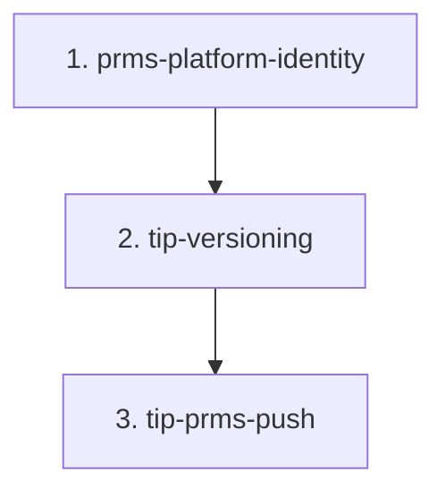

# Spec Family — TIP results in PRMS (AC-1761 phase 2)

> Give every TIP-synced result a version through the normal versioning procedure, and push the eligible ones to PRMS automatically, one by one, as part of the TIP sync — without letting TIP and STAR results collide in PRMS or in the sync history.

---

## 0. Document Control

- **Family path:** `docs/specs/changes/tip-prms-phase-2/`
- **Parent spec / Feature:** `TIP Integration / TIP results in PRMS`
- **Date created:** `2026-10-21`
- **Last updated:** `2026-10-21`
- **Spec-family status:** `open`
- **Owner / Squad:** David Casañas / ARI
- **Linked PRD section:** [`docs/prd.md`](../../../prd.md) — external result ingestion (TIP); PRMS as downstream consumer
- **Linked TRD section:** [`docs/trd/trd.md`](../../../trd/trd.md) — integrations (TIP, PRMS Normalizer); result lifecycle
- **Requirement source:** owner, chat 2026-10-21 (phase 2 of AC-1761) + scout findings recorded in each child's Premise Ledger
- **Extends:** [`docs/specs/changes/tip-kp-project-pool-funding`](../tip-kp-project-pool-funding/) (phase 1 — TIP projects + pool-funding import). **Related family, not a parent:** [`docs/specs/bilateral/prms-sync/`](../../bilateral/prms-sync/family.md) — this family reuses its sync engine and **inherits its principles P-1, R-F1, R-F3, R-F4, R-F6** (cited, not restated). It adds no row to that family's closed set.
- **Approval Mode:** gated

---

## 1. Context & Splitting Rationale

Phase 1 saved TIP projects and the primary project's pool-funding mapping. Phase 2 must (a) version every TIP result the sync creates or updates, and (b) push to PRMS each one that meets all four conditions — reporting year, contributing primary contract, green pool-funding section, no PRMS code yet — with the TIP submitter as author.

Three cut points with different risk:

1. **Identity first.** `result_official_code` is numbered per platform, but the PRMS sync log, the decision history, the webhook correlator and the reference PRMS receives all key on code + year only. A TIP push before this is fixed can land a PRMS decision on a STAR result. Data foundation — it goes first. It also carries the phase-1 T-04 defect fix (the STAR client never requests Pool Funding for a TIP result), because it is the earliest child to ship.
2. **Versioning.** `SP_versioning` accepts STAR rows only, and TIP already writes its own per-year snapshot rows. Shared stored procedures on the STAR critical path — isolated so its review is not diluted.
3. **Push.** TIP-specific gate equivalences, a non-request (sync) actor, sequential per-result push inside the TIP sync, legacy TIP results.

MoSCoW: all three **Must**; order is forced by dependency.

---

## 2. Child Specs Manifest

| # | Spec Path | Title / Scope | Depends on | Parallel-safe | Status | Owner |
|---|---|---|---|---|---|---|
| 1 | `tip-prms-phase-2/prms-platform-identity` | `platform_code` on `result_prms_sync_log` and `result_prms_sync_history` (STAR backfill for existing rows); every reader/writer and the webhook correlator platform-aware; `external_reference` = `TIP-<code>` for TIP (STAR unchanged); PRMS code copied to the live row of the result's own platform; **client: show the Pool Funding section for TIP results** (phase-1 T-04 defect) | `none` | `yes` | `done` | David Casañas |
| 2 | `tip-prms-phase-2/tip-versioning` | Versioning procedures platform-aware; the TIP sync versions every result it creates or updates (delete old version, recreate), reconciled with TIP's own per-year snapshot rows; legacy TIP results | `prms-platform-identity` | `no` | `pending` | David Casañas |
| 3 | `tip-prms-phase-2/tip-prms-push` | TIP gate equivalences (`COMPLETED_IN_TIP` ≙ Approved, `submitted_by` = TIP submitter, KP allowed for TIP only); push from the sync with no HTTP request user; sequential per result; skip when `prms_result_code` is present; legacy TIP results | `tip-versioning` | `no` | `pending` | David Casañas |

### Status Vocabulary
- `pending`: proposed, drafted, or awaiting a prerequisite child.
- `active`: approved and in `/akili-execute`.
- `done`: implementation and `/akili-test` complete and verified.
- `blocked`: blocked by an external dependency or a prerequisite child.

`Parallel-safe: no` on 2–3: both edit the TIP sync service and the server package (root `CLAUDE.md` §4.3).

---

## 3. Dependency Graph

---

## 4. Closed-Set Rule (Non-Negotiable)

> [!IMPORTANT]
> **Closed-Set Rule:** The child table in Section 2 is the **exhaustive child set** of this spec family.
> - No AKILI command or agent may create or execute a child spec folder without a prior registered row in this manifest.
> - Adding, removing, or re-ordering child specs requires a Human-In-The-Loop (HITL) approved manifest edit.
> - The spec family is considered `complete` only when all child specs in this manifest have achieved `done` status and have been verified.

---

## 5. Family-level decisions & open questions (inherited by every child)

| ID | Item |
|---|---|
| FD-1 | **Owner decisions 2026-10-21:** every TIP result gets a version whether or not it is pushed; push only when all four conditions hold (year = `ARI_PRMS_SYNC` reporting year, primary contract contributes to pool funding, pool-funding green check green on the created version, no `prms_result_code`); one result at a time, waiting for PRMS before the next; author = the TIP submitter's STAR user; applies to legacy TIP results. |
| FD-2 | **TIP identity in PRMS:** `external_reference` = `TIP-<official_code>`; STAR keeps the bare code (no change for results already synced). `UNVERIFIED — confirm at source before relying on it` — PRMS acceptance of the prefixed value; evidence in child 1 design P-18; settled by child 3's first TEST-env push. |
| FD-3 | **TIP gate equivalences:** `COMPLETED_IN_TIP` counts as Approved; `submitted_by` = TIP submitter's STAR user; Knowledge Product is sendable for TIP results only (handle from the `'Handled'` evidence row — prms-sync D-4b). The STAR gate is unchanged. A TIP result whose submitter has no STAR user is not pushed, with a recorded reason (P-1). |
| FD-4 | PRMS itself dedupes KPs by handle and enforces the reporting cycle year (spike `changes/prms-sync-knowledge-products/spike/README.md`); STAR surfaces PRMS's 207 row message verbatim (R-F4). |
| OQ-1 | Child 2: how SP versions coexist with TIP's own per-year snapshot rows (`is_version` → `is_snapshot`) — design question, owner child 2. |
