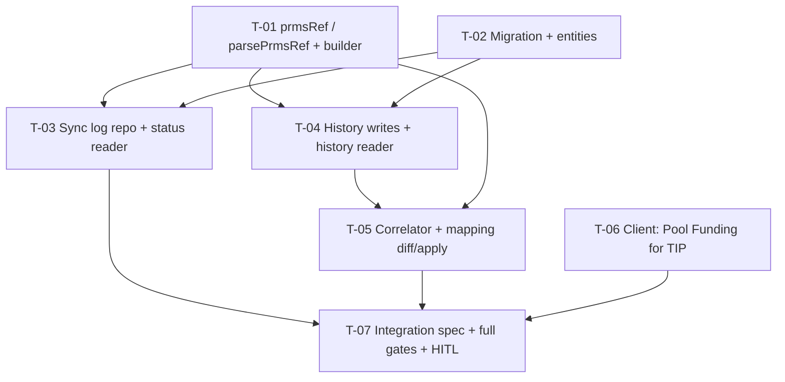

# Tasks — PRMS Sync / Platform identity for TIP results

- **Module:** prms-sync + prms-webhook (server) · bilateral read path (client)
- **Spec id:** 2026-10-prms-platform-identity
- **Status:** in-progress
- **Owner:** David Casañas
- **Linked requirements:** ./requirements.md
- **Linked design:** ./design.md (judgment: ./judgment.md — ESCALATED, owner-resolved 2026-10-21)
- **Family:** ../family.md (child 1 of 3)
- **Budget:** 7 tasks · ~850 LOC · 11 review rounds (design §1)
- **Last updated:** 2026-10-21

Server commands run from `server/researchindicators/`; client commands from `client/research-indicators/`.

---

## 1. Dependency graph

T-01 and T-02 are independent but in the same package — run sequentially. **T-06 (client) is parallel-safe with any server task** (separate package; root `CLAUDE.md` §4.3). T-03, T-04, T-05 are sequential (same package, shared repository files).

**Falsifier note (honest state):** the expected reds below are **not pre-observed** at spec time — T-01 and T-02 create new code and the rest depend on them. Each Implementer MUST execute its falsifier against the post-change code and quote the observed red verbatim; a predicted red is not evidence (KZ-014).

**Gate scope (KZ-017):** the server's SQL lives in raw strings. Unit specs assert the **SQL text** (that is generated output, KZ-001), but only T-07's integration spec proves the SQL **runs and filters** on a real schema. `npm run build` excludes `**/*spec.ts`; the spec type gate is `npx tsc --noEmit -p tsconfig.json` (found in the parent spec).

---

## 2. Task list

### T-01 — `prmsRef` / `parsePrmsRef`, its SQL form, and the builder

- [x] **Status:** done (2026-10-21, PASS attempt 1 + 1 continuation — see `execution.md`) · **Size:** S · **Dependencies:** none
- **Requirements covered:** R-PPI-003 (*Reference by platform* — THEN `TIP-123`; BUT STAR bare); R-PPI-004 parsing half (*Bare reference* AND IT MUST NOT match TIP; *Unknown prefix* → null).
- **Design refs:** §7.1, §7.5 ("One SQL expression for the reference"), D-1, D-4, P-5, P-6.
- **Scope (files):**
  - `src/domain/tools/prms-normalizer/reference/prms-external-reference.ts` (new) — `prmsRef`, `parsePrmsRef`, and the SQL `CASE` fragment that yields `prmsRef(platform_code, result_official_code)`.
  - `src/domain/tools/prms-normalizer/reference/prms-external-reference.spec.ts` (new).
  - `src/domain/tools/prms-normalizer/builders/common-fields.builder.ts` (+ its spec) — `external_reference` via `prmsRef`.
  - `src/domain/tools/prms-normalizer/dto/prms-sync-aggregate.ts` — `platform_code` on the aggregate type.
  - `src/domain/entities/result-prms-sync/repositories/result-prms-sync-aggregate.repository.ts` (+ spec) — header SELECT adds `r.platform_code` (amended 2026-10-21, design P-21).
- **Tests:** round-trip for every `ReportingPlatformEnum` value; STAR → `'123'`; TIP → `'TIP-123'`; `parsePrmsRef` null for `STAR-123`, `tip-123`, `TIP-007`, `TIP-0`, `TIP-`, `TIP-12a`, `XYZ-1`, `'9007199254740993'`, `''`, null; the SQL fragment rendered for each enum value equals `prmsRef` for that value (assert on the fragment string with the platform substituted, or evaluate it in T-07); builder: STAR aggregate → bare code, TIP aggregate → prefixed.
- **Verification:** `npx jest src/domain/tools/prms-normalizer --silent` · `npx eslint src/domain/tools/prms-normalizer` · `npx tsc --noEmit -p tsconfig.json` · `npm run build`.
- **Falsifier:** (a) make `prmsRef` prefix every platform (`STAR-123`) → builder STAR case and round-trip red; (b) make `parsePrmsRef` accept leading zeros → `TIP-007` case red; (c) drop the STAR branch from the SQL fragment → fragment-vs-`prmsRef` assertion red for STAR.
- **Red run:** each mutation observed red on its behavioral assertion and quoted; reverted.
- **Disqualifier:** a fixture using only STAR and TIP cannot prove the enum-wide round-trip; a fragment test that hard-codes the expected string instead of comparing to `prmsRef` cannot prove the SQL matches the function.
- **Consumers:** `common-fields.builder.ts` → its spec and `payload.builder` specs that snapshot `external_reference` (`grep -rln "external_reference" src/domain/tools/prms-normalizer --include='*.spec.ts'` — run and list in the report). Run `npx jest src/domain/tools/prms-normalizer src/domain/entities/result-prms-sync --silent`.
- **Review:** `full` — defines the shared identity contract every other task consumes.
- **Done criteria:**
  - [x] All tests green; falsifiers (a)–(c) observed red and reverted.
  - [x] STAR payload `external_reference` byte-identical to HEAD for an existing fixture (old-vs-new, K-019).
  - [x] eslint, tsc, build green.
- **Skills:** `nestjs-expert`, `tdd`.

---

### T-02 — Migration and entity columns

- [x] **Status:** done (2026-10-22, PASS attempt 2 after the restart — see `execution.md`) · **Size:** M · **Dependencies:** none
- **Requirements covered:** R-PPI-001 (*Existing rows* — THEN log platform from the named result; AND non-STAR reference rewritten; AND history STAR rules; BUT never-matched history → no platform; AND IT MUST be reversible); NFR-PPI-002.
- **Design refs:** §5 (table, migration order, down, collision abort), D-2, D-3, P-2, P-3, P-4, P-19.
- **Scope (files):**
  - `src/db/migrations/<ts>-addPlatformCodeToPrmsSyncTables.ts` (new; `npm run migration:empty --name=addPlatformCodeToPrmsSyncTables`).
  - `src/db/migration-specs/<ts>-addPlatformCodeToPrmsSyncTables.spec.ts` (new — **not** beside the migration, server child guide §9).
  - `result-prms-sync-log.entity.ts`, `prms-webhook-delivery.entity.ts` — `platform_code` column + the new `(platform_code, …)` index decorators.
- **Tests:** migration spec asserts the statement order (add nullable → backfill → `NOT NULL` → drop old index → create new) and down order (drop new → recreate old → drop columns); log backfill SQL covers STAR match, TIP-only match (platform TIP + reference `TIP-<code>`), no match (STAR), and the collision pre-check that raises; history backfill: CORRELATED → STAR, `event_source='STAR'` + canonical number → STAR, `event_source='STAR'` + non-numeric → NULL, PRMS-sent uncorrelated → NULL. No `?` / `:word` in SQL comments (server child guide §7).
- **Verification:** `npx jest src/db/migration-specs --silent` · `npx tsc --noEmit -p tsconfig.json` · `npm run build` · **run it:** `npm run compose:test:up` → `npm run migration:test:bootstrap` → `npm run migration:test:revert` on a **fresh** container (FP-49: bootstrap once per container) → `npm run compose:test:down`.
- **Environment pre-check (Leader, before spawn):** Docker daemon up (`docker info`); else ask the owner.
- **Falsifier:** (a) drop the `MODIFY … NOT NULL` step → the spec's order assertion red; (b) in down, drop the column before its index → `migration:test:revert` red on the TEST container (observed, quoted); (c) remove the TIP-only branch of the log backfill → the TIP-only case red.
- **Red run:** (a), (c) on jest assertions; (b) on the real revert run — quoted.
- **Disqualifier:** a migration verified only by its unit spec has not been shown to run (K-006); a bootstrap on a reused container is inconclusive (FP-49) — report it, do not count it.
- **Consumers:** the two entities are read by every §7 site (design P-9); entity edits are additive (new property). The DB-backed specs P-17 lists are already broken and are not this task's gate.
- **Review:** `full` — schema change on shared tables (override b, f).
- **Done criteria:**
  - [x] Migration spec green; falsifiers observed red and reverted ((b) cannot go red on MySQL 8.0 — recorded).
  - [x] Up + down observed green on a fresh container (targeted route, RB-3) and on a restored Dev dump, outputs quoted.
  - [x] tsc, build green.
- **Skills:** `nestjs-expert`, `tdd`.

---

### T-03 — Sync log repository and status reader

- [x] **Status:** done (2026-10-22, PASS attempt 2 — see `execution.md`) · **Size:** M · **Dependencies:** T-01, T-02
- **Requirements covered:** R-PPI-001 (*New push row* — log half); R-PPI-002 (*Same code and year on two platforms* — sync status + attempt number THEN/AND, BUT STAR unchanged); R-PPI-005 (*TIP push settles* — THEN TIP live row, AND STAR untouched); NFR-PPI-001 (log half).
- **Design refs:** §7.2, §7.5 (status reader), D-1, D-5, P-6, P-7, P-8, P-10, P-20.
- **Scope (files):**
  - `src/domain/entities/result-prms-sync/repositories/result-prms-sync-log.repository.ts` (+ spec) — claim / refused insert select `platform_code` and write it + `prmsRef`; in-flight and both `MAX+1` key on `(platform_code, external_reference, result_year)`; live-row copy `live.platform_code = COALESCE(pushed.platform_code, 'STAR')` (amended 2026-10-22, design §7.2), **no year predicate**.
  - `src/domain/entities/result-prms-sync/result-prms-sync-status.reader.ts` (+ spec) — `LAST_ATTEMPT_SQL` via the T-01 SQL fragment + `platform_code`; `LAST_DECISION_SQL` on `(platform_code, code, year)`.
  - `src/domain/tools/prms-normalizer/reference/prms-external-reference.ts` (+ spec) — the SQL fragment reads a NULL platform as STAR (`COALESCE(<platform>, 'STAR')`), matching the builder (design §7.5, amended 2026-10-21). Test: fragment for a NULL platform equals `prmsRef(STAR, code)`; falsifier: drop the `COALESCE` → that case red.
- **Tests:** SQL-text assertions for every changed statement; claim for a TIP result writes `platform_code='TIP'` and `external_reference='TIP-123'`, for STAR `'STAR'` / `'123'` (old-vs-new for STAR, K-019); live-row copy SQL contains the platform join and **no** `report_year_id`; status reader binds the platform.
- **Verification:** `npx jest src/domain/entities/result-prms-sync src/domain/tools/prms-normalizer --silent` · `npx eslint src/domain/entities/result-prms-sync` · `npx tsc --noEmit -p tsconfig.json` · `npm run build`.
- **Falsifier:** (a) leave `MAX+1` without `platform_code` → the platform-in-key assertion red; (b) keep the `'STAR'` literal in the live copy → the TIP live-row assertion red; (c) add `report_year_id` to the live copy → the "no year predicate" assertion red.
- **Red run:** each observed red on its assertion and quoted; reverted.
- **Disqualifier:** a test that asserts only that a query "was called" cannot prove the key — assert the SQL text and the bound parameters; SQL-text tests cannot prove the query runs (T-07 owns that).
- **Consumers:** `result-prms-sync-log.repository.spec.ts` (43 SQL-text assertions today), `result-prms-sync-status.reader.spec.ts` (12), `result-prms-sync.service.spec.ts`; realign from the failing run, not a grep (K-018).
- **Review:** `full` — changes the push's key and a write to `results` (override b).
- **Done criteria:**
  - [x] Suites green; falsifiers observed red and reverted.
  - [x] STAR claim/settle values byte-identical to HEAD for an existing fixture.
  - [x] eslint, tsc, build green.
- **Skills:** `nestjs-expert`, `tdd`.

---

### T-04 — Decision-history writes and history reader

- [ ] **Status:** todo · **Size:** M · **Dependencies:** T-01, T-02
- **Requirements covered:** R-PPI-001 (*New push row* — history half); R-PPI-002 (history THEN/BUT); NFR-PPI-001 (history half).
- **Design refs:** §7.3, §7.5 (history reader), D-3, D-6, P-11, P-12.
- **Scope (files):**
  - `src/domain/entities/prms-webhook/repositories/prms-webhook-delivery.repository.ts` (+ spec) — inbound `recordInsideLock` stores parsed platform + bare code (unparseable → raw, NULL); `recordOutboundPendingReview` writes platform + bare code; `replaceImportedHistory` writes `STAR` and adds `platform_code = 'STAR'` to its DELETE and `NOT EXISTS`; `findHistory*` gain a platform parameter.
  - `src/domain/entities/prms-webhook/prms-webhook-delivery.service.ts` (+ spec) — parse at insert via `parsePrmsRef`.
  - `src/domain/entities/result-prms-sync/result-prms-sync.service.ts` (+ spec) — pass the pushed result's platform and bare code to the outbound history write (call site `:302-309`).
  - `src/domain/entities/result-prms-sync/prms-sync-history.reader.ts` (+ spec) — metadata selects `platform_code`; events/count key on it.
- **Tests:** inbound `TIP-123` → row `platform_code='TIP'`, `result_official_code='123'`; inbound `123` → STAR; inbound `XYZ-123` → raw string, NULL platform; outbound for STAR byte-identical to HEAD; imported-history DELETE/NOT EXISTS carry `platform_code = 'STAR'`; history reader binds platform.
- **Verification:** `npx jest src/domain/entities/prms-webhook src/domain/entities/result-prms-sync --silent` · `npx eslint src/domain/entities/prms-webhook src/domain/entities/result-prms-sync` · `npx tsc --noEmit -p tsconfig.json` · `npm run build`.
- **Falsifier:** (a) drop `platform_code = 'STAR'` from the imported `NOT EXISTS` → its assertion red; (b) store the raw `TIP-123` as the code → the bare-code assertion red; (c) history reader without platform → its key assertion red.
- **Red run:** each observed red and quoted; reverted.
- **Disqualifier:** an inbound fixture with only STAR references cannot prove parsing; a STAR-only outbound fixture cannot prove the platform is passed through.
- **Consumers:** `prms-webhook-delivery.repository.spec.ts` (34 SQL-text assertions), `prms-webhook-delivery.service.spec.ts`, `prms-sync-history.reader.spec.ts` (25), `result-prms-sync.service.spec.ts`, `prms.opensearch.service.spec.ts` (imported history caller); realign from the failing run (K-018).
- **Review:** `full` — stored field + shared contract (override b).
- **Done criteria:**
  - [ ] Suites green; falsifiers observed red and reverted.
  - [ ] eslint, tsc, build green.
- **Skills:** `nestjs-expert`, `tdd`.

---

### T-05 — Correlator and mapping diff/apply

- [ ] **Status:** todo · **Size:** M · **Dependencies:** T-01, T-02, T-04
- **Requirements covered:** R-PPI-004 (*TIP decision* THEN/AND; *Bare reference* THEN/AND IT MUST NOT; *Unknown prefix*); R-PPI-002 (mapping diff/apply never mixes platforms).
- **Design refs:** §7.4, §7.5 (mapping), D-4, P-13, P-14.
- **Scope (files):**
  - `src/domain/entities/prms-webhook/delivery-correlator.service.ts` (+ spec) — `classify` via `parsePrmsRef`; `LIVE_ROW_SQL` `platform_code = ?`; multiple-live-rows warn names the platform.
  - `src/domain/entities/prms-webhook/pool-funding-mapping-diff.service.ts` (+ spec) — `HISTORY_ROW_SQL` selects `platform_code`; `resolveActiveSnapshot` gains a platform parameter; `ACTIVE_SNAPSHOT_SQL` filters it.
  - `src/domain/entities/prms-webhook/pool-funding-mapping-apply.service.ts` (+ spec) — `HISTORY_SQL` selects `platform_code`; passes it to `resolveActiveSnapshot`.
- **Tests:** TIP 123 and STAR 123 both live: `TIP-123` → TIP row, `123` → STAR row, `XYZ-123` → UNKNOWN_REFERENCE, null → NO_REFERENCE; diff/apply resolve the snapshot of the history row's platform.
- **Verification:** `npx jest src/domain/entities/prms-webhook --silent` · `npx eslint src/domain/entities/prms-webhook` · `npx tsc --noEmit -p tsconfig.json` · `npm run build`.
- **Falsifier:** (a) keep `platform_code='STAR'` in `LIVE_ROW_SQL` → *TIP decision* red; (b) `resolveActiveSnapshot` ignoring its platform argument → the diff/apply platform assertion red.
- **Red run:** each observed red and quoted; reverted.
- **Disqualifier:** a correlator fixture where only one platform has a live row with the code cannot prove platform routing.
- **Consumers:** `delivery-correlator.service.spec.ts` (21 SQL-text assertions), `pool-funding-mapping-diff.service.spec.ts`, `pool-funding-mapping-apply.service.spec.ts`, every other caller of `resolveActiveSnapshot` (`grep -rn "resolveActiveSnapshot" src test` — run and list).
- **Review:** `full` — inbound decision routing (live path) + exported symbol signature (override b).
- **Done criteria:**
  - [ ] Suites green; falsifiers observed red and reverted.
  - [ ] eslint, tsc, build green.
- **Skills:** `nestjs-expert`, `tdd`.

---

### T-06 — Client: Pool Funding section for TIP results

- [x] **Status:** done (2026-10-21, PASS attempt 1 — see `execution.md`) · **Size:** S · **Dependencies:** none (parallel-safe with server tasks)
- **Requirements covered:** R-PPI-006 (*TIP result with imported alignment* THEN tab shown, AND read-only, BUT not editable / no save; *TIP result without alignment* stays hidden; *Other platforms* unchanged).
- **Design refs:** §6, §8, D-7, reversion challenge (§10), P-15, P-16.
- **Scope (files):** `client/research-indicators/src/app/shared/utils/platform-code.util.ts` (+ spec), `shared/services/api.service.ts` (`bilateralPath`, + spec), `shared/services/bilateral.service.spec.ts` (flip the zero-request assertion), `shared/components/result-sidebar/result-sidebar.component.spec.ts` (tab for `display_only`).
- **Tests:** `POOL_FUNDING_PLATFORMS` = `[STAR, TIP]`; `isPoolFundingCapable('TIP-123')` true, `'AICCRA-1'` false; `bilateralPath` for `TIP-123`, `STAR-123`, `123` → digits; `getAlignment('TIP-123')` issues **one** request to the numeric path (HttpTestingController); sidebar shows the tab for `display_only: true` and hides it for `eligible: false, display_only: false`; component `editable()` false for a TIP result (KZ-015: arrange the transition — load, then response).
- **Verification:** `npx jest src/app/shared/utils/platform-code.util.spec.ts src/app/shared/services/api.service.spec.ts src/app/shared/services/bilateral.service.spec.ts src/app/shared/components/result-sidebar --silent` · `npm run lint -- --quiet` · `npm run build`.
- **Falsifier:** (a) leave `bilateralPath` stripping only `STAR-` → the numeric-path request assertion red (`TIP-123` in the URL); (b) remove TIP from `POOL_FUNDING_PLATFORMS` → the one-request assertion red.
- **Red run:** each observed red and quoted; reverted.
- **Disqualifier:** a test that sets the alignment signal directly cannot prove the fetch happens; a request-count assertion without checking the URL cannot prove D-7.
- **Consumers:** `platform-code.util.spec.ts:57-78` (asserts `[STAR]`), `bilateral.service.spec.ts:296-297,339` (zero requests for `TIP-…`), every `bilateralPath` caller (`grep -rn "bilateralPath" src` — run and list), `result-sidebar.component.spec.ts`, `pool-funding-alignment.component.spec.ts`.
- **Review:** `checklist` + exported constant (override b) → conformance Reviewer.
- **Done criteria:**
  - [x] Specs green; falsifiers observed red and reverted.
  - [x] lint, build green (client budgets unchanged).
  - [x] Visual read-only state deferred to T-07 HITL (jsdom cannot render it).
- **Skills:** `angular-developer`.

---

### T-07 — Integration spec, full gates, and HITL check

- [ ] **Status:** todo · **Size:** M · **Dependencies:** T-03, T-05, T-06
- **Requirements covered:** R-PPI-002 and R-PPI-004 at the SQL level (end to end on a real schema); NFR-PPI-001 (full suites); R-PPI-006 rendered state (HITL); parent spec `tip-kp-project-pool-funding` T-04 item 1 (unblocked by R-PPI-006).
- **Design refs:** §13 (integration row), §14, P-17.
- **Scope (files):** `test/prms-platform-identity.integration-spec.ts` (new, `test:integration`; own `result_official_code` band — read sibling headers first, FP-45). No production code.
- **Tests (integration, TEST schema):** STAR 123 and TIP 123 same year, both live; seed a STAR log row and a STAR history row; run the real repository/reader methods: TIP status/history empty, TIP next attempt = 1, STAR unchanged; correlate `TIP-123` → TIP, `123` → STAR; evaluate the T-01 SQL fragment for every enum value and compare with `prmsRef`.
- **Verification:**
  - `npm run compose:test:up` → `npm run migration:test:bootstrap` → `npm run test:integration -- prms-platform-identity` → `npm run compose:test:down`.
  - Server: `npm test -- --silent` (full unit suite) · `npm run build` · `npx eslint src/domain/entities/result-prms-sync src/domain/entities/prms-webhook src/domain/tools/prms-normalizer`.
  - Client: `npm test -- --silent` · `npm run build`.
  - **Human, on Dev after deploy:** open a TIP result with imported pool funding (e.g. agreement `A132`, TIP id 19191) → Pool Funding tab visible, every field read-only, no save; open an AICCRA result → unchanged; open a STAR result → unchanged and editable as before.
- **Falsifier:** remove the platform predicate from `LAST_ATTEMPT_SQL` → the integration spec's "TIP next attempt = 1 / status empty" red on the real schema.
- **Red run:** observed on the TEST schema and quoted; reverted.
- **Disqualifier:** a run on a reused container is inconclusive (FP-49); the HITL observation covers only what it quotes (KZ-002) — a screenshot of the tab does not discharge "no save"; the three pre-existing DB-backed specs (P-17) failing is not this spec's red.
- **Consumers:** none beyond the suites listed.
- **Review:** `checklist` — test-only code; produces derived evidence a later gate consumes (override c) → conformance Reviewer.
- **Done criteria:**
  - [ ] Integration spec green on a fresh container; falsifier observed red and reverted.
  - [ ] Full server and client suites, builds, lint green (summary lines quoted).
  - [ ] Human observation quoted, covering each check; parent T-04 item 1 recorded there.
- **Skills:** `nestjs-expert`, `systematic-debugging` (only if the integration run disagrees).

---

## 3. Coverage closure (scenario / clause → task)

| Requirement | Scenario / clause | Task |
| --- | --- | --- |
| R-PPI-001 | Existing rows — THEN log platform, AND reference rewrite, AND history STAR rules, BUT never-matched no platform, AND IT MUST reversible | T-02 |
| R-PPI-001 | New push row — log | T-03 |
| R-PPI-001 | New push row — history | T-04 |
| R-PPI-002 | Same code/year — status + attempt number | T-03 (unit), T-07 (SQL) |
| R-PPI-002 | Same code/year — history | T-04 (unit), T-07 (SQL) |
| R-PPI-002 | Same code/year — mapping diff/apply | T-05 |
| R-PPI-002 | BUT STAR unchanged | T-03, T-04 (old-vs-new), T-07 (full suites) |
| R-PPI-003 | Reference by platform — THEN TIP, BUT STAR bare | T-01 |
| R-PPI-004 | TIP decision — THEN TIP, AND STAR unchanged | T-05 (unit), T-07 (SQL) |
| R-PPI-004 | Bare reference — THEN STAR, AND IT MUST NOT match TIP | T-01 (parser), T-05 |
| R-PPI-004 | Unknown prefix → uncorrelated | T-01 (parser), T-04 (stored raw), T-05 |
| R-PPI-005 | TIP push settles — THEN TIP live row, AND STAR untouched | T-03 |
| R-PPI-006 | TIP with alignment — THEN shown, AND read-only, BUT no edit/save | T-06 (unit), T-07 (HITL) |
| R-PPI-006 | TIP without alignment — hidden | T-06 |
| R-PPI-006 | Other platforms — unchanged | T-06, T-07 (HITL) |
| NFR-PPI-001 | STAR regression | T-03, T-04, T-07 |
| NFR-PPI-002 | Migration safety | T-02 |

Premise hand-off: `consumer` rows P-9 → T-03/T-04/T-05 `Consumers`; P-15 → T-06 `Consumers`. `UNVERIFIED` P-18 → child 3 (outside this spec). P-17 → recorded in T-02/T-07 Disqualifiers.

## 4. Risks & blockers log

| # | Date | Risk / Blocker | Mitigation | Owner | Status |
| --- | --- | --- | --- | --- | --- |
| RB-1 | 2026-10-21 | T-02/T-07 need Docker for the TEST schema | Leader environment pre-check before spawn | David Casañas | open |
| RB-2 | 2026-10-21 | PRMS acceptance of `TIP-<code>` unproven (P-18) | No TIP push in this spec; child 3 settles | David Casañas | open |
| RB-3 | 2026-10-21 | `migration:test:bootstrap` cannot complete on a fresh container: `CreatePiDelegates1787600000000` fails errno 3780 (utf8mb4 vs utf8mb3) since `027bc60f` — pre-existing, outside this spec | T-02/T-07 use a targeted run (baseline + the sync-table migrations + this spec's); fixing it needs a new append-only migration in its own spec | David Casañas | open |
