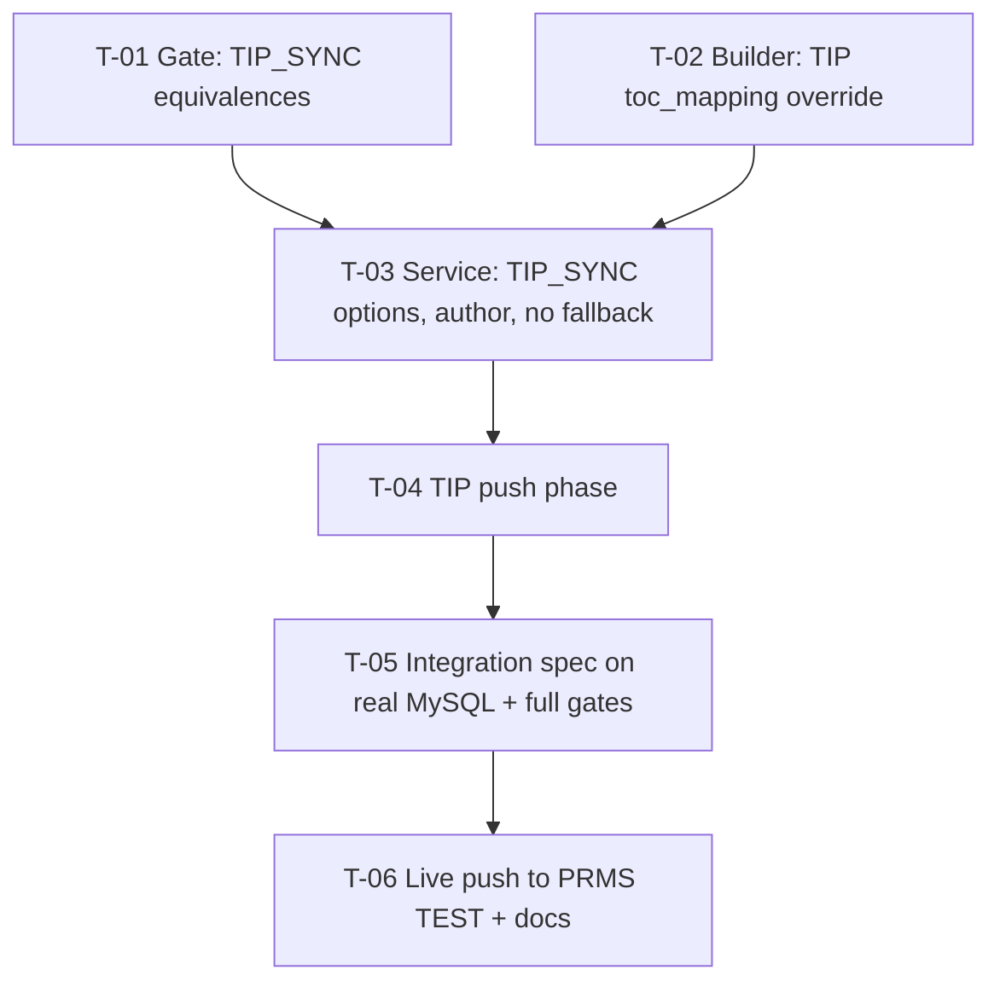

# Tasks — TIP Integration / Push TIP Knowledge Products to PRMS

- **Module:** tip-integration (server) + `entities/result-prms-sync` + `tools/prms-normalizer`
- **Spec id:** 2026-10-tip-prms-push
- **Status:** pending — specified 2026-10-26 (all three gates approved by the owner)
- **Owner:** David Casañas
- **Linked requirements:** ./requirements.md
- **Linked design:** ./design.md (judgment: ./judgment.md — round 1, fixes applied, no re-judgment by owner choice)
- **Family:** ../family.md (child 3 of 3)
- **Budget:** 6 tasks · ~850 LOC · 8 review rounds (design §14)
- **Deadline:** QA-tested by Thursday 2026-10-29
- **Last updated:** 2026-10-26

All commands run from `server/researchindicators/`.

---

## 1. Dependency graph

Every task is in the server package, so run them **sequentially** (root `CLAUDE.md` §4.3). T-01 and T-02 are independent of each other.

**Falsifier note (honest state):** the expected reds below are **predictions**, because every task creates new code. Each Implementer MUST execute its falsifier against the post-change code and quote the observed red verbatim; a predicted red is not evidence (KZ-014).

**Gate scope (KZ-017):**
- Unit specs mock the `DataSource`, so they cannot evaluate the gate snapshot SQL, the `IN (…)` read, or an `undefined` bind. Only T-05 proves those on real MySQL.
- `npm run build` excludes `**/*spec.ts`; the spec type gate is `npx tsc --noEmit -p tsconfig.json`.
- `npm test` does not run `test:integration` or `test:e2e`, so `test/prms-sync.e2e-spec.ts` is run explicitly where it is a consumer.
- No automated check reaches PRMS. Only T-06 does.

**DB verification (owner preference):** DB checks run against the **TEST container** (seeded rows, or a Dev dump restored into it), never against `ARI_MYSQL_*` (shared). The read-only Dev count in T-04 step 1 is the one exception, and it is read-only.

---

## 2. Task list

### T-01 — Gate: TIP equivalences, only for the TIP sync

- [x] **Status:** done 2026-10-26 (PASS, `execution.md`) · **Size:** S · **Dependencies:** none
- **Requirements covered:** R-TPP-003, all five scenarios:
  - *Eligible TIP KP* — the gate allows it.
  - *TIP KP with the section not green* — refused, recorded `REFUSED_BY_STAR`.
  - *STAR KP* — BUT IT MUST NOT become sendable.
  - *STAR result in status 20* — refused as not Approved.
  - *TIP KP through the HTTP route* — BUT IT MUST NOT be sendable through the HTTP route.
  - NFR-TPP-001 for the gate.
- **Design refs:** §2.1 (`sync-gate.ts` and `loadGateSnapshot` rows), §5 *Gate equivalences*, DD-1, P-3, P-4.
- **Scope (files):**
  - `src/domain/entities/result-prms-sync/eligibility/sync-gate.ts` and its spec:
    - optional `platform_code` and `origin` on `SyncGateSnapshot`;
    - `isTipSyncPush`;
    - the `approved` and `indicator_mappable` predicates.
  - `repositories/result-prms-sync-log.repository.ts`: `loadGateSnapshot` selects `r.platform_code` and maps it.
  - Its spec.
- **Tests (`sync-gate.spec.ts`):**
  - TIP + `TIP_SYNC`, status 20, KP, green, contributor → allowed.
  - Same but not green → `alignment_green`, `persistsRow: true`.
  - TIP KP, status 20, `origin` absent → `approved` refusal (the HTTP-route case).
  - STAR KP (status 6, `TIP_SYNC` set) → `indicator_mappable` refusal.
  - STAR status 20 with `TIP_SYNC` → `approved` refusal.
  - TIP OICR with `TIP_SYNC` → `indicator_mappable` refusal.
  - Every existing case unchanged.
- **Verification:**
  - `npx jest src/domain/entities/result-prms-sync src/domain/tools/prms-normalizer --silent`
  - `npx eslint src/domain/entities/result-prms-sync`
  - `npx tsc --noEmit -p tsconfig.json`
  - `npm run build`
- **Falsifier:** both are predictions until run.
  - (a) key `isTipSyncPush` on `platform_code` only, dropping `origin` → the "TIP KP, `origin` absent" case goes red.
  - (b) key it on `origin` only → the "STAR KP with `TIP_SYNC`" case goes red.
- **Red run:** (a) and (b) are each observed on the gate-decision assertion, quoted, then reverted.
- **Disqualifier:** a test that calls a helper directly instead of `evaluateSyncGate(snapshot)` does not prove the entry order. Every case asserts `entryId` from `evaluateSyncGate`.
- **Consumers:**
  - `sync-gate.spec.ts`
  - `knowledge-product.builder.spec.ts` (imports the gate and pins the KP refusal)
  - `result-prms-sync-log.repository.spec.ts`
  - `result-prms-sync.service.spec.ts`
  - `result-prms-sync.controller.spec.ts`
  - `test/result-prms-sync-claim-concurrency.integration-spec.ts` (builds `SyncGateSnapshot` literals, `:98`)
  - `test/prms-sync.e2e-spec.ts` (pins the gate messages)

  The grep was run 2026-10-26 over `src` and `test`, `*spec.ts`, for `SyncGateSnapshot|evaluateSyncGate|loadGateSnapshot|indicator_mappable|Knowledge Product and OICR`.
- **Review:** `full` — this is the shared gate on STAR's critical path.
- **Done criteria:**
  - [x] The new cases and every existing gate test are green.
  - [x] Falsifiers (a) and (b) were observed red and reverted.
  - [x] Entry order, statuses, messages and `persistsRow` are unchanged (diff reviewed).
  - [x] tsc and build are green.
- **Skills:** `nestjs-expert`, `tdd`.

---

### T-02 — Builder: TIP `toc_mapping` override

- [x] **Status:** done 2026-10-26 (PASS, `execution.md`) · **Size:** S · **Dependencies:** none
- **Requirements covered:**
  - R-TPP-004 *Payload shape*: the TIP fields TIP gave; BUT it must NOT invent a value (the key is omitted).
  - The `toc_mapping` row of the R-TPP-004 table: seven keys.
- **Design refs:** §2.1 (builder row), DD-4, P-6, P-17.
- **Scope (files):**
  - `src/domain/tools/prms-normalizer/builders/common-fields.builder.ts`: `build(aggregate, overrides?)`.
  - `payload.builder.ts`: passes `overrides` through.
  - Both specs.
- **Tests:**
  - An override carrying all seven TIP keys → `toc_mapping` equals exactly those seven.
  - An override with `aow_compose_code: ''` and `target_contribution: null` → both keys absent.
  - An override with no `science_program_id` → `PrmsPayloadBuildError` naming `toc_mapping.science_program_id`.
  - No override → the JSON from the existing fixtures is unchanged (existing tests).
  - A KP aggregate with `platform_code = 'TIP'` → `results[0].type = 'knowledge_product'`, `external_reference = 'TIP-<code>'`, `knowledge_product.handle` present.
  - Assertions are on the built JSON, never on calls.
- **Verification:**
  - `npx jest src/domain/tools/prms-normalizer --silent`
  - `npx eslint src/domain/tools/prms-normalizer`
  - `npx tsc --noEmit -p tsconfig.json`
- **Falsifier:** both are predictions until run.
  - (a) emit the override with `buildTocMapping` keys spread in → the "exactly seven" assertion goes red.
  - (b) emit empty strings instead of omitting them → the omission assertion goes red.
- **Red run:** (a) and (b) are each observed on the JSON-equality assertion, quoted, then reverted.
- **Disqualifier:** a `toMatchObject` / `objectContaining` assertion passes with extra keys, so it cannot catch (a). Use exact equality (`toEqual`) on `toc_mapping`.
- **Consumers:**
  - `common-fields.builder.spec.ts`
  - `payload.builder.spec.ts`
  - `result-prms-sync-aggregate.repository.spec.ts`
  - `result-prms-sync.service.spec.ts`
  - `result-prms-sync.controller.spec.ts`
  - `test/result-prms-sync-claim-concurrency.integration-spec.ts`

  The grep was run 2026-10-26 for `CommonFieldsBuilder|PayloadBuilder|payloadBuilder.build`.
- **Review:** `checklist` — additive, an optional parameter, and the no-override path is pinned by existing tests.
- **Done criteria:**
  - [x] The new cases and the existing builder tests are green.
  - [x] Falsifiers observed red and reverted.
  - [x] tsc is green.
- **Skills:** `nestjs-expert`, `tdd`.

---

### T-03 — Service: `TIP_SYNC` options, run author, no stored-alignment fallback

- [x] **Status:** done 2026-10-26 (PASS, `execution.md`) · **Size:** M · **Dependencies:** T-01, T-02
- **Requirements covered:**
  - R-TPP-004: the `created_by` / `submitted_by` rows. *Missing mandatory value* names the first failing field. AND IT MUST NOT send `toc_mapping` from the stored alignment.
  - R-TPP-005 *Unknown submitter*: no PRMS call; the log reads the first failing field.
  - R-TPP-006 unchanged for the no-`origin` path.
  - NFR-TPP-001 for the service.
- **Design refs:** §2.1 (service row), §5 *Authorship* and *`toc_mapping`*, DD-5, P-2, P-5, P-15, P-18.
- **Scope (files):** `src/domain/entities/result-prms-sync/result-prms-sync.service.ts` and its spec.
  - `SyncOptions` gains `origin`, `tocMapping` and `author`.
  - `origin` is set on the snapshot before `evaluateSyncGate`.
  - For `TIP_SYNC`:
    - replace `aggregate.created_by` with the author's staff;
    - synthesize `submitted_by` with `submitted_date = created_at`;
    - throw `PrmsPayloadBuildError('toc_mapping')` when `tocMapping` is missing (settled as `REFUSED_BY_STAR` by the existing catch);
    - call `build(aggregate, { tocMapping })`.
- **Tests:**
  - `TIP_SYNC` with author A while `results.created_by` is B → the built `created_by` and `submitted_by` are A. This is the JD-7 falsifier.
  - Null author → `REFUSED_BY_STAR` and `ingest` is not called.
  - `TIP_SYNC` with no `tocMapping` → `REFUSED_BY_STAR` with a message naming `toc_mapping`; `ingest` not called; the stored `toc_mapping` is never emitted. This is the JD-6 falsifier.
  - No `origin` → the snapshot has no `origin`, the build gets no overrides, and `submitted_by` comes from `submission_history` (existing tests).
- **Verification:**
  - `npx jest src/domain/entities/result-prms-sync --silent`
  - `npx eslint src/domain/entities/result-prms-sync`
  - `npx tsc --noEmit -p tsconfig.json`
  - `npm run build`
- **Falsifier:** all are predictions until run.
  - (a) keep `aggregate.created_by` and only synthesize `submitted_by` from it → the author-A assertion goes red.
  - (b) call `build(aggregate)` when `tocMapping` is missing → the "no `tocMapping`" case goes red (`ingest` called).
  - (c) apply the TIP branch without checking `origin` → an existing STAR test goes red.
- **Red run:** each falsifier is observed on its assertion, quoted, then reverted.
- **Disqualifier:** a stubbed `payloadBuilder.build` hides whether the overrides reach the JSON. At least one case uses the real `PayloadBuilder` and asserts on the payload passed to `ingest`.
- **Consumers:**
  - `result-prms-sync.service.spec.ts`
  - `result-prms-sync.controller.spec.ts` (calls `sync` with no options — must stay green)
  - `result-prms-sync.module.spec.ts`
  - `test/result-prms-sync-claim-concurrency.integration-spec.ts`
  - `test/prms-sync.e2e-spec.ts`
- **Review:** `full` — this is the shared engine entry point used by the STAR button.
- **Done criteria:**
  - [x] New cases green; controller and service specs green unchanged.
  - [x] Falsifiers (a), (b) and (c) observed red and reverted.
  - [x] tsc and build are green.
- **Skills:** `nestjs-expert`, `error-handling-patterns`, `tdd`.

---

### T-04 — TIP push phase

- [ ] **Status:** pending · **Size:** M · **Dependencies:** T-03
- **First step (settles P-13, High):** read-only count on Dev (`ARI_MYSQL_*`, `SET SESSION TRANSACTION READ ONLY`, VPN needed — owner). Count TIP `is_snapshot = 1`, `report_year_id = <ARI_PRMS_SYNC>`, `result_status_id = 20` rows, then:
  - how many have `prms_result_code IS NULL`;
  - how many have `pool_funding_alignment_validation(result_id) = 1`;
  - how many have a contributing primary contract.

  Record the query and the counts in `execution.md`. **If the eligible count is 0, stop and report to the owner before building on it.** That is a Pivot input, not a quiet continue.
- **Requirements covered:**
  - R-TPP-001, all scenarios:
    - *Two eligible results* — BUT must NOT send two in one envelope or in parallel.
    - *One push fails* — AND IT MUST NOT mark the run `FAILED`.
    - *Run without the reporting year* — logs `candidates=0`.
  - R-TPP-002, all scenarios:
    - *Already has a PRMS code*.
    - *No longer contributes in TIP* — BUT IT MUST NOT be sent with the stored alignment.
    - *Legacy result*.
    - *Row the run did not write*.
  - R-TPP-007:
    - *Cron run* — the actor is the submitter.
    - BUT it must NOT carry the previous result's actor.
  - R-TPP-008 *Summary*.
  - NFR-TPP-002, NFR-TPP-003, NFR-TPP-004 (the push counts every candidate `NOT_SENT` when the flag is off).
- **Design refs:** §2 diagram, §2.1 (tip-integration service, repository and module rows), §5 *Push phase* steps 1–6, DD-2, DD-3, DD-6, DD-7, DD-8, DD-9, P-1, P-7, P-9, P-10, P-11, P-16.
- **Scope (files):**
  - `src/domain/tools/tip-integration/tip-integration.service.ts` and its spec:
    - the run-level `pushCandidates`, carried through `persistHandles` and `syncHandle`;
    - `collectSaved` pushes a candidate on the version call only;
    - `update(counters)` moves before the push;
    - new `pushToPrms`.
  - `repository/tip-handle.repository.ts` and its spec: `idsWithPrmsCode`, where an empty list means no query.
  - `tip-integration.module.ts`: import `ResultPrmsSyncModule`.
- **Tests (`tip-integration.service.spec.ts`):**
  - Candidates:
    - Only version saves of the reporting year become candidates; a live save of the same year adds none.
    - A skipped or error outcome adds none.
    - Dedup by `resultId`.
    - A `year = 2024` run with reporting year 2026 → `candidates=0`, and `idsWithPrmsCode` and `sync` are not called.
    - Null `poolFunding` → `not_eligible`, `sync` not called.
    - A row with a code → `skipped`, `sync` not called.
  - Ordering and failures:
    - **Deferred `sync` promises:** the second `sync` does not start before the first resolves.
    - `sync` throws `PrmsSyncPersistedRefusalException` → `REFUSED_BY_STAR`.
    - `sync` throws a 409 `ConflictException` → `NOT_SENT`.
    - `sync` throws an `Error` → `ERROR`, and the next candidate is still sent.
    - The run reaches `endSync`, not `markFailed`.
  - Actor:
    - `setSystemUser` is called with each candidate's `userData` (including null), with force, before its `sync`.
    - `clearSystemUser` runs after every candidate, the throwing ones included.
  - The summary line holds every key, and the counts sum to `candidates`.
- **Verification:**
  - `npx jest src/domain/tools/tip-integration --silent`
  - `npx eslint src/domain/tools/tip-integration`
  - `npx tsc --noEmit -p tsconfig.json`
  - `npm run build`
- **Falsifier:** all are predictions until run.
  - (a) replace the loop with `Promise.all` → the deferred-order assertion goes red.
  - (b) drop the `finally` → the "clear after a throwing candidate" assertion goes red.
  - (c) record candidates on the live call too → the "live save adds none" case goes red.
  - (d) remove the null-`poolFunding` filter → the `not_eligible` case goes red (`sync` called).
- **Red run:** each falsifier is observed on its behavioral assertion, quoted, then reverted. A red that comes from an unresolved deferred promise (timeout) is not the red.
- **Disqualifier:** synchronous `sync` mocks resolve in order whether or not the loop awaits, so a sequential test with synchronous mocks is not evidence for NFR-TPP-002.
- **Consumers:**
  - `tip-integration.service.spec.ts`
  - `tip-integration.controller.spec.ts`
  - `repository/tip-handle.repository.spec.ts` (also pins the module wiring)
  - `test/tip-versioning.integration-spec.ts`

  The grep was run 2026-10-26 for `getKnowledgeProductsByYear|collectSaved|persistHandles|TipHandleRepository|TipIntegrationModule`.
- **Review:** `full` — new integration behavior; ordering, actor and failure isolation are all correctness-critical.
- **Done criteria:**
  - [ ] P-13 count recorded, and the owner informed if it is 0.
  - [ ] All new cases are green; the existing TIP specs are green.
  - [ ] Falsifiers (a)–(d) observed red and reverted.
  - [ ] tsc and build are green.
- **Skills:** `nestjs-expert`, `error-handling-patterns`, `tdd`.

---

### T-05 — Integration spec on real MySQL, then full gates

- [ ] **Status:** pending · **Size:** M · **Dependencies:** T-04
- **Requirements covered:**
  - R-TPP-003 on generated SQL: the snapshot reads `platform_code`.
  - R-TPP-002: `idsWithPrmsCode` returns only rows with a code.
  - R-TPP-006 *PRMS accepts*: the code reaches the TIP live row — BUT IT MUST NOT write the code onto a STAR row with the same official code.
  - R-TPP-005 / R-TPP-007 with a null actor.
  - The requirements §7 rows: *Gate snapshot SQL*, *Null actor*, *Code written to a STAR row*.
- **Design refs:** §10 (integration and compile rows), P-4, P-9, P-12.
- **Scope (files):** new `test/tip-prms-push.integration-spec.ts` (`test:integration` config, TEST container harness from children 1–2).
  - Seed a TIP live row and a 2026 version row with code `C` (status 20, KP, `'Handled'` evidence, a primary contributing contract, a green alignment), plus a STAR row with the same code `C`.
  - Run the real `ResultPrmsSyncService.sync(versionId, { origin: 'TIP_SYNC', tocMapping, author })` with `PrmsNormalizerService.ingest` stubbed to an ACCEPTED 207 row carrying a result code.
- **Tests:**
  - `loadGateSnapshot(versionId).platform_code === 'TIP'`.
  - `idsWithPrmsCode([withCode, withoutCode, []-case])`.
  - After ACCEPTED:
    - the version row has `is_synced_to_prms = 1` and the code;
    - the TIP live row has the code;
    - the STAR row with code `C` is unchanged.
  - A null-author `sync()` → a `REFUSED_BY_STAR` log row with `created_by IS NULL`.
  - The same row through `sync(versionId)` with no `origin` → no claim, and the `approved` refusal.
- **Verification:**
  - `npm run test:integration -- tip-prms-push`
  - full `npm test -- --silent`
  - `npm run test:integration`
  - `npx jest --config ./test/jest-e2e.json prms-sync`
  - `npx tsc --noEmit -p tsconfig.json`
  - `npm run build`
- **Falsifier:** predictions until run.
  - (a) temporarily drop `r.platform_code` from the snapshot SELECT → the `platform_code` assertion goes red.
  - (b) drop the platform condition in the live-row write → the STAR-row assertion goes red.
- **Red run:** (a) and (b) are each observed on the row-value assertion against MySQL, quoted, then reverted.
- **Disqualifier:** a run against `ARI_MYSQL_*` (shared) is not evidence and must not happen. A green with zero seeded rows is inert, so assert the seed count first.
- **Consumers:** the full server suite, `test/result-prms-sync-claim-concurrency.integration-spec.ts`, `test/prms-platform-identity.integration-spec.ts`, `test/tip-versioning.integration-spec.ts`, `test/prms-sync.e2e-spec.ts`.
- **Review:** `checklist` — test-only. The re-measure of the full suite is the Leader's own step (root `CLAUDE.md` §4.3).
- **Done criteria:**
  - [ ] The integration spec is green on the TEST container; falsifiers observed red and reverted.
  - [ ] The full unit suite, the integration suite and the PRMS e2e are green, re-measured by the Leader with no worker active.
  - [ ] tsc and build are green.
- **Skills:** `nestjs-expert`, `tdd`.

---

### T-06 — Live push to PRMS TEST (HITL) and docs

- [ ] **Status:** pending · **Size:** S · **Dependencies:** T-05
- **Requirements covered:**
  - requirements §7 *PRMS accepts the TIP payload end to end* (no automated gate).
  - OQ-2 / design P-14 (child 1 P-18, FD-2).
  - NFR-TPP-004 live: the flag off → `NOT_SENT`.
  - OQ-1 confirmation by the owner.
- **Design refs:** §10 (live row), §11 rollout, P-14.
- **Scope:**
  1. Run a local `PATCH ipr-data/sync?year=2026` (owner, VPN — the local server points at the Dev DB and PRMS **TEST**).
  2. Read the run's push summary line and the `result_prms_sync_log` rows with `platform_code = 'TIP'` (read-only).
  3. Record in `execution.md`: at least one claimed TIP attempt, with its outcome, its `requestId`, and PRMS's message verbatim.
  4. Record whether PRMS accepted `TIP-<code>` (ACCEPTED, or a 207 failure not about the reference, settles P-14).
  5. Docs:
     - TRD §9.1, TIP row: the push phase.
     - `family.md`: row 3 status, and FD-2 settled or still open.
     - Mark `requirements.md` OQ-1 and OQ-2 as answered.
- **Verification:** the owner's live check, recorded verbatim in `execution.md`.
- **Falsifier:** n/a — a live observation. It has no automated red.
- **Red run:** n/a.
- **Disqualifier:**
  - A run where every candidate is `not_eligible`, `skipped` or `NOT_SENT` reached no PRMS call. It settles nothing about P-14. Report it as inconclusive, not as a pass.
  - A 207 failure that names the handle or cycle (RK-2/RK-3) proves the reference was parsed, but not ACCEPTED. Record it as exactly that.
- **Consumers:** none.
- **Review:** `checklist` — docs plus recorded owner evidence.
- **Done criteria:**
  - [ ] At least one claimed TIP attempt recorded, with its outcome and PRMS message.
  - [ ] P-14 / FD-2 recorded as settled or inconclusive, with the reason.
  - [ ] TRD and `family.md` updated.
- **Skills:** none.

---

## 3. Coverage (scenario and clause level)

| Requirement — scenario / clause | Task |
| --- | --- |
| R-TPP-001 *Two eligible* + BUT not parallel | T-04 |
| R-TPP-001 *One push fails* + AND IT MUST NOT mark FAILED | T-04 |
| R-TPP-001 *Run without the reporting year* | T-04 |
| R-TPP-002 *Already has a PRMS code* | T-04 (logic), T-05 (SQL) |
| R-TPP-002 *No longer contributes* + BUT IT MUST NOT send stored alignment | T-04 (filter), T-03 (no fallback) |
| R-TPP-002 *Legacy result*, *Row the run did not write* | T-04 |
| R-TPP-003 *Eligible TIP KP*, *Not green*, *STAR KP* + BUT, *STAR status 20*, *HTTP route* + BUT | T-01 (logic), T-05 (SQL + no-origin path) |
| R-TPP-004 *Payload shape* + AND IT MUST NOT stored `toc_mapping` + BUT not invent | T-02, T-03 |
| R-TPP-004 *Missing mandatory value* (first failing field) | T-03 |
| R-TPP-005 *Unknown submitter* | T-03 (logic), T-05 (null actor on MySQL) |
| R-TPP-006 *PRMS rejects (207)* | Existing engine tests (unchanged interpreter); T-06 live |
| R-TPP-006 *PRMS accepts* + BUT IT MUST NOT write onto a STAR row | T-05 |
| R-TPP-007 *Cron run* + BUT not carry previous actor | T-04 |
| R-TPP-008 *Summary* | T-04 |
| NFR-TPP-001 | T-01, T-03, T-05 (full suite) |
| NFR-TPP-002, NFR-TPP-003 | T-04 |
| NFR-TPP-004 | T-01 (existing `feature_enabled`), T-04 (`NOT_SENT` count), T-06 live |
| OQ-1, OQ-2 | T-06 |

## 4. Risks & blockers log

| ID | Item | Owner |
| --- | --- | --- |
| B-1 | P-13: no eligible TIP KP on Dev would make the feature unreachable there. Settled at T-04 step 1 (VPN) | David Casañas |
| B-2 | T-06 needs VPN plus a local server pointed at the Dev DB, and it sends real data to PRMS TEST | David Casañas |
