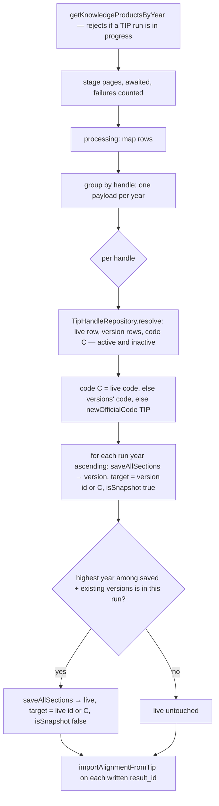

# Design — TIP Integration / One result per handle, one version per year

- **Module:** tip-integration (server)
- **Spec id:** 2026-10-tip-versioning
- **Status:** draft — Judgment Day APPROVED after round one (`judgment.md`); post-judgment info edits applied
- **Owner:** David Casañas
- **Linked requirements:** ./requirements.md (approved 2026-10-22; R-TVR-003 wording sharpened by the round-one Adjust — the live row takes the highest **saved** year)
- **Linked detailed design:** ../../../../trd/trd.md §5.2 (Result aggregate, versioning), §7.4 (cron), §9.1 (TIP)
- **Last updated:** 2026-10-22

---

## 1. Goals & non-goals

**Goals**
- G1 — The TIP sync keeps one result per handle: a live row plus one version row per year (R-TVR-001..003, 007, 008).
- G2 — Pool Funding lands on the rows the sync wrote (R-TVR-004).
- G3 — Staging is complete before it is read (R-TVR-005).
- G4 — A reversible one-off migration merges today's duplicate live rows (R-TVR-006).

**Non-goals**
- No change to `SP_versioning`, `SP_delete_result_version`, STAR `createSnapshot`, or the shared staging query (`prms.repository.ts:16-32`, also read by PRMS at `prms.opensearch.service.ts:333,383`).
- No cron change, no client change, no PRMS push.
- Not deleting versions TIP stops returning (OQ-1), not versioning handles TIP no longer returns (OQ-2).
- Not guarding concurrent runs across several server instances (one instance per environment today).

## 2. Architecture

### 2.1 Composition

| Path | Change |
| --- | --- |
| `src/domain/tools/tip-integration/repository/tip-handle.repository.ts` | **new** — `resolve(handle)`: TIP rows with that `public_link`, **active and inactive** (today's lookup has no `is_active` filter — P-15), split into live row(s) and version rows by year |
| `src/domain/tools/tip-integration/tip-integration.service.ts` | run guard; staging awaited with a failure count (`:157-170`); loop `:213-247` replaced by the per-handle routine (§5); Pool Funding uses the written ids |
| `ExtraData` type (bottom of `save-all-sections.service.ts`) | optional per-call `target: { resultId?: number; officialCode: number; isSnapshot: boolean; compensateRowOnly?: boolean }` — passed in a per-call copy of `extraData`, never stored on the shared object |
| `src/domain/shared/services/save-all-sections.service.ts` | When `target` is given: (1) skip the generic lookup (`:89-110`) and find by `target.resultId`; (2) `isAppliedVersion = target.isSnapshot` on **both** create and update, so `updateInactiveResult(id, isAppliedVersion)` (`:173-176`) can never flip a version to live (JD-1); (3) create with `target.officialCode`. Every call returns `{ resultId, outcome: 'created' \| 'updated' \| 'skipped' \| 'error' }` (today `void`). (4) when `target.compensateRowOnly` is set, a failed create deletes that `result_id` alone. **Without `target` the behavior is unchanged**; PRMS ignores the return value |
| `src/domain/shared/utils/query.service.ts` | **new** method deleting one `result_id` regardless of `is_snapshot` (row-only scope of `full_delete_result_version`, keyed by id — `1789583572262-addPoolFundingDeletesToDeleteRoutines.ts:222-262`) |
| `src/domain/entities/sync-process-log/sync-process-log.service.ts` | **new** read: is a run of a given process `IN_PROGRESS` and younger than N hours; the TIP run marks its log row `FAILED` in its `catch` (today it never does — `tip-integration.service.ts:249-256`) |
| `src/db/migrations/<ts>-mergeTipHandleDuplicates.ts` + `src/db/migration-specs/<ts>-mergeTipHandleDuplicates.spec.ts` | **new** — conversion (§3.2) |
| `test/tip-versioning.integration-spec.ts` | **new** — resolver, `target` save paths and migration on real MySQL |

### 2.2 Reuse

`SaveResultService.saveAllSections` (section writers, duplicate check, compensation), `ResultsService.createResult` / `newOfficialCode`, `BilateralService.importAlignmentFromTip`, `SyncProcessLogService` (its `IN_PROGRESS` status — `sync-process-log.service.ts:36`), `QueryService.resolveResultDeleteTargetIds` (`query.service.ts:57-70`), the `test:integration` config and TEST-container harness from child 1.

## 3. Data model

### 3.1 No schema change to `results`

A version row is an ordinary `results` row: `platform_code = 'TIP'`, `is_snapshot = 1`, `result_official_code = C`, `report_year_id = Y`, `public_link = H` (written by the update path — `save-all-sections.service.ts:190-197`). Uniqueness of (TIP, C, Y, snapshot) is kept by the resolver; `results` has no unique key besides the PK, for STAR too.

### 3.2 Conversion migration `mergeTipHandleDuplicates`

| Step | Rule |
| --- | --- |
| Groups | Live **active** TIP rows grouped by `public_link`, `HAVING COUNT(*) > 1` (63 in Dev, 2026-10-22) |
| Precheck (read-only, before any DDL; abort with no change) | (a) a group with more than 2 rows or two rows of the same year; (b) a demoted row's target (TIP, survivor code, its year, `is_snapshot = 1`) already exists; (c) — not an abort: a group where any row has `prms_result_code` set or `is_synced_to_prms = 1` is **skipped** and left as is, with its count in the record table (the Dev pipeline runs migrations on deploy, so an abort would fail it; the Dev count could not be read on 2026-10-22, DB unreachable); (d) a `result_prms_sync_log` row with `platform_code = 'TIP'` (key: `platform_code`, `external_reference`, `result_year` — index `result-prms-sync-log.entity.ts:15-19`, columns `:41-52,:102`; compared on `platform_code` only, never through `CONCAT`/`CAST` on a text column, MySQL 1267 — server `CLAUDE.md` §7) |
| Survivor | Row referenced by an active `link_results.other_result_id`; none or both → highest `report_year_id`; tie → highest `result_id` |
| Record table | `CREATE TABLE IF NOT EXISTS tip_handle_merge_log(id, kind ENUM('result','link'), row_id, old_code, old_is_snapshot, old_other_result_id, old_is_active, survivor_id, created_at)`; each change is recorded before it is made; DDL commits implicitly in MySQL, so `up()` must be re-runnable: a row is skipped only when its **current** state already equals the target state (never because it is recorded), and a record is inserted only once per row |
| Order | Per group: links first, then the demoted row — so a re-run still finds the group (two live rows) until its last step |
| Demoted rows | `is_snapshot = 1`, `result_official_code = survivor code`, `updated_at = updated_at` |
| Links, `other_result_id` side | Active links to a demoted row → survivor; when the same `result_id` already has an active link to the survivor in the same `link_result_role_id`, the link is deactivated (`is_active = 0`) instead of duplicated |
| Links, `result_id` side | Unchanged: the demoted row's own outgoing links stay on it as a version (STAR versions carry their links — `SP_versioning` copies `link_results`, archive `bugfix--sp-versioning-link-results`) |
| SQL text | No `?` and no `:word` anywhere, comments included (`extra.namedPlaceholders`, server `CLAUDE.md` §7) |
| Down | Restore every recorded value (`updated_at = updated_at`), then drop the record table. Proven only on an untouched dump: after a full sync has run, the survivor may hold another year, so a revert at that point needs the cleanup query recorded in `execution.md` (JD-12) |
| Counts | Groups, demoted rows and re-pointed / deactivated links read from `tip_handle_merge_log` |

## 4. API surface

No endpoint change. `PATCH ipr-data/sync` and the RMQ pattern `tip-clone-knowledge-products` keep their contracts. A run started while another is `IN_PROGRESS` is refused and logged (`warn`). With `async=false` the `PATCH` caller sees the refusal through the existing error path; with `async=true` the controller does not await (`tip-integration.controller.ts:90-96`), so the refusal is visible in the log only.

## 5. Workflows & business rules

**Per run** (`getKnowledgeProductsByYear`):

1. **Before** the existing `try`, refuse the run if a TIP `sync_process_log` row is `IN_PROGRESS` and younger than 6 h; log `warn` and return. A run that fails marks its row `FAILED`, so a failed run does not block the next one. The check and `initiateSync` are not atomic — two runs started in the same instant can both pass; accepted (cron weekly, `PATCH` manual).
2. Stage every page, awaiting each save; count failed staging saves and write the count to the run's log line (JD-14). A failed save means that publication is absent from this run; the next run picks it up.
3. `processing` maps rows as today; the TIP routine never reads `is_version_applied` (it sets `target.isSnapshot`).
4. Group mapped rows by `public_link`. A row with an empty link is skipped with a `warn` (0 in Dev). Within a handle, one payload per year: the first by staging order wins, the rest are logged `warn`.
5. For each handle `H`:
   1. `resolve(H)`. More than one live row (should not happen after the migration): prefer active rows, then the §3.2 survivor rule; log `warn` naming the rows not picked; do not merge or reactivate them.
   2. Code `C` = live row's code; else the versions' code (a version-only handle); else `newOfficialCode(TIP)`.
   3. For each run year `Y` ascending: `saveAllSections(payload_Y, { target: { resultId: versions[Y]?.id, officialCode: C, isSnapshot: true } })`. Record the outcome.
   4. `liveYear` = highest year among this run's **saved** versions and the existing versions. If `liveYear` came from this run and is ≥ the live row's year (or there is no live row): `saveAllSections(payload_liveYear, { target: { resultId: live?.id, officialCode: C, isSnapshot: false } })`. Otherwise the live row is untouched.
   5. `importAlignmentFromTip(resultId, payload.poolFunding, Y, submitter)` for every row whose outcome is `created` or `updated` and whose payload has `poolFunding` (phase-1 rule unchanged).
6. Counters: each written row counts once in `createdRecords` / `updatedRecords` (live and versions separately — a documented change).

**Why versions first:** a year skipped as a cross-platform duplicate (`shouldOmit`) never becomes the live year, and a failed version never moves the live row (JD-5). Residual: a crash or failed live write between steps 5.3 and 5.4 leaves the live row behind its newest version (or a version-only handle) until a later run brings that year; step 5.2 then reuses the versions' code.

**Failures:**
- A failed **version** create is compensated as today: a snapshot seed deletes only itself (`query.service.ts:57-70`).
- A failed **live** create must not use today's compensation: a live seed deletes its whole family (`query.service.ts:31-47,57-70`), which would remove the versions just written in step 5.3. The routine passes a per-call `compensateRowOnly` flag and the compensation deletes that `result_id` alone.
- A failed **update** is not compensated (today's behavior, `save-all-sections.service.ts:262-272`): the row keeps a partial update until the next run; the failure is counted and logged `error`.

**Live row moving to another year:** `updateGeneralInfo` runs `clearAlignmentWhenPortfolioChanges` (`results.service.ts:669-674`, body `:603-636`) and clears the alignment fields the new portfolio hides. When the payload carries `poolFunding`, step 5.5 re-imports it; when it carries none, the cleared state is the correct state for the new year (no mapping). Covered by a unit test.

**Cross-platform duplicates:** TIP prevails over PRMS, and only migrated AICCRA Capacity Sharing prevails over TIP (Rules 1 and 3, `duplicate-result-priority.util.ts:11-24`; AICCRA has no live sync, `:32`). So no live sync deletes TIP rows. A TIP year that duplicates an AICCRA Capacity Sharing result is skipped (`shouldOmit`) and, by step 5.4, never becomes the live year. When TIP prevails, each TIP version save deletes the lower-priority duplicate of **its own year**, exactly as each per-year TIP row does today (`deleteDuplicateResults`, `save-all-sections.service.ts:483-510`, unchanged).

**Audit:** unchanged — `setSystemUser(result.userData, true)` per save (`save-all-sections.service.ts:85`).

## 6. Frontend impact

None in code. The version selector reads `GET results/versions/:code`; the client interceptor derives the platform from a `result/TIP-<code>` URL and the server filters by platform and `is_snapshot` (P-13). Display is checked by the owner on Dev (HITL).

## 7. Integration impact

TIP HTTP unchanged. A full run writes up to (years + 1) rows per handle. OpenSearch indexes live rows only (`result.repository.ts:92`); demoted rows stay in the index until the existing full reindex `POST …/opensearch/result/reset` (`result.opensearch.controller.ts:20`) runs — rollout step 3.

## 8. Security & authorization

No change.

## 9. Observability

`warn`: run refused (in progress); empty link; repeated handle+year; more than one live row; highest year skipped as a duplicate. `error`: failed save. Run log line: staging failures, rows created/updated/skipped/error. Migration counts from `tip_handle_merge_log`.

## 10. Testing strategy

| Layer | What | Where |
| --- | --- | --- |
| Unit | Grouping, one payload per year, code choice (live / versions / new), versions-first order, `liveYear` from saved years only, live untouched for an older year, Pool Funding only on written rows, run guard | `tip-integration.service.spec.ts` |
| Unit | Staging awaited — deferred save promises; staging failure counted | same |
| Unit | `target` branch: update of an existing version keeps `is_snapshot = 1` (JD-1 falsifier: drop the override → red); return value; no-`target` path unchanged (existing tests green) | `save-all-sections.service.spec.ts` |
| Unit | `clearAlignmentWhenPortfolioChanges` on a live year move with and without `poolFunding` | same / service spec |
| Integration (real MySQL, TEST container with Dev dump) | resolver (active + inactive, never a STAR row with the same code); version update stays a version; failed live create deletes only itself; migration prechecks, up, re-run after partial up, down checksums | `test/tip-versioning.integration-spec.ts` |
| End to end (local server → TEST container with Dev dump, real TIP API) | full run twice: rows per handle, no new rows on run 2, linked rows' ids unchanged, no handle with two live rows | task, recorded in `execution.md` |
| HITL | A TIP result on Dev shows its versions in the selector; dashboards still count TIP results sensibly | owner |

## 11. Rollout

1. Merge to `dev` → the Dev pipeline applies the migration (root `CLAUDE.md` §4.3, 2026-08-27 correction).
2. Run one full TIP sync (no `year`) — creates version rows for every handle TIP returns.
3. Run the OpenSearch results reset so demoted rows leave the index.
4. Backout before step 2: `migration:revert`. After step 2: code rollback plus the cleanup query in `execution.md` (JD-12).

## 12. Design decisions

| # | Decision | Rationale | Rejected |
| --- | --- | --- | --- |
| DD-1 | Versions are written directly as `is_snapshot = 1` rows and updated in place | Stable `result_id`s; STAR procedures untouched; every section, KP included, saved by the existing writers | `SP_versioning` delete+recreate: new ids per run, STAR-only (P-3), no KP copy (P-4) |
| DD-2 | The TIP service resolves target rows; `saveAllSections` takes an optional per-call `target` that governs create **and** update, and returns the outcome | PRMS also calls the shared save (P-9); JD-1 | Handle logic inside `saveAllSections`; `target` on create only |
| DD-3 | Versions first; the live row is written once, with the highest **saved** year | A skipped year never becomes live and a failed version never moves the live row (JD-5). A crash between versions and live, or a failed live write, still leaves the live row older than its newest version until the next run brings that year — narrowed, not closed (RK-2) | Live first (abandoned the handle when its highest year was a duplicate) |
| DD-4 | `liveYear` includes existing versions and is compared with the live row's year | A single-year run must not move the live row back (P-5) | Run years only (today's `is_version`) |
| DD-5 | Pool Funding import takes the ids the save returned | No re-find (P-7); skipped rows get no import | Re-find by handle + year + `is_snapshot` |
| DD-6 | Staging writes awaited per page; failures counted | `forEach(async)` returns before writes finish (P-8); a swallowed failure must be visible (JD-14) | `Promise.all` over the whole run |
| DD-7 | Conversion is a migration with a record table written before each change | Reversible; covers handles TIP no longer returns (owner choice A); safe re-run after a partial `up()` (JD-7) | Merge inside the sync (choice B) |
| DD-8 | Survivor = linked row, else highest year | Links point at live rows (owner); 0 links on would-be-demoted rows in Dev (P-11) | Always highest year |
| DD-9 | The resolver sees active and inactive rows and reactivates through the existing update path | Today's lookup reactivates (P-15); an active-only filter would mint new codes (JD-4) | Active-only |
| DD-10 | A TIP run is refused while another TIP run is `IN_PROGRESS` (< 6 h) | `newOfficialCode` is max + 1 without a lock (`results.service.ts:496-515`); two runs could give one code to two handles (JD-9) | DB lock / unique key (schema change, out of scope) |
| DD-11 | A failed live create is compensated by deleting that row only | Today's compensation on a live seed is a family delete and would remove the versions written earlier in the same handle (P-16) | Reorder to live first (re-opens JD-5) |

**Reversion challenge (Step 2.3)** — DD-1/DD-7 remove the "new code per TIP year" behavior. *Run inline by the architect; both Judgment Day judges then audited the same question (`judgment.md`).* Readers of the old per-year codes: `link_results` (by id; re-pointed, 0 today), `result_prms_sync_log`/`history` (0 TIP rows; precheck (c)/(d)), `impersonation_actions.result_official_code` (audit history keeps the old number — accepted), OpenSearch (reset, rollout step 3), `report_general_information` (a view over `results` — follows automatically, P-12).

## 13. Premise Ledger

**Count:** 17 rows — 15 verified, 2 `UNVERIFIED` (1 High: P-13; 1 Low: P-16).
**Blast-radius triggers:** `live-path` (user action: run the TIP sync) · `shared-state` (`saveAllSections` and its compensation shared with PRMS) · `consumer` (stored fields `is_snapshot` / `result_official_code` of TIP rows change; the save's return value changes).

| # | Claim | Class | Citation (as run) | Verified at | If false | Settled by |
|---|---|---|---|---|---|---|
| P-1 | The sync reaches the save through cron → RMQ → controller → `getKnowledgeProductsByYear` → `saveAllSections` | live-path | `tip.cron.ts:15-18` → `self.app.ts:16-17` → `tip-integration.controller.ts:39-42` → `tip-integration.service.ts:182-258`, call at `:215`; REST `PATCH ipr-data/sync` `controller.ts:77-115` | 5bde0b8c | High — wrong file changed | — |
| P-2 | The generic lookup keys on handle + platform + year + `is_snapshot` and creates a new code on a miss | location | `save-all-sections.service.ts:89-110`, `:146-151` | 5bde0b8c | High — DD-2 | — |
| P-3 | `SP_versioning` accepts STAR rows only | existence | `1791468452856-UpdateSPVersionDeletePRMSPhase.ts:25` | 5bde0b8c | Low — DD-1 rationale | — |
| P-4 | `SP_versioning` never inserts into `result_knowledge_products` | existence | `grep -n "INSERT INTO result_knowledge_products" src/db/migrations/1791468452856-UpdateSPVersionDeletePRMSPhase.ts` → 0 hits; `grep -n result_knowledge_product_id` same file → `:871,:879,:1996,:2004` (indicator-mapping column, up and down) | 5bde0b8c | Low — DD-1 rationale | — |
| P-5 | Staging flags a year as version only relative to the same run; PRMS also reads the flag | other | `prms.repository.ts:16-32`; readers `tip-integration.service.ts:198`, `prms.opensearch.service.ts:333,383`; flag read `:1268,1279` | 5bde0b8c | High — DD-4 / non-goal | — |
| P-6 | An update writes `report_year_id`, `public_link` and every section on the target row | location | `results.service.ts:676-681`; `save-all-sections.service.ts:190-250` | 5bde0b8c | High — live row keeps an old year | — |
| P-7 | Pool Funding re-finds the row by handle + year + `is_snapshot` | location | `tip-integration.service.ts:219-238` | 5bde0b8c | Low — DD-5 | — |
| P-8 | Staging saves run in `forEach(async …)` without `await`; failures only logged | existence | `tip-integration.service.ts:157` (`forEach`), `:166-170` (`.catch` logs) | 5bde0b8c | Low — DD-6 | — |
| P-9 | The shared save is reached from TIP (direct) and PRMS (bulk) only | shared-state | `grep -rn "saveAllSections(\|bulkSaveAllSections(" src --include='*.ts' \| grep -v spec.ts` → 6 hits: `tip-integration.service.ts:215`; `save-all-sections.service.ts:67` (def), `:72`, `:76` (def); `prms.opensearch.service.ts:344,390` | 5bde0b8c | High — another caller changes | — |
| P-10 | The duplicate check ignores same-platform rows | location | `save-all-sections.service.ts:443-446` | 5bde0b8c | High — versions self-skip | — |
| P-11 | Dev data: 63 handles with two live rows, never the same year twice, max 2; 118 active links to 114 TIP rows, 0 on would-be-demoted rows; 0 TIP sync-log/history rows; the 3 existing version rows share their live row's code (21156, 21780, 21870) | data-env | read-only `mysql2` queries on `ARI_MYSQL_*`, 2026-10-22 | 2026-10-22 data | High — survivor rule / prechecks | Migration prechecks at run time |
| P-12 | `report_general_information` is a view over `results`, read by `result_id` | consumer | `1776874787128-CreateSectionViews.ts:5`; `star-results-export.repository.ts:145` (both judges) | 5bde0b8c | Low | — |
| P-13 | The client requests versions with the platform, so TIP versions appear under the TIP result | consumer | `api.service.ts:553-556`; `result.interceptor.ts:23-34,53-69`; `results.util.ts:25-50`; `results.service.ts:760-792`. End-to-end display: `UNVERIFIED — confirm at source before relying on it` | — | High — versions invisible | HITL (owner) |
| P-14 | A live row moving year clears portfolio-hidden alignment fields | location | `results.service.ts:603-636`, called `:669-674` | 5bde0b8c | Low — test only | — |
| P-15 | Today's lookup has no `is_active` filter and reactivates through `updateInactiveResult` | location | `save-all-sections.service.ts:89-110,173-176`; `results.service.ts:326-332` | 5bde0b8c | High — DD-9 | — |
| P-16 | Readers affected by TIP rows becoming live+versions: `findResultFamilyIds` (family delete, `query.service.ts:31-47`), `deleteDuplicateResults` (`save-all-sections.service.ts:483-510`), `ResultsUtil.setup` (`results.util.ts:25-50`), OpenSearch live-only (`result.repository.ts:92`), `findResultTIPData` (live-only, `results.service.ts:237-275`, inner join on IP rights), webhook `LIVE_ROW_SQL` (`delivery-correlator.service.ts:27-35`), `ACTIVE_SNAPSHOT_SQL` (`pool-funding-mapping-diff.service.ts:57-70`), PRMS live copy (`result-prms-sync-log.repository.ts:630-655`). Whether `vw_results_dashboard_*` filter `is_snapshot`: `UNVERIFIED — confirm at source before relying on it` (`grep -rln vw_results_dashboard src/db/migrations` → 0 files; created outside migrations) | consumer | as listed | 5bde0b8c | Low — dashboard counts shift by the demoted rows | HITL (owner) |
| P-17 | TIP prevails over PRMS; only migrated AICCRA Capacity Sharing prevails over TIP; AICCRA has no live sync — so no live sync deletes TIP rows | location | `duplicate-result-priority.util.ts:11-24` (Rules 1, 3), `:32` (no live AICCRA sync), `:40-44` (platform set) | 5bde0b8c | High — would need a duplicate-deletion change | — |

`consumer` rows P-12, P-13 and P-16 are copied into the owning tasks' `Consumers` fields.

## 14. Budget (Step 2.4)

| Measure | Estimate |
| --- | --- |
| Tasks | 8 |
| LOC (incl. tests) | ~1,600 |
| Review rounds | 11 |

Re-sized against child 1's actuals (≈2,900 LOC, 10 tasks, 12 rounds) after JD-11. Depth `Full` holds.

## 15. Open questions

None blocking. RK-1 (STAR/TIP equal codes in STAR's version paths) stays recorded in `requirements.md` §8.
