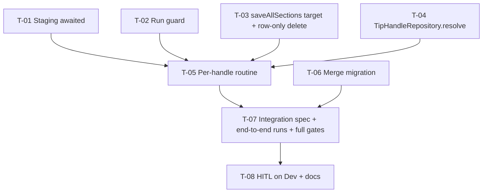

# Tasks — TIP Integration / One result per handle, one version per year

- **Module:** tip-integration (server) — touches `shared/services/save-all-sections`, `shared/utils/query.service`, `sync-process-log`
- **Spec id:** 2026-10-tip-versioning
- **Status:** not-started
- **Owner:** David Casañas
- **Linked requirements:** ./requirements.md
- **Linked design:** ./design.md (judgment: ./judgment.md — APPROVED round 1)
- **Family:** ../family.md (child 2 of 3)
- **Budget:** 8 tasks · ~1,600 LOC · 11 review rounds (design §14)
- **Last updated:** 2026-10-22

All commands run from `server/researchindicators/`.

---

## 1. Dependency graph

Every task is in the server package — run them **sequentially** (root `CLAUDE.md` §4.3). T-01…T-04 are independent of each other; T-06 is independent of T-01…T-05.

**Falsifier note (honest state):** the expected reds below are **predictions** — T-03, T-04 and T-06 create new code and T-05 depends on them. Each Implementer MUST execute its falsifier against the post-change code and quote the observed red verbatim; a predicted red is not evidence (KZ-014).

**Gate scope (KZ-017):** unit specs mock TypeORM, so they cannot evaluate a `where` object's generated SQL or a migration's SQL. Only T-06's Dev-dump run and T-07's integration spec prove the lookups and the conversion on real MySQL. `npm run build` excludes `**/*spec.ts`; the spec type gate is `npx tsc --noEmit -p tsconfig.json`. `npm test` does not run `test:integration` (`rootDir: src`).

**DB verification (owner preference, child 1):** every DB-touching check runs against a **Dev dump restored into the TEST container**, never against `ARI_MYSQL_*` (shared). VPN to the Dev host is needed to take the dump.

---

## 2. Task list

### T-01 — Staging is written completely before it is read

- [ ] **Status:** todo · **Size:** S · **Dependencies:** none
- **Requirements covered:** R-TVR-005 (*Slow staging writes* — THEN every publication is read; BUT must NOT be skipped because its write had not finished).
- **Design refs:** §5 step 2, DD-6, P-8.
- **Scope (files):** `src/domain/tools/tip-integration/tip-integration.service.ts` (`saveTemporalData`, `:127-180`) + `tip-integration.service.spec.ts`.
- **Change:** replace `itemsToStage.forEach(async …)` with awaited saves per page; count failed saves and return the count to `getKnowledgeProductsByYear`, which logs it on the run's summary line.
- **Tests:** stub the staging repository's `save` with **deferred** promises (resolved only after the page loop would have returned); assert `findTemporalResults` is not called before every deferred save resolves; one rejected save → count 1 and the run continues.
- **Verification:** `npx jest src/domain/tools/tip-integration --silent` · `npx eslint src/domain/tools/tip-integration` · `npx tsc --noEmit -p tsconfig.json`.
- **Falsifier:** restore `forEach(async …)` → the deferred-order assertion goes red (predicted: `findTemporalResults` called while saves pending).
- **Red run:** observed on the order assertion, quoted, reverted. A red from a timeout or an unresolved promise is not the red.
- **Disqualifier:** synchronous mock saves resolve before the loop ends and make the test pass with or without the fix — a green under synchronous mocks is not evidence.
- **Consumers:** `tip-integration.service.spec.ts` (pins staging behavior — run whole file).
- **Review:** `checklist` — small, mechanical, one file, behavior pinned by the deferred test.
- **Done criteria:**
  - [ ] Deferred test green; falsifier observed red and reverted.
  - [ ] Failure count logged on the run's summary line.
  - [ ] eslint and tsc green.
- **Skills:** `nestjs-expert`, `tdd`.

---

### T-02 — A TIP run is refused while another is in progress

- [ ] **Status:** todo · **Size:** S · **Dependencies:** none
- **Requirements covered:** R-TVR-001 (*New handle* — BUT must NOT create a second official code for `H`: two overlapping runs could mint one code twice).
- **Design refs:** §5 step 1, §4, DD-10, §2.1 (`sync-process-log.service.ts` row).
- **Scope (files):** `src/domain/entities/sync-process-log/sync-process-log.service.ts` (+ spec) — new read "is `<process>` `IN_PROGRESS` and younger than N hours"; `tip-integration.service.ts` (+ spec) — guard **before** the existing `try`; the `catch` marks the log row `FAILED`.
- **Tests:** guard refuses when an `IN_PROGRESS` row is 1 h old; allows when it is 7 h old; allows when the last row is `FAILED`/`COMPLETED`; a failing run (TIP fetch throws) marks its row `FAILED`; the refusal logs `warn` and does not throw `'Error saving temporal data'`.
- **Verification:** `npx jest src/domain/entities/sync-process-log src/domain/tools/tip-integration --silent` · eslint on both folders · `npx tsc --noEmit -p tsconfig.json`.
- **Falsifier:** (a) drop the age bound → the 7 h case goes red; (b) remove the `FAILED` update from the `catch` → the failing-run case goes red.
- **Red run:** both observed on their assertion, quoted, reverted.
- **Disqualifier:** a test that stubs the new read method itself cannot prove the query filters by process, status and age — assert the `where`/SQL the method builds (generated output, KZ-001); T-07 runs it on MySQL.
- **Consumers:** `grep -rn "SyncProcessLogService" src --include='*.spec.ts'` — run and list; every listed spec runs.
- **Review:** `checklist` — narrow guard, accepted non-atomic window stated in design.
- **Done criteria:**
  - [ ] Four guard cases + failing-run case green; falsifiers observed red.
  - [ ] Consumers' specs green; eslint, tsc green.
- **Skills:** `nestjs-expert`, `error-handling-patterns`, `tdd`.

---

### T-03 — `saveAllSections` per-call `target`, outcome return, row-only compensation

- [ ] **Status:** todo · **Size:** M · **Dependencies:** none
- **Requirements covered:** R-TVR-002 (*Version exists* — THEN updated, keeps `result_id`; BUT must NOT delete and recreate); NFR-TVR-001 (no-`target` path unchanged).
- **Design refs:** §2.1 (`ExtraData`, `save-all-sections.service.ts`, `query.service.ts` rows), §5 *Failures*, DD-2, DD-11, P-2, P-15, judgment JD-1.
- **Scope (files):** `src/domain/shared/services/save-all-sections.service.ts` (+ spec) — `target` handling on lookup, **create and update** (`isAppliedVersion = target.isSnapshot`), return `{ resultId, outcome }`, `compensateRowOnly`; `src/domain/shared/utils/query.service.ts` (+ spec) — row-only delete by `result_id`.
- **Tests:**
  - update with `target.isSnapshot = true` on an existing row calls `updateInactiveResult(id, true)` even when `result.is_version_applied = false` (JD-1);
  - create with `target.officialCode = C` creates with `C`, never `newOfficialCode`;
  - `target.resultId` skips the generic lookup;
  - outcomes `created` / `updated` / `skipped` (`shouldOmit`) / `error`;
  - failed create with `compensateRowOnly` deletes that id only (row-only method called, family delete not called);
  - **no-`target` path:** every existing spec in the file stays green unchanged (K-019 old-vs-new over the existing fixtures).
- **Verification:** `npx jest src/domain/shared --silent` · `npx jest src/domain/tools/open-search/prms --silent` (PRMS caller) · eslint on touched folders · `npx tsc --noEmit -p tsconfig.json` · `npm run build`.
- **Falsifier:** (a) apply `target.isSnapshot` on create only → JD-1 test red (expected call `updateInactiveResult(…, true)`, received `false`); (b) let a failed `compensateRowOnly` create call `deleteFullResultById` → row-only test red.
- **Red run:** both observed on the call-argument assertion, quoted, reverted.
- **Disqualifier:** a fixture whose `is_version_applied` already equals `target.isSnapshot` cannot distinguish (a) — the fixture must set them opposite.
- **Consumers:** `grep -rln "saveAllSections\|bulkSaveAllSections\|deleteFullResultById" src test --include='*.ts'` — run and list; at least `save-all-sections.service.spec.ts`, `tip-integration.service.spec.ts`, `prms.opensearch.service.spec.ts`, `query.service.spec.ts` (P-9).
- **Review:** `full` — shared save path used by PRMS.
- **Done criteria:**
  - [ ] New tests green; falsifiers (a), (b) observed red and reverted.
  - [ ] Existing save and PRMS specs green with no edits to their expectations.
  - [ ] eslint, tsc, build green.
- **Skills:** `nestjs-expert`, `tdd`.

---

### T-04 — `TipHandleRepository.resolve`

- [ ] **Status:** todo · **Size:** S · **Dependencies:** none
- **Requirements covered:** R-TVR-001 (*Equal codes across platforms* — THEN every TIP lookup filters `platform_code = 'TIP'`).
- **Design refs:** §2.1 (resolver row), §5 step 5.1, DD-9, P-15.
- **Scope (files):** `src/domain/tools/tip-integration/repository/tip-handle.repository.ts` (new) + spec; provider registration in the TIP module.
- **Behavior:** by `platform_code = 'TIP'` and `public_link = H`, active **and** inactive; returns live row(s) and versions keyed by year; when several live rows: active first, then survivor rule (§3.2), others reported for the caller's `warn`.
- **Tests (unit):** the `where` / SQL sent contains the TIP platform filter and no `is_active` filter; split live/versions; several live rows → active preferred.
- **Verification:** `npx jest src/domain/tools/tip-integration --silent` · eslint · tsc. **Real-MySQL proof is in T-07.**
- **Falsifier:** drop the platform filter → the unit SQL assertion red; in T-07 the "STAR row with the same code" case goes red.
- **Red run:** unit red observed and quoted; the T-07 red is recorded there.
- **Disqualifier:** a unit test can only see the query it builds, not what MySQL returns (KZ-001) — this task is not done on unit evidence alone for the platform claim.
- **Consumers:** none (new file).
- **Review:** `checklist` — small new repository; correctness proven in T-07.
- **Done criteria:**
  - [ ] Unit tests green; falsifier observed red.
  - [ ] eslint, tsc green.
- **Skills:** `nestjs-expert`, `tdd`.

---

### T-05 — The per-handle routine in the TIP sync

- [ ] **Status:** todo · **Size:** L · **Dependencies:** T-01, T-02, T-03, T-04
- **Requirements covered:**
  - R-TVR-001 *New handle* (live + version with new `C`; BUT no second code later), *Same handle, another year* (version with `C`; AND IT MUST NOT create a new live row).
  - R-TVR-002 *First year seen also gets its version*; *Year TIP no longer returns* (version left unchanged).
  - R-TVR-003 *Three years*, *Older year after a newer one* (BUT live row must NOT change), *New highest year* (AND IT MUST keep `result_id` and `C`), *Highest year skipped as a duplicate* (BUT 2026 must NOT be written to any TIP row).
  - R-TVR-004 *Two years, two mappings* (BUT must NOT write one year's mapping onto another's row).
  - R-TVR-007 (versions for handles TIP returns; skipped years excepted).
- **Design refs:** §2 flowchart, §5 steps 3–6, *Why versions first*, *Live row moving to another year*, *Cross-platform duplicates*, DD-3, DD-4, DD-5, P-5, P-6, P-7, P-10, P-14.
- **Scope (files):** `tip-integration.service.ts` (loop `:213-247` replaced; grouping; code choice; versions first; `liveYear`; live write; Pool Funding on written ids; `warn` lines) + `tip-integration.service.spec.ts`.
- **Tests (unit, fakes for resolve/save/import):** one test per scenario above, plus: empty link skipped with `warn`; repeated handle+year → first wins, `warn`; version-only handle reuses its code; live row year 2026 with no version and a run bringing 2025 → live untouched (R-TVR-003 "not below the live row's year"); failed live create passes `compensateRowOnly`; Pool Funding called only for `created`/`updated` outcomes; live year move with and without `poolFunding` (P-14).
- **Verification:** `npx jest src/domain/tools/tip-integration src/domain/shared --silent` · eslint · tsc · build.
- **Falsifier:** (a) compute `liveYear` from run years only → *Older year* and legacy-live cases red; (b) write live before versions → *Highest year skipped* red (live written with 2026 or not at all); (c) import Pool Funding for `skipped` outcomes → import-count assertion red.
- **Red run:** each observed on its behavioral assertion, quoted, reverted.
- **Disqualifier:** fixtures where every handle has one year cannot distinguish (a) or (b) — use handles with ≥ 2 years and differing payloads per year; a fake `save` that ignores `target` cannot prove which row was written — assert the `target` passed per call.
- **Consumers:** `tip-integration.service.spec.ts`, `bilateral.service.importAlignmentFromTip.spec.ts` (call contract), `tip-integration.controller.spec.ts`.
- **Review:** `full` — core behavior of the spec.
- **Done criteria:**
  - [ ] Every listed scenario has a green test; falsifiers (a)–(c) observed red and reverted.
  - [ ] Counter semantics change (live and versions counted separately) asserted.
  - [ ] eslint, tsc, build green.
- **Skills:** `nestjs-expert`, `tdd`, `systematic-debugging` (on any red not explained by the falsifier).

---

### T-06 — Conversion migration `mergeTipHandleDuplicates`

- [ ] **Status:** todo · **Size:** M · **Dependencies:** none
- **Requirements covered:** R-TVR-006 (*Two live rows, no links* — B live, A version with B's code, keeps `result_id`; AND IT MUST record before-values; *Linked older row* — A live, B version; *Reverse*); NFR-TVR-002; NFR-TVR-003.
- **Design refs:** §3.2 (every row), DD-7, DD-8, P-11, P-12; server `CLAUDE.md` §7 (`?`/`:word`, `updated_at = updated_at`, collation 1267).
- **Scope (files):** `src/db/migrations/<ts>-mergeTipHandleDuplicates.ts` (new; `npm run migration:empty --name=mergeTipHandleDuplicates`); `src/db/migration-specs/<ts>-mergeTipHandleDuplicates.spec.ts` (new, not beside the migration).
- **First step (settles P-12 consumer and the precheck (c) count):** on the Dev dump, record read-only: groups, rows per group, years per group, linked rows, rows with `prms_result_code`/`is_synced_to_prms`, TIP sync-log rows. Quote the figures in the report.
- **Tests:**
  - migration spec (unit): SQL text has no `?` and no `:word`; every UPDATE on `results` and `link_results` sets `updated_at = updated_at`; prechecks run before `CREATE TABLE`; order links → row per group;
  - **Dev-dump run (TEST container):** baseline checksum of TIP `results` rows and `link_results` → `up` → assertions (no handle with two active live rows except skipped (c) groups; every demoted row kept its `result_id`; links point at live rows) → `down` → checksum equals baseline → `up` again → same post-state;
  - partial-up: abort `up` after the first group (injected error in a scratch copy, not in the shipped file) → re-run `up` → same post-state as a clean run.
- **Verification:** `npx jest src/db/migration-specs --silent` · eslint · tsc · Dev-dump run per §11 of the server guide (`compose:test:up`, load the dump, `migration:test:execute`, `migration:test:revert`).
- **Falsifier:** (a) remove `updated_at = updated_at` from the demote UPDATE → down checksum differs (`CHECKSUM MATCH: false`); (b) skip by "recorded" instead of current state → partial-up re-run leaves a group with two live rows; (c) survivor = highest year always → *Linked older row* fixture red.
- **Red run:** each observed on the Dev dump, quoted, reverted.
- **Disqualifier:** a checksum over columns that exclude `updated_at`, or over a dump with 0 groups, proves nothing — confirm the dump has ≥ 1 group and include `updated_at`. If Dev has no linked pair, (c) needs a fixture row inserted into the scratch copy.
- **Consumers:** P-12 (`report_general_information` view — follows `results`), `impersonation_actions` (audit, unchanged), OpenSearch (reset in T-08).
- **Review:** `full` — data migration on shared data.
- **Done criteria:**
  - [ ] First-step figures quoted.
  - [ ] Migration spec green; up/down/up on the Dev dump with `CHECKSUM MATCH: true`; partial-up re-run proven.
  - [ ] Falsifiers (a)–(c) observed red and reverted.
- **Skills:** `nestjs-expert`, `systematic-debugging`.

---

### T-07 — Integration spec, end-to-end runs and full gates

- [ ] **Status:** todo · **Size:** M · **Dependencies:** T-05, T-06
- **Requirements covered:** R-TVR-002 *Version exists* on MySQL (BUT not delete/recreate — same `result_id`); R-TVR-003 *Older year* (BUT live unchanged, `updated_at` included); R-TVR-004 on MySQL; R-TVR-006 *Linked older row* (AND the next full run writes the highest year to A); R-TVR-007 *Legacy handle still in TIP*; R-TVR-008 *Second run* (BUT must NOT create any row); NFR-TVR-001; NFR-TVR-002.
- **Design refs:** §10 (integration and end-to-end rows), §11, P-11, P-15.
- **Scope (files):** `test/tip-versioning.integration-spec.ts` (new) + `execution.md` evidence.
- **Integration cases (TEST container with Dev dump, own `result_official_code` band — read sibling headers, server guide FP-45):** resolver never returns a STAR row with the same code (T-04 falsifier); version update keeps `is_snapshot = 1` and its `result_id`; live untouched (row + `updated_at`) for an older year; failed live create deletes that row only; run guard query filters process/status/age (T-02); routine over a fixture twice → identical row set.
- **End-to-end (local server → TEST container with Dev dump, real TIP API, full run 2021 → current):** before/after counts of live rows, versions, handles with > 1 live row (must be 0), linked rows' ids unchanged; run 2 creates 0 rows.
- **Full gates:** `npm test -- --silent`, `npm run test:integration`, `npm run build`, `npx tsc --noEmit -p tsconfig.json`, `npx eslint src test` — run by the Leader after the worker reports (§4.3 concurrency).
- **Falsifier:** re-apply T-03 falsifier (a) → the "version update keeps `is_snapshot = 1`" integration case red on MySQL.
- **Red run:** observed on MySQL, quoted, reverted.
- **Disqualifier:** an end-to-end run whose TIP fetch failed (staging failures > 0 or the run refused) is not evidence of R-TVR-008 — check the run's summary line first; counts over a run that processed 0 handles prove nothing.
- **Consumers:** every `*.integration-spec.ts` (shared config; run all).
- **Review:** `full` — the only real-MySQL evidence.
- **Done criteria:**
  - [ ] Integration spec green; falsifier observed red on MySQL.
  - [ ] End-to-end figures for both runs recorded in `execution.md`.
  - [ ] Full gates green.
- **Skills:** `nestjs-expert`, `systematic-debugging`.

---

### T-08 — HITL on Dev and documentation

- [ ] **Status:** todo · **Size:** S · **Dependencies:** T-07 (and the owner's push)
- **Requirements covered:** P-13 / P-16 settlement; rollout §11 steps 2–3.
- **Design refs:** §6, §11, P-13, P-16.
- **Scope:** after the owner pushes to `dev` (pipeline applies the migration): owner runs one full TIP sync and the OpenSearch results reset; owner checks (1) a multi-year handle (e.g. `hdl.handle.net/10568/181023`) opens as one TIP result with its versions in the selector; (2) results lists / dashboards show TIP counts the owner considers right. Docs: `docs/trd/trd.md` §9.1 TIP row (one result per handle, versions per year); server child guide §8 if the owner wants the rule recorded.
- **Verification:** owner's words quoted in `execution.md` (KZ-002 — quote what the observation covered).
- **Falsifier:** n/a — a human check; it can fail by the owner seeing two results for one handle or no versions.
- **Red run:** n/a.
- **Disqualifier:** a check on a handle with only one year cannot show the selector working; use a multi-year handle.
- **Consumers:** P-13 (client version selector), P-16 (dashboard views).
- **Review:** `skip-eligible` — claim to prove at execute time: the only code-free change is the TRD/guide text, reviewed by the owner at the HITL.
- **Done criteria:**
  - [ ] Owner observations quoted; P-13 and P-16 settled.
  - [ ] TRD §9.1 updated.
- **Skills:** none.

---

## 3. Coverage (scenario and clause → task)

| Requirement / scenario or clause | Task |
|---|---|
| R-TVR-001 New handle; BUT no second code | T-05 (+ T-02 overlap guard) |
| R-TVR-001 Same handle, another year; AND IT MUST NOT create a new live row | T-05 |
| R-TVR-001 Equal codes across platforms | T-04 (unit), T-07 (MySQL) |
| R-TVR-002 Version exists; BUT must NOT delete and recreate | T-03, T-07 |
| R-TVR-002 First year seen also gets its version | T-05 |
| R-TVR-002 Year TIP no longer returns (left unchanged) | T-05 |
| R-TVR-003 Three years in one run | T-05 |
| R-TVR-003 Older year; BUT live must NOT change (data, year, `updated_at`) | T-05 (unit), T-07 (`updated_at` on MySQL) |
| R-TVR-003 New highest year; AND IT MUST keep `result_id` and `C` | T-05 |
| R-TVR-003 Highest year skipped; BUT not written to any TIP row | T-05 |
| R-TVR-003 "not below the live row's year" | T-05 |
| R-TVR-004 Two mappings; BUT not mixed | T-05, T-07 |
| R-TVR-005 Slow staging; BUT not skipped | T-01 |
| R-TVR-006 No links; AND IT MUST record before-values | T-06 |
| R-TVR-006 Linked older row | T-06; "next full run writes 2026" → T-07 |
| R-TVR-006 Reverse | T-06 |
| R-TVR-007 Legacy handle still in TIP | T-07 |
| R-TVR-008 Second run; BUT must NOT create any row | T-07 |
| NFR-TVR-001 STAR unchanged | T-03 (no-`target` path), T-07 (full gates) |
| NFR-TVR-002 No `result_id` changes | T-06, T-07 |
| NFR-TVR-003 Reversible conversion | T-06 |

## 4. Risks & blockers log

| # | Date | Risk / Blocker | Mitigation | Owner | Status |
|---|---|---|---|---|---|
| RB-1 | 2026-10-22 | Dev DB unreachable from this machine at spec time (VPN) — the Dev dump for T-06/T-07 needs it | Connect VPN before T-06 | David Casañas | open |
| RB-2 | 2026-10-22 | `migration:test:bootstrap` blocked by a pre-existing migration (child 1 F1) | Use the Dev dump path, as child 1 did | — | open |
