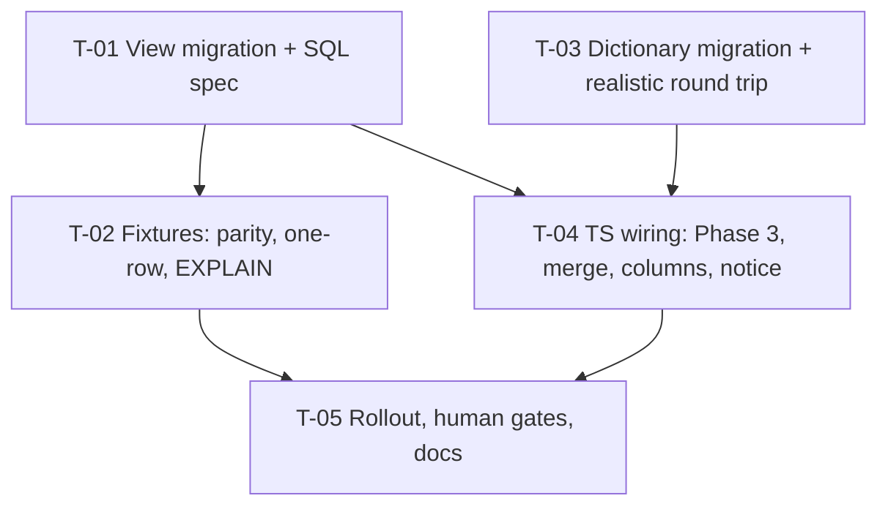

# Tasks — Innovation Development / Excel export section

- **Module:** reports (reads `result-innovation-dev`)
- **Spec id:** 2026-10-innovation-dev-excel-export
- **Status:** in-progress (T-01…T-04 done; T-05 not started — paused by the user 2026-10-06) — resumed 2026-10-06 after `docs/specs/reports/excel-layout-server-side` (done). Amended at T-02's gate (Pivot Record in `execution.md`): T-01 reopened for blank catalog names; T-02 step 6(b) reworded; T-03 keeps only the dictionary half; T-04 adds the `INNOVATION_DEVELOPMENT` section and tags its 32 columns (no fallback row, no banner literal).
- **Owner:** ARI server squad
- **Linked requirements:** ./requirements.md
- **Linked design:** ./design.md (judgment: ./judgment.md — round 1 fixed, **not re-judged**, by user choice)
- **Last updated:** 2026-10-06

> **Baseline readings, observed 2026-10-06 at `13310040`** (scratch `research_indicators_server_test_mysql`, 8.0.46, 392 migrations). The falsifiers below cite these; each was run before this file was written.
>
> | # | Command (from `server/researchindicators`) | Reading |
> | --- | --- | --- |
> | B-1 | ``SELECT LOCATE('order by `root`.`result_id`', VIEW_DEFINITION) > 0 FROM information_schema.VIEWS WHERE TABLE_NAME='report_innovation_dev'`` (scratch) | `1`: the baseline-only view exists and carries a top-level `ORDER BY root.result_id`. *(Amended 2026-10-06 at T-01's gate, user-approved: the first wording, `VIEW_DEFINITION LIKE '%order by%'`, also matches the `GROUP_CONCAT(… ORDER BY …)` that design §3.1 row 4 mandates inside the laterals, so no conforming view could read `0`.)* |
> | B-2 | `SELECT COUNT(*), SUM(section_fill_argb='FF6A1B9A'), SUM(field_label='Link to Innovation Use'), SUM(section='Innovation details') FROM report_data_dictionary WHERE workbook_key='star_results_metadata'` (scratch) | `6 6 0 0`: scratch holds only the 6 Innovation Use rows. **No seed rows, no anchor**, so every layout fixture must seed its own pre-state |
> | B-3 | `SELECT COUNT(*) FROM information_schema.ROUTINES WHERE ROUTINE_NAME='innovation_dev_validation' AND ROUTINE_DEFINITION LIKE '%result_innovation_tool_function%'` (scratch) | `1`: scratch's function is the `1758125999162` body |
> | B-4 | `grep -c report_innovation_dev src/domain/entities/reports/repositories/star-results-export.repository.ts` | `0` |
> | B-5 | `grep -rn "toHaveLength(80)\|bannerTitleMergeToCol: 80\|STAR_RAW_COMING_SOON_NOTICE\|coming soon" src/domain/entities/reports` | `…handler.spec.ts:143` (notice text), `:165` (80 columns), `sheet-presentation.ts:80` (banner 80), `banner-subtitle.ts:15-18`, `…handler.ts:30,102`; `excel-workbook.builder.spec.ts:1019,1039` (builder's own notice test — **unrelated, stays**) |
> | B-6 | `grep -n "mock.calls\[" src/domain/entities/reports/repositories/star-results-export.repository.spec.ts` | `:92` (`calls[0]`, `SET LOCAL`), `:95` and `:247` (`calls[1]`, Phase 2 SQL) |
> | B-7 | Phase 2 top-level table count (design P-3 command) | `60` |

## Dependency graph

All tasks are server-side and run **sequentially** in one worktree (root `CLAUDE.md` concurrency rule): T-01 → T-02 → T-03 → T-04 → T-05. **T-03 is blocked on OQ-1 and OQ-2** (labels and column 89), which were not answered at either gate. The Leader asks them at T-02's continue gate (Kaizen KZ-innovation-use--excel-export-2) and does not start T-03 without answers.

---

### T-01 — Settle P-12, then author the `report_innovation_dev` view migration

- **Status:** done (PASS 2026-10-06; amendment A-1 PASS 2026-10-06, see `execution.md`) · **Size:** M · **Dependencies:** none
- **Requirements covered:**
  - R-IDX-001 (whole);
  - R-IDX-002…005 (cell expressions: every row of their tables, every line format, every rule);
  - NFR-IDX-001 *BUT* clause (no `*_validation()`, no top-level `GROUP BY`/`DISTINCT`/aggregate/`ORDER BY`/`LIMIT`);
  - NFR-IDX-004;
  - the requirements' exclusions (no ids, no audit columns, `Unknown (id n)`, Yes/No, 1–5 numbers).
- **Design refs:** §3.1–§3.5, §3.2a (aliases only), DD-2, DD-5, DD-6, DD-7; Premise Ledger P-9, P-11, P-12 (settled here), P-19
- **Scope:**
  1. **First step: settle P-12.** Run one read-only query per table against the **Dev** database: `SELECT COUNT(*) FROM result_actors ra JOIN results r ON r.result_id = ra.result_id WHERE r.indicator_id = 2 AND r.is_active AND ra.is_active AND ra.actor_role_id <> 1`, and the same for `result_institution_types` / `institution_type_role_id`. Record the command and counts in `execution.md`.
     - **Both 0:** P-12 is verified.
     - **Any non-zero:** stop and take it to the user before T-02.
     - **Dev unreachable** (it timed out from this machine during AC-1681): record the error verbatim, keep P-12 `UNVERIFIED`, and tell the user. The task may continue; the divergence fixture in T-02 still pins the behaviour.
  2. `src/db/migrations/<ts>-CreateReportInnovationDevView.ts`, with `<ts>` after `1791600000000`: `CREATE OR REPLACE VIEW report_innovation_dev` per design §3. That means:
     - a live-results root;
     - `rid` with `is_active` in `ON`;
     - the 6 catalogs (`cit` on **code**);
     - 4 `LEFT JOIN LATERAL` blocks (actors, organizations, tool functions, linked tools), each guarded by `root.indicator_id = 2`;
     - every `applies` exactly as in §3.2 and wrapped whole in `COALESCE(…, FALSE)`;
     - NULL-safe Yes/No via `CASE`;
     - role, indicator and catalog discriminators interpolated from their enums;
     - the `IS NOT NULL` custom-name tests for actor 5 and organization 78;
     - 32 aliases prefixed `innovation_dev_`, plus `result_id`.
     The header comment names the T-02 parity fixture as mandatory for any future redefinition of `innovation_dev_validation`, `valid_text` or `report_field` (requirements R3). `down()`: `DROP VIEW IF EXISTS report_innovation_dev` (DD-6).
  3. `src/db/migration-specs/<ts>-CreateReportInnovationDevView.spec.ts` (fake `QueryRunner` recording SQL) asserts:
     - (a) no `?` and no `:word` outside quoted strings (the `named-placeholders` regex, `src/CLAUDE.md` §7);
     - (b) no top-level `GROUP BY`/`DISTINCT`/`HAVING`/`ORDER BY`/`LIMIT`/`UNION`, checked after stripping lateral bodies;
     - (c) no `_validation(`;
     - (d) exactly 4 `LEFT JOIN LATERAL` blocks, each containing `root.indicator_id = 2`;
     - (e) the 32 aliases of §3.2, all prefixed;
     - (f) `down()` is exactly the drop.
  4. Apply on scratch (`npm run migration:test:execute`). Run `SELECT * FROM report_innovation_dev LIMIT 1` and B-1, which must now read `0`, and confirm the stored definition ends at the root `WHERE` (no top-level `ORDER BY`).
  5. **Amendment A-1 (2026-10-06, rework):** every catalog **name** rendered behind an id the green check accepts — single cells and line slots alike — uses `COALESCE(NULLIF(name, ''), CONCAT('Unknown (id ', id, ')'))` (design §3.1, requirements §3), so a blank name renders `Unknown (id n)`, never `Not provided`. The migration (`1791700000000`, committed `e5db630a`, **not pushed**) is edited in place: revert it on scratch first (`migration:test:revert`), edit, re-apply. The migration spec gains one assertion that every catalog-name `COALESCE` in the SQL wraps the name in `NULLIF(…, '')`. The behavioural proof is T-02's blank-name cases. *(Amended 2026-10-06 at T-02's gate, user-approved.)*
- **Tests:** the migration spec. The behavioural proof is T-02.
- **Falsifier** (each observed red at assertion level, message quoted in `execution.md`):
  - remove `root.indicator_id = 2` from one lateral → (d) red;
  - add `ORDER BY root.result_id` at the top level, the baseline view's shape (B-1) → (b) red;
  - put `:fake` in a SQL comment → (a) red.
  - **Fixture on which they diverge:** the SQL string itself.
- **Red run:** before the file exists the spec's `import` fails. **That is a setup red and does not count.** The assertion-level red comes from applying each Falsifier mutation to the finished migration.
- **Disqualifier:**
  - The spec proves **text, not behaviour** (KZ-001); a green here says nothing about any cell value.
  - B-1 still reading `1` after step 4 means the baseline view survived. The task is not done. (B-1 measures the **top-level** order only; the lateral `GROUP_CONCAT … ORDER BY` is required by design §3.1.)
- **Consumers:** none yet (new symbol). Phase 3 reads it in T-04.
- **Review:** `full`: the cell expressions carry every green-check rule, the dominant defect class (D1).
- **Done criteria:**
  - [x] P-12 outcome recorded (counts, or the Dev error verbatim) and, if non-zero, the user's ruling
  - [x] Migration applies on scratch; `SELECT … LIMIT 1` returns `result_id` + 32 aliases; B-1 reads `0`
  - [x] Migration spec green; the 3 Falsifier mutations observed red at assertion level, messages quoted
  - [x] `npx eslint` and `npx prettier --check` clean on both files
  - [x] `migration:test:revert` drops the view, then it is re-applied
  - [x] **A-1:** blank catalog names fall back to `Unknown (id n)` in every catalog-name cell and slot; migration spec assertion added and seen red with one `NULLIF` removed; re-applied on scratch; eslint/prettier clean
- **Skills:** `nestjs-expert`, `tdd`

---

### T-02 — Fixture suite: green-check parity, one row per result, EXPLAIN gate

- **Status:** done (PASS on attempt 2, 2026-10-06, see `execution.md`) · **Size:** L · **Dependencies:** T-01
- **Requirements covered:**
  - NFR-IDX-002 (whole, incl. the two named divergences);
  - NFR-IDX-001 *Target* (a) and (b), timing as a reading;
  - **R-IDX-001:** "Many children, one row" + *AND IT MUST NOT duplicate* + *BUT must NOT include snapshot/soft-deleted*; "Other indicators" (32 × `NA`); "No detail row" (commonFields `NP`, conditional `NA`).
  - **R-IDX-002:** variety count scenario, including *BUT* (variety No or blank → `NA` with a stale count).
  - **R-IDX-003:**
    - users determined + empty list → `NP`;
    - every line-level violation: actor 5 NULL name, actor type NULL, known org without id, org 78 without name, org type with children and no sub-type, org with no type;
    - *AND IT MUST* use the exact "has children" predicate;
    - users not determined → 4 × `NA` with stale data.
  - **R-IDX-004:**
    - level < 7 → 94–112 `NA` with stale data;
    - opt out → 95 shows `Opt out`, 96–103 `NA`;
    - proceed with gaps → 98/100 `NP`, and *BUT* 101–103 `NM`, never `NP`.
  - **R-IDX-005:** optional scaling answers `NM`, and *BUT must NOT* `NP`.
  - Requirements defect classes D1, D2, D3.
- **Design refs:** §3.3, §3.4, §10 rows 2–4; Premise Ledger P-3, P-4 (re-measured), P-11, P-12 (divergence fixture), P-19, P-20
- **Scope:**
  1. `test/fixtures/innovation-dev/report-innovation-dev-view.fixture-spec.ts` under `test/jest-fixtures.json`. The session first sets `group_concat_max_len = 4194304`. Reuse seeding helpers from `test/fixtures/innovation-use/innovation-dev-validation-behavioral.fixture-spec.ts` where they fit.
  2. **Parity cases:**
     - one result per green-check clause (design §3.3 rows);
     - one fully valid result;
     - one users-not-determined, one level-6, one opt-out;
     - one Innovation Use result (indicator 6);
     - one result with 3 actors, 2 organizations, 3 tool functions and 2 links;
     - one snapshot copy and one soft-deleted result;
     - the **NULL / empty cases** of design §10: variety NULL, knowledge sharing NULL at level ≥ 7, expansion NULL, level NULL, each Yes/No NULL, `is_organization_known` NULL, actor 5 with `''`, org 78 with `''`.
     - **blank catalog names (A-1):** a blank (`''`) name behind an accepted id (nature, type, anticipated users, dissemination, and any other catalog-name cell or slot) reads `Unknown (id n)` with the function TRUE — these cases replace the current `expectBreak` pins. *(Amended 2026-10-06 at T-02's gate, user-approved.)*
  3. **For every indicator-2 case:**
     - `expected = innovation_dev_validation(id)`;
     - assert `expected = TRUE` ⇔ no cell contains `Not provided`;
     - each single-clause case asserts the **exact** cell and slot text that requirements name, and that every other cell is free of `Not provided`;
     - expected strings come from `requirements.md`, never from the view.
     The indicator-6 case asserts 32 × `Not applicable`; the function is not evaluated for it.
  4. **Divergence fixtures** (outside the biconditional): an inactive `rid` with complete data, and role-2 actor rows on an indicator-2 result. Each asserts the documented divergence itself (design §3.3).
  5. **One-row:** `SELECT result_id, COUNT(*) FROM report_innovation_dev GROUP BY result_id HAVING COUNT(*) > 1` returns 0 rows. Snapshot and soft-deleted ids are absent.
  6. **EXPLAIN gate.** Seed ≥ 200 mixed results.
     - (a) `EXPLAIN FORMAT=TREE` of the Phase 3 SQL: 4 × `Materialize (invalidate on row from root)` correlated on `result_id`, and no `Materialize`/`Hash` over a full scan of `results` for the view.
     - (b) Re-run B-7 on the Phase 2 SQL: still `60` top-level rows, and no view merged today becomes `<derived…>` — the 28 pre-existing `<derived…>` rows stay as they are (compare the set of `<derived…>` rows before and after; this spec adds no Phase 2 join). *(Amended 2026-10-06 at T-02's gate, user-approved.)*
     - **Ordering note:** T-04 has not run yet, so (a) uses a test-local Phase 3 string identical to design §2. T-04's Done criteria re-run this fixture against the real repository's captured SQL.
  7. **Timing:** Phase 3 on the seeded set, 3 runs, median and spread. A reading, not a gate.
- **Tests:** this fixture (`npm run test:fixtures -- report-innovation-dev-view`).
- **Falsifier** (each observed red against the T-01 view; the mutation is applied, the named case goes red on its value assertion, then reverted):
  - (a) col 85 `applies` unwrapped (`rid.is_new_or_improved_variety = TRUE` without `COALESCE`): the variety-NULL row reads `NP` while the function is TRUE.
  - (b) `L7` as `cirl.id >= 7` instead of `cirl.level >= 7`: the level-6 row diverges. Scratch's `clarisa_innovation_readiness_levels` is **empty** (`SELECT COUNT(*)` → `0`, run 2026-10-06), so the fixture seeds the catalog itself with `id = level + 1`. Under the mutation the level-6 row (id 7) gets 94 `applies` → 94 reads `NP` (knowledge sharing blank) while the function is TRUE.
  - (c) Yes/No as `IF(b,'Yes','No')`: the knowledge-sharing-NULL row shows `No` where `NP` is expected.
  - (d) org 78 custom name tested with `valid_text`: the `''` row shows `Not provided` while the function is TRUE.
  - (e) drop the `> 0` guard on col 85: the count-0 row shows `0` while the function is FALSE.
  - (f) replace one lateral with a derived + `GROUP BY` table: the positive `invalidate on row from root` match for that child goes red.
- **Red run:** every Falsifier is red **on its behavioural assertion** (a value or plan-line mismatch), message quoted. A red from seeding, an FK error or a timeout is not a red.
- **Disqualifier:**
  - A parity case whose expected value was copied from the view's output is inert.
  - An EXPLAIN on fewer than 200 seeded rows is not evidence.
  - A timing reading whose spread exceeds the median difference it claims is "inconclusive".
  - **Cannot reach:** Dev/Prod data, the Prod MySQL version (P-13).
- **Consumers:** the T-01 view. `star-results-export.repository.ts` is imported read-only for the B-7 Phase 2 SQL capture.
- **Review:** `full`: correctness-critical gate for D1–D3, budgeted at 3 rounds.
- **Done criteria:**
  - [x] All parity, NULL, divergence, one-row and exclusion cases green on scratch
  - [x] Falsifiers (a)–(f) observed red with quoted messages
  - [x] EXPLAIN excerpts (a) and (b) quoted in `execution.md`; B-7 still `60`
  - [x] Timing recorded as a reading
  - [x] **OQ-1 and OQ-2 asked at this task's continue gate**; answers recorded in `requirements.md` §10 (T-03 is blocked until then) — answered 2026-10-06 (OQ-1 confirmed, OQ-2 keep)
- **Skills:** `nestjs-expert`, `tdd`, `systematic-debugging`

---

### T-03 — Settle P-14, then author the dictionary migration with a realistic round trip

- **Status:** done (PASS on attempt 2, 2026-10-06, see `execution.md`) · **Size:** M · **Dependencies:** OQ-1 and OQ-2 answered (gate at T-02); must not run alongside T-01/T-02
- **Requirements covered:**
  - R-IDX-006 (dictionary half): 27 rows reused, normalised, explained, renamed, moved last; 5 inserted; *AND IT MUST leave no `Innovation details` row*; *BUT must NOT change any Innovation Use row*; *BUT must NOT move, rename or recolour any existing dictionary row*. The band itself is T-04 (derived in code; no group row — amended 2026-10-06).
  - NFR-IDX-003 (dictionary half: exact restore of the pre-`up()` rows).
  - NFR-IDX-004.
  - Defect class D5.
- **Design refs:** §3.2a, §5 (whole), DD-3, DD-4; Premise Ledger P-6, P-14 (settled here), P-16, P-17
- **Scope:**
  1. **First step: settle P-14.** Run a read-only query on Dev: `SELECT id, sort_order, section, field_label, explanation, section_fill_argb FROM report_data_dictionary WHERE workbook_key='star_results_metadata' ORDER BY sort_order`. Record the anchor, the 27 rows that follow it, and whether each label matches the seed byte-for-byte. If Dev is unreachable, record the error verbatim; the migration's guard still protects every environment.
  2. Apply the OQ-1/OQ-2 answers to design §3.2a before writing any SQL (if column 89 is dropped, the count becomes 31 and every "32" in the spec is swept, per Correction Closure).
  3. `src/db/migrations/<ts+1>-StarRawInnovationDevDictionary.ts`, exactly per design §5 (no group row):
     - anchor `Link to Innovation Use`;
     - an id-resolved block of 27 with a position-by-position byte-exact guard in TS;
     - `B = MAX` read once;
     - id-keyed `UPDATE`s and 5 `INSERT`s;
     - integer interpolation only, no `?`.
     `down()` is relative to the anchor, with NULL for `''`.
  4. `src/db/migration-specs/<ts+1>…spec.ts`: no `?`/`:word`; every `UPDATE` keyed by `id` (no `WHERE field_label =` in any write); the guard throws before any write on a mismatched block.
  5. `test/fixtures/innovation-dev/star-raw-innovation-dev-dictionary.fixture-spec.ts`: seed a **realistic pre-state** in a transaction. B-2 shows scratch has none, so the fixture builds it:
     - the anchor rows `Link to Innovation Dev`/`Link to Innovation Use`;
     - the 27 seed rows at **seed sort + 1** (P-17), `''` stored as NULL, fill on the first only;
     - 2 OICR rows after them;
     - the 6 existing Innovation Use rows (already on scratch).
     Then run `up → down → up` and assert:
     - after `up`: 32 rows in §3.2a order at `B+1…B+32`, Innovation Use rows byte-identical, and `report_workbook_column_group` untouched (no row written);
     - after `down`: every pre-state row byte-identical, including `sort_order`, NULLs and fill;
     - a pre-state with one seed label altered makes `up` throw with **zero** rows changed.
- **Tests:** the migration spec and the round-trip fixture.
- **Falsifier** (observed red, messages quoted):
  - (a) key one `UPDATE` by `field_label = 'Actors'`: the "Innovation Use rows byte-identical" assertion goes red, because the seeded IU `Actors` row changes.
  - (b) restore `sort_order` from the seed constant (58…) instead of `A + j`: the "pre-state byte-identical" assertion goes red, because the fixture's rows sit at seed + 1.
  - (c) restore `explanation` as `''`: the same assertion goes red (NULL vs `''`).
  - (d) drop the guard: the altered-label pre-state no longer throws.
- **Red run:** each Falsifier red on its assertion, not on seeding.
- **Disqualifier:**
  - A round trip whose pre-state lacks the Innovation Use rows, the +1 shift or the NULLs **cannot** turn (a)–(c) red, and is not evidence (judgment C-1/C-3).
  - **Cannot reach:** Dev's and Prod's real rows beyond the P-14 reading.
- **Consumers:** `report-layout.repository.ts` (`findDataDictionaryRows`, unchanged). T-04's column headers must equal these labels.
- **Review:** `full`: shared tables read by every section; judgment found two severe defects here.
- **Done criteria:**
  - [x] P-14 reading (or Dev error) recorded
  - [x] OQ-1/OQ-2 answers applied, sweep done
  - [x] Migration spec and round-trip fixture green; Falsifiers (a)–(d) observed red, quoted
  - [x] `npx eslint` / `npx prettier --check` clean
  - [x] Applied on scratch, then reverted, then re-applied; scratch left with the pre-state rows removed (fixture cleans up). *(Amended 2026-10-06: with the never-seeded no-op of design §5, a schema-only scratch applies, reverts and re-applies the migration as a no-op; any hand-seeded rows are removed and `migration:test:bootstrap` on a fresh container reports 0 pending.)*
- **Skills:** `nestjs-expert`, `tdd`

---

### T-04 — TS wiring: Phase 3 query and merge, `INNOVATION_DEVELOPMENT` section and 32 tagged columns, notice removal

- **Status:** done (PASS attempt 1, visual approval 2026-10-06, see `execution.md`) · **Size:** M · **Dependencies:** T-01, T-03
- **Requirements covered:**
  - R-IDX-006: Raw data at 112 columns, band 81–112, headers equal to dictionary labels in order, band derived from the `INNOVATION_DEVELOPMENT` tag, banner 112 derived, *BUT must NOT move existing columns*.
  - R-IDX-007 (whole).
  - NFR-IDX-001 (b), re-run on the real repository.
  - NFR-IDX-003 deploy order (code half).
  - Defect classes D4 and D8.
- **Design refs:** §2, §2.1, DD-1 (merge contract), DD-5; reversion challenge (§12); Premise Ledger P-7 (settled here), P-10, P-15, P-20
- **Scope:**
  1. **First step: consumer sweep (P-7).** Run one grep per changed symbol over `server/researchindicators/src`, `server/researchindicators/test` and `client/research-indicators/src`:
     - `STAR_RESULTS_METADATA_RAW_COLUMNS`
     - `STAR_RAW_SECTIONS`
     - `deriveColumnGroups`
     - `STAR_RAW_SHEET_PREAMBLE_BASE`
     - `STAR_RAW_COMING_SOON_NOTICE`
     - `bannerNotice`
     - `findStarResultsMetadataRows`
     - `queryPhase2WithGroupConcatLimit`
     List every hit in `execution.md`. Each pinning file joins this task's Verification. B-5 and B-6 are the known pins; `excel-workbook.builder.spec.ts:1019,1039` stays untouched.
  2. `star-results-export.repository.ts`:
     - Phase 2 adds `gi.result_id AS result_id`;
     - the pinned-connection method runs Phase 2 **then** Phase 3 (`SELECT result_id, <32 aliases> FROM report_innovation_dev WHERE result_id IN (…)`, one placeholder per id) in the same transaction;
     - merge per the DD-1 contract: `String()` keys, Phase 2 order, all 32 keys = `Not applicable` for a missing Phase 3 row;
     - zero ids return before either phase;
     - the class comment lists the new view and Phase 3.
  3. New `star-results-metadata.innovation-dev.columns.ts`: 32 `StarRawSectionColumn` in §3.2a order (key = alias, header = label, `section: 'INNOVATION_DEVELOPMENT'`), spread at the end of `STAR_RESULTS_METADATA_RAW_COLUMNS` (80 → 112).
  4. `star-results-metadata.sections.ts`: add `INNOVATION_DEVELOPMENT: { label: 'INNOVATION DEVELOPMENT', fillArgb: 'FF00897B' }`. The band 81–112 and the banner end 112 come from `deriveColumnGroups`; there is no fallback list or banner literal to edit. *(Amended 2026-10-06 at T-02's gate, user-approved.)*
  5. Notice: remove `STAR_RAW_COMING_SOON_NOTICE` and the `bannerNotice` line from the handler. The builder's warning-row capability stays.
  6. Specs:
     - repository spec: Phase 3 call, same `queryRunner`, inside the transaction; merge cases (order, string keys, missing row → `NA`); Phase 3 failure → rollback; the B-6 index pins moved by one, not deleted;
     - handler spec: 112 columns; no notice;
     - `.xlsx` read-back: headers located **by content**, band cells at 81–112, no cell containing `coming soon`;
     - excel-layout specs that pin today's layout, updated with expected values typed from the requirements (never from the derivation): sections spec 11 → 12 entries; derivation real-array test 11 → 12 bands and last column 80 → 112; handler read-back `INTENDED_RAW_BANDS` + `{81–112, INNOVATION DEVELOPMENT, FF00897B}` and banner `C1:CB1` → `C1:DH1`.
  7. Re-run T-02's fixture with Phase 3 SQL captured from the real repository (closes T-02's ordering note).
- **Tests:** the specs above, the full server suite `npm test -- --silent`, `npm run build`, and the T-02 fixture re-run.
- **Falsifier** (observed red, messages quoted):
  - (a) compare merge keys without `String()` and feed one id as `'7'` in the mock: the merge test shows the row's dev cells as `Not applicable` instead of the mocked values.
  - (b) restore the `bannerNotice` line: the read-back's "no `coming soon`" assertion goes red.
  - (c) change one header in the columns file: the header = dictionary-label test goes red.
  - (d) assign a number to `header` in the new columns file: `npm run build` goes red (compile gate; jest may stay green).
  - (e) tag column 81 `INNOVATION_USE` instead of `INNOVATION_DEVELOPMENT`: the read-back's band assertion goes red (INNOVATION USE 75–81, INNOVATION DEVELOPMENT 82–112).
- **Red run:** each red on its assertion; (d) on the compiler error line.
- **Disqualifier:**
  - A merge test whose mock returns ids of the same type on both sides cannot fail (a), and is inert.
  - A suite run while another agent is building is not evidence (root `CLAUDE.md` concurrency rule).
  - **Cannot reach:** visual rendering (D7), deploy order (D6).
- **Consumers:**
  - from B-5 and B-6: `…handler.spec.ts`, `star-results-export.repository.spec.ts`, `sheet-presentation.ts`, `banner-subtitle.ts`, `…handler.ts` (re-run B-5 first: the excel-layout spec already removed `bannerTitleMergeToCol: 80`);
  - the excel-layout specs `star-results-metadata.sections.spec.ts` and `excel-workbook.column-groups.spec.ts` (real-array case);
  - plus every hit of step 1;
  - design P-8: `client/research-indicators/.../api.service.ts:386` stores the `.xlsx` blob without parsing it, so it is unaffected; the sweep re-confirms this.
- **Review:** `full`: shared export path for every user; the merge is new logic.
- **Done criteria:**
  - [x] Consumer sweep recorded; every pinning file updated or confirmed unaffected
  - [x] Specs green; `npm test -- --silent` full suite green (Leader re-measures after the worker reports); `npm run build` exit 0
  - [x] Falsifiers (a)–(e) observed red, quoted
  - [x] T-02 fixture green against the real captured Phase 3 SQL; B-7 still `60` on the real Phase 2 SQL
  - [x] `npx eslint` / `npx prettier --check` clean
  - [x] A generated `.xlsx` (mocked data) offered to the user for the visual check (D7). **No commit before visual approval**
- **Skills:** `nestjs-expert`, `tdd`

---

### T-05 — Rollout gates, risk notes, docs

- **Status:** not-started · **Size:** S · **Dependencies:** T-02, T-04
- **Requirements covered:** NFR-IDX-003 deploy order; defect classes D6, D7; requirements §9 R1, R2 (D9 / R4 resolved by the excel-layout spec, 2026-10-06)
- **Design refs:** §11 (all bullets), §14 FU-1; Premise Ledger P-13, P-18
- **Scope:**
  1. `docs/specs/innovation-use/OPEN-ITEMS.md` §3.3 (or an Innovation Development section next to it) gains these items:
     - **G-IDX-1:** Prod MySQL ≥ 8.0.14 and migrations-before-code. Shared with AC-1681 G1/G2. Owner: human, before the `main` merge.
     - **G-IDX-2:** the S-1 rollout rule. Thursday's removal of `5b426acf` must not run `1781300000000.down()` after this view is on Dev, or must re-apply it.
     - ~~**G-IDX-3:** Dev band overlap~~ — not filed: resolved by `docs/specs/reports/excel-layout-server-side` (D9).
     - **G-IDX-4:** per-item visual check on real data.
     - **FU-1:** Phase 2 is at 60 of 61 tables.
  2. `docs/trd/trd.md` ADR-11: one line naming `report_innovation_dev` and its parity fixture as a gate for redefinitions of `innovation_dev_validation`.
  3. Before merge, a human runs `migration:show` on the target (D6).
- **Tests:** none (documentation and human gates).
- **Falsifier:** n/a. This task makes no code claim; its gates are human checks.
- **Red run:** n/a.
- **Disqualifier:** a gate marked done without the human's recorded reading is not done. This task stays `[~]` until those readings exist, as AC-1681's T-05 did.
- **Consumers:** none.
- **Review:** `checklist`: documentation only; the reviewer checks that every §11 bullet and FU-1 has a home.
- **Done criteria:**
  - [ ] OPEN-ITEMS entries G-IDX-1, G-IDX-2, G-IDX-4 and FU-1 written
  - [ ] ADR-11 line added
  - [ ] Human readings recorded for G-IDX-1, G-IDX-2, G-IDX-4 (may stay open at archive only by explicit user acceptance)
- **Skills:** `cognitive-doc-design`

---

## Coverage map (scenario and clause level)

| Requirement clause | Owner |
| --- | --- |
| R-IDX-001 Many children, one row; *AND IT MUST NOT duplicate*; *BUT must NOT snapshot/soft-deleted* | T-02 (steps 2, 5); T-04 merge keeps one row per Phase 2 row |
| R-IDX-001 Other indicators (32 × NA) | T-02 step 3 |
| R-IDX-001 No detail row | T-02 step 2 (`rid` missing) |
| R-IDX-002 variety count + *BUT* NA with stale count | T-02, Falsifiers (a), (e) |
| R-IDX-003 users determined, empty list → NP | T-02 |
| R-IDX-003 six line-level violations + *AND IT MUST* children predicate | T-02 |
| R-IDX-003 users not determined → 4 × NA | T-02 |
| R-IDX-004 readiness < 7; opt out; proceed with gaps + *BUT* 101–103 NM | T-02 |
| R-IDX-005 optional scaling NM + *BUT must NOT* NP | T-02 |
| R-IDX-006 layout + dictionary + *AND IT MUST* no orphan rows + *BUT* IU rows untouched | T-03 (dictionary rows), T-04 (sheet, section tag; band and banner derived) |
| R-IDX-006 *BUT must NOT move/rename/recolour existing* | T-03 (Innovation Use dictionary rows untouched in round trip), T-04 (columns 1–80 unchanged in read-back) |
| R-IDX-007 no notice | T-04 Falsifier (b) |
| NFR-IDX-001 (a) merged view | T-02 step 6(a), re-run in T-04 step 7 |
| NFR-IDX-001 (b) Phase 2 stays at 60, no view newly un-merged | T-02 step 6(b), T-04 step 7 |
| NFR-IDX-001 *BUT* no `_validation()`/top-level aggregate | T-01 spec (b), (c) |
| NFR-IDX-002 biconditional + 2 divergences | T-02 steps 3–4 |
| NFR-IDX-003 view drop on revert | T-01 Done (revert) |
| NFR-IDX-003 dictionary exact restore | T-03 round trip |
| NFR-IDX-003 deploy order | T-05 G-IDX-1, D6 |
| NFR-IDX-004 | T-01 spec (a), T-03 spec |
| OQ-1, OQ-2 | Asked at T-02's continue gate; applied in T-03 step 2 |

**Skip-eligible tasks:** none. Every task has `Review: full` except T-05 (`checklist`).

## Risks & blockers log

| # | Item | Owner |
| --- | --- | --- |
| RB-1 | ~~OQ-1/OQ-2 unanswered~~ — answered 2026-10-06 at T-02's gate | closed |
| RB-2 | Dev DB may be unreachable from this machine (AC-1681 precedent): P-12 and P-14 then stay UNVERIFIED | T-01 / T-03 first steps |
| RB-3 | Design fixes after Judgment Day round 1 were not re-judged; T-01 and T-03 Reviewers are the first independent audit of §3.2/§5 | Reviewer, T-01/T-03 |
