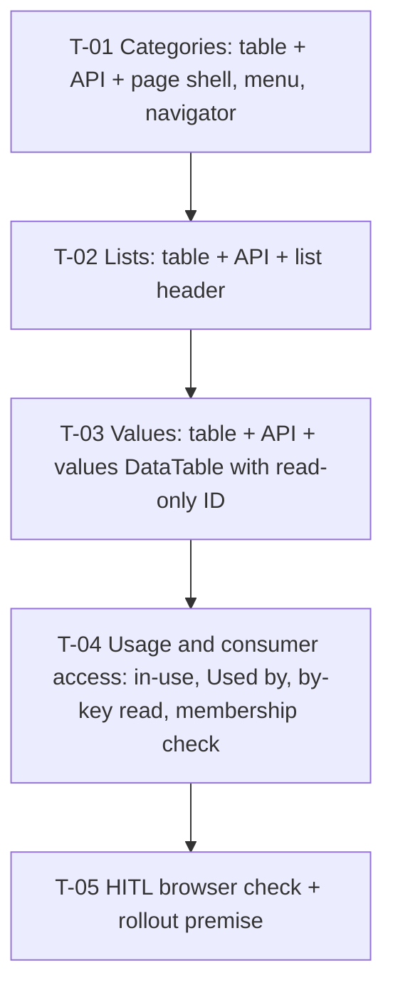

# Tasks — Institutional Performance / Control Lists

- **Module:** institutional-performance (new) — server + client
- **Spec id:** 2026-09-control-lists
- **Status:** not-started
- **Owner:** Hector F. Tobón (requester); implementers assigned by `/akili-execute`
- **Linked requirements:** [`./requirements.md`](requirements.md)
- **Linked design:** [`./design.md`](design.md) (judgment: [`./judgment.md`](judgment.md) — APPROVED before D-CTL-14…16; see RB-3)
- **Branch:** `institutional-kpis`
- **Jira:** epic [AC-1773](https://cgiarmel.atlassian.net/browse/AC-1773) · stories AC-1774 (US1) · AC-1775 (US2) · AC-1776 (US3) · AC-1777 (US4) · AC-1778 (US5) · AC-1779 (US6). Sub-tasks re-mapped 2026-10-01: AC-1780…AC-1784 = T-01…T-05; AC-1785…AC-1789 marked [OBSOLETE] (left open for the PO to close). Mark each Done when its task finishes.
- **Last updated:** 2026-10-01 — re-cut into vertical slices at the requester's request (design D-CTL-16). The earlier 10-task horizontal plan is in git history (`07f85abd`).

> **Legend for verification fields.** *Falsifier* = the concrete input or mutation that must turn the gate red. *Red run* = what must be observed failing, and on which assertion. *Disqualifier* = what makes a green reading worthless. *Consumers* = existing files that pin a symbol this task changes (from the Premise Ledger + a test-file grep). An absent value reads `n/a` or `none`, never blank.

> **Slice rule (D-CTL-16).** Every task T-01…T-04 delivers its **database** part (T-01…T-03: a migration + seed; T-04: no schema change — its DB check is a temporary FK table inside the integration test), its **server** (entity, repository, DTOs, service rules, endpoints, Swagger, tests) and its **screen** (the part of the Control Lists page a user can open and use). Each task is executed as two parallel dispatches — one server Implementer, one client Implementer. That is safe for editing across packages (root `CLAUDE.md` §4.3). The client codes against the contract in design §4 with a mocked `ApiService`. One Reviewer audits the combined diff, and the Leader re-measures both full suites after both workers report. A task closes only when both halves pass.

> **Evidence database (requester, 2026-10-01).** There is no disposable schema. Every DB check runs on the user's **local development database**: `ari_local_mysql`, `127.0.0.1:3306/stardb`, restored from the STAR backup of 2026-09-30. `ARI_TEST_MYSQL_*` point to it, so `migration:test:execute`, `migration:test:revert` and `test:integration` hit it. Rules:
> - Verify the **resolved** host and port before each run (dotenv), never just the variable name.
> - **Never run `migration:test:bootstrap` or `baseline:test:load`.** They would load the baseline schema onto a database that holds real data. `load-baseline.js:64` should refuse (host == `ARI_MYSQL_HOST`), but that refusal has **not** been observed red (K-004), so do not rely on it.
> - A `revert` may drop only the table its own slice created. Tests clean up every row and temporary table they create.
> - The shared remote Dev database stays forbidden as evidence (root `CLAUDE.md` §4.3).

---

## 1. Dependency graph and PR plan

| PR | Task | What a user can do after it merges to `dev` |
| --- | --- | --- |
| **PR 1** | T-01 | Open *Center admin › Portfolio Management › Control Lists*, pick a portfolio, create, edit and delete categories |
| **PR 2** | T-02 | Create and edit lists inside a category, see the reference `P<id> · <key>`, and see that system lists cannot be deleted *(superseded by CR-2 / D-CTL-18, 2026-10-07: any list deletes once it has no values)* |
| **PR 3** | T-03 | Manage the values of a list in the standard table (ID, sort, page, search, export) |
| **PR 4** | T-04 | See *In use* and *Used by*; a delete of a value in use is blocked; other modules can read and validate values |
| — | T-05 | Human check on Dev; no code |

The slices are strictly sequential. T-01's migration FKs to the existing `portfolios` table, T-02's to categories and T-03's to lists. T-04 adds no schema, and its code reads the three tables.

---

## 2. Task list

### T-01 — Slice 1: Categories (table + API + page shell, menu and navigator)

- **Jira:** [AC-1780](https://cgiarmel.atlassian.net/browse/AC-1780) (story [AC-1779](https://cgiarmel.atlassian.net/browse/AC-1779))
- **Status:** done (PASS on attempt 2, 2026-10-01) · **Size:** L · **Dependencies:** none
- **Requirements covered:** R-CTL-001 (category isolation, default portfolio, *not configured* stays selectable — J-2), R-CTL-002 *Duplicate name* (the *non-empty* scenario needs lists and closes in T-02), R-CTL-007 for A1–A5 (server roles; client `canMatch` and menu gating), R-CTL-008 *Menu placement* (incl. **BUT it must NOT** change existing items) and the page header and navigator, R-CTL-010 (2 categories), NFR-CTL-002/003/005
- **Design refs:** §3 (categories), §4 A1–A5, §5 rules 1, 2, 7, §6.1, §6.2 header + navigator, §8, D-CTL-2, D-CTL-7–11, D-CTL-14 (explicit seed ids), P-2, P-5, P-6, P-8, P-9, P-11, P-12, P-14
- **Scope — database:** `server/researchindicators/src/db/migrations/<epochMs>-createControlListCategories.ts` — `control_list_categories` extending `AuditableEntity`, FK `portfolio_id` → `portfolios.id` RESTRICT, `uq_control_list_categories_portfolio_name`, explicit `utf8mb4_unicode_ci`. Seed 2 categories for Portfolio 2 (resolved by years — D-CTL-8) with explicit ids 1–2, `INSERT … SELECT … WHERE NOT EXISTS`, then `AUTO_INCREMENT` above them. `down` drops the table.
- **Scope — server:** `src/domain/entities/control-lists/`:
  - `entities/control-list-category.entity.ts`;
  - `repositories/control-list-category.repository.ts`;
  - `dto/` category create/update + `portfolioId` query;
  - `control-lists.service.ts` (category rules);
  - `control-lists.controller.ts` (A1 with `lists: []` until T-02, A2, A3–A5);
  - `control-lists.module.ts`;
  - registration in `src/domain/routes/main.routes.ts` (path `control-lists`) and `src/domain/entities/entities.module.ts`.

  Siblings `*.spec.ts` for the service, the controller and the repository.
- **Scope — screen:**
  - `shared/interfaces/administration-nav.interface.ts` (optional `children`) and `shared/components/alliance-sidebar/*`: *Control Lists* nested under *Portfolio Management* in **both** template loops (`.html:69` expanded, `.html:115` flyout);
  - `app.routes.ts`: lazy `administration/center-admin/control-lists`, `canMatch: [centerAdminGuard]`;
  - `shared/interfaces/control-lists.interface.ts`;
  - `ApiService`: A1–A5;
  - `modal.types.ts` + `all-modals.service.ts` (`controlListForm` at both config sites, like `portfolioManagement` `:155`, `:303`);
  - page `pages/platform/pages/administration/center-admin/control-lists/control-lists.component.{ts,html,scss,spec.ts}` with: header (title, portfolio selector defaulting to the current-year portfolio, *(not configured)* label, **+ New category**); left navigator of categories with edit and delete icon buttons (`aria-label`); modal in category mode; delete via `showGlobalAlert`; loading, empty, error and success states.
- **Description:** the first usable screen. The service checks that the portfolio exists (404). It returns a field-named 409 on a duplicate name, and also catches `QueryFailedError` errno 1062 and rethrows `ConflictException` — never through `sqlErrorsHelper` (D-CTL-11, P-14). Audit runs through `CurrentUserUtil.audit`. Class-level `RolesGuard` + `SetUpInterceptor`; `@Roles(CENTER_ADMIN, SYSTEM_ADMIN)` on A1–A5; `ValidationPipe({ whitelist, forbidNonWhitelisted, transform })` on writes; full Swagger.
- **Tests:**
  - **DB, on the local development database only (`ari_local_mysql`, 127.0.0.1:3306 — requester, 2026-10-01; never the shared Dev):** `npm run migration:test:execute` → 2 rows for Portfolio 2 and 0 for Portfolio 1, with ids 1 and 2. Re-run the seed statement → 0 rows added. `npm run migration:test:revert` and then re-apply. `SHOW CREATE TABLE` shows the unique index, the RESTRICT FK and the collation.
  - **Server unit:** duplicate name in another letter case → 409. Simulated 1062 → 409. Unknown portfolio → 404. The same name in two portfolios → allowed. Controller: roles metadata on A1–A5 equals `[CENTER_ADMIN, SYSTEM_ADMIN]`, iterating every handler.
  - **Server integration (local dev DB):** a Contributor with a **valid** token → 403 on A3. Center Admin and System Admin → 201.
  - **Client unit:**
    - route (J-9): the `control-lists` route declares `canMatch: [centerAdminGuard]`, and the guard returns `false` for a resolved user without center-admin access and `true` for Admin / Center Admin;
    - sidebar: the nested child renders in the expanded mode and in the flyout; the exact array of the existing four children is unchanged; the hide filter still works;
    - page: the default portfolio is chosen; a 0-category portfolio is selectable and shows the empty state with **+ New category**; create/edit/delete category flows call `ApiService` with real `MainResponse` shapes; a server 409 is shown as-is.
- **Falsifier:**
  1. Seed lookup by a year range that matches nothing → the count check reads 0.
  2. Remove `WHERE NOT EXISTS` → the second run fails on the unique index or doubles the count.
  3. Route the 1062 catch through `sqlErrorsHelper` → the test fails on 400 ≠ 409.
  4. Add `TECHNICAL_SUPPORT` to A3 → the roles-metadata test fails.
  5. Render nested children only in the expanded loop → the flyout test fails.
  6. Disable 0-category portfolios in the selector → the selectable test fails.
  7. Remove `canMatch` from the `control-lists` route → the route test fails (J-9).
- **Red run:** each falsifier observed failing on its count, status, roles, DOM, route or exact-array assertion — not on setup. Then revert it.
- **Disqualifier:**
  - Any run against the shared **Dev** database is forbidden and is not evidence (root `CLAUDE.md` §4.3).
  - A count read from a failed migration output is a confident zero (K-014): check the raw output first.
  - `arrayContaining` for the sidebar cannot catch a moved existing item.
  - A fixture where every portfolio has categories cannot exercise *not configured*.
  - A 403 caused by a missing token is the wrong red.
  - `npm test` green does not prove the `ModalName` union compiles; `ng build` is required.
- **Consumers:**
  - `alliance-sidebar.component.spec.ts:61-72, 157-168, 175-186`;
  - `alliance-sidebar.component.ts:21,50,51,203` (P-9);
  - `all-modals.service.ts:155,303` and `modal.types.ts:1-18` (P-11) — run `grep -rln "ModalName" src` before editing and list every hit;
  - `src/domain/entities/entities.module.spec.ts` and `main.routes.ts` — re-run.
- **Review:** `full` — new tables, authorization surface and the shared sidebar.
- **Done criteria:**
  - [x] Migration up/re-run/revert/re-apply on the local dev DB as above; `SHOW CREATE TABLE` quoted in `execution.md`. *(The revert/re-apply ran during the attempt-1 incident recovery — see Run 5.)*
  - [x] Server and client specs green; falsifiers 1–7 each observed red, then reverted. *(Server: 3 failures in 2 suites that reproduce at base 18ef3255 — pre-existing.)*
  - [x] The route is reachable only through `centerAdminGuard`: route config reviewed, and the route test quoted (J-9).
  - [x] A1–A5 visible in `/swagger` with tags, operation and params (local boot; quote what was seen).
  - [x] No hex literals in the new component files.
  - [x] Server: `npm test -- --silent`, `npx eslint src/domain/entities/control-lists`, `npm run build`. Client: `npm test -- --silent`, `npm run lint -- --quiet`, `ng build`. *(Server lint measured on the committed LF blobs: the Windows working tree is CRLF under `core.autocrlf=true`. Server tests: 3 pre-existing failures — see Run 5.)*
- **Skills:** `nestjs-expert`, `api-design-principles`, `error-handling-patterns`, `angular-developer`, `ui-ux-pro-max`

### T-02 — Slice 2: Lists (table + API + list header)

- **Jira:** [AC-1781](https://cgiarmel.atlassian.net/browse/AC-1781) (story [AC-1775](https://cgiarmel.atlassian.net/browse/AC-1775))
- **Status:** done (PASS on attempt 2, 2026-10-02) · **Size:** M · **Dependencies:** T-01
- **Requirements covered:** R-CTL-001 (cross-portfolio move → 400 — J-4), R-CTL-002 *Delete a non-empty category* → 409, R-CTL-003 (all scenarios except *Used by*, which closes in T-04), R-CTL-010 (6 system lists)
- **Design refs:** §3 (lists), §4 A1 (lists summary), A6–A8, §5 rules 1, 3, 6, §6.2 list header, D-CTL-2, D-CTL-13
- **Scope — database:** `<epochMs>-createControlLists.ts` — `control_lists` with FK `category_id` → categories RESTRICT, FK `portfolio_id`, `uq_control_lists_portfolio_key`, `idx_control_lists_category`, collation. Seed 6 system lists (`is_system = 1`, keys and prefixes UOM/DIR/FRQ/KLV/KTY/L per R-CTL-010) with explicit ids 1–6, then reset `AUTO_INCREMENT`. `down` drops only this table.
- **Scope — server:**
  - `entities/control-list.entity.ts`;
  - `repositories/control-list.repository.ts`;
  - `dto/` list create (with `listKey`) and update (**without** `listKey`);
  - service rules: `portfolio_id` copied from the category; immutable key; system list never deleted *(superseded by CR-2 / D-CTL-18, 2026-10-07: any list deletes once it has no values)*; the same key allowed in two portfolios; category delete blocked while it has lists;
  - A1 now returns `lists` (id, key, name, `valueCount` 0 until T-03, `isSystem`, `usedBy: []` until T-04);
  - A6–A8.
- **Scope — screen:** navigator lists under each category, with value counts and an *add list* icon button; list header (caps category label, name, description, **Reference `P<id> · <key>`**, **Edit list**, **Delete list** for custom lists only); modal in list mode with the key disabled in edit mode; `ApiService` A6–A8.
- **Tests:**
  - **DB (local dev DB):** 6 lists for Portfolio 2 with ids 1–6; the re-run adds 0; revert drops only `control_lists` and leaves categories intact; re-apply.
  - **Server unit:** `PATCH` with `listKey` → 400; system list delete → 409 *(superseded by CR-2 / D-CTL-18, 2026-10-07: any list deletes once it has no values)*; the same key in Portfolio 1 → 201; a second in Portfolio 2 → 409; move to another portfolio's category → 400; delete a category with lists → 409, with the description naming them; custom list create/edit/delete → 201/200/200.
  - **Server integration (local dev DB):** `PATCH /lists/:id` with `listKey` → 400 through the real `ValidationPipe`.
  - **Server unit (J-10):** the roles metadata of A6–A8 equals `[CENTER_ADMIN, SYSTEM_ADMIN]`, iterating every new handler.
  - **Client unit:** the reference reads `P2 · kpi.direction`; *Delete list* is hidden for system lists *(superseded by CR-2 / D-CTL-18, 2026-10-07: any list deletes once it has no values)*; the key input is disabled in edit mode; selecting a list updates the header; a category with 0 lists shows its empty state with **+ Add list** (J-11).
- **Falsifier:**
  1. Accept `listKey` in the update DTO → the immutable-key test fails.
  2. Drop `forbidNonWhitelisted` → the integration case returns 200 and fails.
  3. Return 409 for the cross-portfolio move → the J-4 test fails on 400.
  4. Build the reference from the portfolio name → it fails on `P2 · …`.
  5. Show *Delete list* for every list → the system-list test fails. *(superseded by CR-2 / D-CTL-18, 2026-10-07: any list deletes once it has no values)* — CR-2 inverts it: restoring the `!isSystem` guard now fails the test.
  6. Add `TECHNICAL_SUPPORT` to A6 → the roles-metadata test fails (J-10).
  7. Render nothing for a category with 0 lists → the empty-state test fails (J-11).
- **Red run:** each observed on its status, roles or DOM assertion.
- **Disqualifier:** a portfolio-isolation test with one portfolio proves nothing (the fixture needs two portfolios holding the same key). The same Dev and K-014 rules as T-01.
- **Consumers:** the T-01 service, controller and page specs (A1 shape change) — re-run them.
- **Review:** `full` — immutable key and J-4.
- **Done criteria:**
  - [x] Migration checks on the local dev DB quoted; specs green; falsifiers 1–7 observed red, then reverted.
  - [x] A6–A8 in `/swagger`. *(Via `SwaggerModule.createDocument` on a created app — see Run 6.)*
  - [x] Both packages' test, lint and build gates as in T-01. *(Server lint on committed blobs of `a77f94d5`: 18 linted, 0 failing. Server tests: 3 pre-existing failures.)*
- **Skills:** `nestjs-expert`, `api-design-principles`, `angular-developer`

### T-03 — Slice 3: Values (table + API + values table with a read-only ID)

- **Jira:** [AC-1782](https://cgiarmel.atlassian.net/browse/AC-1782) (story [AC-1778](https://cgiarmel.atlassian.net/browse/AC-1778))
- **Status:** done (PASS on attempt 2, 2026-10-02) · **Size:** L · **Dependencies:** T-02
- **Requirements covered:** R-CTL-003 *Custom list lifecycle* (a list with values cannot be deleted), R-CTL-004 (all, incl. **AC.3 read-only ID**), R-CTL-009 (all ACs except resize persistence, which T-05 covers), R-CTL-008 empty and loading states for the table, R-CTL-010 (23 values; total 2 / 6 / 23), NFR-CTL-003, NFR-CTL-004 (`aria-sort`)
- **Design refs:** §3 (values, permanent ID), §4 A1 (`valueCount`), A9–A12, §5 rules 2, 4, 6, §6.2 values table + modal, §6.3, D-CTL-4, D-CTL-5, D-CTL-6, D-CTL-14, P-3, P-4; judgment J-5, J-7
- **Scope — database:** `<epochMs>-createControlListValues.ts` — `control_list_values` with FK `list_id` → lists RESTRICT, `uq_control_list_values_list_code`, `uq_control_list_values_list_value`, `idx_control_list_values_list_order`, collation. Seed 23 values with **explicit ids 1–23**, then reset `AUTO_INCREMENT`. `down` drops only this table.
- **Scope — server:**
  - `entities/control-list-value.entity.ts`;
  - `repositories/control-list-value.repository.ts`;
  - `dto/` value create/update — **`id` not whitelisted** in update (D-CTL-14);
  - service rules: case-insensitive uniqueness of code and value; code proposal `<prefix>-<nn>` / `L<n>`; deactivate through `is_active`; a list with values cannot be deleted; physical delete (the in-use block arrives in T-04);
  - A1 `valueCount`; A9–A12.
- **Scope — screen:**
  - `shared/utils/natural-compare.util.ts` and `shared/utils/xlsx-export.util.ts` (+ specs; `exceljs` loaded lazily; `angular.json` `allowedCommonJsDependencies` only if `ng build` warns);
  - `shared/components/data-table/data-table.component.{ts,html,scss,spec.ts}` (F-7: page sizes 10/25/50/100, resizable columns in `expand` mode, natural sort with Code ascending by default, `aria-sort`, local search, export of the filtered and sorted rows across all pages, action, loading and empty slots; tokens only);
  - on the page: the values table with **ID** · Code · Value · Description · Order · Active · Actions, the modal in value mode (proposed code pre-filled; **ID shown as read-only text in edit mode, absent in create mode**), value delete via confirm;
  - `ApiService` A9–A12.
- **Tests:**
  - **DB (local dev DB):** 23 values with ids 1–23 and totals 2 / 6 / 23; the re-run adds 0; inserting `dir-01` into `kpi.direction` (which holds `DIR-01`) fails on the unique index (P-4); revert drops only `control_list_values`; re-apply.
  - **Server unit:** duplicate code or value in another letter case → 409; simulated 1062 → 409; `PATCH` with `id` → 400 and the id unchanged; code proposal `UOM-08` after `UOM-07` and `L5` after `L4`; deactivate keeps the value in A9; delete a list with values → 409; the roles metadata of A9–A12 equals `[CENTER_ADMIN, SYSTEM_ADMIN]`, iterating every new handler (J-10).
  - **Client unit:**
    - comparator: `['UOM-10','UOM-2','uom-1', null]` → `['uom-1','UOM-2','UOM-10', null]`;
    - export row builder: a given order that differs from id order is kept;
    - `DataTable`: the default order is natural by code; a page-size change keeps the sort and the search; export receives the filtered and sorted rows of all pages (12 rows, page size 10, search matching 11 → 11); headers expose `aria-sort`;
    - page: the ID column renders and has no input in the row; the edit modal shows the ID as text with no form control bound to it; the create modal has no ID.
- **Falsifier:**
  1. Remove `WHERE NOT EXISTS` from the values seed → the re-run fails or doubles.
  2. Whitelist `id` in the update DTO → the read-only-ID server test fails on 400.
  3. Bind the ID to an input in the modal → the "no form control" DOM test fails.
  4. Swap the comparator for `localeCompare` without `numeric` → `UOM-10` sorts before `UOM-2`.
  5. Export only the current page → the 11-row assertion fails.
  6. Reset the sort on a page-size change → the persistence test fails.
  7. Add `TECHNICAL_SUPPORT` to A12 → the roles-metadata test fails (J-10).
- **Red run:** each observed on its count, status, roles, DOM, order or row-count assertion.
- **Disqualifier:**
  - A uniqueness fixture differing only in id, not in letter case, cannot prove case-insensitivity.
  - A comparator fixture without a two-digit number cannot tell natural from lexical order.
  - A table test with fewer rows than one page cannot tell all pages from the current page.
  - jsdom cannot measure column widths, so resize behavior is **not** claimed here (T-05), and the spec says so in a comment.
- **Consumers:** T-01/T-02 specs (A1 `valueCount`); `angular.json` (no test consumers).
- **Review:** `full` — DB uniqueness, the permanent ID and the shared table pattern.
- **Done criteria:**
  - [x] Migration checks on the local dev DB quoted; specs green; falsifiers 1–7 observed red, then reverted.
  - [x] `ng build`: `exceljs` only in a lazy chunk, not in `main` (read the build stats); the initial bundle within budget. *(`exceljs-min` lazy chunk 947 kB; Initial total 1.35 MB vs 2 MB warning — Leader's own build run.)*
  - [x] A9–A12 in `/swagger`; both packages' test, lint and build gates. *(Swagger via `createDocument`; server lint on committed blobs of `f7955d46`: 18 linted, 0 failing; server tests: 3 pre-existing failures.)*
- **Skills:** `nestjs-expert`, `error-handling-patterns`, `angular-developer`, `ui-ux-pro-max`

### T-04 — Slice 4: Usage and consumer access (in-use, *Used by*, by-key read, membership check)

- **Jira:** [AC-1783](https://cgiarmel.atlassian.net/browse/AC-1783) (story [AC-1776](https://cgiarmel.atlassian.net/browse/AC-1776))
- **Status:** done (PASS on attempt 1, 2026-10-06) · **Size:** M · **Dependencies:** T-03
- **Requirements covered:** R-CTL-005 (all, incl. AC.3 test consumer), R-CTL-003 *Used by*, R-CTL-006 (ordered read, `activeOnly`, unknown key, **membership check — AC.2**), R-CTL-004 *Deactivate* (consumer read omits inactive values), R-CTL-007 (A13 open to any authenticated user), R-CTL-001 AC.1–2 end to end
- **Design refs:** §4 A1 `usedBy`, A9 `inUse`, A12 block, A13; §5 rules 5, 10; D-CTL-3, D-CTL-12, D-CTL-14, D-CTL-15, P-10
- **Scope — database:** **no schema change.** The integration test creates a temporary consumer table on the local dev DB with a plain FK to `control_list_values.id` `ON DELETE RESTRICT`. It proves the DB backstop (D-CTL-3) and drops the table afterwards.
- **Scope — server:**
  - `control-list-usage.registry.ts` (+ spec): a singleton of providers (consumer name, list keys, async count over value ids), with **no request-scoped dependency** (P-10);
  - A9 `inUse` summed across providers; A12 refuses with 409 when the sum is > 0 (the description states the count and proposes deactivation); A1 `usedBy` derived from the registry (D-CTL-12);
  - A13 `GET /by-key/:listKey/values` with no `@Roles`, ordered by display order then natural code, `activeOnly` default true;
  - `ControlListsService.assertValueInList(valueId, portfolioId, listKey)` (D-CTL-15);
  - the module exports the service and the registry.
- **Scope — screen:** the **In use** column in the values table; the list header shows *Used by* or *Not linked to a form yet*; a 409 on a value delete shows the server description with a single *Close*.
- **Tests:**
  - **Server unit:**
    - registry: two providers on the same key returning 2 and 3 sum to 5; a provider declaring another key contributes no consumer name to this key's *Used by* (counts are summed over every registered provider, per R-CTL-005 — amended at T-04); consumer names come back per key;
    - service: delete with a provider returning 3 → 409, and the value is still there;
    - A13: ordered read puts `UOM-2` before `UOM-10` at equal order; `activeOnly` omits inactive values; unknown key → 404;
    - `assertValueInList`: the right key and portfolio → returns the value; a `kpi.direction` value checked against `kpi.unit_of_measure` → 400 naming the expected key; the right key in another portfolio → 400; unknown id → 404;
    - controller: A13 has no roles metadata.
  - **Server integration (local dev DB):** a registered test provider drives `inUse` in A9 and the 409 in A12; the temporary FK table blocks a physical delete; any authenticated user gets 200 on A13.
  - **Client unit:** the *In use* column shows the count; *Used by* lists names, or shows *Not linked to a form yet* when empty; a 409 message is shown verbatim.
- **Falsifier:**
  1. Make the registry return only the first provider's count → the sum-to-5 test fails.
  2. Drop the in-use check → the delete test fails on `ConflictException`.
  3. Make `assertValueInList` check only the portfolio, not the key → the cross-list test fails on 400.
  4. Check only the key, not the portfolio → the cross-portfolio test fails.
  5. Add `@Roles` to A13 → the open-read test fails.
- **Red run:** each observed on its sum, exception, status or roles assertion.
- **Disqualifier:**
  - A fixture where both providers return the same number cannot tell first-only from summed (KZ-004).
  - A membership fixture with a single list or a single portfolio cannot falsify 3 or 4.
  - Injecting `CurrentUserUtil` into the registry makes it request-scoped — check the constructor against `current-user.util.ts:7`.
- **Consumers:** T-01…T-03 service, controller and page specs (A1, A9 and A12 shape changes).
- **Review:** `full` — the protection rule and the contract every later child depends on.
- **Done criteria:**
  - [x] Specs and integration green; falsifiers 1–5 observed red, then reverted.
  - [x] All 13 endpoints in `/swagger` (quote what was seen). *(Via `SwaggerModule.createDocument`; paths quoted in Run 8.)*
  - [x] Both packages' test, lint and build gates. *(Server lint on committed blobs of `6962e7ae`: 18 linted, 0 failing. Server `npm run build` exit 0 after the user stopped their dev servers. Server tests: 3 pre-existing failures. Client: 7,937 passed, lint and build OK.)*
- **Skills:** `nestjs-expert`, `error-handling-patterns`, `api-design-principles`, `angular-developer`

### T-05 — HITL: real-browser check and rollout premise

- **Jira:** [AC-1784](https://cgiarmel.atlassian.net/browse/AC-1784) (story [AC-1774](https://cgiarmel.atlassian.net/browse/AC-1774))
- **Status:** done — Dev run waived by the requester (local check, 2026-10-07; see `execution.md`) · **Size:** S · **Dependencies:** T-04 deployed to Dev
- **Requirements covered:** R-CTL-009 AC.2 (resize persistence — the substitute gate from requirements §10), R-CTL-008 visual fidelity and *Menu placement* in a real browser, NFR-CTL-001 (timing, 3 runs), NFR-CTL-004 (keyboard pass), the P-13 rollout premise
- **Design refs:** §10 Manual row, §11 Rollout, P-13, judgment J-7
- **Scope:** no code. Update `execution.md` with the observations.
- **Description:** the requester, or a person they name, runs this checklist on Dev with an Admin account:
  1. open *Center admin › Portfolio Management › Control Lists*, expanded and with the flyout;
  2. drag a column edge, change the page, sort — the width holds;
  3. export with a search active — the file holds only the matching rows;
  4. the ID column cannot be edited in the table or in the modal;
  5. delete an in-use value — it is blocked (until child 2 registers a consumer this is a known gap — RB-1; use a value with count 0 to check the confirm flow);
  6. compare with artboard 1 of the mockup;
  7. keyboard pass through the modal and the table headers;
  8. confirm whether the Prod pipeline applies migrations like Dev.
- **Tests:** manual, recorded verbatim.
- **Falsifier:** step 2 fails if the widths reset after sorting; step 1 fails if the item is missing in the flyout.
- **Red run:** n/a — human observation; record what was actually seen (KZ-002).
- **Disqualifier:** "the page loads" does not discharge steps 2–5. Quote the observed words and tick only what they cover.
- **Consumers:** n/a.
- **Review:** `checklist`.
- **Done criteria:**
  - [ ] Steps 1–7 observed and quoted in `execution.md`. *(Waived: requester checked locally, no per-step quotes; Dev run carried to rollout.)*
  - [x] P-13 settled, or carried as an open rollout item with the owner named. *(Carried; owner: requester — `execution.md` T-05.)*
- **Skills:** n/a

---

### CR-2 — Change request: any list can be deleted once empty (2026-10-07)

- **Request (requester):** the organization manages every list, including the seeded ones; drop the "system list cannot be deleted" rule (D-CTL-18).
- **Requirements covered:** R-CTL-003 (amended scenarios and AC.2), R-CTL-010 note.
- **Scope — server:** `removeList` (A8) no longer checks `is_system`; the list-with-values 409 applies to every list. `is_system` stays in the schema (no migration).
- **Scope — client:** *Delete list* shows on every list; the 409 is still shown as-is.
- **Tests:** server unit (empty seeded list → 200; seeded list with values → 409), the GlobalExceptions contract, integration on scratch `is_system = 1` lists, client DOM (button on a seeded list) and the confirm → DELETE path for a seeded list.
- **Falsifier:** restore the `is_system` guard in `removeList` → 3 server tests fail; restore the `!isSystem` template guard → the client button test fails.
- **Evidence:** `execution.md` → CR-2.

## 3. Scenario and clause coverage

| Requirement › scenario / clause | Owning task(s) |
| --- | --- |
| R-CTL-001 *Lists are isolated per portfolio* · **BUT** no other portfolio's rows | T-01 (categories), T-02 (lists), T-04 (end to end) |
| R-CTL-001 **AND IT MUST** reject a cross-portfolio write (400) | T-02 (falsifier 3) |
| R-CTL-001 *Default portfolio* · P1 selectable with empty state | T-01 (falsifier 6) |
| R-CTL-002 *Duplicate name* (case variant) → 409 | T-01 |
| R-CTL-002 *Delete a non-empty category* → 409 · **BUT** nothing deleted | T-02 |
| R-CTL-003 *System key is fixed* · *Same key in two portfolios* | T-02 |
| R-CTL-003 *A list with values cannot be deleted* (replaces *System list cannot be deleted*) | T-02, CR-2 |
| R-CTL-003 *List lifecycle (any list, seeded or created)* | T-02 (no values), T-03 (with values → 409), CR-2 (seeded lists) |
| R-CTL-003 *Used by* | T-04 |
| R-CTL-004 *Duplicate code or value* · AC.1–2 | T-03 |
| R-CTL-004 *Deactivate* — admin read keeps it · consumer read omits it | T-03 (admin), T-04 (A13) |
| R-CTL-004 AC.3 read-only permanent ID | T-03 (falsifiers 2, 3), T-05 (step 4) |
| R-CTL-005 *Value in use* · *Value not in use* · AC.3 test consumer | T-04, T-05 (step 5, gap RB-1) |
| R-CTL-006 *Ordered read*, unknown key | T-04 |
| R-CTL-006 *Value from another list* · AC.2 membership | T-04 (falsifiers 3, 4) |
| R-CTL-007 *Denied role* · *Allowed roles* | T-01 (A1–A5, falsifier 4), T-02 (A6–A8, falsifier 6), T-03 (A9–A12, falsifier 7), T-04 (A13 open, falsifier 5) |
| R-CTL-007 AC.2 menu hidden **and** route blocked without access | T-01 (sidebar test + route test, falsifier 7 — J-9) |
| R-CTL-008 *Menu placement* · **BUT** existing items unchanged | T-01, T-05 |
| R-CTL-008 *Empty list* + four UI states | T-01 (page, no categories), T-02 (no lists — J-11), T-03 (no values, table) |
| R-CTL-009 natural sort · export · page size keeps sort/search | T-03 |
| R-CTL-009 AC.2 resize persists | T-05 (jsdom gap recorded in T-03) |
| R-CTL-010 seed 2 / 6 / 23 · *Seed is idempotent* | T-01, T-02, T-03 |
| NFR-CTL-001 performance | T-05 |
| NFR-CTL-002 security | T-01…T-04 (roles test per handler) |
| NFR-CTL-003 DB uniqueness | T-01, T-02, T-03 |
| NFR-CTL-004 a11y | T-01 (`aria-label`), T-03 (`aria-sort`), T-05 (keyboard) |
| NFR-CTL-005 Swagger | T-01…T-04 |

## 4. Risks & blockers log

| # | Date | Risk / Blocker | Mitigation | Owner | Status |
| --- | --- | --- | --- | --- | --- |
| RB-1 | 2026-09-27 | T-05 step 5 cannot show a real in-use value until `organizational-structure` registers its consumer | T-04 unit + integration (test provider, temporary FK table) cover the rule; re-check in child 2's HITL | Requester | open |
| RB-2 | 2026-09-27 | The Prod pipeline may not apply migrations (P-13) | Settle in T-05 before merging to `main` | Requester | open |
| RB-3 | 2026-10-01 | `judgment.md` (APPROVED) predated D-CTL-14…16 and this re-cut | Judgment Day round 2 run 2026-10-01: APPROVED, 0 confirmed severe; suspects J-9…J-11 await the user | Requester | closed (suspects pending) |
| RB-4 | 2026-10-01 | Jira sub-tasks AC-1780…AC-1789 describe the old horizontal split | Re-mapped with the user's go-ahead: AC-1780…AC-1784 rewritten as T-01…T-05 and re-parented; AC-1785…AC-1789 titled [OBSOLETE], still Open — closing them is the PO's call | Requester | closed |
| RB-5 | 2026-10-01 | T-01 and T-03 are size L, with both packages in one task | Two parallel dispatches per task (slice rule); if a half overruns, split that half's dispatch, not the task | Leader | open |

## 5. Done definition

- [ ] T-01 … T-05 `done`, each with its Reviewer PASS recorded in `execution.md`.
- [ ] T-05 human check done **before** `/akili-validate`.
- [ ] Every row of §3 covered.
- [ ] Swagger lists the 13 endpoints.
- [ ] Rollout note (P-13 outcome; backout = revert + migration `down` values → lists → categories) recorded.
