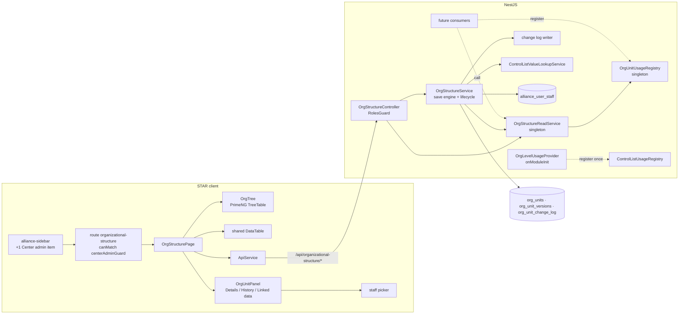

# Design — Institutional Performance / Organizational Structure

- **Module:** institutional-performance — server `domain/entities/organizational-structure/` + client Center admin page
- **Spec id:** 2026-10-organizational-structure
- **Status:** approved 2026-10-16 (requester, design gate; delegates added after approval at the requester's request)
- **Owner:** Hector F. Tobón (requester)
- **Linked requirements:** [`./requirements.md`](requirements.md)
- **Linked TRD:** [`docs/trd/trd.md`](../../../trd/trd.md) — backend module layout, response envelope, auth
- **Parent spec:** [`../family.md`](../family.md) (F-1, F-3 … F-9; F-2 excepted)
- **Builds on:** Control Lists (archived — [`design.md`](../../archive/2026-10-08-institutional-performance--control-lists/design.md)), whose patterns this design reuses and cites as `D-CTL-n`
- **Visual reference:** artboard *2 · Organizational Structure* — https://claude.ai/artifact/EPtLbFVhaEQb3Vgq7kuyRP · [`../mockup/OrgStructure.dc.html`](../mockup/OrgStructure.dc.html). It is updated in this phase to the year-based, global model (§6.5)
- **Exploration:** one Explore scout (2026-10-08) plus direct reads, folded into §13 Premise Ledger
- **Last updated:** 2026-10-16 — delegates per entry (R-ORG-017, D-ORG-15): new table `org_unit_delegates`, migrations renumbered (delegates `…003`, seed `…004`). Also 2026-10-16 — RB-3 of `changes/control-lists-global-scope` applied: D-ORG-3 dropped, level check is `assertValueInList(valueId, 'org.level')`, seed moved to `src/db/seeds/` (D-ORG-14), client reads `org.level` by key, premises P-1…P-4, P-6, P-12, P-13 re-verified. Previous: 2026-10-08

---

## 1. Goals & non-goals

**Goals**
1. A global entry table with per-year versions and a save engine that keeps them valid (R-ORG-001…005).
2. Year views, lifecycle actions and an append-only log that never lose history (R-ORG-006…009).
3. A read service and a usage registry for consumers, and the `org.level` wiring owed by Control Lists (R-ORG-010, 011).
4. A page with tree, table, year selector, side panel and staff picker for director and delegates (R-ORG-012…014, 016, 017).
5. Seed data (R-ORG-015).

**Non-goals** — versions finer than a year; any consumer module; HR sync; any change to the Agresso staff sync; the per-portfolio KPI flag (moves to `institutional-indicators`).

---

## 2. Architecture

**Why two services:** `OrgStructureService` writes and needs the request-scoped `CurrentUserUtil` for audit fields. `OrgStructureReadService` and `OrgUnitUsageRegistry` must stay singletons so consumers can inject them without being forced into request scope (control-lists P-10, D-CTL-15 amendment). The read service takes no user dependency.

### 2.1 Composition

**Server** — `server/researchindicators/src/domain/entities/organizational-structure/`

| Path | Responsibility |
| --- | --- |
| `organizational-structure.module.ts` | Imports `ControlListsModule`; declares controller, services, repositories, registry, level provider; **exports** `OrgStructureReadService` and `OrgUnitUsageRegistry` |
| `organizational-structure.controller.ts` | HTTP edge (§4); class-level `RolesGuard`, `SetUpInterceptor`, Swagger |
| `organizational-structure.service.ts` | Save engine (§5.2), lifecycle (§5.4–5.5), code proposal, staff search; request-scoped |
| `org-structure-read.service.ts` | Singleton: year view, resolve, ancestors, successors, `assertExists` |
| `org-unit-usage.registry.ts` | Singleton: consumer providers; **deduplicates by consumer name** (lesson from control-lists F-4) |
| `org-level-usage.provider.ts` | Singleton with `onModuleInit` that registers *Organizational Structure › Level* in `ControlListUsageRegistry` once |
| `org-version-timeline.util.ts` | Pure functions over an entry's version list: find covering version, split, propagate, validate contiguity. No I/O, so it is unit-testable in isolation |
| `org-structure.constants.ts` | `ORG_LEVEL_LIST_KEY = 'org.level'`; level-id map `{20: L1, 21: L2, 22: L3, 23: L4}`; allowed parent levels; code prefix `ORG-` |
| `entities/org-unit.entity.ts`, `org-unit-version.entity.ts`, `org-unit-delegate.entity.ts`, `org-unit-change-log.entity.ts` | TypeORM entities (§3) |
| `repositories/*.repository.ts` | One per entity, same pattern as Control Lists |
| `dto/*.dto.ts` | Create, update, lifecycle, query DTOs (§4) |
| sibling `*.spec.ts` for every file above; `organizational-structure.global-exceptions.spec.ts` | Unit tests, including the real `GlobalExceptions` wire contract (as Control Lists) |
| `test/org-structure-{versions,lifecycle,consumers,seed}.integration-spec.ts` | Integration on the local development DB (`test:integration`) |
| `src/db/migrations/1791000000000-createOrgUnits.ts` · `…001-createOrgUnitVersions.ts` · `…002-createOrgUnitChangeLog.ts` · `…003-createOrgUnitDelegates.ts` · `…004-seedOrgStructure.ts` | Schema per table, then the seed migration, which **imports** its SQL from the seed file below and exports only its class (D-ORG-14) |
| `src/db/seeds/org-structure.seed.ts` | Seed data and idempotent insert functions (§3.4); lives outside `migrations/**` (D-ORG-14). Seeds no delegates |
| `src/domain/routes/main.routes.ts`, `src/domain/entities/entities.module.ts` | Register the module at `organizational-structure` |

**Server — Control Lists (additive changes only, R-ORG-011)**

| Path | Change |
| --- | --- |
| `control-lists/control-lists.service.ts` (`removeValue`) | Catch MySQL errno **1451** on the delete and rethrow `ConflictException` (*"in use; deactivate instead"*), same technique as errno 1062 (D-CTL-11) |

**Client** — `client/research-indicators/src/app/`

| Path | Responsibility |
| --- | --- |
| `pages/platform/pages/administration/center-admin/organizational-structure/organizational-structure.component.{ts,html,scss,spec.ts}` | Page shell: header, year selector, view toggle, filters, split layout, state handling |
| `…/organizational-structure/components/org-tree/*` | Tree view on PrimeNG `p-treeTable` (D-ORG-6) |
| `…/organizational-structure/components/org-unit-panel/*` | Right panel: header, tabs Details / History / Linked data, form, actions |
| `…/organizational-structure/components/org-lifecycle-dialog/*` | Inactivate / reactivate / delete dialog content (year, successor, back-date) |
| `…/organizational-structure/utils/org-tree.util.ts` (+spec) | Builds `TreeNode[]` from the flat year view; counts units under each node |
| `shared/interfaces/org-structure.interface.ts` | Client types |
| `shared/services/api.service.ts` | Methods for §4, plus `GET_ControlListValuesByKey(listKey, activeOnly)` for the open by-key read (none exists in the client today — P-13) |
| `shared/components/alliance-sidebar/alliance-sidebar.component.ts` | Add *Organizational Structure* as a *Center admin* child after *Portfolio Management* (not nested — F-3 amended 2026-10-13) |
| `shared/types/modal.types.ts`, `shared/services/cache/all-modals.service.ts` | Register modal name `orgUnitLifecycle` |
| `app.routes.ts` | Lazy route `administration/center-admin/organizational-structure`, `canMatch: [centerAdminGuard]` (pattern at :321-323) |

### 2.2 Reuse

Server: `AuditableEntity`, `ResponseUtils.format`, `RolesGuard` + `@Roles`, `SetUpInterceptor`, `CurrentUserUtil.audit`, `GlobalExceptions`, `ControlListValueLookupService`, `ControlListUsageRegistry`, `AllianceUserStaff` entity (read only).
Client: `DataTable` (F-7) + `natural-compare` + `xlsx-export`, `ApiService` + `MainResponse<T>`, `app-modal`, `app-custom-progress-bar`, `ActionsService.showToast` / `showGlobalAlert`, `centerAdminGuard`, token utilities.

**Not reused, on purpose:** `AllianceUserStaffService.findBySearch`. Its query appends `first_name LIKE … OR last_name LIKE … OR email LIKE …` after `is_active = true` without parentheses (`alliance-user-staff.service.ts:37-43`), so `AND` binds tighter than `OR` and inactive staff match by last name or email. This module runs its own parenthesized search (D-ORG-8). The existing defect is reported, not fixed here (§15).

---

## 3. Data model

All four tables: `utf8mb4`, collation `utf8mb4_unicode_ci` declared explicitly (case-insensitive unique code — control-lists P-4). No `portfolio_id` anywhere (R-ORG-001). **Exception (D-ORG-16):** the two staff-reference columns (`org_unit_versions.director_carnet`, `org_unit_delegates.staff_carnet`) take the character set **and** collation of `alliance_user_staff.carnet`, read at migration time — a string FK needs both to match, and that column is `utf8mb3` on Dev (baseline dump) but `utf8mb4_0900_ai_ci` locally.

### 3.1 Tables

| Table | Columns (beyond `AuditableEntity`) | Indexes / constraints |
| --- | --- | --- |
| `org_units` | `id` bigint PK · `code` varchar(30) · `status` enum(`active`,`inactive`,`deleted`) default `active` · `status_from_year` smallint null · `successor_id` bigint null FK → `org_units.id` (RESTRICT) | `uq_org_units_code (code)` · `idx_org_units_status` |
| `org_unit_versions` | `id` bigint PK · `org_unit_id` FK → `org_units.id` (CASCADE, only reachable by a physical delete, §5.5) · `valid_from_year` smallint · `valid_to_year` smallint null · `name` varchar(255) · `acronym` varchar(50) null · `level_value_id` bigint FK → `control_list_values.id` (**RESTRICT**) · `parent_id` bigint null FK → `org_units.id` (RESTRICT) · `director_carnet` varchar(10) null FK → `alliance_user_staff.carnet` (**RESTRICT**) | `uq_org_unit_versions_unit_from (org_unit_id, valid_from_year)` · `idx_org_unit_versions_years (valid_from_year, valid_to_year)` · `idx_org_unit_versions_parent` · `idx_org_unit_versions_level` |
| `org_unit_delegates` | `id` bigint PK · `org_unit_id` FK → `org_units.id` (CASCADE, only reachable by a physical delete) · `staff_carnet` varchar(10) FK → `alliance_user_staff.carnet` (**RESTRICT**) | `uq_org_unit_delegates_unit_staff (org_unit_id, staff_carnet)` · `idx_org_unit_delegates_staff` |
| `org_unit_change_log` | `id` bigint PK · `org_unit_id` bigint (**no FK**, survives a physical delete — NFR-ORG-003) · `action` enum(`seed`,`create`,`edit_in_place`,`new_version`,`inactivate`,`reactivate`,`delete_logical`,`delete_physical`,`code_change`,`delegates_change`) · `applies_from_year` smallint null · `backdated` tinyint default 0 · `changes` JSON (`{field: {old, new}}`; for a physical delete, the last values) | `idx_org_unit_change_log_unit_created (org_unit_id, created_at)` |

- **Year range:** half-open `[valid_from_year, valid_to_year)`; `NULL` = open-ended. A year *N* is covered when `from ≤ N AND (to IS NULL OR to > N)` (R-ORG-006 AC.1).
- **Entry end:** when an entry is inactivated or deleted from year *E*, its last version gets `valid_to_year = E` and the entry gets `status`, `status_from_year = E`. Reactivation from *R* adds a version `[R, NULL)` and sets `status = active`, `status_from_year = NULL`, `successor_id = NULL`.
- **Audit:** the log's `created_by` / `created_at` (from `AuditableEntity`) are the *who* and *when* of R-ORG-009. The log is never updated, so its `updated_*` columns stay null.
- **Director** (R-ORG-016): only the `carnet` is stored; name and email are joined from `alliance_user_staff` on read. The staff sync upserts and never deletes (P-9), and the RESTRICT FK is the backstop if that changes.
- **Delegates** (R-ORG-017, D-ORG-15): one current list per entry, **not versioned**, so they hang off `org_units`, not off a version. Replacing the list deletes and inserts rows inside the write transaction. A logical delete or inactivation leaves the rows; the list's history lives only in the log (`delegates_change`, `{delegates: {old: [...], new: [...]}}`).
- **Level** (R-ORG-003, R-ORG-011): the FK to `control_list_values.id` with RESTRICT closes control-lists F-4's FK item.

### 3.2 Invariants (kept by the service, inside one transaction per write)

| # | Invariant | Enforced by |
| --- | --- | --- |
| I-1 | One version per entry per start year | DB unique index (backstop) + timeline util |
| I-2 | An entry's versions are contiguous and non-overlapping, ordered by `from` — except one gap per inactive period, left by a reactivation from a year later than the end year (D-ORG-17); no save or lifecycle end fills or shrinks a gap (`appliesFromYear` inside one → 400; an end at the version that follows a gap → 400); only the last may be open-ended, and only if the entry is active | `org-version-timeline.util` `assertTimeline` run before commit |
| I-3 | Every version's parent obeys the level rules and is active for every year the version covers | §5.3 |
| I-4 | No entry is its own ancestor in any year from the first changed year onward | §5.3 |
| I-5 | Exactly one log row per write action | service writes the log in the same transaction |
| I-6 | No delegate of an entry is the director of its version covering the current year or of any later version | §5.2 step 1, checked on every save that touches either field |

### 3.3 Migrations

`1791000000000…004` (next free block after `1790900000003` — P-6). One table per migration, then the seed. `down` drops in reverse order (seed → delegates → log → versions → units). Append-only once merged.

### 3.4 Seed (R-ORG-015)

- **Location:** `src/db/seeds/org-structure.seed.ts`, imported by `…004-seedOrgStructure.ts` (D-ORG-14). Same shape as `control-lists.seed.ts`: each function returns `affectedRows` so the seed suite can assert a re-run inserts 0.
- **Source:** the `TREE` constant in `../mockup/OrgStructure.dc.html` (:417 onward), the transcription of MMF sheet *04. ORG structure* used for the approved mockup. The seed migration embeds it as data. **Count (re-run 2026-10-21 by evaluating `TREE`, not by regex):** L1 = 3, L2 = 19, L3 = 1, L4 = **94** — 117 entries, matching the proposal and the requester's sheet image (per-department counts identical, three parentless rows placed as stated). The 2026-10-08 figure of 95 was a miscount of the regex method. **Requester (2026-10-21):** load all 94 (yellow-highlighted rows in the sheet included — the highlight is ignored; same-named units under Global Support and Regional are distinct entries) and the mockup's directors (P-11, RB-1 closed).
- Fixed ids 1…N in tree order; codes `ORG-001`…; every version `[2026, NULL)`; level ids 20–23; `AUTO_INCREMENT` set above N (D-CTL-14 technique).
- **Directors:** the mockup `TREE` assigns **11** directors (carnets A0101–A0111; A0112–A0114 exist only in `STAFF` as delegate/demo staff — the earlier "12" was a miscount, corrected 2026-10-21 at T-05). Only **active** staff (`is_active = 1`, not deleted) are candidates, as for the picker (P-14); an inactive-only hit stores `NULL` and is reported. Match `alliance_user_staff` by email, else exact `first_name + last_name`; no single match → `NULL`. The migration logs the unmatched names (`LoggerUtil`) and the seed task records them for the requester.
- Idempotent: every insert is `INSERT … SELECT … WHERE NOT EXISTS` on the fixed id. One `seed` log row per entry, also guarded.

---

## 4. API surface

Base `/api/organizational-structure` (unversioned — root `CLAUDE.md` §4.1). Class-level `@UseGuards(RolesGuard)`, `@UseInterceptors(SetUpInterceptor)`, `@ApiTags('Organizational Structure')`, `@ApiBearerAuth()`; every handler has `@ApiOperation` and per-param docs. Writes use `ValidationPipe({ whitelist, forbidNonWhitelisted, transform })`, so `id`, `portfolioId`, `directorName`, `directorEmail` or any delegate name/email field in a body → `400` (R-ORG-001, 002, 016, 017). **Literal routes are declared before `:id` routes.**

Admin = `@Roles(CENTER_ADMIN, SYSTEM_ADMIN)`. Consumer = any authenticated user (no `@Roles`), as control-lists A13.

| # | Method + path | Roles | Input | Response `data` | Errors |
| --- | --- | --- | --- | --- | --- |
| B1 | `GET /units?year=&includeEnded=` | Admin | `year` default current; `includeEnded` default false | `YearViewRow[]`: id, code, status, statusFromYear, version (from, to, name, acronym, levelId, levelCode — derived from `levelId` via `ORG_LEVEL_BY_ID`, `null` outside 20–23 (D-ORG-4), levelName — the list value's editable display name, parentId, parentCode, parentName, director {carnet, name, email, isActiveStaff}), `delegates` {carnet, name, email, isActiveStaff}[] (current), `scheduledFromYear` (next version start after `year`, if any) | 400 year out of range |
| B2 | `GET /years` | Admin | — | `{ min, max, current }` for the selector (R-ORG-006) | — |
| B3 | `GET /units/code-proposal` | Admin | — | `{ code: 'ORG-118' }` (§5.6) | — |
| B4 | `GET /staff?search=` | Admin | `search` ≥ 2 chars | `{carnet, name, email}[]`, active staff only — **active = `alliance_user_staff.is_active = 1`** (P-14, requester 2026-10-16), max 20 (D-ORG-8) | 400 short search |
| B5 | `GET /units/:id` | Admin | — | entry + all versions (with resolved director) + current delegates | 404 |
| B6 | `GET /units/:id/history` | Admin | — | `{ versions[], log[] }`, log newest first | 404 (also for a physically deleted id: the log is reachable through B7) |
| B7 | `GET /change-log?unitId=` | Admin | `unitId` required | log rows, newest first — works after a physical delete (R-ORG-009 scenario) | 400 |
| B8 | `GET /units/:id/linked-data` | Admin | — | `{ consumer, count }[]` from `OrgUnitUsageRegistry`, plus child count | 404 |
| B9 | `POST /units` | Admin | `{ code?, levelId, name, acronym?, parentId?, directorCarnet?, delegateCarnets?, appliesFromYear, backdate? }` | entry with versions (201) | 400 level/parent/staff/delegates/back-date · 404 parent · 409 code |
| B10 | `PATCH /units/:id` | Admin | `{ code?, name?, acronym?, levelId?, parentId?, directorCarnet?, delegateCarnets?, appliesFromYear?, backdate? }` — `appliesFromYear` required unless only `code` and/or `delegateCarnets` are sent; `delegateCarnets` replaces the list (omitted = unchanged, `[]` = clear) | entry with versions | 400 · 404 · 409 code · 409 entry deleted |
| B11 | `POST /units/:id/inactivate` | Admin | `{ fromYear, successorId?, backdate? }` | entry | 400 successor/back-date · 404 · 409 active children |
| B12 | `POST /units/:id/reactivate` | Admin | `{ fromYear, backdate? }` | entry | 400 · 404 · 409 deleted or already active |
| B13 | `DELETE /units/:id?fromYear=&backdate=` | Admin | `fromYear` ignored for a physical delete and for an already-inactive entry | `{ id, mode: 'physical' \| 'logical', fromYear }` — `fromYear` = the end year actually applied (`null` for a physical delete; for an already-inactive entry, its existing end year) | 404 · 409 children / linked data |
| C1 | `GET /resolve?ids=&year=` | Consumer | ≤ 200 ids | `ResolvedUnit[]` (version for the year + status that year + current delegates; ended entries resolved for years before their end; for a year with **no** covering version — at or after the end, or inside a D-ORG-17 gap — the row is still returned with `version: null` and that year's status, D-ORG-18; a year **before** the entry's first version also returns `version: null` with status `inactive` — not distinguished from a gap year, D-ORG-19; an id that does not exist returns `{ id, missing: true }` in its place and the call still succeeds, D-ORG-19) | 400 (ids / year) |
| C2 | `GET /units/:id/ancestors?year=` | Consumer | — | chain to L1 for that year | 404 · 400 not covered that year |
| C3 | `GET /units/:id/successors` | Consumer | — | successor chain in order | 404 |

**B9/B10 response `outcome` (added 2026-10-16, T-02 review — Reviewers A and B):** `data` is the B5 shape plus an additive `outcome` object: `action` — one of `create`, `edit_in_place`, `new_version`, `code_change`, `delegates_change`, or `null` (no-op, nothing written) — the action the service actually logged; `appliesFromYear` (number or `null`); `backdated` (boolean). The client's success toast (§6.5) is derived **only** from `outcome`; deriving it from the viewed version misreports in-place edits of a scheduled later version.

Exported in-process API (`OrgStructureReadService`): `getYearView`, `resolve`, `ancestors`, `successors`, `assertExists(ids)`. `OrgUnitUsageRegistry.register({ consumerName, countByUnitIds })`.

---

## 5. Workflows & business rules

### 5.1 Year range and "current year"
- Current year = server UTC calendar year (requirements §11).
- Accepted years: 2000 … current + 10. Outside → 400 (keeps a typo like `20277` out).

### 5.2 Save engine (B9, B10) — R-ORG-004, 005

Inside one transaction, with `SELECT … FOR UPDATE` on the entry row (serializes concurrent saves on the same entry):

1. **Validate input**: delegates (when sent): ≤ 20, no duplicates, each `carnet` exists, each **newly added** one is active staff (P-14), none is the director of the version covering the current year or of a later version — computed **after** the save's own director change (I-6; 400 `delegates`, or 400 `director` when the director change causes the overlap); level via `assertValueInList(levelId, 'org.level')` (`ControlListValueLookupService`, singleton — global-scope R-CLG-004) and must be one of ids 20–23 (D-ORG-4); `directorCarnet` exists in `alliance_user_staff` (400 `director`); `appliesFromYear` in range.
2. **Back-date gate**: `appliesFromYear < currentYear` requires `backdate = true`, else 400. Creating with a first year before the current one is also a back-date.
3. **Load** the entry's versions (ordered).
4. **Bounds**: `appliesFromYear ≥ first.from`, and `< status_from_year` when the entry has ended. Deleted entries → 409.
5. **Locate and apply** (timeline util):
   - a version starts at *Y* → update it in place;
   - else split the covering version `[a, b)` into `[a, Y)` (old values) and `[Y, b)` (new values).
6. **Propagate**: for each later version, and for each changed field, replace the value **only where the later version equals the replaced value** (R-ORG-004 *A later deliberate change is kept*).
7. **Validate** I-2, I-3, I-4 over the resulting timeline (§5.3).
8. **Write** versions; write one log row: `create`, `edit_in_place` or `new_version`, with `backdated` and the field diff. A code-only change writes `code_change` and no version. A delegates-only change replaces the delegate rows, writes `delegates_change` and no version. A save that changes both versioned fields and delegates writes one row whose diff carries both (I-5 stays one row per action).
9. Commit. Any failure rolls back everything; the log row never exists without its change.

No other entry is read for writing, so no other entry's rows change (R-ORG-004 AC.3).

### 5.3 Hierarchy validation — R-ORG-003

- For every version of the saved entry from the first changed year on: parent level must be allowed for the entry's level (`L1: none · L2: L1 · L3: L2 · L4: L2 or L3`), and the parent must have a version covering **every** year of the child version's range (the parent's versions are loaded once).
- Cycle check: build the parent map for each distinct **boundary year** from the first changed year to the last version start among all entries (the structure only changes at boundaries). Walk up from the entry; meeting itself → 400. At ≤ 500 entries this is a few in-memory passes.
- Children rule used by lifecycle (§5.4, 5.5): an entry *has active children from year E* when any version with `parent_id = entry` covers a year ≥ E.

### 5.4 Inactivate / reactivate — R-ORG-007

- Inactivate from *E*: back-date gate (§5.2 step 2); active children from *E* → 409 naming them; successor must be active in *E* with the same level id → else 400. *E* must be later than the entry's first year (else 400). A version that starts **after** *E* is scheduled, and the request is rejected (400 — remove or move the scheduled change first). A version that starts **exactly at** *E* is dropped (it would cover no year; the log keeps it). Then the last remaining version gets `to = E`, and the entry gets `status = inactive`, `status_from_year = E`, `successor_id`.
- Reactivate from *R* ≥ `status_from_year`: copy the last version's values into `[R, NULL)`; clear status fields and successor. Deleted → 409. When *R* is later than the year it ended, the years in between keep no version (an inactive period, D-ORG-17).

### 5.5 Delete — R-ORG-008

- **Blockers first:** active children (any year ≥ the delete year) or registry count > 0 → 409 with names / count, proposing *Inactivate*.
- **Physical** when the first version starts in the current year or later (the entry was never in a past year view): log `delete_physical` with the last values, then delete the entry (versions cascade). The log row has no FK, so it survives.
- **Logical** otherwise: as inactivate, with `status = deleted`, no successor; log `delete_logical`. An entry that is already **inactive** keeps its end year (`fromYear` and `backdate` are ignored) and its successor is cleared; B13 returns that year (T-03 review, 2026-10-19).
- A deleted entry rejects every write (409).

### 5.6 Code proposal — R-ORG-002
`ORG-` + (1 + highest numeric suffix among **all** codes matching `ORG-<digits>`, any case, any status), zero-padded to 3. Duplicate check is case-insensitive via the collation; errno 1062 on insert/update → `ConflictException` naming `code` (D-CTL-11 technique).

### 5.7 Year view — R-ORG-006
One query: versions covering *Y* joined to entries, parent's version covering *Y*, level value, staff. With `includeEnded`, add entries whose `status_from_year ≤ Y` with their last version and status. `scheduledFromYear` = smallest `valid_from_year > Y` per entry (one grouped subquery).

### 5.8 Consumers — R-ORG-010, R-ORG-011
- `OrgUnitUsageRegistry`: same contract shape as Control Lists, deduplicated by `consumerName`. B8 and the delete blocker sum it; it does **not** block an inactivation (D-ORG-18).
- `OrgLevelUsageProvider.onModuleInit` registers `{ consumerName: 'Organizational Structure › Level', listKeys: ['org.level'], countByValueIds }` where the count is the number of **versions** using each level value (R-ORG-011 AC.1). Registered exactly once (singleton, P-3).
- Consumers must store `org_units.id` with an FK RESTRICT of their own and call `assertExists` before writing (each consumer spec cites this section).

### 5.9 Side effects
None beyond the database: no OpenSearch, sockets or queues. Logs via `LoggerUtil` (§9).

---

## 6. Frontend — STAR client

### 6.1 Navigation (R-ORG-013)
Add `{ label: 'Organizational Structure', link: '/administration/center-admin/organizational-structure', icon: 'pi-sitemap', iconSize: '13px' }` to the *Center admin* `children`, right after the *Portfolio Management* item (a leaf since the global-scope change, P-12) — same indent, not nested (requester, 2026-10-13; F-3 amended). Control Lists has moved to *System admin* (`changes/control-lists-global-scope`).

### 6.2 Page layout

| Region | Content | Notes |
| --- | --- | --- |
| Header | Title, one-line explanation of the 4 levels and the permanent ID, **Structure year** `p-select` (from B2, extended to next year; default current — D-ORG-20), **Tree / Table** toggle, *Show inactive / deleted* checkbox, **Export .xlsx** (table view), **+ New entry** | No portfolio selector (R-ORG-001) |
| Count chips | Divisions · Departments · Offices · Units for the chosen year | From B1 rows |
| Left (≈ 60 %) | Tree (§6.3) or `DataTable` (§6.4) | Same B1 data; the toggle keeps the selection |
| Right panel (≈ 40 %) | Selected entry: code, level caps, name, path (as of the year), read-only permanent ID; tabs **Details** (form), **History**, **Linked data**; actions **Save**, **Cancel**, **Delete**, **Inactivate** / **Reactivate** | Empty panel text when nothing is selected; sticky, with its own scroll (D-ORG-20) |
| Dialog `orgUnitLifecycle` | Inactivate: *From year*, *Successor* (same level, active that year), back-date checkbox + warning. Delete: states physical vs logical, and that the entry stays in earlier years | A blocked action shows the server's 409 description and a single *Close* |

UI states: loading = `app-custom-progress-bar`; empty = no entries (*+ New entry*) / no entries in the chosen year (message with the year); error = inline message with *Retry*; success = `showToast` after each write.

### 6.3 Tree (`org-tree`)
- PrimeNG `p-treeTable` (D-ORG-6) over `TreeNode[]` built by `org-tree.util` from B1. Columns: Name (with expander), Code, Level, Responsible director, Status / badges. Opens collapsed; the selected row is highlighted (D-ORG-20).
- Badges: *Inactive (from Y)*, *Deleted (from Y)*, *Change scheduled in Y*, *Inactive staff* on the director.
- Container rows show *N units*. Row **+** adds a child (pre-fills parent and the next level); hidden on L4 and on ended entries.
- Keyboard: `p-treeTable` row toggler with arrow keys (NFR-ORG-005); expanders carry `aria-label`.

### 6.4 Table (`DataTable`, R-ORG-014)
Columns ID · Code · Level · Name · Acronym · Parent · Director · Delegates (names, `; `-joined) · Status · Since. Default sort Code ascending (natural, `ORG-2` < `ORG-10`); search fields code, name, acronym, director name, delegate names; export file name `organizational-structure_<year>.xlsx`. B1 rows are flattened into display strings before they reach the table (`DataTable` columns are typed by field, P-7).

### 6.5 Form (Details tab)
- **Delegates (current)**: a staff search field on B4 (same debounce; picking a person adds them and clears the field) with the selected delegates as removable **chips below the field**, styled like the AGROVOC *Keywords* picker on `dev` (`app-agrovoc-keywords`: `p-chip`, `--ac-grey-200` / `--ac-grey-800`, rounded) — chip shows the **name**, the **email in a tooltip** and the *Inactive staff* mark; the chip's accessible name is "name, email[, inactive staff]" (D-ORG-22, superseding D-ORG-21's in-field chips); max 20; the current director is excluded from the options. Placed after the director, outside the *Applies from year* group, with a hint that delegates are not tied to a year.
- Fields: Code* (pre-filled from B3 on create), Level* (`p-select` of `org.level` values from `GET /api/control-lists/by-key/org.level/values?activeOnly=true` — the four ids; no portfolio filter, the structure is global), Name*, Acronym, Parent* (hidden for L1; options = B1 rows of an allowed level for *Applies from year*, shown with path), **Responsible director** (`p-autoComplete` on B4, debounce 300 ms, shows name + email; email echoed read-only below), **Applies from year*** (`p-select`; options up to next year — D-ORG-20; **default = the *Structure year* selected at the top when it is the current year or later, otherwise the current year** — never a pre-checked back-date, D-ORG-23), **Back-date** checkbox (enables years before the current one; shows the warning).
- The *Applies from year* field appears once something changed; a code-only edit hides it (B10 rule).
- Save explains the result in the toast: *updated in place*, *new version from Y*, or *back-dated from Y*.

### 6.6 History and Linked data tabs
History: versions table (years, name, parent, level, director) then the log timeline (user, timestamp, action, *applies from*, *back-dated*, field diffs). Linked data: child count + B8 rows, or *No linked data yet*.

### 6.7 Mockup update (this phase)
Artboard 2 is updated to match this design — no portfolio selector, *Structure year* select, no KPI filter/column/chip, *Applies from year* + back-date in place of *Organizational change / Correction*, staff picker, *Inactivate* / *Delete* wording, scheduled/inactive-staff badges. The other artboards are not touched. **2026-10-16:** the *Delegates* field (chips with Remove, staff search that excludes the director and current delegates, both overlap errors, limit 20, "current list" hint) and a *Delegates* table column were added (R-ORG-017; shared artifact version 25).

### 6.8 Design tokens
Same mapping as Control Lists (control-lists design §6.4): `--ac-primary-blue-600` titles, `--ac-light-blue-400` links/codes, `--ac-grey-100/200/400/700` surfaces, borders, muted text, `--ac-green-100/700` active badge, `--ac-red-1` destructive. Added: scheduled badge = `--ac-light-blue-400` outline; inactive/deleted = `--ac-grey-700` on `--ac-grey-100`. No hex literals.

---

## 7. Integration impact

- **Control Lists:** no new method (the existing portfolio-free `assertValueInList` is used); errno 1451 mapping on value delete; one registered consumer (§2.1).
- **Agresso staff:** read-only use of `alliance_user_staff`; the sync is not changed.
- No CLARISA, OpenSearch, DynamoDB, RabbitMQ or Socket.IO. No env vars or crons.

## 8. Security & authorization

- B1–B13: `@Roles(CENTER_ADMIN, SYSTEM_ADMIN)`; `SYSTEM_ADMIN` bypasses. `TECHNICAL_SUPPORT` not granted (D-CTL-7).
- C1–C3: any authenticated user. Machine tokens get no admin role, so writes are unreachable by them (NFR-ORG-004).
- PII: staff names and emails already in STAR; returned only to admins (B4) and in resolved directors (C1).

## 9. Observability

`LoggerUtil` info on every write (entry id, action, applies-from year, backdated, user id); warn on every blocked action (reason); info in the seed with the unmatched director names. No new metrics.

## 10. Testing strategy

| Layer | Tests |
| --- | --- |
| Timeline util (unit, pure) | Table-driven sequences: create → split → in place → back-date → propagate (kept/overwritten) → inactivate → reactivate; `assertTimeline` after each step; boundary years `from`, `to − 1`, `to`, open |
| Service (unit) | Each §5 rule with allowed + rejected case; back-date gate; cycle that appears only in a scheduled later version; successor rules; physical vs logical delete; errno 1062 → 409; unknown staff → 400; level from another list → 400 |
| Controller (unit) | Envelope per handler; roles metadata `[CENTER_ADMIN, SYSTEM_ADMIN]` on B1–B13 and absent on C1–C3; route inventory has no update/delete on the log; literal routes before `:id` |
| Registry / provider (unit) | Dedup by name; level provider registers once across two `onModuleInit` calls |
| Global exceptions (unit) | 400/404/409 shapes through the real `GlobalExceptions` (KZ-017: the integration harness does not mount it) |
| Integration (local DB) | Migrations up; seed counts and re-run adds 0; year view with an ended entry; untouched-entry checksum after a save; physical delete keeps the log; control-list value delete → 409 via FK 1451; staff row change keeps past directors |
| Client unit | `org-tree.util` (nesting, unit counts, ended entries); page (default year, year change reloads, empty states); panel (fields per level, applies-from appears on change, back-date warning); sidebar order; export file name contains the year |
| Build | `npm run build` (server), `ng build` (client) |
| Manual (HITL) | Tree expand/collapse and keyboard, column resize, mockup fidelity, seed review against the sheet (requirements §10 substitutes) |

## 11. Rollout

- Migrations merge with the code; the Dev pipeline applies them on deploy (root `CLAUDE.md` §4.3). Prod parity still unconfirmed (control-lists F-2) — confirm before merging to `main`.
- No feature flag: admin-only, additive page.
- Backout: revert code, then `down` of `…004` → `…000`. Safe while no consumer stores unit ids. The Control Lists changes are additive and need no backout.

## 12. Design decisions log

| # | Date | Decision | Rationale | Rejected |
| --- | --- | --- | --- | --- |
| D-ORG-1 | 2026-10-08 | Entry table + per-year version table with half-open year ranges | Requester: versions per year, global, history kept (proposal Option A) | Per-date versions; full tree copy per year |
| D-ORG-2 | 2026-10-08 | Save engine as pure timeline functions + one transactional service method with a row lock | The temporal rules are the riskiest code; pure functions make every sequence testable without a DB | Logic in SQL; logic spread across handlers |
| ~~D-ORG-3~~ | 2026-10-08 · **dropped 2026-10-16** | ~~New `assertValueInListKey(valueId, 'org.level')` in Control Lists~~ | Dropped: `changes/control-lists-global-scope` made the existing `assertValueInList(valueId, listKey)` portfolio-free (R-CLG-004, P-2). Nothing in Control Lists' lookup changes | — |
| D-ORG-4 | 2026-10-08 | Level rules keyed by the four seeded value ids (20–23) | Ids are the only immutable reference (D-CTL-14); name, code and display order are admin-editable | Keying by display order or code |
| D-ORG-5 | 2026-10-08 | Change log as its own table, without FK to the entry | Must survive a physical delete and never be edited (NFR-ORG-003) | Reusing audit columns; a FK with SET NULL |
| D-ORG-6 | 2026-10-08 | Tree on PrimeNG `p-treeTable` (already in PrimeNG 19; not used yet — P-8); table view reuses `DataTable` | Gives columns + expand + keyboard support; no tree exists in the client today | Extending `DataTable` with hierarchy; hand-built nested lists |
| D-ORG-7 | 2026-10-08 | Server returns the year view flat; the client builds the tree | One endpoint feeds tree, table, chips and export; ≤ 500 rows | A nested tree endpoint |
| D-ORG-8 | 2026-10-08 | Own staff search endpoint (B4), parenthesized, active only, max 20 | The existing search has an `AND`/`OR` precedence defect (§2.2) and returns unbounded rows | Reusing `GET /alliance-user-staff?search=` |
| D-ORG-9 | 2026-10-08 | Director stored as `carnet` with FK RESTRICT; name and email joined on read | Requester: link to Agresso staff (R-ORG-016); names stay current | Copying name/email into the version |
| D-ORG-10 | 2026-10-08 | Usage registry deduplicated by consumer name; level provider registered from a singleton `onModuleInit` | Control-lists F-4: its registry does not dedupe and double registration doubles counts | Registering from a request-scoped service |
| D-ORG-11 | 2026-10-08 | Inactivate/delete rejected while a later version is scheduled | Ending an entry under a scheduled change makes the timeline ambiguous; the admin removes or moves the scheduled change first | Silently dropping the scheduled version |
| D-ORG-12 | 2026-10-08 | Seed data taken from the mockup's `TREE` constant, with a per-group count check | It is the approved transcription of sheet 04 and the only copy in the repo (P-11) | Waiting for the OneDrive sheet |
| D-ORG-15 | 2026-10-16 | Delegates as one current list per entry in `org_unit_delegates` (entry + `carnet`, RESTRICT to staff), not versioned; history only in the log; no permissions granted here | Requester, 2026-10-16: not versioned, director excluded, record only. A child table keeps the FK to staff per person (a JSON column could not hold one) | Delegates inside each version (rejected by the requester); a JSON array of carnets |
| D-ORG-14 | 2026-10-16 | Seed SQL in `src/db/seeds/org-structure.seed.ts`; the migration imports it and exports only its class | `orm.config.ts` loads every exported function under `migrations/**` as a migration and rejects names without a 13-digit timestamp, so a `seed…` export breaks every `migration:*` command (global-scope D-CLG-11, `control-lists.seed.ts:7-12`) | Exporting the seed from the migration file |
| D-ORG-13 | 2026-10-08 | Physical delete allowed for an entry whose first year is the current year or later (not only future ones); logical end year must be after the first year | Otherwise an entry created by mistake this year could not be removed at all; it was never in a past year view, and the log keeps the record (found while building the mockup) | Physical delete only for future entries |
| D-ORG-16 | 2026-10-16 | Staff-reference columns inherit `alliance_user_staff.carnet`'s character set and collation (read from `information_schema` in the migration, whitelisted); every other column keeps `utf8mb4_unicode_ci` | MySQL requires the same charset and collation on both sides of a string FK; the staff table is `utf8mb3` on Dev (`baseline.sql:3`, `:928-946`) and `utf8mb4` locally, so a fixed value breaks one of them. Raised by T-01 review (Reviewer A, issue 1). **Measured 2026-10-16 (MySQL 8.4.11, local probe schema with the Dev DDL):** the attempt-1 form (`COLLATE` only) did **not** fail — MySQL inferred `CHARACTER SET utf8mb3` from the collation; the explicit `CHARACTER SET … COLLATE …` form also runs up and down there. Kept for explicitness; the predicted Dev failure is **not demonstrated**, and the Dev server's MySQL version was not measured (RB-5). **Acknowledged by the requester 2026-10-16** (T-01 gate) | Hard-coding either collation; converting `alliance_user_staff` (shared table, out of scope) |
| D-ORG-17 | 2026-10-19 | A reactivation from a year later than the year the entry ended leaves the years in between with **no version** (an inactive period); the entry is absent from those year views. `assertTimeline` allows such a gap only where the entry was ended and reopened; a save never creates or fills one (`appliesFromYear` inside a gap → 400), and neither does a lifecycle end: inactivating or logically deleting from a year *E* where the version starting at *E* follows a gap → 400 `fromYear` (the earlier version is never stretched across the gap — T-03 review, 2026-10-19) | R-ORG-007 lets the admin pick any reactivation year ≥ the end year, while R-ORG-004 / NFR-ORG-002 said "no gap" — contradiction found by the T-03 server Implementer; requester chose to allow the gap (2026-10-19). Amended: R-ORG-004 Details + AC.2, NFR-ORG-002, the risk row, I-2, §5.4 | Reactivating only from the end year (loses the year choice); showing the gap as *Inactive* in the year view (more work in §5.7) |
| D-ORG-18 | 2026-10-20 | (a) Consumer counts (`OrgUnitUsageRegistry`) block **delete** only; an inactivation is blocked by active children only, and records follow the successor. (b) `resolve` (C1) returns a row for every requested existing id; for a year with no covering version (at or after the end, or inside a D-ORG-17 gap) the row carries `version: null` and that year's status | (a) R-ORG-010 said "delete/inactivate block" while R-ORG-007 / design §5.4 block inactivation by children only, and the delete 409 proposes *Inactivate* — found by the Leader at T-04 brief time after T-03 had already shipped the delete-only rule; requester confirmed. The proposal (lines 54, 134) had the broader rule and is annotated, not rewritten. (b) Spec silent on years without a version once D-ORG-17 allowed gaps; requester chose the null-version row so a consumer never loses a stored id | (a) Blocking inactivation by linked records (makes the delete 409's advice impossible). (b) Returning the last earlier version; omitting the id |
| D-ORG-19 | 2026-10-20 | C1 `resolve`: (a) an id that does not exist (never existed, or physically deleted) returns `{ id, missing: true }` in its place, in request order, and the call still returns 200 — `assertExists`, C2 and C3 keep their 404; (b) a year before the entry's first version returns `version: null` with status `inactive`, documented as not distinguishable from a D-ORG-17 gap year | T-04 Reviewer A: the shipped C1 failed the whole call with 404 on one missing id and returned `inactive` before the first version — neither recorded in the design. Requester (2026-10-20): (a) per-id `missing` rows, so a 200-id roll-up never fails on one deleted id (D-ORG-18b's reason); (b) keep `inactive`, document it | (a) Batch 404 (kept for `assertExists`). (b) A distinct `not_started` status |
| D-ORG-20 | 2026-10-21 | Page usability after the HITL pass: the tree opens **collapsed** (expansion kept across reloads; ancestors of the selected entry expanded on demand); the right panel is **sticky** with its own scroll; the selected row is **highlighted** in tree and table; the *Structure year* selector and *Applies from year* both reach **next year** (`max(max, current + 1)`), default the current year | Requester, T-06 round 1 (2026-10-21): an expanded 117-entry tree buries the selection; the panel scrolled out of view; no cue for which entry is shown; with every version from 2026 no UI selector offered 2027, so a scheduled change could not be entered (server already accepts up to current + 10) | Starting expanded; a non-sticky panel with scroll-to-top on select; current + 5 for *Applies from year* (proposed by the Leader; requester chose next year) |
| D-ORG-21 | 2026-10-21 | Delegate chips take the app's *Keywords* chip style (global `keywords-autocomplete` on the `p-autoComplete multiple`): name + remove icon in the chip, **email in a tooltip**, *Inactive staff* mark kept in the chip. The org form gets a **visual-consistency pass**: labels, hints, selects and autocompletes aligned with the components and classes the app already uses (e.g. `app-select` / the `.label` heading and hint styles of other forms) — no behaviour change | Requester, T-06 (2026-10-21): "ajusta la forma en que se muestran los delegados … como en la imagen [Keywords]. Trata de mantener en este modulo toda la linea visual que ya tiene la aplicacion"; chose email-on-hover and the form-wide pass. Amends R-ORG-017 *Add delegates* ("shows their names and emails" → names, emails on hover) and design §6.5, which T-02 Reviewer B had enforced (name **and** email in the chip) | Name + email inside the chip; name only (drops the email) |
| D-ORG-22 | 2026-10-21 | Delegate chips move **below** the search field as removable `p-chip`s, styled locally like the AGROVOC *Keywords* picker (`app-agrovoc-keywords`, on `dev` since `e3ba7f8e`) with tokens; the global `keywords-autocomplete` class is no longer used. Email stays on hover; each chip gets the accessible name "name, email[, inactive staff]" | Requester, T-06 round 3 (2026-10-21), screenshot of the AGROVOC keywords: "no se ven bien los chips de delegados. ajustalo mas bien para que se vean asi, con los chips debajo con la opcion de eliminar". Leader finding: commit `e3ba7f8e` on `dev` **deletes** `.keywords-autocomplete` from `styles.scss`, so the T-08 chips would lose their style on the merge with `dev`. The accessible name answers T-08 Reviewer advisory A1 (screen-reader half) without a visual change; the keyboard half (seeing the email without a mouse) was **accepted as is by the requester on 2026-10-22** ("dejalo como esta, con teclado no se podria ver") — a recorded deviation from the WCAG 2.1 AA floor in `docs/ux-ui/design.md` §10 for this field | In-field chips with the global class (D-ORG-21); importing `app-agrovoc-keywords` itself (AGROVOC-specific search, not on this branch) |
| D-ORG-23 | 2026-10-21 | *Applies from year* defaults to the *Structure year* selected at the top of the page when that year is the current year or later; for a past structure year it defaults to the current year and *Back-date* stays unchecked. Applies to create and edit, and the default follows the top selector whenever the form is (re)initialised | Requester, T-06 round 4 (2026-10-21): "si tengo en el selector de año superior seleccionado el año, ese debe ser el año preseleccionado en este campo"; for a past year the requester chose to keep the back-date gate deliberate. Closes the T-02 Reviewer B advisory ("Applies-from default (current year) can target a different version than the one viewed") | Always the top year with back-date auto-checked (makes rewriting the past one click) |

**Reversion challenge (Step 2.3):** not triggered (re-checked for D-ORG-15: it adds a field) — no decision removes, disables or inverts shipped behavior. The one Control Lists change turns a would-be `500` into `409` (re-checked 2026-10-16: dropping D-ORG-3 removes planned work, not shipped behavior).

## 13. Premise Ledger

**Count:** 14 premises — 14 verified, 0 open (P-11 settled 2026-10-21). Verified at `9e69c79a`; P-1…P-4, P-6, P-12, P-13 re-verified at `fa99546b` (2026-10-16).

| # | Claim | Citation (as run) | If false |
| --- | --- | --- | --- |
| P-1 | Control Lists exports `ControlListUsageRegistry` and `ControlListValueLookupService` as singletons | `control-lists.module.ts:38-42` | D-ORG-3/10 need module changes — High |
| P-2 | `assertValueInList(valueId, listKey)` takes **no portfolio**: 404 unknown value, 400 value of another list (changed by global-scope R-CLG-004; was portfolio-bound on 2026-10-08) | `control-list-value-lookup.service.ts:42-74` | Level check needs a portfolio again — Medium |
| P-3 | The usage registry's `register()` does not deduplicate; no consumer is registered today | `control-list-usage.registry.ts:36-38`; `grep -rn "\.register(" src \| grep -v spec` → no control-lists registration (re-run 2026-10-16: only `RouterModule`, PRMS webhook, report registries) | Counts double — Medium |
| P-4 | Value delete does not map errno 1451; a raw FK error returns 500. The registry in-use check runs first, so the FK is a race backstop | `control-lists.service.ts:565-590`; `global.exception.ts:30` | R-ORG-011 AC.2 already met — Low |
| P-5 | `CurrentUserUtil` is request-scoped | `current-user.util.ts:7` | Two-service split unnecessary — Low |
| P-6 | Latest migration is `1790900000003-createControlListValuePortfolios` (2026-10-16) | `ls src/db/migrations \| sort \| tail -8` | Timestamp clash — Low |
| P-7 | `DataTable` has no hierarchy and no outputs; columns typed by field | `data-table.component.ts:12-21,57-82` | D-ORG-6 alternative — Low |
| P-8 | No tree component used in the client; PrimeNG is 19.x | `grep -rn "p-treeTable\|<p-tree\|TreeTableModule\|primeng/tree" app` → 0; `package.json:49` | — |
| P-9 | Staff sync upserts and never deletes; staff PK is `carnet` varchar(10) | `base-control-list-save.ts:39-41`; `alliance-user-staff.entity.ts` | FK RESTRICT would block the sync — Medium |
| P-10 | Existing staff search mixes `AND`/`OR` without parentheses | `alliance-user-staff.service.ts:35-43` | D-ORG-8 rationale weaker — Low |
| P-11 | Mockup `TREE` holds 3 / 19 / 1 / 94 entries by level | `node` evaluation of `TREE` (`OrgStructure.dc.html:417-447`, 2026-10-21): `{"L1":3,"L2":19,"L3":1,"L4":94} total 117`; the 2026-10-08 regex count (95) was wrong | **Settled 2026-10-21:** 94 = proposal = requester's sheet image; requester: load all rows (highlight ignored) and the mockup directors |
| P-12 | *Portfolio Management* is a leaf *Center admin* item (no `children`); Control Lists is under *System admin*; center-admin route pattern at `app.routes.ts:321-323` | `alliance-sidebar.component.ts:88-93,120` | Nav task changes shape — Low |
| P-13 | The client has no method for the by-key read (`GET /api/control-lists/by-key/:listKey/values`); the server route exists without `@Roles` | `grep -n by-key api.service.ts` → 0; `control-lists.controller.ts:344-349` | Reuse it instead of adding one — Low |
| P-14 | "Active staff" (R-ORG-016) has two candidate columns: `alliance_user_staff.status` (text, copied raw from Agresso — `alliance-staff.mapper.ts:14`; values undocumented) and `is_active` (from `AuditableEntity`, which the existing search filters on — `alliance-user-staff.service.ts:37`) | **Settled 2026-10-16 (requester): `is_active = 1`.** Measured on local `stardb` 2026-10-16: `status='N', is_active=1` → 3046; `status=NULL, is_active=1` → 39 — neither column separates leavers, and the Agresso sync (`cloneAllAgressoStaff`) never writes `is_active`. **Accepted risk:** until something marks leavers, the picker offers everyone in the table. The same column already drives the existing staff search. **Invalidating condition (K-013):** a sync or job that starts writing `is_active = 0`, or a documented meaning for `status` | The picker offers people who have left (accepted) — Medium |

## 14. Budget (tripwire for `/akili-execute`)

| Measure | Estimate |
| --- | --- |
| Tasks | 6: five vertical slices (read model + page; save engine + form; lifecycle + history; consumers + Control Lists wiring + linked data; seed) and one manual HITL check |
| LOC (incl. tests) | **~20,000** (re-based 2026-10-16 at T-01, see below; was ~9,700) with delegates (server ~5,900, client ~3,800); ~9,000 before them. Re-based on Control Lists actuals (estimated 2,250, delivered ~13,500, mostly tests): this module has fewer CRUD surfaces but a harder engine |
| Review rounds | ≤ 2 per task; ≤ 12 in total |

The estimate matches **Full** depth. One PR per slice (5 PRs + HITL), each up to ~4,500 lines with tests (re-based 2026-10-16; was 1,200–2,500).

**Re-checked 2026-10-16 (RB-3):** dropping D-ORG-3 removes ~150 LOC from Control Lists; the client by-key method adds ~40. Net unchanged at ~9,000. **Delegates (D-ORG-15):** +1 migration, +1 entity, validation in the save path, multi-select in the form, one column — about **+700 LOC** with tests, so **~9,700**; still 6 tasks and Full depth. Second data point: `control-lists-global-scope` delivered ≈ 8,360 against a 2,950 budget (2.8×, mostly tests), and Control Lists 6×. This estimate already includes tests at that ratio. If a slice passes **2,500 LOC**, the Leader stops at the tripwire and reports.

**Re-based 2026-10-16 at the T-01 tripwire (requester decision):** slice 1 measured **4,427 LOC** (2,498 tests / 1,929 prod; `git diff --numstat`, new files intent-added) against the 2,500 tripwire. New figures: **slice tripwire ~4,500 LOC**, whole-spec estimate **~20,000 LOC** incl. tests; review-round cap unchanged (≤ 2). Record: `execution.md` → *Budget Tripwire: T-01*.

## 15. Open questions

None blocking. Reported, not fixed here: the `AND`/`OR` precedence defect in `AllianceUserStaffService.findBySearch` (P-10) — candidate for `/akili-propose bugfix/...`.

## 16. References

- `../family.md` §4, `./proposal.md`, `./requirements.md`
- Control Lists archive: `design.md` (D-CTL-n), `archive-summary.md` §9 F-4
- Mockup artboard 2
- Jira PARI-258
