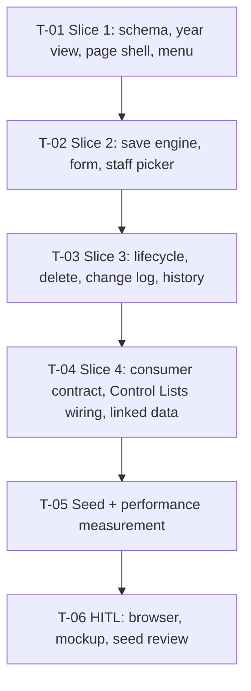

# Tasks — Institutional Performance / Organizational Structure

- **Module:** institutional-performance — server `domain/entities/organizational-structure/` + client Center admin page
- **Spec id:** 2026-10-organizational-structure
- **Status:** in-progress (T-01 started 2026-10-16)
- **Owner:** Hector F. Tobón (requester); implementers assigned by `/akili-execute`
- **Linked requirements:** [`./requirements.md`](requirements.md)
- **Linked design:** [`./design.md`](design.md) — approved 2026-10-16 after the RB-3 update
- **Parent spec:** [`../family.md`](../family.md) — child 2 of 5
- **Branch:** `institutional-kpis`
- **Jira:** [PARI-258](https://cgiarmel.atlassian.net/browse/PARI-258) — sub-tasks `<TO CONFIRM>`
- **Last updated:** 2026-10-16 (delegates added — R-ORG-017, D-ORG-15)

> **Legend.** *Falsifier* = the concrete input or mutation that must turn the gate red. *Red run* = what must be observed failing, and on which assertion. *Disqualifier* = what makes a green reading worthless. *Cannot prove* = what a presence-type check leaves open, and the check that closes it. *Consumers* = existing files that pin a symbol the task changes. An absent value reads `n/a`, never blank.

> **Slice rule (as D-CTL-16).** T-01…T-04 each deliver database + server + screen, as one server dispatch and one client dispatch in parallel. Editing across the two packages at once is safe (root `CLAUDE.md` §4.3). The client codes against design §4 with a mocked `ApiService`. One Reviewer audits the combined diff, and the Leader re-measures both full suites after both workers report. A task closes only when both halves pass. T-05 is server only.

> **Clock seam.** Every rule that says "current year" (back-date gate, physical vs logical delete, defaults) reads it from **one injected provider**, so a test can fix *today* at 2026 or 2027. A scenario that says "today is in 2027" is tested by setting that provider, never by the machine date.

> **Evidence database.** `server/researchindicators/.env` → `ARI_MYSQL_*` and `ARI_TEST_MYSQL_*`. The archived control-lists specs resolved both to the requester's local DB `127.0.0.1:3306/stardb`; **re-check before each run** and stop if either is not local. Rules carried from those archives:
> - **Never** run `migration:test:bootstrap` or `baseline:test:load`.
> - Tests clean up every row they create, and never touch seeded rows (control lists ids ≤ 23; org units ids ≤ the seed's N, after T-05).
> - The shared Dev DB is never evidence (root `CLAUDE.md` §4.3).

> **Budget tripwire (design §14, re-based 2026-10-16 at T-01).** About **20,000** LOC including tests (was 9,700); ≤ 2 review rounds per task. A slice that passes **4,500 LOC** (was 2,500), or a third review round, stops execution and goes to the requester.

---

## 1. Dependency graph and PR plan

| PR | Task | What a user can do after it |
| --- | --- | --- |
| **PR 1** | T-01 | Open *Center admin › Organizational Structure*, pick a year, see tree and table (empty state on an empty DB), export |
| **PR 2** | T-02 | Create entries and change them from a year, back-date with a warning, pick a director and the delegates from staff |
| **PR 3** | T-03 | Inactivate with successor, reactivate, delete (physical or logical), read History |
| **PR 4** | T-04 | Other modules resolve entries by ID and year; *Linked data* tab; an `org.level` value in use cannot be deleted |
| **PR 5** | T-05 | The page opens with the Alliance structure (seeded) |
| — | T-06 | Human check; no code |

Every task depends on the one before it. They share the module's service, controller and page, and the server half of each one is the same package. T-05 needs only the T-01 schema, but it runs after T-04 so that NFR-ORG-001 can measure `resolve` (T-04). The Leader may move only its seed half earlier, and only while no other server worker is active.

---

## 2. Task list

### T-01 — Slice 1: schema, year view, page shell and menu

- **Status:** done (2026-10-16, Reviewer PASS ×2 on attempt 2 — execution.md) · **Size:** L · **Dependencies:** none
- **Requirements covered:**
  - R-ORG-001 — *No portfolio anywhere*: THEN same structure whatever portfolio is current; **BUT** must NOT show a portfolio selector; AC.1 (no `portfolio_id` column; no read endpoint declares a portfolio parameter). The write half (`portfolioId` → 400) is T-02.
  - R-ORG-004 — AC.1 (unique index on `(org_unit_id, valid_from_year)`). *Three years without change*, read half: the three year views return the same version (the "one row" clause is T-02).
  - R-ORG-006 — *Deleted later, visible before* (2026 shows it, 2027 does not, **AND IT MUST** appear as *Deleted (from 2027)* with *Show inactive / deleted*) on fixture rows; *Which units were active one year ago*; AC.1, AC.2, AC.3 (scheduled badge); selectable-years rule (B2).
  - R-ORG-012 — AC.1 for B1, B2, B5 (Contributor 403; Center Admin, System Admin 200); AC.2 (menu item hidden and route closed without center-admin access).
  - R-ORG-013 — *Menu placement* (right after *Portfolio Management*, same indent; **BUT** must NOT change order, label or link of any existing item); *Empty module* (empty state with *+ New entry*; the "AND IT MUST allow creating the first L1" clause is T-02); header (year selector, toggle, filter); AC.1 (expanded and collapsed sidebar); AC.2 for loading, empty (both variants) and error with Retry, in both views; AC.3.
  - R-ORG-014 — *Export of a past year* (exact rows of the 2026 view in screen order; name contains `2026`); AC.1, AC.2; columns.
  - R-ORG-016 — read half of AC.1 (B1 returns director name and email joined from staff; `isActiveStaff` drives the *Inactive staff* mark).
  - R-ORG-017 — read half: AC.1 (B1/B5 return current delegates joined from staff); *Delegates shown in a past year* first clause (a past year view shows the **current** list, labelled *current*) on fixture rows; table *Delegates* column and its export.
  - NFR-ORG-002 (index half), NFR-ORG-004 (B1, B2, B5), NFR-ORG-005 (tree keyboard, `aria-label`, `aria-sort`), NFR-ORG-006 (B1, B2, B5).
- **Design refs:** §2.1 (module, controller, read service, constants, entities, repositories; client page, `org-tree`, `org-tree.util`, interface, sidebar, route), §3.1, §3.3 (`…000–…002`), §4 B1, B2, B5, §5.1, §5.7, §6.1–6.4, §6.8, §8, D-ORG-1, 5, 6, 7, P-6, P-8, P-12
- **Scope — database:** `src/db/migrations/1791000000000-createOrgUnits.ts`, `…001-createOrgUnitVersions.ts`, `…002-createOrgUnitChangeLog.ts`, `…003-createOrgUnitDelegates.ts`, with tables, FKs, indexes and collation exactly as design §3.1. This includes `level_value_id` → `control_list_values.id` RESTRICT, `director_carnet` → `alliance_user_staff.carnet` RESTRICT and `org_unit_delegates.staff_carnet` → `alliance_user_staff.carnet` RESTRICT, with `uq_org_unit_delegates_unit_staff`. No FK on the log. Each file exports only its class. Then `npm run migration:test:execute` on the local DB.
- **Scope — server:** entities, repositories, `org-structure.constants.ts`, clock provider, `OrgStructureReadService` (singleton: `getYearView`, year range), controller with B1, B2, B5 (class-level `RolesGuard`, `SetUpInterceptor`, Swagger; literal routes before `:id`), module registered in `entities.module.ts` and `main.routes.ts` at `organizational-structure`. The read service imports nothing request-scoped.
- **Scope — screen:** page shell (header, *Structure year* `p-select` from B2, *Tree / Table* toggle, *Show inactive / deleted*, count chips, split layout with an empty right panel, *+ New entry* button wired to an empty form placeholder), `org-tree` on `p-treeTable`, `org-tree.util`, `DataTable` view with the R-ORG-014 columns and file name `organizational-structure_<year>.xlsx`, interface file, `ApiService` methods for B1, B2, B5, sidebar item, lazy route with `canMatch: [centerAdminGuard]`.
- **Tests:**
  - **Server unit:**
    - Year-coverage function on boundary years `from`, `to − 1`, `to` and open-ended.
    - Read service: an ended entry appears before its end year and not from it, unless `includeEnded`; `scheduledFromYear` = the smallest later start.
    - Controller: roles metadata `[CENTER_ADMIN, SYSTEM_ADMIN]` on B1, B2, B5; literal routes before `:id`; envelope per handler; B1 year out of range → 400 through the real `GlobalExceptions`.
  - **Server integration (local DB):**
    - Migrations up; `SHOW COLUMNS … LIKE 'portfolio_id'` empty on all three tables.
    - `SHOW INDEX` → `Non_unique = 0` on `uq_org_units_code` and `uq_org_unit_versions_unit_from`; a raw duplicate `(org_unit_id, valid_from_year)` insert → errno 1062.
    - `SHOW CREATE TABLE org_unit_versions` names RESTRICT on the level and director FKs; `SHOW CREATE TABLE org_unit_delegates` names RESTRICT on the staff FK and the unique pair; `org_unit_change_log` has no FK.
    - Delegates on fixtures: an entry with two delegate rows is returned with both in the 2026 **and** 2027 views (current list, not per year).
    - Year view on inserted fixtures: one entry with `[2026, 2027)` + `[2027, NULL)` under different parents; one ended in 2027 (`status = deleted`, `status_from_year = 2027`); one created in 2028. Views for 2026, 2027 and 2028 return exactly the expected rows and parents, with and without `includeEnded`.
    - A Contributor token gets 403 on B1.
  - **Client unit:**
    - `org-tree.util`: nesting, *N units* counts, ended entries included only with the filter, L4 directly under L2.
    - Page: default year = B2 `current`; a year change calls B1 once with the new year and reloads both views (AC.3); loading, both empty variants, and error with *Retry* (Retry calls B1 again).
    - No portfolio selector is rendered (query by role and by label).
    - Table: default natural sort `ORG-2` before `ORG-10`; export rows equal the filtered and sorted rows; file name contains the year.
    - Tree: expander `aria-label`.
    - Sidebar: exact children array of *Center admin*, with the new item right after *Portfolio Management*, in the expanded and the collapsed renderings; the other groups' arrays are unchanged.
    - Route spec: new path with `centerAdminGuard`. Guard test with the real `RolesService`: `[9]` admitted, `[1]` admitted, a Contributor-only user denied.
- **Falsifier:**
  1. Write year coverage as `to >= N` → the boundary test at `to` returns the ended version.
  2. Treat open-ended `to` as excluded (`to > N` without `IS NULL`) → the 2028 view loses every current entry.
  3. Export `seed…` or any function from a migration file → `migration:show` fails with "migration name is wrong" (the D-ORG-14 trap appears here first).
  4. Drop the unique index → the raw duplicate insert succeeds.
  5. Put *Organizational Structure* inside *Portfolio Management* `children` → the sidebar exact-array test fails.
  6. Remove `@Roles` from B1 → the roles-metadata test fails.
- **Red run:** each falsifier is observed failing on its own assertion (returned rows, loader error, errno, DOM array, roles array), not on setup, then reverted.
- **Disqualifier:**
  - Any run against a non-local host.
  - A year-view test whose fixture entries all share one version range: it cannot tell coverage from "return everything".
  - `arrayContaining` used for sidebar order.
  - A guard test with a boolean-mocked `RolesService`.
  - A `migration:show` count read with ANSI codes in it, or from a command that failed (K-014).
  - Client `npm test` green without `ng build`.
- **Cannot prove:** jsdom cannot show that the tree expands, collapses and indents visually, or that columns resize. Those go to T-06 in a real browser.
- **Consumers:** `alliance-sidebar.component.spec.ts` (exact arrays of *Center admin*); `app.routes.spec.ts`; `entities.module.spec.ts`, `main.routes.spec.ts` (re-run); `testing/mock-services.mock.ts` (new `ApiService` methods).
- **Review:** `full` — new schema, new routes, shared sidebar.
- **Skills:** nestjs-expert, api-design-principles, error-handling-patterns (server); angular-developer, ui-ux-pro-max (client); systematic-debugging on any failure.
- **Done criteria:**
  - [x] `migration:test:execute` output quoted; `SHOW INDEX` / `SHOW CREATE TABLE` results quoted. *(execution.md → T-01 verbatim evidence)*
  - [x] Server: `npm test -- --silent`, `npm run test:integration -- org-structure`, `npx eslint src/domain/entities/organizational-structure src/db/migrations/1791*`, `npm run build`. Client: `npm test -- --silent`, `npm run lint -- --quiet`, `ng build`. *(server full suite: 2 red suites pre-existing, proven on a clean HEAD — execution.md)*
  - [x] Falsifiers 1–6 observed red, then reverted.
  - [x] B1, B2, B5 seen in `/swagger` on a local reduced boot (D-EX-4 of the global-scope spec); the observation is quoted.

### T-02 — Slice 2: save engine, form and staff picker

- **Status:** in progress (2026-10-16; P-14 settled) · **Size:** L · **Dependencies:** T-01
- **Requirements covered:**
  - R-ORG-001 — *No portfolio anywhere*: **AND IT MUST** reject (`400`) any write that sends `portfolioId` (B9, B10); AC.2.
  - R-ORG-002 — *Code proposed and unique*: pre-filled `ORG-118`; **AND IT MUST** reject `org-050` with `409` naming `code` because a deleted entry still owns it (fixture row with `status = deleted`). *ID is read-only*: `id` in a body → 400; **BUT** must NOT change the stored ID. AC.1, AC.2. Code not versioned (`code_change`, no version).
  - R-ORG-003 — every scenario: *Wrong parent level* (400 naming `parent`; **AND IT MUST NOT** store the version); *Unit directly under a department*; *Parent not active in the covered years* (400 naming the years); *Cycle* (400; **AND IT MUST** check every year from *Applies from year*, including later scheduled versions); *Value from the wrong list* (400 naming `level`). Level outside ids 20–23 → 400. AC.1, AC.2.
  - R-ORG-004 — *Three years without change* (**AND IT MUST** be stored as one row `[2026, open)`); *Move from next year* (two versions, year views; **BUT** must NOT create a version for any other entry); *Typo fix in the current version's year* (in place; **AND IT MUST** log old and new name); *A later deliberate change is kept* (director reaches both versions; the name fix changes only `[2026, 2028)`; **BUT** must NOT overwrite *Data & AI*); bound "*Y* not before the entry's first year"; AC.2, AC.3.
  - R-ORG-005 — *Back-date without the flag* (400; **AND IT MUST NOT** change any version); *Back-date with the flag* (views move; **AND** the log records `backdated`, the year and the timestamp); create with a past first year is a back-date; AC.1, AC.2 (UI warning).
  - R-ORG-009 — AC.1 for `create`, `edit_in_place`, `new_version`, `code_change` (exactly one log row each, with the listed fields).
  - R-ORG-012 — AC.1 for B3, B4, B9, B10; *Denied role*: Contributor 403; **BUT** must NOT change data or append to the log.
  - R-ORG-013 — *Empty module*: **AND IT MUST** allow creating the first L1 entry; form fields; parent picker limited to allowed levels active in *Applies from year*; *Applies from year* appears only after a change and is hidden for a code-only edit; AC.2 success state (toast naming *updated in place* / *new version from Y* / *back-dated from Y*).
  - R-ORG-017 — *Add delegates* (stores `[B2001, B2002]`; **AND IT MUST** write one log row with old and new lists; **BUT** must NOT create a version or ask for *Applies from year*); *Director as delegate* (400 `delegates`; **AND IT MUST NOT** change the list); *Delegate made director* (400 `director`); replace semantics (omitted unchanged, `[]` clears); a deleted entry → 409; AC.1–AC.4. The History half of *Delegates shown in a past year* is T-03.
  - R-ORG-016 — *Pick a director* (stores `A1234`; **AND** the form shows her email read-only); *Director leaves later* (2026 still shows her with *Inactive staff*; **BUT** the picker must NOT offer her); *Unknown staff ID* (400 naming `director`); director name or email in a body → 400; AC.1, AC.2, AC.3.
  - NFR-ORG-002 (invariant half), NFR-ORG-004 (B3, B4, B9, B10), NFR-ORG-006 (same handlers).
- **Design refs:** §2.1 (service, `org-version-timeline.util`, DTOs, `org-unit-panel` Details tab, by-key `ApiService` method), §3.2 I-1…I-5, §4 B3, B4, B9, B10, §5.2, §5.3, §5.6, §6.5, D-ORG-2, 4, 8, 9, P-2, P-10, P-13, **P-14**
- **First step (P-14):** run `SELECT status, is_active, COUNT(*) FROM alliance_user_staff GROUP BY status, is_active` on the local DB. Record the output and its date in `execution.md`, and write the chosen "active staff" rule into design §4 B4 **before** any code. If the output does not separate current staff from people who left, stop and ask the requester.
- **Scope — server:**
  - Timeline util (pure: locate, split, edit in place, propagate only where the later value equals the replaced value, `assertTimeline`).
  - Service: one transaction per write with `SELECT … FOR UPDATE` on the entry; `assertValueInList(levelId, 'org.level')` + level id ∈ {20…23}; staff existence; back-date gate; hierarchy and cycle validation over boundary years; one log row per write in the same transaction; errno 1062 → 409 naming `code`.
  - Delegates: validation of §5.2 step 1 (≤ 20, duplicates, existence, newly added active, I-6 in both directions, computed after the save's own director change); replace inside the same transaction; `delegates_change` log row.
  - Code proposal (B3); parenthesized staff search (B4, active only per P-14, at most 20 rows).
  - DTOs with `whitelist` + `forbidNonWhitelisted`, so `id`, `portfolioId`, `directorName` and `directorEmail` are rejected.
  - B9, B10 with Swagger.
- **Scope — screen:**
  - Details tab of `org-unit-panel`: Code (pre-filled from B3), Level from `GET_ControlListValuesByKey('org.level', true)`, Name, Acronym, Parent (hidden for L1; options limited by level and *Applies from year*, shown with path), director `p-autoComplete` on B4 (debounce 300 ms, name + email, email echoed read-only), **Delegates (current)** multi-select on B4 (chips, max 20, the director excluded, *Inactive staff* mark, hint that it is not tied to a year), *Applies from year*, *Back-date* checkbox with warning.
  - Save / Cancel; the toast states the result.
  - Row **+** in the tree pre-fills parent and next level.
- **Tests:**
  - **Server unit (pure util, table-driven):**
    - Sequences create → split → in place → back-date → propagate (kept / overwritten), with `assertTimeline` after every step.
    - The *A later deliberate change is kept* case uses **different** values per version (name *Data Science* / *Data & AI*, director A / B), so propagation and overwrite give different answers.
  - **Server unit (service, real `ValidationPipe`):**
    - Each R-ORG-003 rule, allowed and rejected.
    - A cycle that exists **only** in a scheduled 2029 version, when saving from 2027.
    - Back-date gate with the clock at 2027; level from `kpi.direction` → 400 naming `level`; level id 24 (a real value of another list, or a fabricated one) → 400; unknown `carnet` → 400 naming `director`.
    - `id`, `portfolioId`, `directorName`, `directorEmail` → 400 with no repository write.
    - Simulated errno 1062 with the pre-check stubbed → 409 naming `code`.
    - Exactly one log row per action, with `backdated` set correctly.
    - Delegates: 21 ids, a duplicate, an unknown `carnet`, a newly added inactive one → 400 naming `delegates`; an inactive one already in the list is kept on an unrelated save; director as delegate → 400 `delegates`; a delegate set as director from the current year → 400 `director`; the director of a **scheduled later** version added as delegate → 400; one request that changes the director away from X and adds X as delegate → accepted (overlap computed after the save).
  - **Server integration (local DB):**
    - Create, then move from 2027 → two rows with the right ranges.
    - Checksum of every other entry's version rows before and after a save is identical (R-ORG-004 AC.3).
    - Back-date with the flag → the 2026 and 2027 views move; the log row has `applies_from_year = 2026`, `backdated = 1` and `created_at` = now.
    - Contributor 403 on B9 → row and log counts unchanged.
    - Delegates-only `PATCH` → `org_unit_versions` row count unchanged, `org_unit_delegates` rows replaced, exactly one `delegates_change` log row with old and new lists.
    - Staff: set a fixture staff row inactive (per P-14), then restore it → the past version still resolves the same `carnet` with the current name and email, and B4 no longer returns it.
    - B4 with a search term that matches an inactive staff member **only by last name or email** → not returned. This is the P-10 precedence defect, asserted on real SQL.
  - **Client unit:**
    - Fields per level (Parent hidden for L1).
    - Parent options exclude wrong levels and entries ended before *Applies from year*.
    - *Applies from year* hidden until a change and hidden for a code-only edit.
    - Back-date unlocks earlier years and shows the warning before save.
    - The payload carries `directorCarnet` and `delegateCarnets` only (no names or emails).
    - Delegates: the director is not offered; a delegates-only edit does not show *Applies from year*; the 21st pick is refused.
    - The email echo is read-only.
    - The toast text for each of the three outcomes.
    - The picker list excludes an inactive staff fixture.
    - Empty module → creating the first L1 posts with no parent.
- **Falsifier:**
  1. Propagate a changed field to every later version unconditionally → the *Data & AI* assertion fails.
  2. Validate cycles only at *Applies from year* → the scheduled-2029 cycle is accepted.
  3. Drop the back-date gate → the 2026-without-flag save returns 201.
  4. Remove `forbidNonWhitelisted` → `portfolioId` passes.
  5. Use the existing unparenthesized staff query → the inactive last-name match is returned (integration, real SQL).
  6. Write the log row after the commit → a forced failure after the version write leaves a version without its log row (or a log row without its version).
  7. Read the year from `new Date()` instead of the clock provider → the "today is 2027" tests fail.
  8. Check the director/delegate overlap only against the stored director (before the save's change) → the "change director away from X and add X" request is rejected, and the "delegate made director" request passes.
  9. Store delegates on the version → the delegates-only save adds a version row.
- **Red run:** each falsifier is observed failing on its own assertion (version ranges, status, row set, log count), then reverted.
- **Disqualifier:**
  - A propagation test whose later versions hold the same value as the earlier one: it cannot tell "kept" from "overwritten".
  - A staff-search test on a mocked `QueryBuilder`: it cannot show `AND`/`OR` precedence (KZ-001, KZ-017).
  - An "other entries unchanged" check that compares counts instead of row contents.
  - A P-14 rule chosen without the measured output.
  - Any non-local host.
- **Cannot prove:** whether the autocomplete dropdown positions correctly and stays usable at 1,280 px goes to T-06.
- **Consumers:** T-01's service, controller, page and specs; `control-list-value-lookup.service.ts` (called, not changed); `api.service.ts` + `testing/mock-services.mock.ts`.
- **Review:** `full` — temporal engine, transaction, PII field.
- **Skills:** nestjs-expert, api-design-principles, error-handling-patterns, tdd (timeline util) (server); angular-developer, ui-ux-pro-max (client); systematic-debugging on any failure.
- **Done criteria:**
  - [ ] P-14 query output quoted with date; design §4 B4 updated before code.
  - [ ] Same command set as T-01, all green; falsifiers 1–7 observed red, then reverted.
  - [ ] B3, B4, B9, B10 in `/swagger`, observation quoted.

### T-03 — Slice 3: lifecycle, delete, change log and history

- **Status:** todo · **Size:** L · **Dependencies:** T-02
- **Requirements covered:**
  - R-ORG-004 — bound "*Y* not on or after the year the entry ends" (save on an ended entry → 400; on a deleted one → 409).
  - R-ORG-005 — back-date gate on inactivate, reactivate and logical delete.
  - R-ORG-007 — *Merge* (2027 view omits `ORG-061`, 2026 shows it; **AND** reading `ORG-061` returns successor `ORG-060` through B5); *Active children block* (409 naming both units; **BUT** must NOT change any version); AC.1, AC.2 (reactivate adds one version from the chosen year, clears the successor), AC.3 (successor of another level, or not active that year → 400); D-ORG-11 (a version scheduled after *E* → 400; a version starting at *E* is dropped and logged).
  - R-ORG-008 — *Logical delete* (*Deleted (from 2027)*; **AND IT MUST** still appear in the 2026 view); *Physical delete of an entry created this year* (rows gone, code free; **AND** the log keeps a delete row with the last values); *Linked records block* (409 stating the count and proposing *Inactivate*, through a test consumer in `OrgUnitUsageRegistry`); AC.1, AC.2, AC.3; the dialog states the entry stays visible in earlier years.
  - R-ORG-002 — the "code reused only after a physical delete" clause (after the physical delete, a create with the same code → 201).
  - R-ORG-006 AC.2 — end to end: inactivated and deleted entries, produced by B11 and B13, in earlier views and absent later.
  - R-ORG-017 — *Delegates shown in a past year*: **AND** the History tab shows the change with its date and user.
  - R-ORG-009 — *Log survives everything* (create + physical delete both returned by B7); AC.1 for `inactivate`, `reactivate`, `delete_logical`, `delete_physical`; AC.2 (no route updates or deletes the log); History tab.
  - R-ORG-012 — AC.1 for B6, B7, B11, B12, B13 (Contributor 403, nothing written, no log row).
  - R-ORG-013 — *Inactivate* / *Reactivate* next to *Delete*; the lifecycle dialog; a 409 shows the server's description and a single *Close*.
  - NFR-ORG-003 (route inventory + physical-delete survival), NFR-ORG-004, NFR-ORG-005 (dialog focus trap), NFR-ORG-006 (B6, B7, B11–B13).
- **Design refs:** §2.1 (`org-unit-usage.registry.ts`, `org-lifecycle-dialog`, History tab, modal name `orgUnitLifecycle`), §4 B6, B7, B11, B12, B13, §5.3 children rule, §5.4, §5.5, §6.2 dialog row, §6.6 History, D-ORG-5, 10, 11, 13
- **Scope — server:** inactivate / reactivate / delete in the service, using the T-02 transaction and log path. `OrgUnitUsageRegistry` (singleton, **deduplicated by `consumerName`**, `countByUnitIds`) feeds the delete and inactivate blocker. B6, B7, B11, B12, B13 with Swagger. Warn logs on every blocked action.
- **Scope — screen:** `org-lifecycle-dialog` (Inactivate: *From year*, *Successor* limited to the same level and active that year, back-date + warning; Delete: physical vs logical text plus "stays visible in earlier years"; Reactivate: year); modal registration in `modal.types.ts` + `all-modals.service.ts`; History tab (versions table, then the log timeline newest first with field diffs); action buttons per status (no edit on a deleted entry).
- **Tests:**
  - **Server unit:**
    - Every §5.4 / §5.5 rule, allowed and rejected.
    - Children "active from E" uses a child whose **later** version (from 2028) moves it under the entry: inactivating from 2027 is blocked.
    - Physical delete versus logical delete with the clock at 2026 and at 2027, for an entry first seen in 2026.
    - Registry deduplication: registering the same name twice counts once.
    - Delete blocked by a test consumer reporting 5 (409 text contains `5` and *Inactivate*).
    - Route inventory: no `PATCH`, `PUT` or `DELETE` under `/change-log`, and no handler writes the log table except the service's log writer.
  - **Server integration (local DB):**
    - Physically delete a fixture entry → its `org_units` and `org_unit_versions` rows are gone, `org_unit_change_log` keeps the `create` and `delete_physical` rows, and B7 returns both.
    - Logical delete → the row is still in `org_units` with `status = deleted`, the 2026 view has it, the 2027 view does not.
    - Merge → B5 on `ORG-061` returns `successorId`.
    - Delegates history: change `[B2001]` → `[B2002]`; B6 returns the `delegates_change` row with both lists, user and timestamp (R-ORG-017 *Delegates shown in a past year*, History half).
    - Physical delete of an entry with delegates → its delegate rows are gone; logical delete → they stay.
    - Blocked inactivate → checksum of the version rows unchanged.
  - **Client unit:**
    - Dialog fields per action.
    - Successor options = same level and active in *From year*.
    - Back-date warning.
    - A 409 renders the server text with a single *Close*.
    - History shows versions, then the log newest first.
    - A deleted entry shows no *Save* and no *Reactivate*.
    - The modal traps focus (focus stays inside on Tab from the last control).
- **Falsifier:**
  1. Decide physical versus logical by `status_from_year` instead of the first version's start → the 2027 clock case deletes physically a 2026 entry.
  2. Add an FK from the log to `org_units` with CASCADE → the physical-delete integration test loses the log rows.
  3. Check children only at year *E* → the child that moves in from 2028 does not block.
  4. Register with `push` (no dedup) → the double-registration count is 2.
  5. Allow reactivate on a deleted entry → the 409 test returns 200.
- **Red run:** each falsifier is observed failing on its own assertion, then reverted.
- **Disqualifier:**
  - A "log survives" test that never physically deletes on the real DB.
  - A children-block fixture where every child is active in every year: it cannot tell "from E" from "at E".
  - A focus-trap test that only checks an attribute is present.
  - Any non-local host.
- **Cannot prove:** whether the dialog reads well, and whether the back-date warning is noticed before *Save*. Human check at T-06.
- **Consumers:** T-02's service, panel and specs; `modal.types.ts`, `all-modals.service.ts` and their specs.
- **Review:** `full` — irreversible delete path, history guarantees.
- **Skills:** nestjs-expert, error-handling-patterns (server); angular-developer, ui-ux-pro-max (client); systematic-debugging on any failure.
- **Done criteria:**
  - [ ] Same command set as T-01, all green; falsifiers 1–5 observed red, then reverted.
  - [ ] B6, B7, B11–B13 in `/swagger`, observation quoted.

### T-04 — Slice 4: consumer contract, Control Lists wiring and linked data

- **Status:** todo · **Size:** M · **Dependencies:** T-03
- **Requirements covered:**
  - R-ORG-010 — `resolve` returns the **current** delegates (R-ORG-017) for any requested year.
  - R-ORG-010 — *KPI history continues through a move*, with a registered test consumer holding values for 2026–2030 under ID 57 and a move from 2029: one series under ID 57; roll-up puts 2026–2028 under A and 2029–2030 under C; **BUT** must NOT require rewriting any stored value. AC.1 (`resolve` and `ancestors` for the requested year, including ended entries before their end); AC.2 (the test consumer drives *Linked data*; its delete-block half was proven in T-03 and is re-run here); successor chain; `assertExists`.
  - R-ORG-011 — *Level in use* (deleting `L4 Unit` → 409 stating the count and proposing deactivation; **AND** the `org.level` list shows *Used by: Organizational Structure › Level*); AC.1 (count per value = number of **versions** using it); AC.2 (a raw FK violation on value delete → 409); registered exactly once from a singleton `onModuleInit`.
  - R-ORG-012 — consumer reads C1–C3 open to any authenticated user (Contributor 200); AC.1 re-run over **every** handler of the controller (B1–B13 admin, C1–C3 open).
  - R-ORG-013 — *Linked data* tab (child count + per-consumer counts, or *No linked data yet*).
  - NFR-ORG-004 (full handler sweep), NFR-ORG-006 (C1–C3, B8).
- **Design refs:** §2.1 (`org-level-usage.provider.ts`, read-service exports, Control Lists `removeValue` row), §4 B8, C1, C2, C3 and the exported in-process API, §5.8, §6.6 Linked data, §7, D-ORG-10, P-1, P-3, P-4
- **Scope — server:**
  - `OrgStructureReadService`: `resolve`, `ancestors`, `successors`, `assertExists`. Module exports the read service and the registry.
  - `OrgLevelUsageProvider` with `onModuleInit` registering in `ControlListUsageRegistry` once (count = versions per level value).
  - B8, C1 (≤ 200 ids), C2, C3 with Swagger.
  - **Control Lists:** in `control-lists.service.ts` `removeValue`, map MySQL errno **1451** → `ConflictException` ("in use; deactivate instead"), the same technique as the 1062 mapping. The only change in that module.
  - A reusable test consumer under `test/support/` for the integration suites.
- **Scope — screen:** *Linked data* tab; `ApiService` method for B8.
- **Tests:**
  - **Server unit:**
    - `resolve` for years before, at and after a move, and for an entry ended in 2027 asked for 2026 (resolved) and 2027 (status ended).
    - `ancestors` across a move; `successors` over a two-step chain.
    - Provider: two `onModuleInit` calls register once.
    - `removeValue` with a simulated errno 1451 and the registry stubbed to 0 → 409, not 500, through the real `GlobalExceptions`.
    - Controller: iterate every handler. Roles `[CENTER_ADMIN, SYSTEM_ADMIN]` on all B-handlers and **no** `@Roles` on C1–C3.
  - **Server integration (local DB):**
    - Test consumer + move fixture → the KPI scenario's series and roll-up.
    - Delete control-list value 23 while fixture versions use it → 409 with the count, and the A1 `usedBy` for `org.level` contains *Organizational Structure › Level*.
    - The FK backstop: with the registry count forced to 0, a raw delete of a used value → 409 (errno 1451 mapped).
    - Contributor token → 200 on C1 and 403 on B8.
  - **Client unit:** *Linked data* renders counts per consumer, the child count, and *No linked data yet* when all are zero.
- **Falsifier:**
  1. Remove the errno 1451 mapping → the FK-backstop test gets 500.
  2. Count entries instead of versions in the level provider → an entry with two versions on L4 counts 1, not 2 (the fixture has one).
  3. Register the provider from the request-scoped service → the double-init test registers twice, or the module fails to resolve the singleton.
  4. Make `resolve` return the current version regardless of year → the 2026–2028 roll-up lands under C.
  5. Add `@Roles` to C1 → the Contributor 200 test fails.
- **Red run:** each falsifier is observed failing on its own assertion, then reverted.
- **Disqualifier:**
  - A KPI-scenario fixture without a move: it cannot tell year resolution from "current version".
  - A level-count fixture where every entry has one version.
  - A 1451 test that never reaches the real `GlobalExceptions`.
  - Any non-local host.
  - The Control Lists integration suites not re-run (the change touches `removeValue`).
- **Cannot prove:** n/a (no rendered-geometry claim).
- **Consumers:** `control-lists.service.ts` + `control-lists.service.spec.ts`, `test/control-lists-usage.integration-spec.ts`, `test/control-lists-values.integration-spec.ts` (re-run); `control-lists.module.ts` (imported, not changed).
- **Review:** `full` — cross-module contract and a change inside Control Lists.
- **Skills:** nestjs-expert, api-design-principles, error-handling-patterns (server); angular-developer (client); systematic-debugging on any failure.
- **Done criteria:**
  - [ ] Same command set as T-01, plus `npm run test:integration -- control-lists`, all green; falsifiers 1–5 observed red, then reverted.
  - [ ] B8, C1–C3 in `/swagger`, observation quoted.

### T-05 — Seed and performance measurement

- **Status:** todo · **Size:** M · **Dependencies:** T-04 (the seed half needs only T-01; see §1)
- **Requirements covered:**
  - R-ORG-015 — *Seed runs twice* (no entry, version or log row added); AC.1 counts; fixed ids; one version `[2026, open)` per entry; DT = Technology Integration; the three parentless units placed under the parent they appear with; director matching (email, else exact first + last name; no single match → empty) and the seed report; one `seed` log row per entry.
  - NFR-ORG-001 — year view of ≤ 500 entries p95 ≤ 300 ms; `resolve` of 100 ids ≤ 100 ms.
- **Design refs:** §3.4, D-ORG-12, D-ORG-14, P-11
- **First step (P-11):** list the mockup `TREE` (`../mockup/OrgStructure.dc.html:387` onward) per group, with the count per level. Send the requester the list and the 94 / 95 discrepancy, and record their answer in `execution.md` before writing the seed. The AC.1 counts are then the confirmed ones; "117" in requirements AC.1 is corrected if they differ (with a Correction Closure sweep).
- **Scope — database:** `src/db/seeds/org-structure.seed.ts` (data + insert functions returning `affectedRows`; no delegate rows; `INSERT … SELECT … WHERE NOT EXISTS` on fixed ids; `AUTO_INCREMENT` above N; director lookup by email, then by exact name; unmatched names logged with `LoggerUtil`). `src/db/migrations/1791000000004-seedOrgStructure.ts` imports it and exports only its class (D-ORG-14). Then `npm run migration:test:execute`.
- **Scope — tests:** `test/org-structure-seed.integration-spec.ts`.
- **Tests:**
  - **Integration (local DB):**
    - After the migration: counts per level equal the confirmed list; every seeded entry has exactly one version with `valid_from_year = 2026`, `valid_to_year IS NULL`, and one `seed` log row.
    - Calling the seed functions again → 0 affected rows.
    - Spot checks by fixed id: the DT entry name, and the three formerly parentless units' parents.
    - The unmatched-director list is printed and copied into `execution.md` as the seed report.
  - **Performance (local DB):**
    - Add synthetic entries up to 500 inside a test transaction rolled back after the run.
    - Time B1 for one year and `resolve` of 100 ids, 20 calls each, 3 runs; report p95 per run.
- **Falsifier:**
  1. Remove `WHERE NOT EXISTS` from the versions insert → the re-run adds rows (or fails on the unique index; record which).
  2. Swap the email-first rule for name-first → a fixture staff row with the same name but a different email gets matched.
  3. Export the seed function from the migration file → `migration:show` reports "migration name is wrong".
- **Red run:** each falsifier is observed failing on its own assertion, then reverted.
- **Disqualifier:**
  - Counts asserted against the 2026-10-08 numbers instead of the requester-confirmed list.
  - Timing runs that vary by more than 30 %: report the spread and mark NFR-ORG-001 *inconclusive*, not pass.
  - Timing taken while any other agent or suite is running (root `CLAUDE.md` §4.3).
  - Synthetic rows left behind.
  - Any non-local host.
- **Cannot prove:** that the seeded names and parents match the source sheet. The requester reviews them at T-06; otherwise this is an accepted risk (requirements §10).
- **Consumers:** n/a (new files); T-01's integration suites must still pass with seeded rows present (they create their own rows above N).
- **Review:** `standard` — data only, but irreversible on a shared DB once merged to `dev`, where the pipeline runs migrations.
- **Skills:** nestjs-expert (server); systematic-debugging on any failure.
- **Done criteria:**
  - [ ] Requester's answer on P-11 recorded; counts in requirements AC.1 match it.
  - [ ] `migration:test:execute` output, seed suite green, re-run 0 rows, seed report quoted.
  - [ ] NFR-ORG-001: three runs with p95 per run quoted, verdict *pass* / *fail* / *inconclusive*.
  - [ ] Falsifiers 1–3 observed red, then reverted.

### T-06 — HITL: browser, mockup and seed review

- **Status:** todo · **Size:** S · **Dependencies:** T-05 · **Owner:** requester
- **Requirements covered:** the requirements §10 substitutes: tree rendering, expand/collapse, column resize; visual fidelity to the mockup; seed content against the source sheet. NFR-ORG-005 manual keyboard pass. R-ORG-013 AC.1 seen with a real Center-Admin-only user.
- **Design refs:** §6, §10 *Manual (HITL)*, mockup artboard 2
- **Scope:** no code. With the app running locally (`docker compose up --build -d` or the native commands):
  1. Log in as a **Center Admin only** user: the item sits right after *Portfolio Management*; the page opens. Log in as a Contributor: the item is absent and the URL redirects.
  2. Tree: expand and collapse with the mouse and with the arrow keys; indent per level; badges (*scheduled*, *inactive*, *deleted*, *Inactive staff*).
  3. Table: resize a column, sort, page through 10 / 25 / 50 / 100 rows, export 2026 and open the file.
  4. Create, move from next year, back-date (warning seen before *Save*), add and remove delegates (director not offered; no year asked), inactivate with successor, delete; check History after each.
  5. Compare side by side with `../mockup/OrgStructure.dc.html`; list differences as accepted or as rework. The *Delegates* field and table column were added to the mockup on 2026-10-16 (artifact version 25); compare them too.
  6. Review the seeded tree against sheet *04. ORG structure*, and fill in the directors from the seed report.
- **Falsifier:** n/a (human check). The requester's quoted words are what discharge each criterion (KZ-002).
- **Disqualifier:** a check done with a System Admin user instead of a Center-Admin-only user; a criterion ticked on an observation that covers an adjacent property.
- **Review:** none (human step); the Leader records the quoted observations in `execution.md`.
- **Done criteria:**
  - [ ] Steps 1–6 quoted, the role named for each step.
  - [ ] Mockup differences listed (accepted / rework).
  - [ ] Seed review result and director follow-ups recorded.

---

## 3. Coverage closure (scenario and clause level)

Every scenario and every `BUT` / `AND IT MUST` clause has exactly one owning task. "Read half" / "write half" splits are named in the task.

| Requirement | Scenario / clause | Owner |
| --- | --- | --- |
| R-ORG-001 | *No portfolio anywhere* — same structure; **BUT** no selector | T-01 |
| R-ORG-001 | **AND IT MUST** reject `portfolioId` with 400 | T-02 |
| R-ORG-002 | *Code proposed and unique* — `ORG-118`; **AND IT MUST** 409 on `org-050` | T-02 |
| R-ORG-002 | *ID is read-only* — 400; **BUT** stored ID unchanged | T-02 |
| R-ORG-002 | code reusable only after physical delete | T-03 |
| R-ORG-003 | *Wrong parent level* — 400 `parent`; **AND IT MUST NOT** store | T-02 |
| R-ORG-003 | *Unit directly under a department* | T-02 |
| R-ORG-003 | *Parent not active in the covered years* | T-02 |
| R-ORG-003 | *Cycle* — 400; **AND IT MUST** check later scheduled versions | T-02 |
| R-ORG-003 | *Value from the wrong list*; level outside 20–23 | T-02 |
| R-ORG-004 | *Three years without change* — same version in three views | T-01 |
| R-ORG-004 | **AND IT MUST** be one row `[2026, open)` | T-02 |
| R-ORG-004 | *Move from next year*; **BUT** no version for any other entry | T-02 |
| R-ORG-004 | *Typo fix*; **AND IT MUST** log old and new | T-02 |
| R-ORG-004 | *A later deliberate change is kept*; **BUT** not overwrite *Data & AI* | T-02 |
| R-ORG-004 | bound: not before the first year / not on or after the end year | T-02 / T-03 |
| R-ORG-004 | AC.1 unique index · AC.2 invariant · AC.3 other entries untouched | T-01 · T-02 · T-02 |
| R-ORG-005 | *Back-date without the flag*; **AND IT MUST NOT** change any version | T-02 |
| R-ORG-005 | *Back-date with the flag*; **AND** log year + timestamp | T-02 |
| R-ORG-005 | back-date on lifecycle actions | T-03 |
| R-ORG-006 | *Deleted later, visible before* incl. **AND IT MUST** appear with *Show inactive / deleted* (fixtures) | T-01 |
| R-ORG-006 | same, produced through B11 / B13 end to end | T-03 |
| R-ORG-006 | *Which units were active one year ago*; AC.1, AC.3; selectable years | T-01 |
| R-ORG-007 | *Merge* incl. successor returned | T-03 |
| R-ORG-007 | *Active children block*; **BUT** no version changed | T-03 |
| R-ORG-007 | AC.2 reactivate · AC.3 successor rules · D-ORG-11 | T-03 |
| R-ORG-007 | successor chain read by consumers | T-04 |
| R-ORG-008 | *Logical delete*; **AND IT MUST** still appear in 2026 | T-03 |
| R-ORG-008 | *Physical delete*; **AND** log keeps the delete record | T-03 |
| R-ORG-008 | *Linked records block* (test consumer) | T-03 |
| R-ORG-009 | AC.1 for create / edit / new version / code change | T-02 |
| R-ORG-009 | *Log survives everything*; AC.1 for lifecycle actions; AC.2; History tab | T-03 |
| R-ORG-010 | *KPI history continues through a move*; **BUT** no rewrite; AC.1; AC.2 *Linked data* half | T-04 |
| R-ORG-010 | AC.2 delete-block half | T-03 (re-run T-04) |
| R-ORG-011 | *Level in use*; **AND** *Used by* shown; AC.1; AC.2; register once | T-04 |
| R-ORG-011 | FK RESTRICT on the level column | T-01 |
| R-ORG-011 | `assertValueInList` before every level write | T-02 |
| R-ORG-012 | *Denied role*; **BUT** no data or log change — per handler | T-01 (B1, B2, B5) · T-02 (B3, B4, B9, B10) · T-03 (B6, B7, B11–B13) · T-04 (B8, C1–C3, full sweep) |
| R-ORG-012 | AC.2 menu hidden, route closed | T-01 (automated) · T-06 (real user) |
| R-ORG-013 | *Menu placement*; **BUT** existing items unchanged | T-01 |
| R-ORG-013 | *Empty module* — empty state | T-01 |
| R-ORG-013 | **AND IT MUST** allow creating the first L1 | T-02 |
| R-ORG-013 | AC.2 loading / empty / error · success toast | T-01 · T-02 |
| R-ORG-013 | form fields, parent picker, *Applies from year* rule | T-02 |
| R-ORG-013 | lifecycle actions and dialog · History tab | T-03 |
| R-ORG-013 | *Linked data* tab | T-04 |
| R-ORG-014 | *Export of a past year*; AC.1; AC.2 | T-01 |
| R-ORG-015 | *Seed runs twice*; AC.1; directors; seed report | T-05 |
| R-ORG-016 | read half of AC.1 (joined name / email, `isActiveStaff`) | T-01 |
| R-ORG-016 | *Pick a director* · *Director leaves later* incl. **BUT** not offered · *Unknown staff ID* · AC.1–AC.3 | T-02 |
| R-ORG-017 | read half of AC.1; past year shows the current list | T-01 |
| R-ORG-017 | *Add delegates* incl. **AND IT MUST** one log row, **BUT** no version / no year · *Director as delegate* incl. **AND IT MUST NOT** change · *Delegate made director* · AC.1–AC.4 | T-02 |
| R-ORG-017 | *Delegates shown in a past year* — **AND** History shows the change | T-03 |
| R-ORG-017 | delegates in `resolve` | T-04 |
| NFR-ORG-001 | performance | T-05 |
| NFR-ORG-002 | index · invariant | T-01 · T-02 |
| NFR-ORG-003 | append-only log | T-03 |
| NFR-ORG-004 | roles per handler | T-01…T-04 |
| NFR-ORG-005 | keyboard / aria (automated) · focus trap · manual pass | T-01 · T-03 · T-06 |
| NFR-ORG-006 | Swagger | T-01…T-04 |

**Defect classes (requirements §10) → owning task.**

| Defect class | Task |
| --- | --- |
| Wrong year resolution | T-01 (coverage) · T-04 (`resolve`) |
| Version overlap / gap / duplicate · later change overwritten · other entry touched · invalid parent | T-02 |
| History lost on delete / inactivate · log mutable or incomplete | T-03 |
| Authorization leak | T-01…T-04 |
| Level from the wrong list | T-02 |
| Level value deleted while used | T-04 |
| Director not staff / typed by hand · past director lost | T-02 |
| Delegate overlap, duplicate, unknown; delegates versioned by mistake | T-02 |
| Consumer contract wrong | T-04 |
| Seed counts / idempotency | T-05 |
| Natural sort / export | T-01 |
| Hidden compile errors (`npm run build`, `ng build`) | every task |
| Sidebar regression | T-01 |
| Tree rendering, column resize, mockup fidelity, seed content | T-06 (human substitute) |

---

## 4. Risks & blockers log

| # | Date | Risk / Blocker | Mitigation | Owner | Status |
| --- | --- | --- | --- | --- | --- |
| RB-1 | 2026-10-16 | P-11: the mockup `TREE` has 95 units, the proposal says 94 | T-05 first step: per-group list, requester decides before the seed is written | Leader / requester | open |
| RB-2 | 2026-10-16 | P-14: which staff column means "active" is not documented | T-02 first step: measured query, rule written into design before code; stop if it does not separate current staff from people who left | Leader | **closed 2026-10-16** — measured (no separation); requester chose `is_active = 1`, accepted risk (design P-14, §4 B4) |
| RB-3 | 2026-10-16 | Merging the seed to `dev` applies it to the shared Dev DB automatically (root `CLAUDE.md` §4.3, 2026-08-27 correction); Prod pipeline parity unconfirmed | Requester approves T-05 before merge to `dev`; confirm Prod behaviour before `main` (design §11) | Requester | open |
| RB-4 | 2026-10-16 | Existing `AllianceUserStaffService.findBySearch` `AND`/`OR` precedence defect (P-10) | Not fixed here; candidate `/akili-propose bugfix/...` | Requester | open |
| RB-5 | 2026-10-16 | `alliance_user_staff` charset differs by environment (Dev `utf8mb3` per the 2026-08-14 baseline dump; local `utf8mb4`); Prod not measured. The carnet FK migrations (`…001`, `…003`) depend on it (D-ORG-16) | T-01 rework proves up/down against a local probe schema with the Dev DDL; a human confirms `SHOW CREATE TABLE alliance_user_staff` on Dev and Prod before the merge to `dev`/`main`. **Measured 2026-10-16 by the requester on *testing*:** `alliance_user_staff.carnet` = `utf8mb4` / `utf8mb4_0900_ai_ci`, `VERSION()` = `8.0.46-0ubuntu0.22.04.4` — the baseline dump's `utf8mb3` is stale for that server. Still owed: Prod (`main`) | Requester | open — testing measured, Prod pending |

---

## 5. Done definition

- [ ] T-01…T-06 are `done`, each with its Reviewer PASS in `execution.md`.
- [ ] T-06 ran **before** `/akili-validate` (KZ-007).
- [ ] Every row of §3 is closed by the owning task's evidence.
- [ ] Server coverage ≥ 60 % and client floors still green.
- [ ] Swagger documents B1–B13 and C1–C3.
- [ ] RB-1…RB-3 closed; RB-4 filed or explicitly deferred.
- [ ] Rollout note: merge order, migrations applied on `dev` deploy, backout = revert code, then `down` `…004` → `…000` while no consumer stores unit ids.
