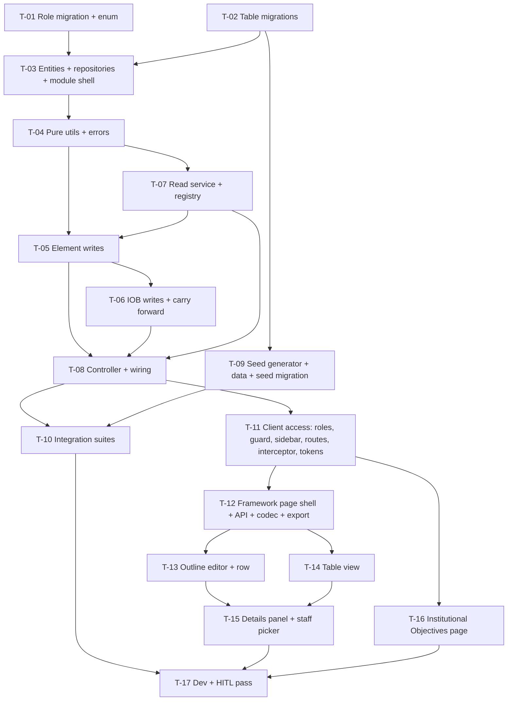

# Tasks — Institutional Performance / Strategy Framework

- **Module:** institutional-performance — server `domain/entities/strategy-framework/` + client *ODS Admin* pages
- **Spec id:** 2026-11-strategy-framework
- **Status:** not-started — approved by the dev lead 2026-11-17 (Phase 3 gate); ready for `/akili-execute`
- **Owner:** Hector F. Tobón (requester) · dev lead
- **Linked requirements:** [`./requirements.md`](requirements.md) (rev 3.1)
- **Linked design:** [`./design.md`](design.md) (r7, Judgment Day lineage 2 approved — [`judgment.md`](judgment.md))
- **Baseline commit for every observed red below:** `64a39c26`; every baseline grep re-observed unchanged (`0`) at `29b97978`, after merging `origin/staging` (2026-11-17)
- **Last updated:** 2026-11-17

> **Answer first.** 17 tasks in 3 phases: server foundation (T-01…T-04), server behaviour (T-05…T-10), client (T-11…T-16), then the Dev/HITL pass (T-17). Two PRs recommended: **PR 1 server** (T-01…T-10), **PR 2 client** (T-11…T-17). Mid-run tripwire after **T-05**: server actuals vs 2,000 LOC (design §14).

**Shared rules for every task**
- **Test DB rule (org-structure precedent):** never run `migration:test:bootstrap` or `baseline:test:load`; integration runs use the local `ARI_TEST_MYSQL_*` database; each suite cleans up the rows it creates and never touches seeded rows of other modules.
- **Lint as a gate:** server `npx eslint <path>` (never `npm run lint`, K-001); client `npm run lint -- --quiet`. CRLF checkout: lint committed content with `git show HEAD:<f> | npx eslint --stdin --stdin-filename <f>`.
- **Concurrency:** one full-suite run at a time; the Leader re-runs the full suite after each worker reports (root `CLAUDE.md` §4.3).
- **Client `tsc -p tsconfig.spec.json`:** gate on the normalized error set of the touched files, never on the total (≈ 945 baseline errors).
- **Absent field values** are written `n/a` or `none`; a greenfield red reads `predicted — greenfield artifact (observed in T-NN)` and that task quotes the observed red in `execution.md`.

---

## 1. Dependency graph

Parallel-safe pairs (different packages): T-09 with T-04…T-07; T-11 with T-10. Never two tasks of the same package at once.

---

## 2. Tasks

### Phase A — Server foundation

### T-01 — ODS Admin role: enum, guarded migration, pre-merge checks
- **Status:** done (2026-11-19, PASS attempt 2 — `execution.md` § T-01) · **Size:** S · **Depends:** none
- **Requirements:** R-STF-013 (Details: new role, next free id, focus application; AC.1 idempotent, `down` refuses while held); R-STF-014 Details "Center Admin has no access" (enum basis)
- **Design:** §3.3 `…000`; D-STF-5; P-2, P-11, P-17, P-22
- **Scope:**
  - `src/domain/shared/enum/sec_role.enum.ts` → `ODS_ADMIN = 11`.
  - `src/db/migrations/1795000000000-createOdsAdminRole.ts`: `up` insert / no-op on same name / throw on another name; `down` counts rows with `role_id = 11` in **every** table whose FK references `sec_roles.sec_role_id` (from `information_schema.KEY_COLUMN_USAGE`, identifiers `^[a-z0-9_]+$` + backticks), throws naming each table and count. Exports only its class.
  - `src/db/migration-specs/1795000000000-createOdsAdminRole.spec.ts`.
  - First step: re-run `git fetch && git ls-tree --name-only origin/dev server/researchindicators/src/db/migrations/ | sort | tail -2` (P-11); renumber the block if anything ≥ `1795000000000` exists.
  - Record in `execution.md` that the dev lead must run, read-only on Dev before merge, `SELECT sec_role_id, name FROM sec_roles WHERE sec_role_id = 11` (P-17) and `SELECT id, name, start_year, end_year, is_active FROM portfolios` (P-31).
  - Backend route: stack NestJS; implement lead `nestjs-expert` support none — project conventions; test-suite lead the spec's scenarios support `nestjs-expert`
- **Tests:** migration spec (insert, same-name no-op, other-name throw, `down` refuse with an inactive `sec_user_roles` row, `down` delete when none); a real run up → up → down → up on the local DB.
- **Falsifier:** change `down` to count only `is_active = 1` rows → the "inactive assignment" case reports 0 and deletes → spec red; change `up` to `INSERT IGNORE` without the name check → "other name" case stops throwing.
- **Red run:** baseline observed — `grep -c 'ODS_ADMIN' server/researchindicators/src/domain/shared/enum/sec_role.enum.ts` → `0` (2026-11-17). Migration spec: predicted — greenfield artifact (observed in T-01).
- **Disqualifier:** a migration spec that mocks `queryRunner.query` with canned rows cannot prove the FK walk — only the real local run counts for `down`; if the local DB has no `sec_user_roles` row to test with, the task inserts one (and removes it), never asserts on an empty table.
- **Consumers:** `sec_role.enum.ts` readers — every `@Roles(...)` site compiles against it; `npm run build` covers them. Test files pinning the enum: none found by `grep -rl "SecRolesEnum\.\w* = " src` (enum values are not asserted).
- **Review:** full — schema change on a shared, non-disposable Dev DB path.
- **Done criteria:** enum + migration + spec merged-ready; up/up/down/up observed on local DB with outputs quoted; the two Dev checks written in `execution.md` with owner *dev lead*; no `?` or `:word` outside bound placeholders (by-hand read, design §3.3 — `migration:scan` does not exist); `npm run build` green (observed red once with a wrong-typed enum use, K-004).
- **Skills:** `nestjs-expert`

### T-02 — Framework and objective table migrations
- **Status:** done (2026-11-19, PASS attempt 3 — `execution.md` § T-02) · **Size:** M · **Depends:** none
- **Requirements:** R-STF-002 (levels as data; one indicator level), R-STF-003 (one table; parent at depth − 1), R-STF-004 (responsibles keyed by staff ID; unique per element), R-STF-005 (code uniqueness per portfolio; IOB per portfolio + year), R-STF-009 / R-STF-010 (IOB tables), §7 constraints
- **Design:** §3.1, §3.3 `…001`, `…002`; D-STF-2, D-STF-3, D-STF-15, D-STF-21; P-10, P-30, P-32, P-35
- **Scope:**
  - `1795000000001-createFrameworkTables.ts`: `framework_levels` (incl. `short_label`, generated `indicator_portfolio_key` STORED + unique), `framework_elements` (self FK RESTRICT, `uq_framework_elements_portfolio_code`), `framework_element_responsibles` (CASCADE to element, staff FK with `readStaffCarnetColumnClause`).
  - `1795000000002-createInstitutionalObjectives.ts`: `institutional_objectives`, `institutional_objective_elements` (CASCADE to IOB, RESTRICT to element).
  - All `utf8mb4_0900_ai_ci` (the connection collation, P-37); `down` drops in reverse order.
  - Migration specs in `db/migration-specs/` asserting the generated-column DDL text; the `information_schema.COLUMNS.EXTRA = 'STORED GENERATED'` check for `indicator_portfolio_key` is a real-DB property — observed in this task's scratch run and **committed in T-10's schema integration suite** (amended 2026-11-19: a unit spec cannot reach MySQL, server guide §9).
  - First step: re-run P-1's grep with `framework_element|framework_level|FrameworkElement|FrameworkLevel` (expect 0) and read `SELECT VERSION()` locally (P-30).
  - Backend route: stack NestJS; implement lead `nestjs-expert` support none — project conventions; test-suite lead the spec's scenarios support `nestjs-expert`
- **Tests:** migration specs; local run up/down/up; two inserts of `is_indicator_level = 1` for one portfolio → 1062; a responsible with an unknown carnet → 1452; deleting an element that has a child → 1451.
- **Falsifier:** drop the unique index on `indicator_portfolio_key` → second indicator-level insert succeeds → test red; make the self FK `CASCADE` → deleting a parent removes the child instead of 1451 → test red.
- **Red run:** predicted — greenfield artifact (observed in T-02).
- **Disqualifier:** a "green" that ran against a schema where the tables already existed from an earlier attempt proves nothing — the run starts from `down` to a clean state and quotes the `CREATE TABLE` output.
- **Consumers:** none (new tables).
- **Review:** full — schema, generated column (new in this server, P-35) and self-referencing FK.
- **Done criteria:** both migrations and specs; local up/down/up quoted; P-30 local version quoted; P-1 re-grep quoted; no `?` or `:word` outside bound placeholders (by-hand read, design §3.3).
- **Skills:** `nestjs-expert`

### T-03 — Entities, repositories and module shell
- **Status:** done (2026-11-19, PASS attempt 1 — `execution.md` § T-03) · **Size:** M · **Depends:** T-01, T-02
- **Requirements:** R-STF-002, R-STF-003, R-STF-004, R-STF-009 (data mapping); R-STF-012 Details "injectable server service" (module exports)
- **Design:** §2.1 server table (entities row incl. the `generatedType` mapping, repositories incl. `portfolio-lookup.repository.ts`), §2 *Why two services*; D-STF-1, D-STF-11; P-21, P-35
- **Scope:**
  - Five entities extending `AuditableEntity`; `FrameworkLevel.indicator_portfolio_key` mapped `generatedType: 'STORED'`, `asExpression`, `insert: false`, `update: false`.
  - Repositories (one per aggregate) and `PortfolioLookupRepository` (no `CurrentUserUtil`).
  - `strategy-framework.module.ts` declaring repositories; exports reserved for T-07.
  - Backend route: stack NestJS; module-design lead existing design support `nestjs-expert`; implement lead `nestjs-expert` support none — project conventions; test-suite lead the spec's scenarios support `nestjs-expert`
- **Tests:** repository specs with mocked managers for non-trivial queries; an entity-metadata spec asserting the generated column has `insert === false` and `update === false`.
- **Falsifier:** remove `insert: false` → T-10's level insert fails with MySQL error 3105 ("value specified for generated column"); in this task, the metadata spec goes red.
- **Red run:** predicted — greenfield artifact (observed in T-03).
- **Disqualifier:** `npm run migration:generate` producing a diff that drops or re-adds `indicator_portfolio_key` means the mapping is wrong even if specs pass — run it once and quote "No changes in database schema were found" (then discard any generated file).
- **Consumers:** none.
- **Review:** checklist — mechanical mapping of an approved schema.
- **Done criteria:** entities, repositories, specs; `migration:generate` no-diff quoted; `npm run build` green.
- **Skills:** `nestjs-expert`

### T-04 — Pure utilities: tree, codes, errors, constants
- **Status:** done (2026-11-19, PASS attempt 1 — `execution.md` § T-04) · **Size:** M · **Depends:** T-03
- **Requirements:** R-STF-003 (depth rules, move same depth, cycles — util-level per AC.2), R-STF-005 (root and child proposal portfolio-wide; gap; moved element; non-numeric parent; IOB-n; 30-char limit), R-STF-002 AC.1 (four-level fixture), R-STF-006 (blocked message with way-out)
- **Design:** §5.2 steps 2–3, §5.3, §5.4 step 2, `framework-errors.ts`, `strategy-framework.constants.ts`; D-STF-16
- **Scope:** `framework-tree.util.ts`, `framework-code.util.ts`, `framework-errors.ts`, `strategy-framework.constants.ts` (+ specs).
  - Backend route: stack NestJS; implement lead `nestjs-expert` support none — project conventions; test-first lead `tdd` support `nestjs-expert`
- **Tests:** table-driven: root proposal skips a hand-typed `5` on a Dimension; child `1.1`, `1.3` → `1.4`; moved `1.7` under Area 2 still blocks `1.7` under Area 1; parent code `A.b` escaped; IOB `IOB-1…3` → `IOB-4`; proposal > 30 chars → error; descendant counts on a four-level fixture; cycle check on a hand-built cyclic map; error helpers produce `{ message: { description, field } }` and `{ message: { description, blockers } }`.
- **Falsifier:** restrict the child scan to the parent's current children → the moved-element row returns `1.7` → red; drop regex escaping → parent `1.1` matches `121.x` codes → red; scan root codes at depth 1 only → the hand-typed `5` case returns `5` → red.
- **Red run:** predicted — greenfield artifact (observed in T-04).
- **Disqualifier:** a fixture where all codes are consecutive cannot distinguish "max + 1" from "count + 1" — the fixtures include a gap and a non-numeric code.
- **Consumers:** none.
- **Review:** checklist — pure functions under table tests.
- **Done criteria:** utils + specs; each falsifier executed and its red quoted in `execution.md`.
- **Skills:** `nestjs-expert`, `tdd`

### Phase B — Server behaviour

### T-05 — Element writes, responsibles, staff search, lazy levels, locks
- **Status:** done (2026-11-19, PASS attempt 1 — `execution.md` § T-05) · **Size:** L · **Depends:** T-04, T-07
- **Requirements:** R-STF-001 (scenario: cross-portfolio link → 400 naming the field, MUST NOT store; AC.1), R-STF-003 (all Details; scenario BUT "must NOT accept a parent that is an Indicator or another Dimension"; AC.1, AC.2 API cases; 500 cap), R-STF-004 (scenario BUT "must NOT accept a typed name"; AND IT MUST "reject an unknown staff ID with 400"; AC.1, AC.2), R-STF-005 (scenario AND IT MUST "reject `1.3` with 409 naming `code`"; AC.2), R-STF-006 (element blockers; scenario MUST NOT delete; AC.1, AC.2), R-STF-007 Details "first create on any portfolio" (lazy levels), R-STF-014 (writes reject machine tokens — service side none; guard in T-08)
- **Design:** §5.2 steps 1–7, §5.4, §3.2 I-1…I-8; D-STF-3, D-STF-6, D-STF-21; P-9, P-24
- **Scope:** `strategy-framework.service.ts` element half: create (lazy `DEFAULT_LEVELS`, portfolio lock, parent lock, depth, cap, code proposal, responsibles), update (A6 `parentId` semantics, move, code change, responsibles replace), delete (blockers via read service, physical delete, 1451 mapping, `LoggerUtil` line), staff search (parenthesized, active only, max 20); DTOs for A4–A7.
  - **Tripwire:** after this task, the Leader compares server actuals with 2,000 LOC and re-estimates before continuing (design §14).
  - Backend route: stack NestJS; implement lead `nestjs-expert` support none — project conventions; error-model lead `error-handling-patterns` support `nestjs-expert`; test-first lead `tdd` support `nestjs-expert`
- **Tests:** service specs per rule: depth/parent cases (null, depth-1 `parentId`, wrong depth, other portfolio → `400` `parentId`); responsibles (duplicate, unknown, newly inactive, on a non-indicator level → `400`; existing inactive kept); 501st create → `400`; delete blocked by children / IOB link / test provider, free delete; race mapping per constraint (1062 `code`, 1452 parent → `404`, 1452 staff → `400` `responsibleCarnets`, 1451 → blockers `409`); lazy levels created once.
- **Falsifier:** remove the active-staff check for newly added carnets → "newly inactive" case saves → red; map every 1452 to `404` → the staff case returns `404` not `400` → red; skip the portfolio lock → the concurrency case is covered in T-10 (here: assert the lock query is issued first, `SELECT … FOR UPDATE` on `portfolios`).
- **Red run:** predicted — greenfield artifact (observed in T-05).
- **Disqualifier:** service specs with a mocked repository cannot show SQL locking or FK errors behave as mapped — they prove the mapping code path only; the real behaviour is T-10's integration run, and this task may not claim it.
- **Consumers:** `alliance_user_staff` is read only; no shared symbol changed.
- **Review:** full — business rules, error model, concurrency.
- **Done criteria:** service + DTO specs green; each falsifier red quoted; `npm run build` green; tripwire numbers recorded.
- **Skills:** `nestjs-expert`, `error-handling-patterns`, `tdd`

### T-06 — Institutional Objectives writes and carry forward
- **Status:** done (2026-11-19, PASS attempt 1 — `execution.md` § T-06) · **Size:** M · **Depends:** T-05
- **Requirements:** R-STF-009 (Details; AC.1; AC.2 "no owner or responsible field → 400"), R-STF-010 (Details; scenario BUT "must NOT change any 2026 IOB"; AC.1, AC.2), R-STF-006 (IOB blocked only by an IOB provider), R-STF-001 (IOB link to another portfolio's element → 400 naming the linked indicators)
- **Design:** §4 A9–A11, §5.2 step 8, §5.5, §5.6; P-36 n/a (client)
- **Scope:** service IOB half: list per year + years with `defaultYear`, create/update/delete (portfolio lock, year in range, indicator-level-only links, codes `IOB-n`, `portfolioId` on PATCH → `400`), carry forward (lock, re-check, copy, 1062 → `409`, `LoggerUtil` line); DTOs.
  - Backend route: stack NestJS; implement lead `nestjs-expert` support none — project conventions; error-model lead `error-handling-patterns` support `nestjs-expert`; test-first lead `tdd` support `nestjs-expert`
- **Tests:** specs: owner/responsible field in body → `400`; link to a non-indicator element → `400` with codes in the description; carry forward to a year with objectives → `409`, zero writes; last year → `400`; empty year → `400`; copy keeps codes and links and does not touch source rows (assert no update/delete issued on source IDs); IOB delete blocked by a test provider with `countByObjectiveIds`.
- **Falsifier:** let carry forward insert before the target-year check → the "target has objectives" case writes rows → red; allow a non-indicator element in `elementIds` → red.
- **Red run:** predicted — greenfield artifact (observed in T-06).
- **Disqualifier:** a source-unchanged assertion on a mocked repository that never records writes proves nothing; the spec asserts on the recorded calls, and T-10 checks real rows.
- **Consumers:** none.
- **Review:** full — transactional copy with a business invariant.
- **Done criteria:** specs green; falsifier reds quoted; build green.
- **Skills:** `nestjs-expert`, `error-handling-patterns`, `tdd`

### T-07 — Read service, usage registry, context
- **Status:** done (2026-11-19, PASS attempt 1 — `execution.md` § T-07) · **Size:** M · **Depends:** T-04
- **Requirements:** R-STF-012 (Details; AC.1 incl. empty portfolio wording; AC.2 provider blocks and shows its count), R-STF-002 AC.1 (read derives levels), R-STF-015 AC.2 (default portfolio), R-STF-009 Details (default year), R-STF-007 (counts, `deletable`, `blockers`)
- **Design:** §4 A0, A1, A1e, A2, A8; §5.1; §5.4 step 5; §5.6; D-STF-10, D-STF-13, D-STF-22; P-21
- **Scope:** `framework-read.service.ts` (singleton, no `CurrentUserUtil`), `framework-usage.registry.ts` (dedup by `consumerName`; optional per-element and per-IOB counters); module exports both.
  - Backend route: stack NestJS; implement lead `nestjs-expert` support none — project conventions; api-contract lead `api-design-principles` support `nestjs-expert`; test-first lead `tdd` support `nestjs-expert`
- **Tests:** A1 on a four-level fixture; A1 of a level-less portfolio → `levels: []`, `elements: []`; A1 of a portfolio with levels and no elements → stored levels, `elements: []`; A1e virtual levels when none exist; A1 never carries `usage`/`deletable`/`blockers`; default portfolio rule (contains-today, latest start, gap year, none); `defaultYear` in and out of range; registry dedup and both counters; a provider's count shows in A1e and blocks.
- **Falsifier:** inject `PortfoliosService` instead of the lookup repository → the constructor-dependency spec (`design:paramtypes`) and instantiation outside a request go red (*amended 2026-11-19: `scope:options` cannot go red for this hazard — Nest propagates request scope at runtime and never writes it to the class metadata*); put editor fields into A1 → the "A1 has no editor fields" spec goes red.
- **Red run:** predicted — greenfield artifact (observed in T-07).
- **Disqualifier:** a default-portfolio test that uses only Portfolio 1 and 2 cannot show the tie-break — the fixture includes an overlapping third portfolio and a gap year.
- **Consumers:** future children 4–5 (none today).
- **Review:** checklist — read paths under table tests; contract reviewed via T-08.
- **Done criteria:** specs green; falsifier reds quoted; build green.
- **Skills:** `nestjs-expert`, `api-design-principles`, `tdd`

### T-08 — Controller, guards, Swagger, module wiring
- **Status:** done (2026-11-19, PASS attempt 2 — `execution.md` § T-08) · **Size:** M · **Depends:** T-05, T-06, T-07
- **Requirements:** R-STF-014 (writes and admin reads ODS + System Admin; Center Admin `403`; writes reject machine tokens; consumer reads any authenticated user; AC.1), R-STF-013 AC.2 (`403` on another `@Roles`-guarded admin area for roles `[11]`), NFR-STF-003, NFR-STF-005
- **Design:** §4 (all routes; literal before `:id`), §8; D-STF-20; P-4, P-6
- **Scope:** `strategy-framework.controller.ts` (class `RolesGuard`, `SetUpInterceptor`, `@ApiTags`, `@ApiBearerAuth`; per handler `@ApiOperation` + params; writes `@UseGuards(HumanCredentialGuard)`), `main.routes.ts` node **and** `entities.module.ts` import (KZ-017), `strategy-framework.global-exceptions.spec.ts`.
  - Backend route: stack NestJS; api-contract lead `api-design-principles` support `nestjs-expert`; implement lead `nestjs-expert` support none — project conventions; test-suite lead the spec's scenarios support `nestjs-expert`
- **Tests:** controller specs: allowed/denied per handler for roles `[11]`, `[1]`, `[9]`, `[3]`; machine credential on each write → `403`; one org-structure `GET units` denial for `[11]`; module-graph spec `Reflect.getMetadata('imports', EntitiesModule)` contains `StrategyFrameworkModule`; `GlobalExceptions` wire shape for a `409` with `blockers` and a `400` with `field`.
- **Falsifier:** remove the `entities.module.ts` import but keep the route node → module-graph spec red (and every route 404 at runtime); drop `HumanCredentialGuard` from one write → its machine-token case red.
- **Red run:** baseline observed — `grep -c 'StrategyFrameworkModule' server/researchindicators/src/domain/entities/entities.module.ts` → `0`; `grep -c 'strategy-framework' server/researchindicators/src/domain/routes/main.routes.ts` → `0` (2026-11-17).
- **Disqualifier:** a route-table grep is not reachability — the module-graph spec plus T-10's HTTP calls are; a Swagger check that only loads `/swagger` without finding the *Strategy Framework* tag and its operations proves rendering, not documentation.
- **Consumers:** `server/researchindicators/src/domain/entities/entities.module.spec.ts` (pins the module graph) — run and extend.
- **Review:** full — authorization surface.
- **Done criteria:** specs green; falsifier reds quoted; `/swagger` shows the tag with every operation (quote the operation count); build green.
- **Skills:** `nestjs-expert`, `api-design-principles`

### T-09 — Seed: generator, committed data file, seed migration
- **Status:** done (2026-11-19, PASS attempt 1 — `execution.md` § T-09) · **Size:** L · **Depends:** T-02
- **Requirements:** R-STF-011 (source table; non-person tokens skipped; unmatched listed; re-run unchanged while staff unchanged; AC.1 3/4/13/31/28/36, every IOB linked, only `1.3.2` unlinked; AC.2; AC.3), NFR-STF-002 (seed atomic)
- **Design:** §3.3 `…003`, §3.4; D-STF-7, D-STF-8, D-STF-24; P-15, P-16, P-26, P-32
- **Scope:**
  - Throw-away generator (scratchpad, not committed) over the three workbooks plus canvas `project/kpi-framework.json`; it **fails** unless the §3.4 assertions hold. Record file dates and the generator command in `execution.md`.
  - `src/db/seeds/seed-data/strategy-framework.data.ts` (constants), `src/db/seeds/strategy-framework.seed.ts` (idempotent `INSERT … SELECT … WHERE NOT EXISTS`, bound parameters only, parents first, responsibles matched at run time by trimmed email then exact trimmed full name, unmatched logged).
  - `1795000000003-seedStrategyFramework.ts`: seed on a **dedicated query runner** with its own transaction (D-STF-24); `down` refuses on non-seed dependants, else one `DELETE` per depth, deepest first.
  - Settle **P-16** first: count candidates that resolve against the local staff table; list the unmatched with reasons.
  - Backend route: stack NestJS; implement lead `nestjs-expert` support none — project conventions; test-suite lead the spec's scenarios support `nestjs-expert`
- **Tests:** data-file spec re-asserting 3 / 4 / 13 / 31 / 28 / 36, distinct pairs, both pre-merge names on `4.1.1`, `4.6` absent, only `1.3.2` unlinked; seed function returns `affectedRows`; migration spec on SQL shape (no `?`/`:word` in comments).
- **Falsifier:** run the seed on the shared migration runner instead of the dedicated one, in the T-10 batch run with an injected failure → seed rows remain → red (P-26, must be observed); remove the alias mapping in the generator → it fails on 34 pairs.
- **Red run:** predicted — greenfield artifact (observed in T-09 for the data spec; the batch-atomicity red is observed in T-10).
- **Disqualifier:** counts produced by the same generator that wrote the data file are not independent — the data spec recomputes them from the committed constants; a P-16 count taken on a staff table copied from nowhere (empty local table) is not evidence, report "not measurable locally" instead.
- **Consumers:** none.
- **Review:** full — data correctness and migration atomicity.
- **Done criteria:** generator assertions and data spec green; P-16 result and unmatched list in `execution.md`; no `?` or `:word` outside bound placeholders (by-hand read, design §3.3); file dates recorded.
- **Skills:** `nestjs-expert`, `anthropic-skills:xlsx`

### T-10 — Integration suites (schema, CRUD, levels, carry forward, seed, role, wiring, performance)
- **Status:** todo · **Size:** L · **Depends:** T-08, T-09
- **Requirements:** R-STF-002 AC.1 (fourth level via fixture appears with no code change), R-STF-003 AC.1/AC.2, R-STF-006 AC.1/AC.2 (RESTRICT backstop), R-STF-010 AC.1/AC.2 (injected failure, concurrent calls), R-STF-011 AC.1–AC.3, R-STF-013 AC.1, NFR-STF-001, NFR-STF-002
- **Design:** §10 Integration row; P-26, P-27, P-32
- **Scope:** `test/strategy-framework-{schema,crud,levels,carry-forward,seed,role,module-wiring,performance}.integration-spec.ts`.
  - **Schema suite includes** `information_schema.COLUMNS.EXTRA = 'STORED GENERATED'` for `framework_levels.indicator_portfolio_key` (moved here from T-02's migration specs, 2026-11-19), observed red once (K-004).
  - **Batch atomicity (P-26):** on a fresh local schema, run the four pending migrations together with an injected seed failure; first with the seed on the shared runner (expect leftover rows — the observed red), then with D-STF-24 (expect zero).
  - Concurrency: two simultaneous first creates on an empty portfolio → one level set; two carry forwards → one `409`, no `500`.
  - Performance: A1, A1e, A4 — p95 over 3 runs of 20 calls; inconclusive if runs differ by > 30 %.
  - Backend route: stack NestJS; test-suite lead the spec's scenarios support `nestjs-expert`
- **Tests:** as scope.
- **Falsifier:** see the batch-atomicity sequence (the shared-runner red is the falsifier, executed); remove the portfolio lock in T-05 → the two-first-creates case yields a `409` or a duplicate level set.
- **Red run:** predicted — greenfield artifact (observed in T-10: the shared-runner seed leaves rows).
- **Disqualifier:** performance numbers from a run while another suite or agent was active are not evidence (root `CLAUDE.md` §4.3); runs differing by > 30 % are reported as spread, not as p95; a concurrency test whose two calls are awaited sequentially is not concurrent — use parallel promises and assert both started before either committed (timestamps or a barrier).
- **Consumers:** `test/jest-integration.json` config (collection pattern) — confirm the new files are collected (`--listTests`).
- **Review:** full — the only executed proofs of locking, atomicity and FKs.
- **Done criteria:** all suites green; the shared-runner red quoted; performance table with three runs quoted; files listed by `--listTests`.
- **Skills:** `nestjs-expert`

### Phase C — Client

### T-11 — Client access: roles, guard, sidebar, routes, interceptor exemption, accent tokens
- **Status:** done (2026-11-19, PASS attempt 1 — `execution.md` § T-11; uncommitted until visual approval) · **Size:** M · **Depends:** T-08
- **Requirements:** R-STF-015 (group after Center admin, before System admin; two items; shown for ODS Admin or System Admin; AC.1), R-STF-014 AC.2 (routes reject Center Admin; group hidden), R-STF-013 AC.2 (ODS-only user sees no Center admin or System admin item), NFR-STF-004 (accents not the only cue — tokens only here)
- **Design:** §2.1 client rows (roles service, guard, sidebar, interceptor, `colors.scss`), §6.1, §6.7; D-STF-25, D-STF-26; P-7, P-8, P-25, P-29, P-34
- **Scope:**
  - `roles.service.ts` `canAccessOdsAdmin` (role 1 or 11); `ods-admin.guard.ts` (+spec); `app.routes.ts` two lazy routes (placeholder components until T-12/T-16).
  - Sidebar: group `ods-admin` with *Framework* and *Institutional Objectives*; template gate at `.html:73` gains `|| rolesService.canAccessOdsAdmin()`; **both** spec mocks (`:39-44`, `:690`) and casts gain `canAccessOdsAdmin`.
  - Interceptor: every `4xx` except `401` on URLs containing `/strategy-framework` skips the global toast (precedent `isPrmsSyncError`).
  - `colors.scss`: `--ac-framework-accent-1…4` light and dark; styles README; `docs/ux-ui/design.md` §7 token entry.
  - Design route: load impeccable-bridge → design-routing.md; playbook build; ENV-2; mode Operate; polish light; motion none
- **Tests:** roles service spec; guard spec (1, 11, 9, none); sidebar **rendered DOM** per role in expanded and collapsed states; interceptor spec: `400`/`404` from `/strategy-framework` → no toast, `500` → toast, `401` unchanged, `/pool-funding-tag` behaviour unchanged.
- **Falsifier:** leave the `.html:73` gate unchanged → the ODS-only DOM case renders no group → red; exempt `5xx` too → the `500` case shows no toast → red.
- **Red run:** baseline observed (2026-11-17) — `grep -c 'canAccessOdsAdmin' client/research-indicators/src/app/shared/components/alliance-sidebar/alliance-sidebar.component.html` → `0`; same in `roles.service.ts` → `0`; `grep -c 'ods-admin' client/research-indicators/src/app/app.routes.ts` → `0`; `grep -c 'strategy-framework' client/research-indicators/src/app/shared/interceptors/http-error.interceptor.ts` → `0`; `grep -c 'framework-accent' client/research-indicators/src/styles/colors.scss` → `0`.
- **Disqualifier:** a sidebar test that asserts on `administrationGroups()` output only cannot see the template gate — the ODS-only case must assert rendered DOM; a test where every role mock returns `true` cannot distinguish the gate.
- **Consumers:** `alliance-sidebar.component.spec.ts`, `platform.component.spec.ts` (renders the sidebar), `roles.service.spec.ts`, `center-admin.guard.spec.ts`, `app-configuration.guard.spec.ts`, `variable-configuration.component.spec.ts`, `project-detail.component.spec.ts`, `bilateral.service.spec.ts` (all mock the role checks — grep `canAccessCenterAdmin\|canAccessAppConfiguration` over `src/**/*.spec.ts` → 7 files), `http-error.interceptor.spec.ts`, `to-promise.service.spec.ts` (interceptor readers). All run as part of Verification.
- **Review:** full — shared surfaces (sidebar, interceptor, global tokens).
- **Done criteria:** specs green incl. every consumer listed; full client suite green after the task (KZ-003); falsifier reds quoted; `ng build` green; completion report names the playbook run, the polish depth and its result, and `finish review: not run (AKILI execute)`.
- **Skills:** `angular-developer`, `impeccable-bridge`

### T-12 — Framework page shell, API methods, types, error util, URL codec, export
- **Status:** todo · **Size:** M · **Depends:** T-11
- **Requirements:** R-STF-007 (header: eyebrow, title from years, subtitle, selector; Editor/Table toggle; summary line; banner; states loading/empty on any portfolio/error), R-STF-008 (Export .xlsx one sheet per level; AC.3), R-STF-015 AC.2 (default portfolio from A0), R-STF-001 Details "not configured"
- **Design:** §6.2, §6.4 export; §2.1 client rows (page shell, `framework-view.util`, `framework-url.codec`, `framework-error.util`, interfaces, `api.service`, `xlsx-export.util`); D-STF-9, D-STF-13, D-STF-23; P-14, P-28, P-36
- **Scope:** page component with A0/A1e loading; `framework-view.util` (nesting, counts, flattened rows, export sheets); `framework-url.codec` (`?view=&level=`, frozen slugs); `frameworkErrorOf` (object, string, string array); additive `exportSheetsToXlsx`; `ApiService` methods for A0–A11; interfaces.
  - Design route: load impeccable-bridge → design-routing.md; playbook build; ENV-2; mode Operate; polish light; motion none
- **Tests:** view util on the seeded shape and a four-level fixture; codec round-trip and unknown slug fallback; `frameworkErrorOf` three shapes; export sheet builder (one sheet per level, natural order `1.2` before `1.10`); page: title *Strategy 2026–2030 – Monitoring framework* from years with name `'Portfolio 2'`; empty state on a level-less portfolio shows **+ Add Performance Area**; error state Retry.
- **Falsifier:** build the title from `name` → the title test reads *Portfolio 2 – …* → red; route framework errors through `ActionsService.handleBadRequest` → the "no result-title alert" test red.
- **Red run:** baseline observed — `grep -c 'exportSheetsToXlsx' client/research-indicators/src/app/shared/utils/xlsx-export.util.ts` → `0` (2026-11-17); page specs: predicted — greenfield artifact (observed in T-12).
- **Disqualifier:** an export test that inspects the row arrays only and never the sheet names/count cannot show "one sheet per level"; assert the workbook object's sheets.
- **Consumers:** `xlsx-export.util.spec.ts`, `data-table.component.spec.ts`, `organizational-structure.component.spec.ts`, `control-lists.component.spec.ts` (pin `xlsx-export`; `exportRowsToXlsx` must stay unchanged) and `actions.service.spec.ts` (P-36: `handleBadRequest` is not used by the framework and must keep its result-title conflict behaviour) — run them.
- **Review:** checklist — shell and plumbing; behaviour-heavy parts are T-13…T-15.
- **Done criteria:** specs green incl. consumers; falsifier reds quoted; `ng build` green; touched-files `tsc` error set unchanged or reduced; completion report names playbook, polish result and `finish review: not run (AKILI execute)`.
- **Skills:** `angular-developer`, `impeccable-bridge`

### T-13 — Outline editor and recursive row (mockup)
- **Status:** todo · **Size:** L · **Depends:** T-12
- **Requirements:** R-STF-007 (cards with accent; rows: label, code badge, inline name, counts, + next level, details, delete; inline name Enter/blur saves, Escape restores, empty rejected; draft *New*; + Add Performance Area; failed save keeps value; AC.1–AC.4), R-STF-006 (delete icon red only when deletable, tooltip names blocker; blocked message with way-out; confirm text; AC.1 UI side), R-STF-005 scenario (stored as `1.7`), NFR-STF-004 (keyboard, labels, colour not the only cue)
- **Design:** §6.3 (all bullets incl. state machine, add child, refresh merge rule, delete, keyboard/focus return), §5.4 messages; D-STF-17, D-STF-19; P-29, P-33
- **Scope:** `outline-editor` and `outline-row` (standalone, `OnPush`, recursive, signal state); accents via `--ac-framework-accent-*`; `maxlength` 255; focus return after the shared alert.
  - Design route: load impeccable-bridge → design-routing.md; playbook build; ENV-2; mode Operate; polish light; motion none
- **Tests:** row state machine (Enter saves once; blur after Enter does not resend; read-only while `saving`; Escape restores; error keeps value; empty rejected); draft: *New* badge, sends no code, two drafts saved → two distinct stored codes, Escape removes; refresh merge keeps dirty rows and drafts; delete icon colour and `aria-disabled` from `deletable`; blocked dialog lists blocker + way-out; focus returns to the delete button, or after delete to the previous row's first enabled control; icon `aria-label`s; four-level fixture renders four depths.
- **Falsifier:** let blur re-submit after Enter → the "one request" test counts 2 → red; take server values for every row on refresh → the "dirty row survives refresh" test red.
- **Red run:** predicted — greenfield artifact (observed in T-13).
- **Disqualifier:** jsdom cannot measure indentation, accent visibility or contrast — those are HITL in T-17, never claimed here; a state-machine test that sets the signal directly instead of driving input events tests the end state, not the transition (KZ-015).
- **Consumers:** none (new components).
- **Review:** full — new client pattern (recursive component, inline editing).
- **Done criteria:** specs green; falsifier reds quoted; `ng build` green with component styles under 4 kB; completion report names playbook, polish result and `finish review: not run (AKILI execute)`.
- **Skills:** `angular-developer`, `impeccable-bridge`

### T-14 — Table view per level
- **Status:** todo · **Size:** M · **Depends:** T-12
- **Requirements:** R-STF-008 (chips from levels with counts; F-7 tables; edit/delete actions; + <Level> with required parent; columns incl. ancestor codes and responsibles; AC.1, AC.2)
- **Design:** §6.4; D-STF-12; P-23
- **Scope:** `framework-tables` with one `app-data-table` per level, flattened string fields, `#rowActions` wired to the panel (T-15) and the delete flow (T-13 shared handler).
  - Design route: load impeccable-bridge → design-routing.md; playbook build; ENV-2; mode Operate; polish light; motion none
- **Tests:** chips and counts from levels (incl. four-level fixture); columns per level; `responsiblesText` with *(inactive)*; edit opens the panel; delete uses the same flow as the editor; F-7 checks via the shared `DataTable` (rows per page, default sort by code natural, search, export).
- **Falsifier:** hard-code three level chips → the four-level fixture shows 3 chips → red.
- **Red run:** predicted — greenfield artifact (observed in T-14).
- **Disqualifier:** asserting the chip labels for the seeded three levels alone cannot show levels are data-driven — the four-level fixture is mandatory.
- **Consumers:** `data-table.component.spec.ts` (shared component used unchanged) — run it.
- **Review:** checklist — reuse of a shipped table pattern.
- **Done criteria:** specs green; falsifier red quoted; `ng build` green; completion report names playbook, polish result and `finish review: not run (AKILI execute)`.
- **Skills:** `angular-developer`, `impeccable-bridge`

### T-15 — Details panel and staff picker
- **Status:** todo · **Size:** M · **Depends:** T-13, T-14
- **Requirements:** R-STF-004 (picker: search ≥ 2 chars, active only, max 20; chips with name/email; reorder; inactive tagged; no typed names; AC.1 UI, AC.2), R-STF-003 (move via Parent; wrong-depth options absent), R-STF-007 Details panel (Save, Cancel, Delete only — F-4), NFR-STF-004 (panel traps focus; labelled combobox)
- **Design:** §6.5; D-STF-14, D-STF-26; P-33
- **Scope:** `element-panel` on `p-drawer` + `pFocusTrap` + page-managed focus return; `staff-picker` on `p-autoComplete` with label and hint; Parent options = elements one level up only.
  - Design route: load impeccable-bridge → design-routing.md; playbook build; ENV-2; mode Operate; polish light; motion none
- **Tests:** focus trapped (Tab from last control returns to first) and returned to the opener on close; picker: no request under 2 chars, debounce, only server results selectable (typed text never becomes a chip), reorder buttons with `aria-label`s, inactive tag; Parent select lists only one-level-up elements; Save/Cancel/Delete only; save error shown via `frameworkErrorOf`.
- **Falsifier:** omit `pFocusTrap` → the Tab-wrap test escapes the drawer → red; allow free-text chips → the "typed text never becomes a chip" test red.
- **Red run:** predicted — greenfield artifact (observed in T-15).
- **Disqualifier:** a focus test that only checks `document.activeElement` after open (initial focus) does not prove trapping — it must Tab past the last control.
- **Consumers:** none.
- **Review:** full — accessibility-critical component.
- **Done criteria:** specs green; falsifier reds quoted; `ng build` green; completion report names playbook, polish result and `finish review: not run (AKILI execute)`.
- **Skills:** `angular-developer`, `impeccable-bridge`

### T-16 — Institutional Objectives page
- **Status:** todo · **Size:** M · **Depends:** T-11 (and T-12 for API methods/types)
- **Requirements:** R-STF-009 (own page; selector; year selector label and default; F-7 table; side form fields; no owner; AC.1, AC.2), R-STF-010 (carry forward button unavailable in last year and on empty year; confirm; toast text; AC.2 UI), R-STF-006 (IOB delete follows `deletable`), NFR-STF-004 (drawer focus trap; multiselect label)
- **Design:** §6.6; P-33
- **Scope:** `institutional-objectives` page + `objective-panel` (`p-drawer` + `pFocusTrap`, `p-multiSelect` grouped by depth-1 ancestor, visible label).
  - Design route: load impeccable-bridge → design-routing.md; playbook build; ENV-2; mode Operate; polish light; motion none
- **Tests:** year label "2026 · 28 objectives"; `defaultYear` selected; carry-forward disabled in 2030 and on an empty year; confirm then toast *"28 objectives copied to 2027; 2026 is unchanged"*; `409` shown inline (no global toast); form has no owner field; multiselect options only indicator-level elements; focus trap and return.
- **Falsifier:** enable carry forward in the last year → the 2030 case clickable → red.
- **Red run:** predicted — greenfield artifact (observed in T-16).
- **Disqualifier:** a toast assertion with a mocked `ActionsService` that accepts any text cannot prove the wording — assert the exact string.
- **Consumers:** none.
- **Review:** checklist — table + form on established patterns, focus covered by test.
- **Done criteria:** specs green; falsifier red quoted; `ng build` green; completion report names playbook, polish result and `finish review: not run (AKILI execute)`.
- **Skills:** `angular-developer`, `impeccable-bridge`

### Phase D — Verification in the running product

### T-17 — Dev deploy checks and HITL visual pass
- **Status:** todo · **Size:** S · **Depends:** T-10, T-15, T-16
- **Requirements:** R-STF-013 AC.2 and R-STF-014 AC.2 (live, with a real ODS-only user), R-STF-007 / R-STF-009 visual fidelity, NFR-STF-001 (re-timed on Dev), NFR-STF-004 (manual keyboard pass), R-STF-011 (requester review of seeded content and unmatched list); requirements §10 rows without an automated check
- **Design:** §10 Dev and HITL rows, §11; P-3, P-17, P-31
- **Scope:**
  - **Before merge (dev lead):** P-17 and P-31 read-only queries on Dev; results quoted in `execution.md`.
  - **After the Dev deploy:** a user given role 11 out of band — `req.user.roles` contains 11 (P-3), a write returns `200`, the menu shows *ODS Admin* with both items; the same user gets `403` on a Center admin `@Roles` endpoint.
  - HITL in a real browser, light and dark, two widths (≥ 1280 px and 800 px): outline geometry, indentation, accent visibility (≥ 3:1), focus order, drawer trap, side-by-side with the Framework mockup and artboard 4; requester review of the seeded framework and the unmatched-responsibles list.
  - NFR-STF-001 re-timed on Dev (3 runs).
  - Design route: load impeccable-bridge → design-routing.md; playbook critique, audit; ENV-2; mode Operate; polish light; motion none
- **Tests:** manual, recorded.
- **Falsifier:** an ODS-only user for whom ROAR does not return 11 → `403` on writes and no menu — this is the outcome the check exists to catch (escalate as a ROAR dependency, P-3).
- **Red run:** n/a — environment check, not a test; outcomes quoted as observed.
- **Disqualifier:** a check performed as System Admin cannot prove the ODS Admin path (System Admin bypasses roles); a human "looks fine" without naming what was compared does not discharge visual fidelity — quote what was covered (KZ-002); Dev timings taken during another deploy are not evidence.
- **Consumers:** n/a.
- **Review:** checklist — the evidence is the recorded observations.
- **Done criteria:** each check quoted in `execution.md` with who, when and what it covered; any P-3 failure escalated before `/akili-test`.
- **Skills:** `impeccable-bridge`, `playwright-cli`

---

## 3. Coverage — scenario and clause level

| Requirement clause | Owner |
| --- | --- |
| R-STF-001 scenario THEN "fails with 400 naming the linked indicators" · AND IT MUST NOT store | T-06 (IOB links), T-05 (parent) |
| R-STF-001 AC.1 | T-05, T-06 |
| R-STF-001 "not configured" | T-07 (A0 `configured`), T-12 (selector suffix) |
| R-STF-002 Details (levels as data, indicator level) · AC.1 four-level fixture | T-02, T-04, T-07, T-10, T-13, T-14 |
| R-STF-002 AC.2 responsibles/links outside the indicator level → 400 | T-05, T-06 |
| R-STF-003 scenario BUT "must NOT accept a parent that is an Indicator or another Dimension" | T-05 |
| R-STF-003 AC.1 · AC.2 (API cases; cycle at util level) · 500 cap | T-04, T-05, T-10 |
| R-STF-004 scenario BUT "must NOT accept a typed name" | T-05 (DTO), T-15 (picker) |
| R-STF-004 scenario AND IT MUST "reject an unknown staff ID with 400" | T-05 |
| R-STF-004 AC.1 · AC.2 | T-05, T-15 |
| R-STF-005 scenario THEN "stored as `1.7`" · AND IT MUST "reject `1.3` with 409 naming code" | T-04, T-05, T-13 |
| R-STF-005 AC.1 · AC.2 | T-04, T-05 |
| R-STF-006 element blockers · IOB blockers · icon colour/tooltip · message with way-out · confirm | T-05, T-06, T-07, T-13, T-16 |
| R-STF-006 scenario AND IT MUST NOT delete the Indicator or its responsibles · AC.1 · AC.2 | T-05, T-10 |
| R-STF-007 header, toggle, summary, banner, cards, rows, inline name, add child, add root, panel, states · AC.1–AC.4 | T-12, T-13, T-15 |
| R-STF-008 chips, tables, actions, + Level, columns · export · AC.1–AC.3 | T-12, T-14 |
| R-STF-009 page, selector, year default, table, form, no owner · AC.1 · AC.2 | T-06, T-07, T-16 |
| R-STF-010 scenario BUT "must NOT change any 2026 IOB" · AC.1 · AC.2 | T-06, T-10, T-16 |
| R-STF-011 sources, skips, unmatched list, re-run · AC.1–AC.3 | T-09, T-10, T-17 |
| R-STF-012 read, resolve, registry · AC.1 · AC.2 | T-07, T-08 |
| R-STF-013 Details · AC.1 · AC.2 | T-01, T-08, T-10, T-11, T-17 |
| R-STF-014 Details (incl. machine tokens) · AC.1 · AC.2 | T-08, T-11, T-17 |
| R-STF-015 Details · AC.1 · AC.2 · responsive panels | T-07, T-11, T-12, T-15, T-16, T-17 |
| NFR-STF-001 | T-10 (local proxy), T-17 (Dev) |
| NFR-STF-002 | T-06, T-09, T-10 |
| NFR-STF-003 | T-08 |
| NFR-STF-004 | T-11, T-13, T-15, T-16, T-17 |
| NFR-STF-005 | T-08 |

**Premise ownership:** P-1 → T-02 · P-3 → T-17 (scheduled by T-01) · P-11 → T-01 · P-15, P-16 → T-09 · P-17, P-31 → T-01 (record) / T-17 (result) · P-25 → T-11 · P-26 → T-09 / T-10 · P-30 → T-02 · P-32 → T-09 / T-10 · P-33 → T-15, T-16 · P-34 → T-11 · P-35 → T-02, T-03 · P-36 → T-12. `consumer` rows P-14, P-23, P-25, P-36 appear in the `Consumers` fields of T-11, T-12 and T-14.

## 4. Review classification

No task is `skip-eligible`. `full`: T-01, T-02, T-05, T-06, T-08, T-09, T-10, T-11, T-13, T-15. `checklist`: T-03, T-04, T-07, T-12, T-14, T-16, T-17.

## 5. Risks & blockers log

| # | Date | Risk / Blocker | Mitigation | Owner | Status |
| --- | --- | --- | --- | --- | --- |
| RB-1 | 2026-11-17 | ROAR may not return role 11 (P-3) | T-17 Dev check before `/akili-test`; escalate as an external dependency | dev lead | open |
| RB-2 | 2026-11-17 | A hand-made `sec_roles` row 11 or an overlapping portfolio on Dev (P-17, P-31) | read-only queries before merge | dev lead | open |
| RB-3 | 2026-11-17 | The Tracking Tool keeps changing | T-09 records file dates; later edits in the pages | T-09 | open |

## 6. Done definition

- [ ] All tasks `done` with evidence in `execution.md`.
- [ ] T-17 performed in the running product **before** `/akili-validate` (KZ-007).
- [ ] Every requirement-level AC checked; Swagger documents every endpoint; coverage thresholds green.
- [ ] Rollout note: Dev pre-merge checks, role assignment owner, backout (design §11).
