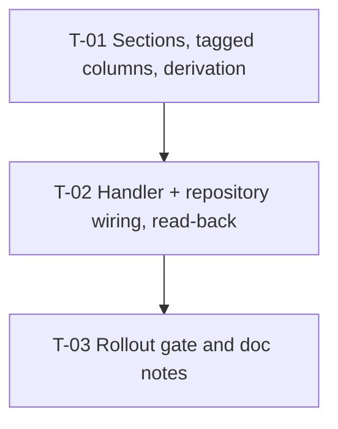

# Tasks — Reports / Excel workbook layout on the server

- **Module:** reports (workbook `star_results_metadata`)
- **Spec id:** 2026-10-excel-layout-server-side
- **Status:** not-started
- **Owner:** ARI server squad
- **Linked requirements:** ./requirements.md
- **Linked design:** ./design.md (judgment: ./judgment.md — **APPROVED** after round 1 + scoped re-judgment)
- **Last updated:** 2026-10-06

> **Baseline readings, observed 2026-10-06 at `7afcedfc`** (from `server/researchindicators`). The falsifiers below cite these.
>
> | # | Command | Reading |
> | --- | --- | --- |
> | B-1 | `npx jest src/domain/entities/reports --silent` | `16 passed` suites, `143 passed` tests |
> | B-2 | `grep -rn -c "findActiveSheets\|findColumnGroups\|STAR_RAW_COLUMN_GROUP_FALLBACK" src/domain/entities/reports` (non-zero files) | repository `2`, repository spec `4`, handler spec `10`, sheet-presentation `1`, handler `4` |
> | B-3 | `grep -n "bannerTitleMergeToCol: 80" src/domain/entities/reports/handlers/star-results-metadata/star-results-metadata.sheet-presentation.ts` | `:80` |
> | B-4 | `STAR_RESULTS_METADATA_RAW_COLUMNS.length` (ts-node listing, design P-10) | `80`, 11 contiguous runs |

## Dependency graph

All tasks are server-side and **sequential** in one worktree (root `CLAUDE.md` concurrency rule).

---

### T-01 — Section catalog, tagged columns and the band derivation

- **Status:** not-started · **Size:** M · **Dependencies:** none
- **Requirements covered:**
  - R-WBL-002 (whole: missing tag and unknown section both fail the build);
  - R-WBL-003 (derivation): "Today's layout" (bands only), "A column is added to a section", "A new section is appended" incl. *BUT no existing band moves, renames or recolours*, "Split section" incl. *BUT must NOT paint two bands or an overlapping band*, "Empty section";
  - R-WBL-005 (computation of the last column, incl. the 81-column case);
  - R-WBL-006 (whole, incl. *BUT must NOT carry the 6-character form*);
  - NFR-WBL-001 (band half), NFR-WBL-003.
- **Design refs:** §3.1, §3.3, §3.4, DD-1, DD-2, DD-4; Premise Ledger P-5, P-8, P-10, P-12
- **Scope:**
  1. `src/domain/entities/reports/handlers/star-results-metadata/star-results-metadata.sections.ts`: `STAR_RAW_SECTIONS` — the 11 entries of requirements §1 "intended layout" (key, `label`, `fillArgb` in `FF` form), declared `as const` and checked with `satisfies`; export the key type as `keyof typeof STAR_RAW_SECTIONS` and the section-tagged column type (`ExcelColumnSpec` + required `section`). `ExcelColumnSpec` is not modified.
  2. `star-results-metadata.columns.ts`: annotate `STAR_RESULTS_METADATA_RAW_COLUMNS` with the tagged type and add `section` to each of the 80 objects per the §1 table. No other property, order or header changes. `STAR_RESULTS_METADATA_DICTIONARY_COLUMNS` untouched.
  3. `src/domain/entities/reports/core/excel-workbook.column-groups.ts`: the pure derivation of design §3.3, generic over the section key; returns the bands in the builder's `columnGroups` shape plus the last column; a split section throws `InternalServerErrorException` naming the section key, the stray column (key, position) and the reopening column (key, position).
  4. Specs (sibling `*.spec.ts`):
     - sections: 11 entries; every `fillArgb` matches `^FF[0-9A-F]{6}$`; labels and fills equal the §1 table (expected values typed from requirements §1, never read from the catalog);
     - derivation, synthetic arrays: contiguous runs; one-column section; empty catalog section → no band; split → throws with all three names; a column added inside a section → that band +1, later bands +1; a section appended → one new band, earlier bands identical; 81 columns → last column 81;
     - derivation over the **real** array: output equals the §1 table exactly (11 × from, to, label, fill) and last column = 80.
- **Tests:** the three specs; `npm run build`.
- **Falsifier** (each observed red at execute time, message quoted in `execution.md`, then reverted):
  - (a) retag column 31 (`who_owns_ip_rights`) as `LINK_TO_RESULT`: the real-array test goes red on the LINK TO RESULT / IP RIGHTS band ranges (30–31 vs expected 30–30; 32–35 vs 31–35).
  - (b) retag column 60 (`implementing_organizations`) as `PARTNERS`: the derivation throws (PARTNERS reopened at 60) — the real-array test goes red on the thrown message, not on a setup error.
  - (c) change one colour to the Dev form `203C61`: the sections spec goes red on the `^FF[0-9A-F]{6}$` assertion.
  - (d) **compile gate:** remove `section` from one column → `npm run build` red with the missing-property error; set one `section` to `'IP_RIGHT'` → `npm run build` red with the not-assignable error. Both quoted (K-004; the gate exists only because of the literal union, design §3.1).
- **Red run:** each falsifier red on its assertion or on the compiler error line. A red from an import error before the file exists is a setup red and does not count.
- **Disqualifier:**
  - A real-array test whose expected bands are computed by the derivation itself is inert.
  - A compile gate seen green under (d) means the key type widened to `string`: the task is not done.
  - **Cannot reach:** rendering (T-02 read-back, human D7); the handler still uses the DB path until T-02.
- **Consumers:** `STAR_RESULTS_METADATA_RAW_COLUMNS` → `star-results-metadata-workbook.handler.ts` (design P-6). The retyped array is a subtype of `ExcelColumnSpec[]`, so the handler keeps compiling unchanged; B-1 must still read `143` tests green plus the new ones.
- **Review:** `full` — override (b): an exported symbol is retyped and a new shared derivation contract is introduced.
- **Done criteria:**
  - [ ] Three specs green; B-1 suites still green
  - [ ] Falsifiers (a)–(d) observed red, quoted
  - [ ] `npm run build` exit 0; `npx eslint` and `npx prettier --check` clean on every touched file
  - [ ] `git diff` touches only the files of scope items 1–4
- **Skills:** `nestjs-expert`, `tdd`

---

### T-02 — Handler and repository wiring; `.xlsx` read-back

- **Status:** not-started · **Size:** M · **Dependencies:** T-01
- **Requirements covered:**
  - R-WBL-001 (whole: "Default order" incl. *AND IT MUST NOT read `report_workbook_sheet`*; "Override still applies" incl. *BUT an unknown key is ignored*);
  - R-WBL-003 "Today's layout" incl. *AND IT MUST NOT read `report_workbook_column_group`* (rendered half);
  - R-WBL-004 (whole);
  - R-WBL-005 (rendered half: banner `C1:<last>1`);
  - R-WBL-007 (whole: neither table read; tables, entities, migrations untouched; "Export with the tables emptied"; dictionary rows still listed);
  - NFR-WBL-001 (rendered half), NFR-WBL-002.
- **Design refs:** §2, §2.1, §3.2, §5, §10 (handler row, incl. the J-2 list), §12 DD-3, DD-5, DD-6, DD-7 and the reversion challenge; Premise Ledger P-1, P-5, P-6, P-7, P-9, P-11, P-13
- **Scope:**
  1. **First step: consumer sweep (design P-6).** One grep per changed symbol over `server/researchindicators/src`, `server/researchindicators/test` and `client/research-indicators/src`: `findActiveSheets`, `findColumnGroups`, `ReportWorkbookColumnGroupRow`, `STAR_RAW_COLUMN_GROUP_FALLBACK`, `STAR_RAW_SHEET_PREAMBLE_BASE`, `bannerTitleMergeToCol`, `STAR_RESULTS_METADATA_RAW_COLUMNS`, `WorkbookSheetRow`. List every hit in `execution.md`; any hit outside design P-6 / P-11 joins this task's Verification.
  2. `constants/star-results-metadata.constants.ts`: `STAR_RESULTS_METADATA_SHEETS` (design §3.2).
  3. Handler: sheets from the constant through the existing resolver; bands and last column from the T-01 derivation; header fill per column from its section (helper typed with the tagged column type); `bannerTitleMergeToCol` = the derivation's last column; remove `resolveRawColumnGroups`, the `FF1565C0` default and both repository calls. Notice row, subtitle, logo, dictionary and result rows unchanged.
  4. `sheet-presentation.ts`: delete `STAR_RAW_COLUMN_GROUP_FALLBACK`; drop `bannerTitleMergeToCol` from the base; type the base `Omit<ExcelSheetPreamble, 'columnGroups' | 'bannerTitleMergeToCol'>`.
  5. `report-layout.repository.ts`: delete `findActiveSheets`, `findColumnGroups`, `ReportWorkbookColumnGroupRow` and the unused `WorkbookSheetRow` import; keep `findDataDictionaryRows`. Entities, tables and migrations untouched.
  6. Specs:
     - repository spec: delete the two reader cases (`:20-28`, `:39-…`); keep the dictionary case;
     - handler spec, per design §10 (J-2 list): `getWorksheet('Raw')` → `'Raw data'` at `:208/:279/:357`; replace `:452-464` and `:480-495` with "unknown override key ignored" and "override reorders"; remove `:541-560`; remove the dead mocks/stubs/providers or keep them only to assert the readers are never called; rename the `:114` case; keep the `:292-295` merge checks;
     - new handler assertions: 2 sheets "Raw data" then "Data dictionary"; column 31 header fill `FF35749A`; dictionary sheet rows = the mocked `findDataDictionaryRows` rows;
     - `.xlsx` read-back: the band-row merges equal the 11 §1 ranges with their titles and fills (located by content); banner merge `C1:<letter(80)>1`.
  7. `npm test -- --silent` (full server suite, Leader re-measures after the worker reports) and `npm run build`.
  8. Generate one `.xlsx` with mocked rows and offer it to the user for the visual check (D7). **No commit before the user's visual approval.**
- **Tests:** the specs above; full suite; build.
- **Falsifier** (observed red, quoted, reverted):
  - (a) re-insert a call to `findColumnGroups` mocked to return the June rows (INNOVATION DETAILS 61–87, OICR 88–101) and use them: the read-back's band assertion goes red on the OICR / INNOVATION USE ranges.
  - (b) set `bannerTitleMergeToCol` back to the literal `79`: the read-back's banner assertion goes red (`C1:CA1` vs `C1:CB1`).
  - (c) restore the range-lookup header fill with groups shifted by one column: the column-31 fill assertion goes red.
  - (d) put `'Raw'` back into one `getWorksheet` lookup: that test fails with the TypeError on `undefined` (P-11) — quoted, then restored.
- **Red run:** each red on its assertion; (d) on the TypeError line. A red caused by a mock wired to a deleted method is a setup red and does not count.
- **Disqualifier:**
  - A read-back whose expected merges come from the derivation's output instead of requirements §1 is inert.
  - A suite run while another agent is building is not evidence (root `CLAUDE.md` concurrency rule).
  - **Cannot reach:** visual appearance (human, D7); Prod's tables (T-03, P-4).
- **Consumers:** design P-6 and P-11 — `report-layout.repository.ts` + spec, `star-results-metadata-workbook.handler.ts` + spec, `star-results-metadata.sheet-presentation.ts`, `star-results-metadata.columns.ts`; plus every new hit of scope step 1. Not consumers (verified): the builder and its specs (`columnGroups` / `bannerTitleMergeToCol` contract unchanged, P-5); the client (P-6).
- **Review:** `full` — overrides (b) (exported symbols deleted, response file shape) and (d) (reverts delivered DB-driven behaviour).
- **Done criteria:**
  - [ ] Consumer sweep recorded; every hit handled
  - [ ] B-2 re-run reads `0` in every `src` file except the entity files' own names (no reader left)
  - [ ] Specs green; full suite green (Leader re-measure); `npm run build` exit 0
  - [ ] Falsifiers (a)–(d) observed red, quoted
  - [ ] `npx eslint` / `npx prettier --check` clean on every touched file
  - [ ] `.xlsx` offered for the visual check; user approval recorded before the commit
- **Skills:** `nestjs-expert`, `tdd`

---

### T-03 — Rollout gate and doc notes

- **Status:** not-started · **Size:** S · **Dependencies:** T-02
- **Requirements covered:** D8 (Prod layout, P-4); requirements §8 cross-system note; design FU-1, FU-2, FU-3
- **Design refs:** §11, §14; Premise Ledger P-4
- **Scope:**
  1. Record the gate **G-WBL-1** (owner: the user): before the `main` merge, a human runs, read-only on Prod, `SELECT * FROM report_workbook_sheet ORDER BY workbook_key, sort_order; SELECT * FROM report_workbook_column_group ORDER BY workbook_key, sheet_key, sort_order;` and compares with requirements §1 "intended layout" (fills compared case-insensitively, ignoring a missing `FF` prefix). A difference goes to the user before merge.
  2. `docs/specs/innovation-dev/excel-export/tasks.md` header: one line under the pause note — T-03 keeps only the dictionary half; T-04 tags its columns with a new `INNOVATION_DEVELOPMENT` section and drops the fallback row and banner literal (design FU-2).
  3. FU-1 (dropping the tables) and FU-3 (dictionary colours vs band colours) recorded where the team tracks follow-ups (`docs/specs/innovation-use/OPEN-ITEMS.md` §3.3, as the precedent did).
- **Tests:** none (documentation and a human gate).
- **Falsifier:** n/a — no code claim; the gate is a human reading.
- **Red run:** n/a.
- **Disqualifier:** G-WBL-1 marked done without the human's recorded Prod reading is not done; the task stays `[~]` until it exists (precedent AC-1681 T-05).
- **Consumers:** none.
- **Review:** `checklist` — documentation only; the reviewer checks that P-4, FU-1, FU-2 and FU-3 each have a home.
- **Done criteria:**
  - [ ] G-WBL-1 written with the exact read-only queries
  - [ ] Innovation-dev re-plan line written
  - [ ] FU-1 and FU-3 recorded
  - [ ] Prod reading recorded by the human (may stay open at archive only by explicit user acceptance)
- **Skills:** `cognitive-doc-design`

---

## Coverage map (scenario and clause level)

| Requirement clause | Owner |
| --- | --- |
| R-WBL-001 "Default order" + *AND IT MUST NOT read `report_workbook_sheet`* | T-02 (handler spec; B-2 re-run) |
| R-WBL-001 "Override still applies" + *BUT unknown key ignored* | T-02 (handler spec) |
| R-WBL-002 "Missing tag", "Unknown section" | T-01 Falsifier (d) |
| R-WBL-003 "Today's layout" (bands) | T-01 real-array test |
| R-WBL-003 "Today's layout" *AND IT MUST NOT read `report_workbook_column_group`* | T-02 (handler spec; B-2 re-run) |
| R-WBL-003 "A column is added to a section" + *no range number edited* | T-01 synthetic case |
| R-WBL-003 "A new section is appended" + *BUT no existing band moves/renames/recolours* | T-01 synthetic case |
| R-WBL-003 "Split section" + *BUT must NOT paint two bands or an overlapping band* | T-01 synthetic case, Falsifier (b) |
| R-WBL-003 "Empty section" | T-01 synthetic case |
| R-WBL-004 "Header colour" | T-02 (col 31 assertion, Falsifier (c)) |
| R-WBL-005 "Banner width" (80 → 3–80) | T-02 read-back, Falsifier (b) |
| R-WBL-005 *AND with 81 columns it merges 3–81* | T-01 synthetic 81-column case |
| R-WBL-006 "Colour format" + *BUT must NOT carry the 6-character form* | T-01 sections spec, Falsifier (c) |
| R-WBL-007 tables not read; tables/entities/migrations unchanged | T-02 (B-2 re-run; `git diff` shows no migration/entity change) |
| R-WBL-007 "Export with the tables emptied" + *AND dictionary rows listed* | T-02 (handler spec: no reader exists; dictionary rows assertion) |
| NFR-WBL-001 output parity | T-01 (bands) + T-02 (read-back) |
| NFR-WBL-002 two fewer queries | T-02 |
| NFR-WBL-003 fail at build | T-01 Falsifier (d) |
| D7 visual rendering | T-02 scope step 8 (human) |
| D8 Prod layout (P-4) | T-03 G-WBL-1 (human) |

**Skip-eligible tasks:** none. T-01 and T-02 are `full`; T-03 is `checklist`.

## Risks & blockers log

| # | Item | Owner |
| --- | --- | --- |
| RB-1 | P-4 Prod layout unverified | user, G-WBL-1 before `main` merge |
| RB-2 | Paused `innovation-dev/excel-export` holds an uncommitted fixture folder in the working tree (`test/fixtures/innovation-dev/`); do not stage it with this spec's commits | Leader, every commit |
