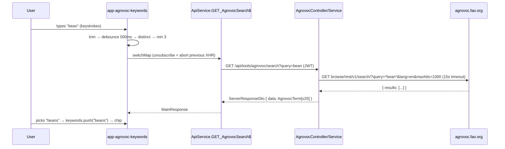

# Design — Results / AGROVOC-backed Keywords (General Information)

- **Module:** results (server `tools/agrovoc` · client General Information)
- **Spec id:** 2026-10-agrovoc-keywords
- **Status:** approved (Phase 2 gate, 2026-10-19)
- **Owner:** STAR / ARI squad
- **Linked requirements:** ./requirements.md
- **Linked detailed design:** ../../../trd/trd.md (integrations, API envelope)
- **Last updated:** 2026-10-19

---

## Executive summary

- **Server:** new `domain/tools/agrovoc/` module. `GET /api/tools/agrovoc/search?query=<text>` makes **one** upstream call (`*text*`, `lang=en`, `maxhits=1000`, 15 s timeout). It dedupes by concept `uri`, ranks exact → prefix → rest, and returns ≤ 20 `{ uri, label, matched_label? }`. Upstream failure becomes `502`, never an empty `200`.
- **Client:** new standalone `app-agrovoc-keywords` field, built on PrimeNG `p-select` with a custom search header (the same look as the Reporting-year dropdown). Selected keywords render as removable chips. The search stream is `debounceTime(500)` → `switchMap` over a **cancellable Observable** HTTP call, so typing again aborts the previous request.
- **Unchanged:** `body().keywords: string[]`, the PATCH, the DB, OpenSearch.

## 1. Goals & non-goals

| Goals | Maps to |
|---|---|
| Host from `AppConfig.ARI_AGROVOC_URL` | R-AGV-001 |
| One bounded, ranked, deduplicated term endpoint | R-AGV-002, NFR-AGV-001/003 |
| Remote-search dropdown replaces the Enter-to-chip input | R-AGV-003, R-AGV-005 |
| Settle-delay + true cancellation | R-AGV-004, NFR-AGV-002 |

**Non-goals:** enforcing max 4 (D-OQ-2) · storing the `uri` · touching `app-select` / `app-multiselect` · other consumers of `keywords` · i18n.

---

## 2. Architecture



### 2.1 Composition — server (`server/researchindicators/src/`)

| Path | Responsibility |
|---|---|
| `domain/shared/utils/app-config.util.ts` | **+** `get ARI_AGROVOC_URL()` (same shape as `ARI_CLARISA_HOST`, `:53-56`) |
| `domain/tools/agrovoc/agrovoc.module.ts` | `imports: [HttpModule]`, controller + service. `AppConfig` is `@Global` (`global-utils.module.ts:10-29`) |
| `domain/tools/agrovoc/agrovoc.controller.ts` | `@Get('search')`, Swagger decorators, `ResponseUtils.format` |
| `domain/tools/agrovoc/agrovoc.service.ts` | Validates the query, builds the URL, makes the call (timeout), maps errors, logs |
| `domain/tools/agrovoc/agrovoc-terms.mapper.ts` | **Pure** function: raw results + query → ranked, deduped `AgrovocTerm[]` (unit-testable without HTTP) |
| `domain/tools/agrovoc/dto/agrovoc-term.dto.ts` | Response item with `@ApiProperty` (`uri`, `label`, `matched_label?`) and the raw upstream types |
| `domain/routes/main.routes.ts` | **+** `{ path: 'agrovoc', module: AgrovocModule }` in `toolsChildren` (`:246-260`) |
| `app.module.ts` | **+** `AgrovocModule` in `imports` (same as `TipIntegrationModule`, `:27,50`). **Both** steps are required (KZ-017) |
| `.env.example` | **+** `ARI_AGROVOC_URL=https://agrovoc.fao.org/` |

### 2.2 Composition — client (`client/research-indicators/src/`)

| Path | Responsibility |
|---|---|
| `app/shared/services/to-promise.service.ts` | **+** `getObservable<T>(url, config?)`: same headers/URL as `get`, but returns a **cold Observable** mapped to the same `MainResponse` shape (`successfulRequest`, `errorDetail`). It never rejects, and unsubscribing aborts the request. `get` is untouched |
| `app/shared/services/api.service.ts` | **+** `GET_AgrovocSearch$(query)` → `TP.getObservable('tools/agrovoc/search', { params })`. Uses `HttpParams`, so the query is encoded (unlike `GET_OpenSearchCountries`, `:1038-1041`) |
| `app/shared/interfaces/agrovoc-term.interface.ts` | `AgrovocTerm { uri; label; matched_label? }` |
| `app/shared/interceptors/http-error.interceptor.ts` | **+** URL-scoped exclusion `tools/agrovoc` from the generic error toast (same pattern as `isPrmsSyncError`, `:114`) |
| `app/shared/components/custom-fields/agrovoc-keywords/agrovoc-keywords.component.{ts,html,scss}` | The field: `p-select` + search header + state rows + chips |
| `app/pages/.../general-information/general-information.component.{ts,html}` | Replace `p-autocomplete` block (`:48-50`) with `<app-agrovoc-keywords>`; update helper text (`:44-45`); drop `AutoCompleteModule` import |
| `styles/styles.scss` | Remove the now-dead `.keywords-autocomplete` block (`:62-87`; its only user is `general-information.component.html:48`) |

### 2.3 Reuse

- `AppConfig`, `HttpService` (`@nestjs/axios`), `ResponseUtils.format`, `GlobalExceptions`, `LoggerUtil`, `ChipModule`, `SelectModule`.
- **Not reused:** `BaseApi` (P-9), `app-select` / `app-multiselect` (P-13). See DD-2 and DD-6.

---

## 3. Data model

No data model changes. P-2 covers the save path.

## 4. API surface

### GET /api/tools/agrovoc/search

- **Controller:** `domain/tools/agrovoc/agrovoc.controller.ts`. Unversioned (no `@Version`, root `CLAUDE.md` §4.1).
- **Auth:** JWT via `JwtMiddleware` (global, not excluded — `app.module.ts:90-124`). No `@Roles`, no `ResultStatusGuard`: it is read-only and not result-scoped.
- **Query:** `query` (required). The service trims it, **strips `*`** (a user wildcard would change the semantics), and checks 3 ≤ length ≤ 100.
- **Response `data`:** `AgrovocTerm[]`, 0–20 items.
- **Swagger:** `@ApiTags('AGROVOC')`, `@ApiBearerAuth()`, `@ApiOperation`, `@ApiQuery({ name: 'query', required: true })`.
- **Errors (thrown as Nest exceptions → `GlobalExceptions` envelope):**

| Status | When | Exception |
|---|---|---|
| 400 | `query` missing, < 3 or > 100 chars after trimming and stripping | `BadRequestException` — no upstream call |
| 503 | `ARI_AGROVOC_URL` empty | `ServiceUnavailableException('AGROVOC host is not configured (ARI_AGROVOC_URL)')` — no upstream call |
| 502 | Upstream non-2xx, network error, timeout, or body without a `results` array | `BadGatewayException('AGROVOC service is unavailable')` |
| 401 | No/invalid token | `JwtMiddleware` |

## 5. Workflows & business rules

**Upstream URL:** host normalized to a single trailing slash, plus `browse/rest/v1/search/`. Params go through axios `params` (encoded): `query=*<text>*`, `lang=en`, `maxhits=1000`. Timeout 15 s.

**Mapping (pure, `agrovoc-terms.mapper.ts`):**

1. Keep rows with a non-empty `uri` and `prefLabel` (rows from other languages are not expected, since `lang=en` is set).
2. **Dedupe by `uri`.** A row whose match was the `prefLabel` itself (no `altLabel`) wins over synonym rows for the same `uri`. Otherwise keep the first synonym row's `altLabel` as `matched_label`.
3. **Rank** (case-insensitive, against the query `q`):
   - 0 = `label == q`
   - 1 = `label` starts with `q`
   - 2 = some word of `label` starts with `q`
   - 3 = anything else, synonym-only matches included

   Ties are broken alphabetically by `label`.
4. Cut to 20.
5. `label` = `prefLabel` (D-OQ-4).

**Logging:** `LoggerUtil.error` on every 502, with `{ query, upstreamStatus | 'timeout' | 'network' }`. `warn` on 503 (misconfiguration). Nothing is logged on success.

**Client field behavior (`app-agrovoc-keywords`):**

| Element | Rule |
|---|---|
| Inputs | `keywords = model<string[]>()` (two-way with `body().keywords`), `disabled = input<boolean>()` |
| Search stream | `Subject<string>` from the header input → `map(trim)` → `debounceTime(500)` → `distinctUntilChanged` (**reset after an error**, so retyping the same text retries — R-AGV-005) → `switchMap`: below 3 chars → `of(idle)`; otherwise `GET_AgrovocSearch$` mapped to `results`/`empty`/`error`, with `startWith(loading)` → `takeUntilDestroyed` → one `state` signal |
| Cancellation | `switchMap` unsubscribes the previous inner Observable. `HttpClient` aborts the XHR, and the interceptor's `merge(timer, next)` (P-11) is torn down with it. A stale response cannot be rendered because its subscription no longer exists |
| Options | `state.results` mapped with `alreadySelected` (case-insensitive `label` ∈ `keywords()`) → `optionDisabled` |
| Pick | `onChange(term)` → if not already there, `keywords.set([...keywords(), term.label])`; reset the `p-select` value to `null` so the field stays a picker |
| No duplicates (set semantics) | `keywords` stays a `string[]` (the PATCH contract), but every add goes through a case-insensitive membership check, so the array behaves as a set. Already-selected terms are also disabled in the list. The server does not dedupe (`transformData` only trims and drops empties), so this guard is the single owner; the only add path is the pick. Legacy duplicates already saved are left as-is (R-AGV-003 legacy scenario) — confirmed with the user at the design gate, 2026-10-19 |
| Remove | Chip `(onRemove)` → `keywords.set(keywords().filter(k => k !== removed))`. Legacy keywords behave the same |
| Enter on free text | Ignored. There is no free-text path (D-OQ-3) |
| Panel close | Clear the search text and reset the state to `idle` |
| Disabled | `p-select [disabled]`, chips without the remove icon, no stream input |

## 6. Frontend UX component architecture

```
app-agrovoc-keywords
├── p-select  [options]=terms [optionLabel]="label" [optionDisabled]="alreadySelected"
│             [filter]=false  appendTo="body"  placeholder="Search AGROVOC keywords"
│   ├── header template  → search input (pi-search icon), (input) → search$.next, click.stopPropagation
│   ├── item template    → label  +  "matched: <matched_label>" secondary line when present  +  "added" tag when disabled
│   └── empty/footer     → state row: hint (<3) | spinner "Searching AGROVOC…" | "No AGROVOC terms match “q”" | error "AGROVOC search is unavailable, try again"
└── chips row  @for keyword of keywords() → p-chip [removable]=!disabled
```

- **Visual reference:** the Reporting-year `app-select` (`general-information.component.html:26-29` → `p-select` with a filter header, `select.component.html:18-54`). The search header markup mirrors the `isOpenSearch` header there (`:40-54`) so it looks identical.
- **Chips:** keep today's look (grey pill with a ⊗, screenshot), restyled with token utilities (`.abc-*` / `var(--ac-*)`) in the component SCSS. No hex literals. Light and dark through Aura. Component styles stay within the 4 kB warning budget.
- **Helper text:** "Search and select keywords from the AGROVOC thesaurus. Use relevant terms that describe the content of your result." The "Max. 4 keywords" hint is kept (D-OQ-2).
- **A11y:** the search input has `aria-label="Search AGROVOC keywords"`. The state row is `aria-live="polite"`. Chips have remove buttons with `aria-label="Remove <keyword>"`.

## 7. Integration impact

- New outbound dependency on `agrovoc.fao.org`: public, no credentials, no cron, no `sync_process_log` (not scheduled).
- New env var `ARI_AGROVOC_URL`, default `https://agrovoc.fao.org/`. Source of truth: `.env` / deploy env (user-stated, P-4).

## 8. Security & authorization

- JWT-only, any authenticated user. Machine tokens are accepted by the middleware like any other route. No new secrets and no PII: only the typed term is forwarded.
- **SSRF:** the host is fixed by config, and the user controls only the encoded `query` param.

## 9. Observability

See §5 logging. The client's existing 5 s "pending" error-collector log (`http-error.interceptor.ts:55-61`) will also fire for slow AGROVOC calls. It is deliberately left alone (narrow blast radius), and requests cancelled before 5 s do not log.

## 10. Testing strategy

| Suite | What it proves | Notes |
|---|---|---|
| `agrovoc-terms.mapper.spec.ts` | Dedupe, synonym preference, ranking, cut to 20 | Fixtures **copied from the real payloads** captured 2026-10-19 (`*training*`, `*bea*`), trimmed |
| `agrovoc.service.spec.ts` | URL + params (with and without trailing slash), timeout applied, 400/503 make no call, upstream 503/timeout/malformed → `BadGatewayException` + log | `HttpService.get` stubbed with `of(...)` / `throwError` / `NEVER` + fake timers |
| `agrovoc.controller.spec.ts` | Envelope `200` + data; error propagation | |
| `app.module.spec.ts` (extend) | `Reflect.getMetadata('imports', AppModule)` contains `AgrovocModule`, **and** the RouterModule tree maps `tools/agrovoc` → `AgrovocModule` | Cannot prove live HTTP; the live check is in T-05 |
| `to-promise.service.spec.ts` | `getObservable` maps success/error like `TP`, and unsubscribing cancels (`HttpTestingController` → `req.cancelled === true`). With the real `httpErrorInterceptor`, a fast response completes the stream and logs **no** 5 s `pending` error (§9), while an unflushed request still does | Amended 2026-10-19 at execute (T-03 attempt 1 FAIL): §9 already limits the pending log to slow calls; this row records the test |
| `http-error.interceptor.spec.ts` (extend) | 502 on `tools/agrovoc/search` → no toast; same 502 elsewhere → toast | |
| `agrovoc-keywords.component.spec.ts` | Debounce (one call per settled input), min 3, cancel-previous with **deferred** Subjects (stale emission after switch is never rendered), distinct + reset after error, pick/duplicate/remove, disabled, each state row | `fakeAsync`; deferred observables, not `of()` (sync mocks hide the race) |
| `general-information.component.spec.ts` | Still builds with the new import, and `keywords` flows into the PATCH body | Existing fixtures use `keywords: ['test']` |

---

## 11. Rollout

- No migration and no flag. Deploy server and client together; the client calls the new route.
- **Backout:** revert the client PR to restore the free-text input. The server endpoint is additive and harmless.
- `ARI_AGROVOC_URL` must exist in every deployed environment before the client ships. Otherwise users get the error state, not a crash.

## 12. Design decisions

| # | Date | Decision | Rationale / rejected alternative |
|---|---|---|---|
| DD-1 | 2026-10-19 | New tool module `domain/tools/agrovoc/`, route `tools/agrovoc/search` | Server guide §3/§8: one folder per external system. Rejected: adding it to `clarisa` (a different system) |
| DD-2 | 2026-10-19 | Use `HttpService` directly with explicit `timeout(15000)` and error → `BadGatewayException`; **not** `BaseApi` | `BaseApi.handleError` swallows errors to `null` (P-9), so an outage would surface as "no matches" — that violates R-AGV-002's BUT clause. Pattern: `prms-normalizer.service.ts:209-226` |
| DD-3 | 2026-10-19 | One upstream call `*text*` with `maxhits=1000`; rank on the server | `maxhits` truncates **after** AGROVOC's alphabetical sort (P-6), so a small cap drops the exact match (`beans` falls out at `maxhits=8`). Measured worst real query: `*water*` = 583 hits / 91 KB, exact at #357. Rejected: extra exact/prefix calls (2–3× upstream load against a slow, flaky host). **Residual:** a query with > 1000 matches may miss its exact term. Accepted |
| DD-4 | 2026-10-19 | Return `{ uri, label, matched_label? }`, deduped by `uri`, max 20 | The "more familiar shape" the user asked for. `uri` is the stable key for dedupe/trackBy even though only `label` is stored (D-OQ-4) |
| DD-5 | 2026-10-19 | Add `ToPromiseService.getObservable` + `ApiService.GET_AgrovocSearch$` | `TP` turns every call into a Promise via `firstValueFrom` with no abort (P-10), so "cancel the previous request" cannot be met with it. Keeps the "HTTP only through ApiService" rule. Rejected: Promise + sequence-id guard (ignores stale responses but does not cancel — the user asked to cancel) |
| DD-6 | 2026-10-19 | New dedicated `app-agrovoc-keywords` component on `p-select`, instead of extending `app-select`/`app-multiselect` | Those components get options from service-locator services; their remote path filters on every keystroke without debounce or cancel (P-13); and they render across the app (blast radius). `p-select` gives the exact dropdown-with-search look the user referenced. Rejected: `p-autocomplete` with `completeMethod`+`delay`. It is closest to today's control, but it is not the dropdown the user asked for, and it still needs custom cancellation |
| DD-7 | 2026-10-19 | URL-scoped toast exclusion for `tools/agrovoc` in `http-error.interceptor` | The field owns its error UX (R-AGV-005). Without the exclusion, every AGROVOC outage stacks a generic toast on the inline message. Same precedent as `isPrmsSyncError` (`:114`) |
| DD-8 | 2026-10-19 | Remove `.keywords-autocomplete` styles and the `AutoCompleteModule` import from General Information | Dead after the swap. Only consumer: `general-information.component.html:48` (P-12). `create-result-form` keeps its own `AutoCompleteModule` |

**Reversion challenge (Step 2.3):** DD-8 removes the free-text chip input and its styles. The question was: what does removing it break?
1. The free-text entry path. This is intended (D-OQ-3).
2. Legacy keywords. They still render as chips and can still be removed, because `keywords` remains `string[]` (R-AGV-003, legacy scenario).
3. Other users of the styles. `grep keywords-autocomplete` over the client → 2 files, the template and `styles.scss`, so nothing else is affected.

No unaddressed breakage was found.

## 13. Budget (tripwire for `/akili-execute`)

| Expected tasks | Expected LOC (incl. tests) | Expected review rounds |
|---|---|---|
| 5 | ~700 (server ~300, client ~400) | 7 |

The estimate matches Standard depth.

## 14. Premise Ledger

**Count:** 15 verified · 1 `UNVERIFIED` (0 High, 1 Low).
**Blast-radius triggers fired:** `live-path` (the user types in Keywords), `shared-state` (shared `http-error.interceptor` and `ToPromiseService`), `consumer` (removed selector `.keywords-autocomplete`, extended exported services).

| # | Claim | Class | Citation (as run) | Verified at | If false | Settled by |
|---|---|---|---|---|---|---|
| P-1 | The Keywords UI the user reaches is the `p-autocomplete` in General Information, bound to `body().keywords` | live-path | Route `/result/:id/general-information` → `GeneralInformationComponent` (codegraph: caller of `GET_GeneralInformation`) → `general-information.component.html:49-50` `[(ngModel)]="body().keywords"`. No branch point: the same component for every result type | 01a3eea8f | T-05 targets the wrong component — **High** | — |
| P-2 | Save accepts `keywords: string[]`, trims, drops empties, replaces the set, re-indexes | existence | `results.service.ts:683-692, 712-720`; `update-general-information.dto.ts:10-15` | 01a3eea8f | A server change to save would be needed (scope grows) — **High** | — |
| P-3 | No AGROVOC code exists anywhere | existence | `grep -rIl -i agrovoc . --exclude-dir={node_modules,.git,dist,.codegraph}` → 0 files | 01a3eea8f | Reuse instead of building T-01 — **High** | — |
| P-4 | `ARI_AGROVOC_URL=https://agrovoc.fao.org/` is set in `.env` and in the deploy envs | data-env | `UNVERIFIED — confirm at source before relying on it` | — | Endpoint answers 503 until set — **Low** | user-stated (2026-10-19); the user asked that `.env` not be read. Settled at the T-05 HITL check: the running app returns terms |
| P-5 | Upstream shape: `{ results: [{ uri, type, prefLabel, altLabel?, lang, vocab }] }` | data-env | `curl '…/search/?query=*bea*&lang=en'` → keys `{uri,type,prefLabel,vocab,altLabel,lang}`, 200 rows, 139 distinct `prefLabel`, 117 with `altLabel` (2026-10-19) | external, 2026-10-19 | Mapper (T-01) is wrong — **High** | — |
| P-6 | `maxhits` truncates after an alphabetical sort by the matched label | data-env | `*bean*` `maxhits=1000` → 135 rows, `beans` at #27; `maxhits=8` → `beans` absent (2026-10-19) | external, 2026-10-19 | DD-3 could use a small cap — **Low** | — |
| P-7 | No default cap; latency 0.35–13.8 s; transient 503 | data-env | `*b*` → 11,439 rows in 13.8 s; `*training*` → HTTP 503 at 10.9 s, then 200 at 0.46 s on retry; `*water*` → 583 rows / 91,462 B (2026-10-19) | external, 2026-10-19 | NFR-AGV-001 timeout and loading state could be relaxed — **Low** | — |
| P-8 | A tool module needs both a `toolsChildren` node and an `AppModule` import | location | `main.routes.ts:246-260`; `app.module.ts:27,50` (`TipIntegrationModule`) | 01a3eea8f | Route 404s silently (KZ-017) — **High** | — |
| P-9 | `BaseApi` swallows errors to `null` with a 30 s timeout | existence | `domain/tools/core/base-api.ts:56-62` (`timeout(30000)`, `catchError` → `of(null)`) | 01a3eea8f | DD-2 could reuse `BaseApi` — **Low** | — |
| P-10 | Client `TP` returns a Promise with no abort | existence | `to-promise.service.ts:15-36` (`firstValueFrom`), `:91-123` (`get`); `grep -rn AbortController client/research-indicators/src/app` → 0 | 01a3eea8f | DD-5 is unnecessary — **Low** | — |
| P-11 | `http-error.interceptor` shows a generic toast for every error except listed URLs/statuses, and logs requests > 5 s. Every HTTP request in the app shares it | shared-state | `http-error.interceptor.ts:55-61` (5 s timer), `:65` `merge(timeoutCheck, next(req)…)`, `:114-138` exclusion list + `showToast`. Siblings: **every** `HttpClient` call (registered globally in `app.config.ts`). Name references: `grep -rln "http-error.interceptor\|httpErrorInterceptor" client/research-indicators/src` → 5 files: `app.config.ts`, `http-error.interceptor.spec.ts`, `http-error.interceptor.ts`, `impersonation.service.ts`, `pool-funding-alignment.component.ts`. DD-7 adds a URL-only clause, so behavior for any non-`tools/agrovoc` URL is unchanged | 01a3eea8f | A double error message, or a broad change leaking to other flows — **High** | — |
| P-12 | `.keywords-autocomplete` and General Information's `AutoCompleteModule` have no other consumer | consumer | `grep -rn "multiple-ac-2\|keywords-autocomplete\|p-autocomplete\|AutoCompleteModule\|Write the keywords" client/research-indicators --exclude-dir={node_modules,dist}` → `general-information.component.{ts:19,45; html:48-50}`, `styles.scss:62-83`, `create-result-form.component.ts:18,49` (its own import, kept). `client/research-indicators/tests` has 0 hits for `keyword` / `general-information` | 01a3eea8f | Removal breaks another screen — **Low** | — |
| P-13 | `app-select`/`app-multiselect` remote filtering has no debounce or cancel; `multiselect-opensearch` debounces but never `switchMap`s | existence | `select.component.html:31, 40-54`; `select.component.ts:159-161`; `multiselect-opensearch.component.ts:77,85,97-98`; `grep switchMap custom-fields` → 0 | 01a3eea8f | DD-6 could reuse a component — **Low** | — |
| P-14 | The Reporting-year visual reference is `app-select` → `p-select` with a filter header | location | `general-information.component.html:26-29` (`app-select label="Reporting year"`); `select.component.html:18-33` | 01a3eea8f | The look-alike target in §6 changes — **Low** | — |
| P-15 | Unversioned endpoints mount at `/api/<path>` | other | Root `CLAUDE.md` §4.1 (`main.ts:53-56`, no `defaultVersion`) | 01a3eea8f | Client URL is wrong (404) — **High** | — |
| P-16 | `JwtMiddleware` covers the new route (not excluded) | other | `app.module.ts:90-124` `.exclude(...)` … `.forRoutes(...)`; the exclusion list is quoted in `app.module.spec.ts` header | 01a3eea8f | The endpoint would be public — **Low** | — |

**Hand-off:**
- **P-4** (`UNVERIFIED`) is owned by T-05. Its first step is the user's live check.
- **P-11** is copied into the `Consumers` field of T-03.
- **P-12** is copied into the `Consumers` field of T-05.

## 15. Open questions

None. The Phase 1 decisions are recorded in `requirements.md` §10.
