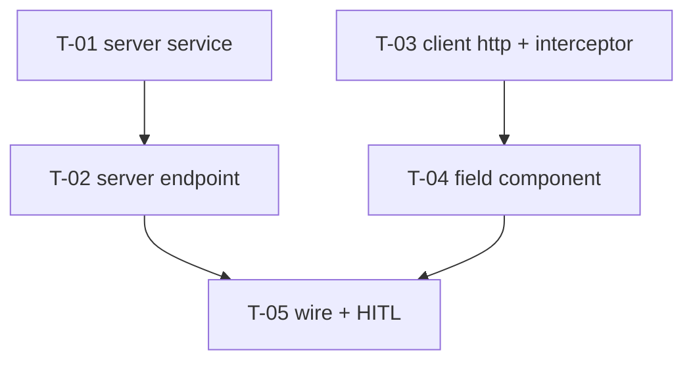

# Tasks — Results / AGROVOC-backed Keywords (General Information)

- **Module:** results (server `tools/agrovoc` · client General Information)
- **Spec id:** 2026-10-agrovoc-keywords
- **Status:** not-started
- **Owner:** STAR / ARI squad
- **Linked requirements:** ./requirements.md
- **Linked design:** ./design.md
- **Last updated:** 2026-10-19

---

## Summary

| ID | Action | Pkg | Size | Depends | Review |
|---|---|---|---|---|---|
| T-01 | `ARI_AGROVOC_URL` + mapper + service (call, timeout, errors, logs) | server | M | — | full |
| T-02 | Controller + module + route + `AppModule` wiring + Swagger | server | S | T-01 | checklist |
| T-03 | Cancellable `getObservable` + `GET_AgrovocSearch$` + interceptor toast exclusion | client | S | — | full |
| T-04 | `app-agrovoc-keywords` field (stream, states, chips) | client | M | T-03 | full |
| T-05 | Wire into General Information, remove dead input/styles, gates, live HITL check | client | S | T-02, T-04 | checklist |

**Parallel-safe:** T-01 ∥ T-03, and T-02 ∥ T-04 (one server task plus one client task can be edited at the same time; the Leader re-runs full suites after each report).
**No task is `skip-eligible`.**

**Common gates:**
- Server, from `server/researchindicators/`: `npm test -- --silent <paths>` · `npx eslint <paths>` (never `npm run lint`, K-001) · `npm run build`
- Client, from `client/research-indicators/`: `npm test -- --silent <paths>` · `npm run lint -- --quiet` · `npm run build` · `npx tsc -p tsconfig.spec.json --noEmit 2>&1 | grep -E '<touched spec>' | wc -l`. That count must not grow versus `git stash` (client guide K-002).

---

## T-01 — AGROVOC config, mapper and service

- **Status:** todo · **Size:** M · **Dependencies:** none
- **Requirements:** R-AGV-001 (both scenarios, AC.1, AC.2) · R-AGV-002 (scenarios *Matches found*, *No matches*, *Upstream failure*, *Query too short* — service level) · NFR-AGV-001 · NFR-AGV-003 (logging)
- **Design refs:** §2.1, §4 (errors table), §5 (URL, mapping, logging), DD-2, DD-3, DD-4; Premise Ledger P-5, P-6, P-7, P-9
- **Scope:**
  - `src/domain/shared/utils/app-config.util.ts`: `get ARI_AGROVOC_URL()`
  - `.env.example`: `ARI_AGROVOC_URL=https://agrovoc.fao.org/`. **Do not read or edit `.env`** (user instruction)
  - `src/domain/tools/agrovoc/dto/agrovoc-term.dto.ts`: response item plus raw upstream types
  - `src/domain/tools/agrovoc/agrovoc-terms.mapper.ts`: pure dedupe / rank / cut
  - `src/domain/tools/agrovoc/agrovoc.service.ts`:
    - validate the query (trim, strip `*`, 3–100 chars → `BadRequestException`)
    - empty host → `ServiceUnavailableException` (with `warn` log), no call
    - URL normalization; params `query=*q*`, `lang=en`, `maxhits=1000`
    - `timeout(15000)`
    - non-2xx, network error, timeout or missing `results` array → `BadGatewayException` + `LoggerUtil.error({ query, upstreamStatus })`
- **Tests:**
  - `agrovoc-terms.mapper.spec.ts`. Fixtures are **trimmed copies of the real 2026-10-19 payloads** (`*training*` 18 rows, `*bea*` subset), committed under `src/domain/tools/agrovoc/__fixtures__/`. Cases:
    - `training` ranks first
    - `skill training` appears exactly once, with no `matched_label`
    - `e-learning` has `matched_label: 'online training'`
    - a 25-distinct-concept fixture is cut to 20
    - empty input → `[]`
  - `agrovoc.service.spec.ts` (`HttpService.get` stubbed):
    - URL + params with and without a trailing slash
    - `q='be'` / `'  '` / `'**'` → 400, and `get` is not called
    - empty host → 503, and `get` is not called
    - upstream `throwError({ response: { status: 503 } })` → `BadGatewayException` + logger called
    - `NEVER` with fake timers advanced 15 s → `BadGatewayException`
    - `{}` body → `BadGatewayException`
    - `results: []` → `[]`
- **Falsifier:** each mutation below must turn a named test red **on its assertion**:
  - (a) dedupe by `prefLabel` instead of `uri`: the `e-learning` fixture has two rows for one `uri`, both with `prefLabel` `e-learning` → no divergence. Instead, mutate to **no dedupe** → the `skill training` once-only assertion goes red
  - (b) swap rank 0 and 3 → the `training`-first assertion goes red
  - (c) map the catch to `of([])` (`BaseApi` behavior) → the 503 → `BadGatewayException` test goes red
  - (d) delete `timeout(...)` → the `NEVER` test goes red, by assertion, not by Jest timeout. Use `rejects.toThrow` after advancing timers, with a 1 s Jest test timeout guard
  - (e) send `query=q` without wildcards → the params assertion goes red
- **Red run:** execute mutations (b), (c) and (d) against the finished code. Quote each failing assertion line in `execution.md`. A red caused by setup, compile or a Jest timeout does not count.
- **Disqualifier:** the evidence does not count if:
  - a fixture is hand-written rather than derived from the captured payload, because P-5 is then untested
  - any test passes with `HttpService.get` never called while it asserts a call
  - the `NEVER` test only passes because Jest timed out
- **Consumers:** none. New symbols only. `AppConfig` gains a getter; there are 43 injecting files, and an added getter changes none of them.
- **Review:** `full`. It holds the error-mapping decision (DD-2) and ranking logic that every user sees.
- **Done criteria:**
  - [ ] All tests above green
  - [ ] Falsifiers (b), (c) and (d) observed red and quoted
  - [ ] `npx eslint src/domain/tools/agrovoc src/domain/shared/utils/app-config.util.ts` clean
  - [ ] `npm run build` green
  - [ ] `.env.example` line present; `.env` untouched (`git status` does not list it)
- **Skills:** `nestjs-expert`, `error-handling-patterns`, `tdd`

---

## T-02 — Endpoint, module and route wiring

- **Status:** todo · **Size:** S · **Dependencies:** T-01
- **Requirements:** R-AGV-001 *Missing host* (503 in envelope, no crash) · R-AGV-002 AC.1 (registration part), AC.2, AC.3, *No matches* (200 envelope), *Query too short* (400 envelope) · NFR-AGV-003 (envelope)
- **Design refs:** §2.1, §4, §8, DD-1; P-8, P-15, P-16
- **Scope:**
  - `agrovoc.controller.ts`: `@ApiTags('AGROVOC')`, `@ApiBearerAuth()`, `@ApiOperation`, `@ApiQuery({ name: 'query', required: true })`, `@Get('search')` → `ResponseUtils.format({ description, status: 200, data })`
  - `agrovoc.module.ts`
  - `main.routes.ts`: `{ path: 'agrovoc', module: AgrovocModule }` in `toolsChildren`
  - `app.module.ts`: add the import
- **Tests:**
  - `agrovoc.controller.spec.ts`: 200 envelope carrying the service data; service exceptions propagate (400/502/503)
  - `app.module.spec.ts` (extend):
    - `Reflect.getMetadata('imports', AppModule)` contains `AgrovocModule`
    - the exported route tree resolves `tools` → `agrovoc` → `AgrovocModule`
    - JwtMiddleware's captured exclude list contains no `tools/agrovoc` entry (AC.3)
- **Falsifier:**
  - remove `AgrovocModule` from `AppModule.imports` (keeping the route node) → the membership assertion goes red
  - remove the route node → the route-tree assertion goes red
  - add `tools/agrovoc/(.*)` to the JwtMiddleware exclude list → the AC.3 assertion goes red
- **Red run:** execute the first two falsifiers and quote the failing lines.
- **Disqualifier:** this does not prove live HTTP reachability or a live 401 (KZ-017). The unit tier has no booted, authenticated seam. That claim is owned by T-05's live check, never by this task's green.
- **Consumers:** `src/app.module.spec.ts` (pins the exclude list in its header comment, which must be updated if the list text changes); `src/domain/routes/main.routes.ts`.
- **Review:** `checklist`. Wiring plus Swagger; the risk is captured by the module-graph falsifiers.
- **Done criteria:**
  - [ ] Tests green
  - [ ] Falsifiers observed red
  - [ ] `npx eslint` on touched files clean
  - [ ] `npm run build` green
  - [ ] Swagger lists `GET /api/tools/agrovoc/search` under **AGROVOC** with the bearer lock and the `query` param (checked on a local boot, or deferred to T-05 and stated so)
- **Skills:** `nestjs-expert`, `api-design-principles`

---

## T-03 — Cancellable GET + API method + interceptor exclusion (client)

- **Status:** todo · **Size:** S · **Dependencies:** none (contract fixed in design §4)
- **Requirements:** R-AGV-004 *Typing again cancels* (transport half: abort on unsubscribe) · R-AGV-005 *Error* (no stacked generic toast) · R-AGV-002 contract (client side)
- **Design refs:** §2.2, DD-5, DD-7; P-10, P-11
- **Scope:**
  - `shared/services/to-promise.service.ts`: `getObservable<T>(url, config?)`. Same headers/URL construction as `get`; maps to `{ ...data, successfulRequest: true }` / `{ ...error, successfulRequest: false, errorDetail: error?.error }`; never errors; cold. **`get` and `TP` unchanged.**
  - `shared/services/api.service.ts`: `GET_AgrovocSearch$ = (query: string) => this.TP.getObservable<AgrovocTerm[]>('tools/agrovoc/search', { params: new HttpParams().set('query', query) })`
  - `shared/interfaces/agrovoc-term.interface.ts`
  - `shared/interceptors/http-error.interceptor.ts`: `const isAgrovocSearchError = req.url.includes('tools/agrovoc');` added to the toast condition
- **Tests:**
  - `to-promise.service.spec.ts` (`HttpTestingController`):
    - success → `successfulRequest: true`
    - a 502 flush → emits `successfulRequest: false` and does not error
    - subscribe, then unsubscribe before flush → `expectOne(...).cancelled === true`
    - the query string is encoded (`seed system` → `seed%20system`)
  - `http-error.interceptor.spec.ts` (extend): a 502 on `.../tools/agrovoc/search?query=x` → `showToast` not called; the same 502 on `.../results/1/general-information` → `showToast` called
- **Falsifier:**
  - implement `getObservable` with `from(this.TP(...))` (Promise-based) → the `cancelled === true` assertion goes red
  - drop `isAgrovocSearchError` from the condition → the no-toast assertion goes red
  - broaden it to `status === 502` alone → the control case (`general-information` 502 shows a toast) goes red
- **Red run:** execute all three; quote the failing assertions.
- **Disqualifier:** the cancel test is not evidence if it never subscribes before unsubscribing (the request was never made), or if it asserts the absence of `expectOne` instead of `cancelled`.
- **Consumers (from P-11):**
  - `http-error.interceptor.spec.ts`
  - `app.config.ts`
  - `impersonation.service.ts`
  - `pool-funding-alignment.component.ts` (references; behavior unchanged for non-AGROVOC URLs)
  - `shared/testing/mock-services.mock.ts` — check whether it mocks `ApiService`/`ToPromiseService` by shape; extend it if a spec needs `GET_AgrovocSearch$`
- **Review:** `full`. It touches a global interceptor and a root HTTP service (shared state).
- **Done criteria:**
  - [ ] Tests green
  - [ ] Falsifiers observed red
  - [ ] `npm run lint -- --quiet` clean
  - [ ] `npm run build` green
  - [ ] Spec type-check count for the 2 touched specs not increased
  - [ ] Full client suite re-run by the Leader
- **Skills:** `angular-developer`, `error-handling-patterns`

---

## T-04 — `app-agrovoc-keywords` field component

- **Status:** todo · **Size:** M · **Dependencies:** T-03
- **Requirements:**
  - R-AGV-003: *Pick a term* (chip part), *Free text is not accepted*, *Duplicate pick*, *Legacy keywords stay* (render and remove), *Read-only result*, AC.2
  - R-AGV-004: all four scenarios (settle, cancel → stale never rendered, below minimum, same text)
  - R-AGV-005: every state row, plus *Slow upstream* (loading throughout; BUT never empty while pending)
  - NFR-AGV-002
- **Design refs:** §5 (client field behavior table incl. "No duplicates"), §6, DD-6
- **Scope:** `shared/components/custom-fields/agrovoc-keywords/agrovoc-keywords.component.{ts,html,scss}`
  - standalone; `keywords = model<string[]>()`; `disabled = input(false)`
  - `p-select` with the search header, item template, state row
  - chips via `p-chip`
  - token utilities / `var(--ac-*)` only, no hex
  - `aria-label`s and an `aria-live` state row
- **Tests (`agrovoc-keywords.component.spec.ts`):** `fakeAsync`, with `GET_AgrovocSearch$` stubbed to return **deferred `Subject`s**, not `of()`. Cases:
  1. `b`,`e`,`a`,`n` 100 ms apart, `tick(500)` → exactly 1 call, with `'bean'`
  2. Call for `bean` pending; type `s`, `tick(500)` → the first subject is unsubscribed (`observed === false`); emitting on the **first** subject afterwards changes nothing rendered; only `beans` results render
  3. `be` → 0 calls, hint shown
  4. Same settled value twice → 1 call; after an error emission, the same value again → a 2nd call
  5. Pick `beans` → `keywords()` = `['beans']`; the select value resets to `null`
  6. `Beans` already present, pick `beans` → still 1 entry; the option is rendered disabled
  7. Enter in the search box with no results → `keywords` unchanged
  8. Legacy `['In-Person','Capacity Sharing']` render as 2 chips; removing one leaves the other
  9. `disabled=true` → select disabled, no remove icons, typing makes 0 calls
  10. States: loading visible while the subject is pending, and the empty text is **absent** while pending; empty after `data: []`; error after `successfulRequest:false`, with existing chips intact; `matched_label` rendered as secondary text
- **Falsifier:**
  - replace `switchMap` with `mergeMap` → case 2 goes red (a stale render)
  - remove `debounceTime` → case 1 goes red (4 calls)
  - remove the case-insensitive check → case 6 goes red
  - drop the post-error reset of `distinctUntilChanged` → case 4b goes red
- **Red run:** execute the `mergeMap`, `debounceTime` and case-insensitivity mutations; quote the failing assertions. A red from a missing provider or a template error is not a red.
- **Disqualifier:**
  - Any race case driven by `of()` / synchronous mocks is not evidence (sync emission hides the race).
  - The DOM assertions must query the real rendered template (the `p-select` panel opened, or the state row in the component's own markup), never a fragment authored in the test.
  - Layout and visual fidelity are **not** provable in jsdom. That gap is recorded here and owned by T-05's HITL check.
- **Consumers:** none (new component).
- **Review:** `full`. It holds the concurrency logic (the debounce/cancel race).
- **Done criteria:**
  - [ ] 10 cases green
  - [ ] 3 falsifiers observed red and quoted
  - [ ] `npm run lint -- --quiet` clean
  - [ ] `npm run build` green; component SCSS under the 4 kB warning budget
  - [ ] Spec type-check grep for the new spec = 0 errors
- **Skills:** `angular-developer`, `ui-ux-pro-max`, `tdd`

---

## T-05 — Wire into General Information, clean up, live HITL check

- **Status:** todo · **Size:** S · **Dependencies:** T-02, T-04
- **Requirements:**
  - R-AGV-003: *Pick a term* (PATCH body unchanged), *Legacy keywords stay* (save keeps them), AC.1 (helper text)
  - R-AGV-002 AC.1 (live reachability), AC.3 (live 401)
  - the visual-fidelity defect class (requirements §8)
- **Design refs:** §2.2, §6 (helper text), DD-8, reversion challenge; P-1, P-4, P-12
- **First step — settle P-4 (`UNVERIFIED`):** the user starts the app with their `.env` (agents do **not** read it) and confirms that a search returns terms. If it does not, stop and report before continuing.
- **Scope:**
  - `general-information.component.html`: replace `:48-50` with `<app-agrovoc-keywords [(keywords)]="body().keywords" [disabled]="!submission.isEditableStatus()" />` (or an equivalent signal binding that writes back into `body`); new helper text at `:44-45`; keep the "Max. 4" hint
  - `general-information.component.ts`: import `AgrovocKeywordsComponent`; drop `AutoCompleteModule`
  - `styles/styles.scss`: delete the `.keywords-autocomplete` block (`:62-87`)
- **Tests:** `general-information.component.spec.ts` (extend):
  - the component renders `app-agrovoc-keywords`, using the real component, not a `template: ''` stub (KZ-001)
  - after setting `keywords` through the child's output, `saveData()` calls `PATCH_GeneralInformation` with `keywords: ['beans']`
  - a loaded `['In-Person']` is still in the PATCH body when saving without edits
- **Falsifier:**
  - bind one-way (`[keywords]` only) → the PATCH-body assertion goes red
  - leave the old `p-autocomplete` in place → the render assertion goes red
- **Red run:** execute the one-way-binding mutation and quote the failing assertion.
- **HITL live check (mandatory before any commit; user memory: no commit before visual approval).** In the running app, the user verifies:
  1. The dropdown looks like Reporting year
  2. Typing `bean` and pausing shows terms
  3. Typing quickly shows one request per pause in DevTools, with earlier ones marked **(canceled)**
  4. Picking adds a chip; duplicates are blocked
  5. Saving and reloading keeps the keywords
  6. Legacy chips remain
  7. Read-only results are disabled
  8. With the network offline (DevTools), an inline error appears and **no** generic toast
  9. `GET /api/tools/agrovoc/search?query=bean` without a token → 401
  10. Swagger shows the endpoint
  - Quote what the user actually confirmed (KZ-002). An item the user did not cover stays open.
- **Disqualifier:** the user's approval of the look does not discharge items 3, 8 or 9 unless they were observed. Record each item separately.
- **Consumers (from P-12):**
  - `general-information.component.{ts,html}`
  - `styles/styles.scss`
  - `general-information.component.spec.ts` (fixtures with `keywords: ['test']`)
  - `create-result-form.component.ts` keeps its own `AutoCompleteModule` import — must stay untouched
- **Review:** `checklist`. Wiring and cleanup; behavior is proven in T-04 and by the HITL check.
- **Done criteria:**
  - [ ] Tests green
  - [ ] Falsifier observed red
  - [ ] `grep -rn "keywords-autocomplete\|multiple-ac-2" client/research-indicators/src` → 0
  - [ ] `npm run lint -- --quiet` and `npm run build` green
  - [ ] HITL items 1–10 each recorded with the user's words
  - [ ] Full server and client suites re-run by the Leader
- **Skills:** `angular-developer`, `ui-ux-pro-max`

---

## Coverage — scenario and clause level

| Requirement clause | Owner |
|---|---|
| R-AGV-001 *Configured host* + MUST same URL without slash | T-01 |
| R-AGV-001 *Missing host* 503 + BUT no call / no crash | T-01 (no call), T-02 (envelope) |
| R-AGV-001 AC.1 getter, AC.2 `.env.example` | T-01 |
| R-AGV-002 *Matches found*: exact first, once, `matched_label`, MUST ≤ 20 | T-01 |
| R-AGV-002 *No matches*: 200 `[]`, BUT not an error | T-01 (service), T-02 (envelope) |
| R-AGV-002 *Upstream failure*: 502, log, BUT not `200 []` | T-01 |
| R-AGV-002 *Query too short*: 400, MUST NOT call | T-01, T-02 (envelope) |
| R-AGV-002 AC.1 reachable on a booted app | T-02 (graph), T-05 (live) |
| R-AGV-002 AC.2 Swagger | T-02, T-05 item 10 |
| R-AGV-002 AC.3 401 | T-02 (exclude list), T-05 item 9 |
| R-AGV-003 *Pick a term*: chip | T-04 case 5 |
| R-AGV-003 *Pick a term*: PATCH shape unchanged | T-05 |
| R-AGV-003 *Free text*: no chip, BUT not saved | T-04 case 7 |
| R-AGV-003 *Duplicate pick* | T-04 case 6 |
| R-AGV-003 *Legacy*: render/remove | T-04 case 8 |
| R-AGV-003 *Legacy*: BUT not dropped on save | T-05 |
| R-AGV-003 *Read-only* | T-04 case 9, T-05 item 7 |
| R-AGV-003 AC.1 helper text | T-05 |
| R-AGV-003 AC.2 stored = `label` | T-04 case 5 |
| R-AGV-004 *Settle delay*: 1 request, BUT none for `b`/`be`/`bea` | T-04 case 1 |
| R-AGV-004 *Cancel*: aborted on the client | T-03 (transport), T-05 item 3 |
| R-AGV-004 *Cancel*: MUST NOT render stale | T-04 case 2 |
| R-AGV-004 *Below minimum*: no request, hint, in-flight cancelled | T-04 case 3 (cancel via `switchMap` → `of(idle)`) |
| R-AGV-004 *Same text again* | T-04 case 4 |
| R-AGV-005 state table (6 rows) | T-04 case 10 + 9 |
| R-AGV-005 error keeps chips; no generic toast | T-04 case 10 (chips), T-03 (toast) |
| R-AGV-005 *Slow upstream*: loading, BUT never empty while pending | T-04 case 10 |
| NFR-AGV-001 timeout + bounded hits | T-01 |
| NFR-AGV-002 request volume | T-04 cases 1, 3 |
| NFR-AGV-003 envelope + logs | T-01 (logs), T-02 (envelope) |
| Defect class: visual fidelity (no automated gate) | T-05 HITL items 1, 4, 6, 7 |
| Defect class: real AGROVOC latency (accepted risk) | T-05 item 2 (observation only) |

## Risks & blockers log

| # | Date | Risk / blocker | Mitigation | Owner | Status |
|---|---|---|---|---|---|
| RB-1 | 2026-10-19 | P-4: `ARI_AGROVOC_URL` presence is user-stated; agents may not read `.env` | T-05 first step: user live check | user | open |
| RB-2 | 2026-10-19 | AGROVOC slow or flaky (0.35–13.8 s, transient 503) | 15 s timeout, loading/error states | — | accepted |

## Estimate & PR strategy

- **LOC:** ~700 including tests (server ~300 across T-01/T-02; client ~400 across T-03–T-05).
- **PRs:** two, on the AC-1525 branch:
  - **PR 1 — server** (T-01, T-02). Additive; safe to merge first.
  - **PR 2 — client** (T-03–T-05). Review T-03 first (shared interceptor/service), then T-04. Out of scope: the "Max. 4" limit.

## Done definition

- [ ] T-01…T-05 done, each with a Reviewer PASS in `execution.md`
- [ ] The user exercised the feature in the running app (T-05 HITL) **before** `/akili-validate`
- [ ] Swagger documents the endpoint
- [ ] `ARI_AGROVOC_URL` confirmed in every deploy environment before PR 2 ships
