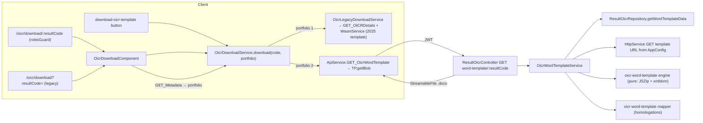

# Design — Results / OICR Word Template 2026 (filled download)

- **Module:** results (server `entities/result-oicr` · client OICR download button, `/oicr/download` route)
- **Spec id:** 2026-10-oicr-word-template-2026
- **Status:** approved (Phase 2 gate, 2026-10-23) — Judgment Day APPROVED, round 2 (see `judgment.md`) · **amended 2026-10-26 by Pivot PV-1** (§16) — amendment approved by the owner 2026-10-26
- **Owner:** STAR / ARI squad
- **Linked requirements:** ./requirements.md
- **Linked detailed design:** ../../../trd/trd.md (frontend route map, line 204); ../../../ux-ui/design.md (screen inventory, lines 100 and 250)
- **Last updated:** 2026-10-26

---

## Executive summary

A new read-only endpoint, `GET /api/results/oicr/word-template/:resultCode`, does the work:

1. checks the result is a Portfolio 2 OICR;
2. loads the creation-modal data with small separate queries;
3. fetches the 2026 template from S3 on every request;
4. hands both to a **pure document engine**.

The engine edits only the 13 target content controls, clones repeating rows when needed, and returns the `.docx` as a `StreamableFile`. It is a stateless module with no Nest DI, built on **JSZip + @xmldom/xmldom**. It is the POC engine that was validated on two real OICRs, ported with the hardening from Judgment Day round 1 (§5 step 7).

On the client:

- the button and a new guarded route `/oicr/download/:resultCode` call that endpoint through `getBlob`;
- the button is shown for Portfolio 1 and 2 (PV-1); Portfolio 2 uses the new endpoint, Portfolio 1 the legacy WASM;
- ~~the Go WASM, its assets and its global script are deleted~~ — **PV-1:** the Go WASM stays as the **legacy path for Portfolio 1 (2025)**, unchanged except that it always uses the 2025 template file; the client picks the path by portfolio in one place (§16).

---

## 1. Goals & non-goals

**Goals**

| Goal | Requirements |
|---|---|
| Serve a filled, faithful 2026 template from the server | R-OWT-001, 002, 004, 005, 007 |
| Map STAR values onto the exact Word options | R-OWT-003 |
| Fail loudly and never half-fill | R-OWT-006, NFR-OWT-002 |
| ~~Button for 2026 only~~ Button for 2025 and 2026 (PV-1), and an email link that survives login | R-OWT-008, 009, 010, 013 |
| ~~One generation path: the client stops building documents~~ Two paths chosen by portfolio: the server for 2026, the unchanged legacy client WASM for 2025 (PV-1) | R-OWT-011, 012, 013 |

**Non-goals**

- Fields outside the modal.
- Generating 2025 templates on the server, or changing the legacy 2025 document (PV-1 keeps it as it is).
- Template caching.
- Removing `GET results/oicr/details/:resultCode`.
- Changing `rolesGuard` (the code goes in the path instead).
- Moving the PI-delegates `downloadBlob` helper.

---

## 2. Architecture

`SetUpInterceptor` resolves the result before the handler runs, exactly as for the existing details endpoint. The response interceptor passes a `StreamableFile` through unwrapped (P-2). `GlobalExceptions` shapes the error envelope.

### 2.1 Composition — server (`server/researchindicators/src/`)

| Path | Responsibility |
|---|---|
| `domain/entities/result-oicr/word-template/oicr-word-template.ids.ts` | The 13 control `w:id`s of the 2026 template, named. This is the only place they live (D-3) |
| `domain/entities/result-oicr/word-template/oicr-word-template.engine.ts` | Pure functions: load package, set text, set option, clone repeating rows, serialize. Keeps every other zip part and the XML declaration verbatim |
| `domain/entities/result-oicr/word-template/oicr-word-template.mapper.ts` | Homologation tables and rules (tag, research areas, geo scope, regions/countries text, contact row). STAR data in, plain field values out |
| `domain/entities/result-oicr/word-template/oicr-word-template.service.ts` | Orchestration: eligibility, data, template fetch, engine, error mapping, logs |
| `domain/entities/result-oicr/word-template/dto/oicr-word-template-data.dto.ts` | The internal shape of the modal data the repository returns |
| `domain/entities/result-oicr/word-template/__fixtures__/oicr-template-2026.docx` | Byte-identical copy of the S3 template (SHA-1 `e469c79d…`), used only by tests |
| `domain/entities/result-oicr/repositories/result-oicr.repository.ts` | **+ `getWordTemplateData(resultId)`**: separate read queries (D-6) |
| `domain/entities/result-oicr/result-oicr.controller.ts` | **+ handler `downloadWordTemplate`** on `GET word-template/:resultCode`, returning `StreamableFile`. The name `getWordTemplate` is already taken by the details route (`result-oicr.controller.ts:108`) |
| `domain/entities/result-oicr/result-oicr.module.ts` | **+ `HttpModule`** import and the new service |
| `domain/shared/utils/app-config.util.ts` | **+ getter `ARI_OICR_TEMPLATE_URL`** |
| `.env.example` | **+ `ARI_OICR_TEMPLATE_URL`** with the Dev value |
| `domain/entities/result-status-workflow/repositories/result-status-workflow.repository.ts:54` | `download_url` switches from `/oicr/download?resultCode=<code>` to `/oicr/download/<code>`, and its assertion `result-status-workflow.repository.spec.ts:174` is updated (P-20) |
| `package.json` | **+ `jszip@3.10.1`, `@xmldom/xmldom@0.8.10`** as direct dependencies (NFR-OWT-003) |

Sibling `*.spec.ts` files are added for the engine, mapper, service and controller.

### 2.2 Composition — client (`client/research-indicators/src/`)

| Path | Change |
|---|---|
| `app/shared/services/api.service.ts` | **+ `GET_OicrWordTemplate(code)`** via `TP.getBlob`, **without** `useResultInterceptor`, so the download is always the live OICR (D-OWT-15) |
| `app/shared/services/oicr-download.service.ts` | **Rewritten** (routing added by PV-1, §16: `download(code, portfolioId)`, `1` → legacy, `2` → server): the server path fetches the blob, saves it as `STAR_OICR_<code>_<yyyyMMdd>_<HHmm>.docx` in local time (today's name), and turns an error Blob into a message (D-9) |
| `app/shared/utils/download-blob.util.ts` | **New:** a shared `downloadBlob(blob, name)` (D-12) |
| `app/shared/components/download-oicr-template/*` | Loses its WASM dependency (no `wasmLoaded` gating). Calls the service and shows an error toast on failure |
| `app/shared/utils/oicr-template-download.util.ts` | Visibility: hidden **unless** the portfolio resolves to ~~2~~ 1 or 2 (PV-1). The constant `OICR_TEMPLATE_DOWNLOAD_PORTFOLIO_2_ENABLED` is removed (D-11) |
| `app/shared/interceptors/http-error.interceptor.ts` | **+ URL-scoped exclusion** `oicr/word-template`, beside `isAgrovocSearchError` (D-9) |
| `app/app.routes.ts` | **+ `oicr/download/:resultCode`** with `canMatch: [rolesGuard]`, `data: { isLoggedIn: true }`. The existing `oicr/download` stays as the legacy entry (D-10) |
| `app/pages/oicr-download/*` | Reads the code from the path. A legacy query code is navigated (`replaceUrl`) to the path form. Shows loading and error, and navigates to General Information only on success |
| ~~**Deleted**~~ **Restored by PV-1** | `app/shared/services/go/wasm.service.ts` (+ spec) · `public/go/main.go`, `main.wasm`, `wasm_exec.js`, `WASM-DOCX-README.md` · the `scripts` entry `./public/go/wasm_exec.js` in `angular.json:44` — deleted by T-07, restored byte-for-byte from `ca43e56c^` by T-09, except `TEMPLATE_URL` (§16) |
| `app/shared/services/api.service.ts`, `app/shared/interfaces/gets/get-oicr-details.interface.ts` | ~~`GET_OICRDetails` … removed~~ **PV-1:** removed by T-07, **restored** by T-09 — the legacy path reads it |
| `src/environments/environment.example.ts:61,74` | **PV-1:** `filesStorageUrl` is **restored** (the legacy `WasmService` reads it). `oicrTemplateName` stays removed: the legacy file name is pinned in code (§16) |
| `docs/ux-ui/design.md:100,250`, `docs/trd/trd.md:204` | `/oicr/download/:resultCode` described as login-required, with generation on the server (R-OWT-012) |

### 2.3 Reuse

| What | Where |
|---|---|
| `ResultsUtil` (result id, indicator, 400 `Result not found`) | `shared/utils/results.util.ts:82-108` |
| `SetUpInterceptor`, `@GetResultVersion` | `result-oicr.controller.ts:30,107` |
| `StreamableFile` binary response | precedent `reports/reports.controller.ts:226` |
| `HttpService` outbound call with timeout | precedent `tools/agrovoc/agrovoc.service.ts:36-60` |
| `AppConfig` env getter | `shared/utils/app-config.util.ts:58-60` |
| `get_portfolio_id_by_result` | `result-oicr.service.ts:479` |
| `LoggerUtil` | logging convention |
| Client `TP.getBlob` | `to-promise.service.ts:189` |
| `rolesGuard` | precedent route `reports/result/:id`, `app.routes.ts:44-49` |
| `ActionsService.showToast` | `actions.service.ts:178` |

---

## 3. Data model

No data model changes. `getWordTemplateData(resultId)` reads the tables below (P-5). Each query returns its own rows, so there is no cross-product. **Every source is filtered on `is_active = 1`** (J-17).

| Data | Source |
|---|---|
| Year, title, geo scope, geo comment | `results` |
| Elaboration | `result_oicrs.outcome_impact_statement` |
| Tag | `result_tags` → `tag_id` |
| Previous handle | the **first** active `TEMP_result_external_oicrs` row, as `/modal` does (`result-oicr.service.ts:584`): `TEMP_external_oicrs.handle_link` when the source is `external`, linked `result_oicrs.cgspace_link` when the source is `result` |
| Main project | `result_contracts` with `is_primary = 1` and `contract_role_id = 1` → `agresso_contracts.agreement_id`, `description`. `ContractRolesEnum` has only `ALIGNMENT = 1` (`result-contracts/enum/contract-roles.enum.ts:1-3`), so the filter matches what the modal saves |
| Research areas | `result_levers` with `lever_role_id = 3`: `lever_id`, `is_primary`, `custom_lever_name`, **ordered by `result_lever_id`** (STAR's order, R-OWT-004) |
| Regions | `result_regions` → `clarisa_regions` (`um49Code` coerced with `Number()`; it is a `bigint`), `name`, ordered by name |
| Countries and sub-nationals | `result_countries` → `clarisa_countries.name`, ordered by name; `result_countries_sub_nationals` → `clarisa_sub_nationals.name`, ordered by name |
| Main contact | the first `result_users` row with `user_role_id = 1` → `alliance_user_staff` (`first_name`, `last_name`, `position`, `center`, `email`) |

---

## 4. API surface

### GET /api/results/oicr/word-template/:resultCode

- **Controller:** `domain/entities/result-oicr/result-oicr.controller.ts`, handler `downloadWordTemplate`, mounted under `results/oicr` (P-3).
- **Roles:** none, matching the details endpoint (P-18). Authentication comes from `JwtMiddleware`.
- **Guards / interceptors:** `SetUpInterceptor` (class level) and `@GetResultVersion()`.
- **Path token:** `:resultCode` (`RESULT_CODE`).
- **Response:** `StreamableFile`.
  - Type `application/vnd.openxmlformats-officedocument.wordprocessingml.document`.
  - Disposition `attachment; filename="STAR_OICR_<code>_<yyyyMMdd>_<HHmm>.docx"`, server clock. The client names its saved file in local time, see D-8.
- **Swagger:** `@ApiOperation`, `@ApiParam` (via `@GetResultVersion`), and `@ApiProduces` with a binary `@ApiOkResponse`. `@ApiTags('Results')` and `@ApiBearerAuth()` are inherited from the class.
- **Errors (envelope):**

  | Status | Cause |
  |---|---|
  | 400 | `Result not found` (existing) |
  | 400 | `Result is not an OICR` |
  | 400 | `The OICR Word template applies to 2026 (Portfolio 2) OICRs only` |
  | 500 | `OICR template URL is not configured` |
  | 500 | `OICR template is missing control <name> (<w:id>)` |
  | 500 | `OICR template control <name> has an unexpected structure (<what>)` |
  | 500 | `OICR template control <name> has no option "<label>"` |
  | 502 | `Could not fetch the OICR template (<status or timeout>)` |

---

## 5. Workflows & business rules

1. The handler's **first** action reads `resultUtil.resultId` and `resultUtil.indicatorId`. `SetUpInterceptor.setup()` leaves a missing result as `null`, and the getter throws 400 `Result not found` (`results.util.ts:82-92`, P-1). Nothing else runs before that.
2. The service checks `indicatorId === 5`. Otherwise it answers 400 "not an OICR".
3. The service reads the portfolio with `get_portfolio_id_by_result(resultId)` (P-4; that call is inline in a private method, so the new service issues its own). If it is not 2, it answers 400 "2026 only". **No template is fetched before steps 1–3 pass** (R-OWT-006 scenario).
4. The service reads `ARI_OICR_TEMPLATE_URL`. If it is empty, it answers 500.
5. It loads the data (§3). Then it fetches the template as an array buffer with a 10 s timeout, set both as the axios `timeout` option (which aborts the socket) and as an RxJS `timeout`. A non-200 or a timeout gives 502. Nothing is cached (D-5).
6. The mapper turns the data into field values:
   - the tag label, or **none**;
   - the previous handle, **only** for tag 2 or 3;
   - `"<agreement_id> - <description>"`;
   - research-area labels, where an unmapped id gives **none**;
   - the "Other" custom names of primary areas;
   - the geo label from the R-OWT-003 table, with the region set `{2, 19, 142, 150, 9, 10, 202, 419}` = Regional;
   - the regions/countries text in the exact format `Regions:\n<names joined by ", ">\n\nCountries:\n<names joined by ", ">`. A block is omitted when it has no names; a country with sub-nationals is written `Country (Sub1, Sub2)` (J-23);
   - the contact row, with `center` as stored and role `Contact Person`.
7. The engine:
   1. loads the package;
   2. **validates before writing anything** (D-OWT-3). Each check raises a named error, which the service maps to 500 (R-OWT-006):
      - all 13 control ids exist;
      - each of the 4 repeating sections holds **exactly one** item (P-21);
      - the **9 pinned leaf ids** exist inside their section's single item (P-21). They are the 3.a dropdown `-690528354`, the "If other" item `-187911690`, the 3.b dropdown `1515729450`, and the section-15 leaves name `1421518631`, position `2120495043`, affiliation `626510419`, email `1156341516`, ORCID `-730922192` and role `-1973903463`. The 3.a/3.b leaves are dropdowns and the role is a combo that offers `Contact Person`. Leaves are addressed **by these ids, never by position**, so a reordered column still receives its own value (R-A-4/R-B-2);
      - no `w:ins`, `w:del`, `*PrChange` or `w:bookmarkStart` sits inside a target (P-21);
      - every **non-none** label the mapper produced is an option of its control. A mapped label that is missing raises an error; it is never silently skipped (J-1);
   3. for each repeating target, keeps the template item and clones it N−1 times right after it. **N counts every STAR item, including items whose label is none**; those rows stay `Choose an item.` (R-A-7). On every element of each clone it assigns a fresh unique `w:id` to each `w:sdt`, and a fresh unique `w14:paraId` below `0x80000000` to **every element carrying one** (`w:p`, `w:tr`; J-4, R-A-6). `w14:textId` is copied as-is: Word itself repeats it (200 of the template's 434 are `77777777`), and R-OWT-004 requires unique `paraId` only (R-A-1/R-B-1). In a clone, the copy of a pinned leaf is the leaf it fills (R-OWT-004);
   4. normalizes text: `\r\n` and `\r` become `\n`, and every character outside the XML 1.0 `Char` production is removed. Kept: `#x9`, `#xA`, `#xD`, `#x20–#xD7FF`, `#xE000–#xFFFD`, `#x10000–#x10FFFF`. That removes C0 controls, U+FFFE/U+FFFF and lone surrogates (J-9, R-A-3/R-B-3);
   5. sets text: removes the runs inside the content, writes new runs carrying the first run's `rPr` minus the `PlaceholderText` style, writes each `\n` as `w:br`, and removes `w:showingPlcHdr`;
   6. sets options with the same text routine. A **none** label leaves the control untouched (R-OWT-003);
   7. leaves empty values untouched, so the placeholder stays;
   8. re-serializes `document.xml` behind the **original declaration prefix**;
   9. regenerates the zip with `compression: 'DEFLATE'`, the template's entry order, and every other entry's original **content** (D-OWT-2).
8. The controller wraps the buffer in a `StreamableFile`.

There are no side effects: no audit write, no OpenSearch, no socket, no message. The operation is read-only, so no transaction is needed. The document always reflects the **live** OICR, whatever version the user is viewing (D-OWT-15).

---

## 6. Frontend UX component architecture

| Surface | Before | After |
|---|---|---|
| `app-download-oicr-template` (icon and outlined button) | Enabled after the WASM loads. Silent on error | Always enabled while idle. Spinner/`loading` while downloading. Error → one toast with the message read from the error Blob: `errors`, then `description`, then a generic text when the body is not JSON (D-OWT-9) |
| `oicr-header`, `section-header` | Hidden for Portfolio 2 | Shown for Portfolio 1 and 2 (D-11 as amended by PV-1); hidden when the portfolio is unknown. `oicr-header` keeps "not published"; `section-header` keeps its own OICR-indicator rule |
| `/oicr/download/:resultCode` page | — | "Preparing your document" → download → navigate to `/result/STAR-<code>/general-information`. Error → the existing error panel with the server message, no navigation |
| `/oicr/download?resultCode=` | Downloads unguarded | Navigates (`replaceUrl`) to the path form. A missing code shows the existing "Missing resultCode" error |

No new tokens or styles. The existing markup is reused.

---

## 7. Integration impact

| Item | Value |
|---|---|
| New server env var | `ARI_OICR_TEMPLATE_URL`. Dev value: `https://alliance-files-storage.s3.us-east-1.amazonaws.com/templates/2026_OICR_Template_dev.docx` (source of truth: the deploy's `.env`) |
| Outbound call | GET to that URL, 10 s timeout, no credentials |
| Client env | **PV-1:** `filesStorageUrl` is read again by the legacy `WasmService`. `oicrTemplateName` stays **unused**: the legacy template is pinned to `templates/2025_OICR_Template.docx` (P-24, P-26). The gitignored env files need no change |

---

## 8. Security & authorization

- **Who can call:** any authenticated user. This is parity with `GET results/oicr/details/:resultCode`, which exposes the same fields as JSON today (P-18).
- **Machine token:** accepted by the middleware as for every route; no change.
- **Secrets:** no new secrets; the template URL is public.
- **Personal data:** the main contact's name, email and position go into the document. `GET results/oicr/:resultCode/modal` (`result-oicr.controller.ts:67` → `result-oicr.service.ts:578-601`) already returns the same main contact to any authenticated user, so this adds no new exposure (P-23).
- **Link:** the email link no longer opens unauthenticated. Today it does, and that is a tightening (C-6).

---

## 9. Observability

| Event | Log |
|---|---|
| Not an OICR / Portfolio 1 | `warn` with `result_code` and reason |
| Template URL missing | `error` with `result_code` and `reason=template_url_missing` |
| Fetch failure | `error` with `result_code`, `upstream_status` or `timeout` |
| Missing control, unexpected structure, missing option | `error` with `result_code`, `control=<name>:<w:id>` and the reason |
| Result not found | logged by `GlobalExceptions` as today (URL only). NFR-OWT-002 is scoped to the errors this handler raises |

All of them go through `LoggerUtil`. Success adds nothing beyond the request log line.

---

## 10. Testing strategy

| Layer | Tests | Asserts on |
|---|---|---|
| Engine: null edit (server) | Parse, serialize and restore the prolog: the result **equals** the original `document.xml` string (J-5, P-8) | String equality |
| Engine: fidelity (server) | Over `__fixtures__/oicr-template-2026.docx`: every entry except `word/document.xml` has identical decompressed content (the count comes from the fixture, not a literal) · same entry order · declaration identical · the 7 revision counts equal · document identical after removing the 13 targets · `w:id` and `w14:paraId` unique over **all** elements (J-4); `w14:textId` is not asserted (R-B-1) · every selected option exact | Generated bytes/XML (KZ-001) |
| Engine: field level (server) | ORCID still shows its placeholder (J-12) · Other Contributing Projects untouched · every filled control has no `w:showingPlcHdr` and no `PlaceholderText` run style (J-18) · `&`, `<`, `>`, `\r\n`, `\r`, `\x0B`, U+FFFE, a lone surrogate and line breaks render as specified (J-9) | Generated XML |
| Engine: drift guards (server) | Each validation of §5 step 7.2 raises its named error on a mutated fixture: a removed section id, a removed pinned leaf id, a second item in a section, a role leaf that is not a combo, a renamed option, and a revision inside a target. A **swapped** section-15 column needs no error: the test asserts each value still lands in its own leaf id | Thrown error, and no output produced |
| Engine falsifiers | The five POC sabotage cases (text outside a target, a deleted revision, a duplicate id, an invalid option, a changed style) **observed red, with the red quoted in `execution.md`** before the suite counts as a gate (J-19, K-004) | Mutated output |
| Mapper (server) | One case per homologation row: tag ×3; research area ×7 plus unmapped → none; geo ×9, including 0 regions, 1 continent, 1 SSA, 1 LAC, 1 sub-region and 2 regions; regions/countries exact format; contact row; previous handle for tag 1 vs 2/3; empty value → untouched | Mapper output **and** the generated XML for one OICR end to end |
| Service (server) | Order and errors: not an OICR or P1 → no fetch; missing URL → 500; fetch non-200 and timeout → 502; missing id, structure or option → 500; log lines | Mocked HttpService and repository; the HTTP status asserted on the thrown exception |
| Controller (server) | `StreamableFile` type and disposition · a missing result → 400 `Result not found` with **no** service/HttpService call (J-7; the getter throws in the handler, R-A-5) | Handler return |
| Client | Visibility over P1/P2/unknown × published · service: file name, blob save, error message order (`errors` → `description` → generic; non-JSON body) · interceptor exclusion · page: path code, legacy redirect, error keeps the page · **routes config**: the new route has `canMatch: [rolesGuard]` and `data.isLoggedIn === true` (J-20) | Component/service/route specs (KZ-015: arrange the transition) |
| Build gates | Server: `npm ls jszip @xmldom/xmldom` (both direct), `npm run build`. Client: `npm run build`, `npx tsc -p tsconfig.spec.json` (J-20) | Command exit + output |
| HITL | Owner's checks, each quoted in `execution.md` (KZ-002): · open STAR-554 and STAR-626 in Word (no repair prompt, "+" and dropdowns work, revisions visible) · logged-out email-link round trip · timing ≤ 5 s · **one download from the deployed Dev server** (S3 egress, P-22) · **PV-1:** a 2025 OICR (e.g. STAR-120) from the button and from its link opens in Word like the pre-spec 2025 document | Human |

Coverage stays above the global 60 % (server) and the client floors.

---

## 11. Rollout

- **No migration.**
- **Deploy order:** the server, with `ARI_OICR_TEMPLATE_URL` set in its `.env`, before or with the client. A client deployed against an old server would 404 on the new endpoint.
- **Feature flag:** none. The visibility rule is the gate.
- **Backout:** revert both PRs. The old client path needs the 2025 template, which is untouched in S3.
- **Comms:** PISA-MELP and BI. 2026 OICRs now get the 2026 template from the server; 2025 OICRs keep the 2025 download as before (PV-1); the email link now requires login.

---

## 12. Design decisions

| # | Date | Decision | Rationale |
|---|---|---|---|
| D-OWT-1 | 2026-10-23 | Generate on the **server** | Owner decision. One place to test, reusable by non-browser callers, and data is not exposed beyond what is needed |
| D-OWT-2 | 2026-10-23 | **JSZip + @xmldom/xmldom**, declared directly at the versions already in the lockfile (P-7). **Not** `fast-xml-parser` | xmldom round-trips the template unchanged except the declaration newline (P-8). `fast-xml-parser` gives no such guarantee |
| D-OWT-3 | 2026-10-23 | Address sections **and** the 9 leaves inside them by **`w:id`, pinned in one constant module**. Run the full structure validation of §5 step 7.2 before writing | No control carries a usable `tag`. Positional addressing could not catch a swapped text column (J-2, R-A-4/R-B-2), and failing early is what makes "never half-fill" true |
| D-OWT-4 | 2026-10-23 | The engine is **pure**: no DI, no IO | Tests run on bytes in, bytes out. This is the shape the POC proved |
| D-OWT-5 | 2026-10-23 | Fetch the template **per request, no cache** (K-016) | ~110 KB from S3. A cache would hide a replaced template for its TTL, which is the K-016 trap |
| D-OWT-6 | 2026-10-23 | **New repository method with separate queries**, not `getResultOicrDetailsByOfficialCode` | That query joins projects × levers × regions × countries (row multiplication) and lacks contact, sub-nationals, custom names and year |
| D-OWT-7 | 2026-10-23 | Homologation tables as constants in the mapper. **Unmapped** (mapper gives none) → the control is untouched. **Mapped but not an option of the template** → named 500 | R-OWT-003 forbids free text in a dropdown, and R-OWT-006 forbids a silently half-filled document (J-1; the POC already threw in that case) |
| D-OWT-8 | 2026-10-23 | The client names the saved file itself, in local time. The server sends a server-clock `Content-Disposition` for direct callers | `getBlob` returns the body only, and today's name is in local time (`oicr-download.service.ts:113-120`) |
| D-OWT-9 | 2026-10-23 | The download **owns its error UX**: the interceptor excludes `oicr/word-template` by URL; the service reads the error Blob as JSON and shows `errors`, then `description`, then a generic message (J-6) | With `responseType: 'blob'` the interceptor sees a Blob and would toast a technical "Http failure…" (P-13). This is the same pattern as AGROVOC and PRMS sync |
| D-OWT-10 | 2026-10-23 | Code **in the path** + `rolesGuard`; the legacy query route navigates to the path form | The guard's `returnUrl` keeps path segments only (C-7, P-12). Changing the guard is out of scope (shared by every route) |
| D-OWT-11 | 2026-10-23 · **amended by PV-1** | Visibility: ~~shown only when the portfolio resolves to 2~~ **shown when the portfolio resolves to 1 or 2**; unknown or other → hidden. *Reversion* — see §13 | The 2025 path that motivated "unknown → shown" is retired |
| D-OWT-12 | 2026-10-23 | New shared `downloadBlob` util; the PI-delegates copy is untouched | Narrow blast radius: do not edit another feature to save ten lines |
| D-OWT-13 | 2026-10-23 · **superseded by PV-1 (D-OWT-17)** | ~~**Delete the WASM** files, service and global script.~~ *Reversion* — see §13 | R-OWT-011. `wasm_exec.js` loads on every page today (`angular.json:44`), and `main.wasm` is fetched whenever the button renders |
| D-OWT-14 | 2026-10-23 | Missing result = 400 `Result not found` (existing), not 404 | `ResultsUtil` already answers that, the first time the handler reads the result (P-1) |
| D-OWT-15 | 2026-10-23 | The client always downloads the **live** OICR: it never sends a version (`useResultInterceptor` off). The endpoint keeps `@GetResultVersion()` like every OICR route, so a direct API caller passing `reportYear` gets that snapshot (R-A-2) | The button produces a working document, not a snapshot. On a version view the button follows that view's metadata, and that is accepted (J-10) |
| D-OWT-16 | 2026-10-23 | The engine normalizes line endings and keeps only XML 1.0 `Char` characters | Real data reaches the DB from imports and pastes, and one invalid character corrupts the whole file (J-9) |
| D-OWT-17 | 2026-10-26 | **Two generation paths, chosen by portfolio, in one client service (PV-1).** Portfolio 1 → the legacy WASM path, unchanged; Portfolio 2 → the server endpoint. The legacy template is **pinned** to `templates/2025_OICR_Template.docx`; the WASM is loaded **only** inside a Portfolio 1 download, never pre-loaded by the button | Owner direction 2026-10-26 (option A of three: A two paths · B port 2025 to the server · C run the WASM on the server). A keeps the 2025 document byte-for-byte as users receive it today and costs the least; later years stay on the new path. Pinning is required because Dev's `oicrTemplateName` now names the 2026 file (P-26) |

---

## 13. Reversion challenges (Step 2.3)

One reviewer, one question per reversion: *"what does removing this break?"* Outcome recorded at the Phase 2 gate.

| DD | Reverts | Challenge outcome |
|---|---|---|
| D-OWT-11 | "Unknown portfolio → button shown" | **No breakage found.** `cache.currentMetadata` has one production writer (`get-metadata.service.ts:27`), and every surface that renders the button awaits it first: `result-exists.resolver.ts:39`, and `result-sidebar.component.ts:724` before `:802`. In create mode `showDownload` is false. A metadata response without a portfolio never renders: `portfolio.util.ts:91-94` throws and the client redirects. **Known spec inversions T-05 owns** (union of both judges): `oicr-header.component.spec.ts:267-268,281-293,295-304,369-377,379-386`; `section-header.component.spec.ts:456-461,464-470,477-485`; `oicr-template-download.util.spec.ts:2,25-39`. T-05 runs the full client suite, so a range missed here still surfaces (J-8) |
| D-OWT-13 | The WASM generator and its global script | **No breakage found.** The repo-wide search finds only the files already listed; `angular.json` has `scripts` only under `build.options`; nothing in `nginx.conf`, `ngsw-config.json`, `index.html`, `Dockerfile` or `jest.config.ts`. **Deploy-time note:** a tab left open across the deploy keeps the old bundle, and its button fails until reload. Accepted |
| D-OWT-10 | Unguarded `/oicr/download?resultCode=` | **No breakage found** (the legacy redirect covers every old link). **Gap the challenge found:** the server still emits the query form at `result-status-workflow.repository.ts:54` (`download_url`). Migration `1791214000000-removeDownloadUrlFromOicrNotificationTemplate.ts` removed it from the only template that used it, but sent emails and unmigrated DBs still carry it. **Adopted:** switch the producer to the path form (§2.1, P-20) and keep the redirect for old links |

---

## 14. Budget (tripwire for `/akili-execute`)

| Measure | Estimate |
|---|---|
| Tasks | 8 (3 server, 4 client, 1 docs + HITL) — 11 after PV-1 (T-09, T-10) and validation R-1 (T-11) |
| LOC | ~1 400 added (≈ 700 server code + tests over the engine/mapper/drift guards, ≈ 450 client code + tests, ≈ 250 fixture-driven test helpers and docs), plus ≈ 1 600 text lines deleted (`main.go` 342, `wasm_exec.js` 575, WASM service and spec 351, old download service and spec 320) and the binary `main.wasm` (J-24) |
| Review rounds | 12 (1.5 per task; the engine and mapper are the likely second rounds) |

Depth check: Standard holds. Two packages, a new endpoint and a binary format engine. Not Lite, and no data/auth migration that would need Full.

---

## 15. Premise Ledger

**Count:** 22 verified · 1 `UNVERIFIED` (High 1, Low 0). P-5, P-6, P-8, P-19 and P-21 rest on machine-local runs (shared test DB, S3, the POC folder outside the repo, gitignored environment files); a reviewer elsewhere reproduces them only with that access (J-28).
**Blast-radius triggers fired:**
- **live-path:** the button click and the email link, with the portfolio branch point;
- **shared-state:** `httpErrorInterceptor` serves every request, and `isOicrTemplateDownloadHidden` is read by two headers;
- **consumer:** exported util symbols, `WasmService`/`OicrDownloadService`, the `/oicr/download` route (including its server-side producer, P-20) and `GET_OICRDetails`.

| # | Claim | Class | Citation (as run) | Verified at | If false | Settled by |
|---|---|---|---|---|---|---|
| P-1 | A missing/inactive result code is answered 400 `Result not found` by `ResultsUtil` **when the handler first reads the result**. `setup()` itself returns `null` silently | location | `shared/utils/results.util.ts:36,51-60` (setup), `:82-92` (`throw new BadRequestException('Result not found')` in the getters) | 83d6c37d | R-OWT-006 row 1 and D-OWT-14 change (Low) | — |
| P-2 | A `StreamableFile` returned by a handler bypasses the `ServerResponseDto` wrapping | existence | `shared/Interceptors/response.interceptor.ts:42-43` | 83d6c37d | The endpoint would need `@Res()`; D-OWT-1 shape changes (High) | — |
| P-3 | `ResultOicrController` is mounted under `results/oicr` | location | `domain/routes/main.routes.ts:114-115` (child of `results`); client `api.service.ts:1176` calls `results/oicr/details/…` | 83d6c37d | Endpoint path in R-OWT-001/§4 changes (Low) | — |
| P-4 | A result's portfolio is read with `get_portfolio_id_by_result(?)` | data-env | `result-oicr.service.ts:479` | 83d6c37d | Step 3 of §5 changes (High) | — |
| P-5 | The §3 tables and columns exist and hold the modal data (`custom_lever_name`, `lever_role_id = 3`, `result_countries_sub_nationals.sub_national_id`, `result_users.user_role_id = 1` → `alliance_user_staff.carnet`, `TEMP_result_external_oicrs.source`) | data-env | `information_schema.COLUMNS` queries + POC `extract.js` returning STAR-554/626, run read-only on the shared test DB 2026-10-22 | 83d6c37d | `getWordTemplateData` (T-02) changes (High) | — |
| P-6 | The S3 Dev template is byte-identical to the POC template, and all 13 control ids exist in it | data-env | `curl -sI` 200, 112 531 B; `shasum` both = `e469c79d…` (2026-10-23); POC `fill.js` resolves all ids, `verify.js` passes | 83d6c37d | D-OWT-3 id map changes (High) | — |
| P-7 | `jszip@3.10.1` and `@xmldom/xmldom@0.8.10` are already in the server lockfile, as transitive dependencies | existence | `server/researchindicators/package-lock.json:11034` (jszip, via exceljs) and `:5465` (xmldom, via xml-crypto) | 83d6c37d | D-OWT-2 version choice changes (Low) | — |
| P-8 | xmldom parse → serialize of the template changes only the declaration's `\r\n` | other | POC `roundtrip.js` (first diff at char 55; the file is in `~/Desktop/OICR-2026-word-export/poc/`), then an **ad hoc, unscripted** `node -e` full-string comparison after the declaration, `o.slice(57) === r.slice(56)` → `true` (2026-10-22). The server null-edit test pins it in the repo (§10) | 83d6c37d | Fidelity strategy D-OWT-2 changes (High) | — |
| P-9 | `HttpService` with an RxJS timeout is the module convention for outbound calls; `HttpModule` must be imported per module | location | `tools/agrovoc/agrovoc.service.ts:36-60`; `tools/agrovoc/agrovoc.module.ts:7` | 83d6c37d | §5 step 5 changes (Low) | — |
| P-10 | `AppConfig` is provided globally | location | `shared/utils/global-utils.module.ts:3,15,25` | 83d6c37d | Module wiring in T-03 changes (Low) | — |
| P-11 | **Live path, button:** `section-header`/`oicr-header` → `app-download-oicr-template` → `OicrDownloadService.generateAndDownload` → `WasmService`. Branch point: `isOicrTemplateDownloadHidden(metadata)` (portfolio) | live-path | `section-header.component.html:43`, `.ts:72-75`; `oicr-header.component.html:80-98`, `.ts:38-43`; `download-oicr-template.component.ts:4-6,28-43`; `oicr-download.service.ts:94` | 83d6c37d | T-05/T-06 target the wrong component (High) | — |
| P-12 | **Live path, link:** a guarded route without children passes `isDeclaredUnder`; `returnUrl` = path segments; Cognito stores and restores `returnUrl` | live-path | `roles.guard.ts:27-31` (no children → `true`), `:82-84`; `cognito.service.ts:27-31,67-73`; precedent `app.routes.ts:44-49` | 83d6c37d | D-OWT-10 fails; the link lands on Home (High) | — |
| P-13 | **Shared state, interceptor:** `httpErrorInterceptor` toasts every non-401/409 error with `errorDetailMessage`, which for a Blob body falls back to `error.message`. Siblings that opt out by URL: `isPrmsSyncError`, `isAgrovocSearchError` (plus the status-scoped AI-formalize and pool-funding exclusions) | shared-state | `http-error.interceptor.ts:15-24,100-145` | 83d6c37d | D-OWT-9 changes; a double toast appears (Low) | — |
| P-14 | **Consumers** of `OICR_TEMPLATE_DOWNLOAD_PORTFOLIO_2_ENABLED` / `isOicrTemplateDownloadHidden` / `resolvePortfolioId` | consumer | `grep -rnE "OICR_TEMPLATE_DOWNLOAD_PORTFOLIO_2_ENABLED\|isOicrTemplateDownloadHidden\|resolvePortfolioId" client/research-indicators/src client/research-indicators/cypress client/research-indicators/e2e` → `oicr-template-download.util.ts:5,19,29-30`; `.util.spec.ts:2-5,9-39`; `oicr-header.component.ts:9,41`; `section-header.component.ts:27,74` (no cypress/e2e hits) | 83d6c37d | T-05 misses a reader (Low) | — |
| P-15 | **Consumers** of `WasmService` / `OicrDownloadService` / `wasm_exec` / `window.Go` | consumer | `grep -rnE "WasmService\|OicrDownloadService\|wasm_exec\|go/main\|processDocxWasm" client/research-indicators/src client/research-indicators/angular.json` and `grep -rnE "window\.Go\|globalThis\.Go" client/research-indicators/src` (only `wasm.service.ts:49,53`) → `download-oicr-template.component.ts`, `oicr-download.service.ts`, `go/wasm.service.ts`, `pages/oicr-download/oicr-download.component.ts`, `angular.json:44`, + specs of all four | 83d6c37d | T-07 deletes something still used (High) | — |
| P-16 | **The client metadata carries `portfolio.id = 2` for a 2026 OICR**, and 1 for a 2025 one, wherever the button renders. The server gate uses the same signal | data-env | Both read `results.report_year_id`. Metadata: `results.controller.ts:607-612` → `portfolio.util.ts:28-41` (range lookup through `ResultsUtil.nullReportYearId`, `results.util.ts:119-121`), with `:91-94` throwing when unresolved. Gate: `get_portfolio_id_by_result` uses the same range predicate (migration `1783020803759-CreateGetPortfolioIdFunction.ts:25-32`). The ranges do not overlap (`1782328490591-CreatePlatformsTable.ts:11,14`; `1783024745006-UpdatePortfolio1Years.ts:6`). Both judges confirmed (J-11). Version views diverge by design (D-OWT-15) | 83d6c37d | D-OWT-11 would need another signal (High) | — (a Dev payload read stays as a T-05 smoke check, not a gate) |
| P-17 | `GET_OICRDetails` has no reader besides `OicrDownloadService` | consumer | `grep -rn "GET_OICRDetails\|oicr/details" client/research-indicators/src server/researchindicators/src server/researchindicators/test` → `oicr-download.service.ts:82`, `api.service.ts:1175-1176` (+ server route) | 83d6c37d | Its removal in T-07 breaks a reader (Low) | — |
| P-18 | `GET results/oicr/details/:resultCode` declares no `@Roles` | other | `result-oicr.controller.ts:28-31` (class: `@ApiTags`, `@ApiBearerAuth`, `@UseInterceptors(SetUpInterceptor)`), `:106-118` (handler: `@Get`, `@GetResultVersion` only) | 83d6c37d | §8 permissions parity changes (Low) | — |
| P-20 | **Consumer/producer** of the legacy link: the server builds `download_url = ${ARI_CLIENT_HOST}/oicr/download?resultCode=<code>` | consumer | reversion challenge: `grep -rnE "oicr/download\|oicr-download\|resultCode=" server/researchindicators` → `result-status-workflow.repository.ts:54` + `.spec.ts:174`; migration `1791214000000-removeDownloadUrlFromOicrNotificationTemplate.ts:34,51-52` | 83d6c37d | T-03 misses a producer of the old form (Low) | — |
| P-21 | **Template shape:** each of the 4 repeating target sections holds exactly one item, and the 9 pinned leaf ids (§5 step 7.2) sit inside them with the stated control types; no revision or bookmark sits inside any target | other | Ad hoc inventory script over the template (2026-10-22, not retained): sections #12, #15, #17 and #119 each hold one item. Leaf ids read 2026-10-23 with `node -e` over `poc/template-2026.docx`: #14 `-690528354`, #16 `-187911690`, #19 `1515729450`, #121–#125 `1421518631`, `2120495043`, `626510419`, `1156341516`, `-730922192`, #128 `-1973903463`. Revision scan over the 22 controls involved (9 single targets #3, #4, #5, #6, #10, #29, #30, #31, #57; items #13, #16, #18, #120, #127; leaves #14, #19, #121–#125, #128): no hits. Same run: `w14:paraId` 434 values, 0 duplicates, 85 of them on `w:tr`; `w14:textId` 434 values with 200 = `77777777`. The engine re-checks all of it at runtime (§5 step 7.2) | 83d6c37d | Rows are cloned wrong or fields land in the wrong cell (High) — now a named 500 instead | — |
| P-22 | The **deployed** server (Dev container) can reach the S3 template URL. Egress, proxy and firewall rules have not been checked from the runtime | data-env | `UNVERIFIED — confirm at source before relying on it`. P-6 ran from the author's workstation only (J-16) | — | Every download answers 502 after deploy (High) | **T-03 first step:** one GET of the template from inside the Dev server container or host (owner: T-03); the HITL download re-confirms it |
| P-23 | The main contact (name, email, position) is already exposed to any authenticated user | other | `result-oicr.controller.ts:67` (`GET :resultCode/modal`, no `@Roles`) → `result-oicr.service.ts:578-601` returns `main_contact_person` | 83d6c37d | §8 must treat it as new exposure (Low) | — |
| P-19 | No other code reads `oicrTemplateName`; the committed `environment.example.ts:61,74` holds both keys (R-B-4) | consumer | `grep -rn "oicrTemplateName" client/research-indicators/src` → `wasm.service.ts:35` + the 3 environment files | 83d6c37d | §7's "no longer read" is wrong (Low) | — |

---

## 16. Pivot PV-1 — 2025 OICRs keep the legacy download (2026-10-26)

**Trigger:** after T-01…T-07, the owner reported that the download must serve **both** years: the template follows the result's year, the 2025 development is the legacy and was not changed, and the new path is the one later years use. The owner chose option A (D-OWT-17).

**What changes**

| Area | Before PV-1 | After PV-1 |
|---|---|---|
| Visibility (`oicr-template-download.util.ts`) | Shown only for Portfolio 2 | Shown for Portfolio 1 and 2; hidden for unknown/other. `oicr-header` keeps "not published"; `section-header` keeps its OICR rule |
| `OicrDownloadService.download(code, portfolioId)` | Server only | **The single routing point:** `1` → `OicrLegacyDownloadService.generateAndDownload(code)`; `2` → the server blob path (unchanged); anything else → rejects with a fixed message. A legacy `{ success: false, error }` result rejects with that `error` text, so the button and the page handle both paths the same way |
| `OicrLegacyDownloadService` (new file, restored code) | — | The pre-spec `OicrDownloadService` from `83d6c37d` (field mapping, `GET_OICRDetails`, `WasmService.processDocx`, file name), renamed. **No logic change** |
| `WasmService` | Deleted (T-07) | Restored from `ca43e56c^`; only `TEMPLATE_URL` changes to `${environment.filesStorageUrl}templates/2025_OICR_Template.docx` |
| Button | Calls `download(code)` | Passes `resolvePortfolioId(cache.currentMetadata())`. **No** `loadWasm()` in `ngOnInit` (the pre-spec button pre-loaded it on every render); the legacy service loads it on demand |
| `/oicr/download/:resultCode` page | Calls `download(code)` | First `GET_Metadata(code)` → `resolvePortfolioId`, then `download(code, portfolioId)`. A failed metadata request or an unresolved portfolio → error panel, no navigation, no download |
| `public/go/*`, `angular.json` `scripts`, `GET_OICRDetails` + interface, `filesStorageUrl` in `environment.example.ts` | Deleted (T-07) | Restored from `ca43e56c^` |
| Server | — | **No change.** The endpoint still answers 400 for Portfolio 1; the client never sends one there |

**Premises (PV-1)**

| # | Claim | Class | Citation (as run) | Verified at | If false |
|---|---|---|---|---|---|
| P-24 | `templates/2025_OICR_Template.docx` and `templates/2025_OICR_Template_dev.docx` both exist in S3 and are byte-identical | data-env | `curl` → `200 103802` for both; `shasum` both `ce2127a09a3c3246153d4d93871ef6183c0f3f59` (2026-10-26) | 6627adf7 | The pinned name must differ per environment (Low) |
| P-25 | The client can resolve a result's portfolio from its code: `ApiService.GET_Metadata(id)` → `results/${id}/metadata`, and `GetMetadata` carries `portfolio_id`/`portfolioId`/`portfolio` (read by `resolvePortfolioId`) | location | `api.service.ts:771-777`; `get-metadata.interface.ts:13-16`; P-16 (server side of the same signal) | 6627adf7 | The page needs another source for the portfolio (Low) |
| P-26 | Dev's gitignored `environment.dev.ts` sets `oicrTemplateName: "2026_OICR_Template_dev.docx"`, so the restored WASM reading that key would load the 2026 template | data-env | `client/research-indicators/src/environments/environment.dev.ts:35` (this host, 2026-10-23 T-07 report) | 6627adf7 | Pinning is unnecessary but harmless (Low) |
| P-27 | The pre-spec legacy code is intact in history: `OicrDownloadService` at `83d6c37d`, and every T-07 deletion at `ca43e56c^` | existence | `git show 83d6c37d:…/oicr-download.service.ts` (131 lines); `git show ca43e56c --stat`; nothing on this branch is pushed (`git merge-base --is-ancestor` → not pushed) | 6627adf7 | Restoration needs a rewrite (High) |

**Superseded clauses (kept visible, struck):** D-OWT-11 (amended), D-OWT-13 (superseded), §2.2 *Deleted* / `GET_OICRDetails` / `environment.example.ts` rows, §7 client env row, the R-OWT-008 "Portfolio 1 hidden" row, the R-OWT-009 "link to a 2025 OICR → error" scenario, R-OWT-011's "every download" sentence, requirements R-1 and the §10 "2025 OICRs?" row.

**Budget delta (§14):** +2 tasks (T-09, T-10), ≈ +350 authored LOC (routing, legacy rename, page, specs) plus ≈ 1 600 restored lines that are not authored, +3 review rounds. New totals: 10 tasks · ≈ 3 350 added LOC (owner re-baseline 2026-10-23 was ≈ 3 000) · 15 review rounds.

---

## 17. Open questions

None. OQ-1/OQ-2 were closed at the Phase 1 gate.
