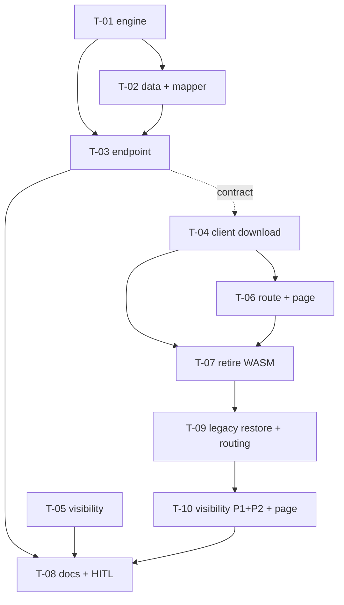

# Tasks — Results / OICR Word Template 2026 (filled download)

- **Module:** results (server `entities/result-oicr` · client OICR download button and `/oicr/download` route)
- **Spec id:** 2026-10-oicr-word-template-2026
- **Status:** approved (Phase 3 gate, 2026-10-23) · **amended 2026-10-26 by Pivot PV-1** (T-09, T-10 added; T-08 amended) — amendment approved by the owner 2026-10-26
- **Owner:** STAR / ARI squad
- **Linked requirements:** ./requirements.md
- **Linked design:** ./design.md (approved; Judgment Day APPROVED, see ./judgment.md)
- **Last updated:** 2026-10-23

---

## Summary

| ID | Action | Pkg | Size | Depends | Review |
|---|---|---|---|---|---|
| T-01 | Document engine (pure) + control-id module + fixture + direct deps + fidelity, field and drift suites | server | L | — | full |
| T-02 | `getWordTemplateData` repository method + homologation mapper + end-to-end XML test | server | M | T-01 | full |
| T-03 | Service + `downloadWordTemplate` endpoint + config + errors/logs + `download_url` path form | server | M | T-01, T-02 | full |
| T-04 | Client download path: API blob call, rewritten `OicrDownloadService`, shared `downloadBlob`, button without WASM, interceptor exclusion | client | M | T-03 (contract) | full |
| T-05 | Button visibility: shown only for Portfolio 2; spec sweep *(done; rule amended by T-10, PV-1)* | client | S | — | checklist |
| T-06 | Guarded route `/oicr/download/:resultCode`, legacy redirect, page states | client | M | T-04 | full |
| T-07 | Retire the WASM path: files, global script, dead API, dead env keys *(done; reversed by T-09, PV-1)* | client | S | T-04, T-06 | checklist |
| T-09 | **PV-1** Restore the legacy WASM path for Portfolio 1 and route downloads by portfolio (service + button) | client | M | T-07 | full |
| T-10 | **PV-1** Visibility for Portfolio 1 and 2; the link page resolves the portfolio before downloading | client | M | T-09 | full |
| T-08 | Baseline docs + HITL checks (Word 2026 and 2025, email link, timing, Dev download) | docs + both | S | T-01…T-07, T-09, T-10 | checklist |

**Parallelism (root `CLAUDE.md` §4.3):**
- **Server and client lanes may be edited in parallel:** T-01→T-02→T-03 on one side, and T-05 / T-04→T-06→T-07 on the other.
- **Two tasks in the same package may not be edited in parallel.**
- **Full-suite runs are never concurrent.** The Leader re-measures the full suite after each worker reports.

**Review intensity:** no task is `skip-eligible`.

---

## Task list

### T-01 — Document engine (pure) with fidelity, field and drift suites

- **Status:** done (PASS attempt 1, 2026-10-23 — see `execution.md`) · **Size:** L · **Dependencies:** none · **Review:** `full` — this is the binary-format core, and every "never half-fill" guarantee lives here
- **Requirements covered:** R-OWT-004, R-OWT-005, R-OWT-006 (template rows), NFR-OWT-003; part of R-OWT-002 (placeholder kept, untouched fields) and R-OWT-003 (exact option)
- **Design refs:** §2.1 (`word-template/*.ids.ts`, `*.engine.ts`, `__fixtures__/`), §5 step 7, §10 engine rows, D-OWT-2, D-OWT-3, D-OWT-4, D-OWT-16, P-6, P-7, P-8, P-21
- **Scope:**
  - Add `jszip@3.10.1` and `@xmldom/xmldom@0.8.10` to `server/researchindicators/package.json` `dependencies` (same versions as the lockfile, P-7).
  - `oicr-word-template.ids.ts`:
    - the 13 target ids, named;
    - the 9 pinned leaf ids, named (design §5 step 7.2, read from the template 2026-10-23).
  - `oicr-word-template.engine.ts`. Pure functions, no Nest, no IO:
    - `validate`: every check of §5 step 7.2, each throwing a named error type that carries `control` and `reason`;
    - `cloneItems`: fresh `w:id` and `w14:paraId` below `0x80000000` on every element; `textId` is copied;
    - `normalizeText`: XML 1.0 `Char` whitelist plus `\r\n?` → `\n`;
    - `setText` and `setOption`;
    - `build`: original declaration prefix, `DEFLATE`, entry order kept, untouched entries' content kept.
    - **Input:** the template buffer and a field-values object. **Output:** a buffer.
  - `__fixtures__/oicr-template-2026.docx`: a byte copy of `~/Desktop/OICR-2026-word-export/poc/template-2026.docx`, SHA-1 `e469c79d…`.
- **Tests** (`oicr-word-template.engine.spec.ts`), every row of design §10 marked "Engine":
  - null edit (exact string equality);
  - fidelity;
  - field level, including ORCID kept, Other Contributing Projects untouched, no placeholder flag or style on filled controls, and special characters;
  - drift guards (6 mutations);
  - the five falsifier cases;
  - a mapped label that is not an option → named error;
  - a none label → control untouched;
  - N items including none-label rows.
- **Verification:**
  - `npm test -- --silent src/domain/entities/result-oicr/word-template`
  - `npm ls jszip @xmldom/xmldom` (both listed as direct deps)
  - `npm run build`
  - `npx eslint src/domain/entities/result-oicr/word-template`
- **Falsifier:** each mutation below must turn its test red.
  - **(a) Fidelity:** write a non-target string (`Use this section to quantify` → `…QUANTIFY`) → the "identical after removing targets" assertion goes red.
  - **(b) Revision:** drop one `w:del` → revision count red.
  - **(c) Duplicate id:** give a clone the template's own `w:id` → uniqueness red.
  - **(d) Invalid option:** write `Multi-regional` into geo scope → option-exact red.
  - **(e) Style:** edit `styles.xml` → part-identical red.
  - **(f) Silent skip:** change `setOption` to skip silently on a missing option → the mapped-missing test goes red.
  - **(g) Positional addressing:** address section-15 leaves by position and swap two columns in the fixture → the swapped-column test goes red.
  - **Baseline observed** for (a)–(e) on the POC verifier, 2026-10-22:
    - `FAIL everything outside the 13 target controls is identical`
    - `FAIL tracked changes <w:del> 5 -> 3`
    - `FAIL 150 content-control ids, all unique`
    - `FAIL 11 selected dropdowns all hold an exact option text`
    - `FAIL part changed: word/styles.xml`
- **Red run:** for each of (a)–(g), the Jest port is observed failing **on its behavioral assertion** (not on fixture loading). The red line is quoted in `execution.md`, then reverted.
- **Disqualifier:**
  - A test that builds its expected value through the engine under test (comparison through the same serializer) is not evidence for the null edit.
  - A green suite whose fixture is not byte-identical to the S3 template (SHA-1 mismatch) is not evidence.
  - A red that comes from a missing fixture path is not a red.
- **Consumers:** none (new symbols only).
- **Done criteria:**
  - [x] All engine tests green.
  - [x] Falsifiers (a)–(g) each observed red and quoted in `execution.md`.
  - [x] The fixture SHA-1 is recorded.
  - [x] `npm ls` shows both libraries as direct dependencies.
  - [x] Build green.
- **Skills:** `nestjs-expert`, `tdd`, `error-handling-patterns`

### T-02 — Modal data query and homologation mapper

- **Status:** done (PASS attempt 1, 2026-10-23 — see `execution.md`) · **Size:** M · **Dependencies:** T-01 (field-values shape) · **Review:** `full` — the homologation tables are the business rules BI agreed
- **Requirements covered:** R-OWT-002 (table, empty → placeholder, previous handle tag 2/3), R-OWT-003 (all tables, unmapped → none), R-OWT-004 (STAR order)
- **Design refs:** §3, §5 step 6, D-OWT-6, D-OWT-7, P-5
- **Scope:**
  - `ResultOicrRepository.getWordTemplateData(resultId)`: the §3 queries, each with `is_active = 1`.
    - Research areas ordered by `result_lever_id`.
    - Main project with `is_primary = 1 AND contract_role_id = 1`.
    - First linked handle.
    - First main contact.
    - `um49Code` coerced with `Number()`.
  - `dto/oicr-word-template-data.dto.ts`.
  - `oicr-word-template.mapper.ts`:
    - tag table;
    - research-area table (10, 11, 12, 14, 15 with the trailing space, 16 → `PISA`, 18 → `Other`, else none);
    - geo rules with the region set `{2, 19, 142, 150, 9, 10, 202, 419}`;
    - the exact regions/countries format;
    - contact row (`center` as stored, role `Contact Person`);
    - previous handle only for tag 2/3;
    - empty → no value.
- **Tests:**
  - `oicr-word-template.mapper.spec.ts`: tag ×3; research area ×7 + unmapped; geo ×9 (0 regions, 1 continent, 1 SSA, 1 LAC, 1 sub-region, 2 regions, codes 3, 4, 5, 50); regions/countries format, including sub-nationals and one empty block; contact row; tag 1 vs 2/3 with a handle present.
  - One end-to-end case: STAR-554-shaped data → T-01 engine → assertions on the generated XML for every R-OWT-002 field.
  - `result-oicr.repository.spec.ts`: the query text carries `is_active`, the `ORDER BY result_lever_id` and the role filters.
- **Verification:** `npm test -- --silent src/domain/entities/result-oicr`; `npm run build`; `npx eslint` on the changed files.
- **Falsifier:**
  - Map 16 → `Policy, Inclusion…` (the STAR name) instead of `PISA` → research-area row red, and the e2e case raises the T-01 mapped-missing error.
  - Classify Sub-Saharan Africa (202) as Sub-regional → the SSA row red.
  - Fill the previous handle for tag 1 → that case red.
  - The fixture must vary the discriminating field per case (KZ-004). Example: the SSA case and the Eastern Africa case differ only in the region code.
- **Red run:** each falsifier observed red on its assertion, quoted in `execution.md`. The mapper is new code, so the baseline has no unit.
- **Disqualifier:**
  - A geo test whose expected label is computed by calling the mapper is not evidence.
  - A repository test that asserts only that `query` was called (not its SQL text) cannot see a missing `is_active`. Record it as structurally blind to live data; the HITL Dev download (T-08) covers it (KZ-017).
- **Consumers:**
  - `result-oicr.repository.spec.ts`: additive method.
  - `result-oicr.service.spec.ts` mocks the repository; no change expected.
- **Done criteria:**
  - [x] Every homologation row has a test.
  - [x] The e2e XML case is green.
  - [x] Falsifiers observed red.
  - [x] Build green.
- **Skills:** `nestjs-expert`, `tdd`

### T-03 — Endpoint, service, configuration and errors

- **Status:** done (PASS attempt 1, 2026-10-23 — see `execution.md`; Swagger boot check pending at the owner's local run) · **Size:** M · **Dependencies:** T-01, T-02 · **Review:** `full` — eligibility order, error contract, outbound call
- **Requirements covered:**
  - R-OWT-001: both scenarios and the version line.
  - R-OWT-006: every row and both scenarios.
  - R-OWT-007: the missing-config scenario, plus no cache.
  - R-OWT-010: the server `download_url` sentence.
  - NFR-OWT-002.
- **Design refs:** §2.1, §4, §5 steps 1–5 and 8, §8, §9, D-OWT-1, D-OWT-5, D-OWT-14, D-OWT-15, P-1, P-2, P-3, P-4, P-9, P-10, P-20, **P-22**
- **First step (settles P-22, owner T-03):**
  - From inside the Dev server container or host, GET the template URL.
  - Record the status and byte count in `execution.md`.
  - If it is not 200, stop and escalate (Pivot Protocol). The design's S3-from-server premise is refuted.
- **Scope:**
  - `AppConfig.ARI_OICR_TEMPLATE_URL`.
  - `.env.example` entry with the Dev value.
  - `oicr-word-template.service.ts`:
    1. order: result → indicator → portfolio, then URL → data → fetch;
    2. axios `timeout` plus RxJS `timeout`, 10 s;
    3. 400/500/502 mapping;
    4. `LoggerUtil` lines per §9;
    5. no cache.
  - `ResultOicrModule`: import `HttpModule`, provide the service.
  - Controller handler `downloadWordTemplate`:
    - `@Get('word-template/' + RESULT_CODE)` with `@GetResultVersion()`;
    - reads `resultUtil.resultId` and `indicatorId` first;
    - `@ApiOperation`, `@ApiProduces`, binary `@ApiOkResponse`;
    - returns a `StreamableFile` with the docx type and disposition.
  - `result-status-workflow.repository.ts:54`: `download_url` in path form, with its spec at `:174` updated.
- **Tests:**
  - **Service spec:**
    - not an OICR → 400, no HttpService call;
    - P1 → 400, no call;
    - empty URL → 500, no call;
    - non-200 → 502;
    - timeout → 502;
    - engine named error → 500 carrying the control name;
    - a log line per error;
    - two consecutive calls → two fetches (no cache).
  - **Controller spec:**
    - `StreamableFile` content type and disposition match `STAR_OICR_<code>_<yyyyMMdd>_<HHmm>.docx`;
    - missing result → 400 `Result not found` with **no** service call.
  - **Static check:** the route is not in the JWT middleware exclusions (`app.module.ts:91-128`).
- **Verification:**
  - `npm test -- --silent src/domain/entities/result-oicr src/domain/entities/result-status-workflow src/domain/tools/clarisa`
  - `npm run build`
  - `npx eslint` on the changed files
  - Boot the app and confirm `GET /api/results/oicr/word-template/{resultCode}` appears in `/swagger`. It must be unversioned (root `CLAUDE.md` §4.1).
- **Falsifier:**
  - Move the template fetch before the portfolio check → the "P1 → no HttpService call" test red.
  - Add a module-level cache → the "two fetches" test red.
  - Return `ResponseUtils.format(...)` instead of a `StreamableFile` → the controller content-type test red.
- **Red run:** each falsifier observed red on its assertion and quoted in `execution.md`.
- **Disqualifier:**
  - A 401 claim evidenced only by the absence of `@Roles` is not evidence. The 401 is the middleware's, and is evidenced by the exclusion-list read plus the HITL anonymous request (T-08).
  - A green service spec whose HttpService mock resolves synchronously before the eligibility checks run cannot show ordering. The mock must record the call order.
- **Consumers:**
  - `result-oicr.controller.spec.ts` (new handler).
  - `result-status-workflow.repository.spec.ts:174` (`download_url`).
  - `domain/tools/clarisa/clarisa.module.spec.ts:80`, which loads the module graph including `ResultOicrModule`; run it after the `HttpModule` import.
  - The client (T-04) consumes the endpoint contract.
- **Done criteria:**
  - [x] P-22 settled and recorded (owner attestation; re-confirmed by the T-08 Dev download).
  - [x] All listed specs green.
  - [x] Falsifiers observed red.
  - [x] Swagger shows the route unversioned (local server :3001, `/swagger-json` → `/api/results/oicr/word-template/{resultCode}`; see `execution.md`).
  - [x] Build green.
- **Skills:** `nestjs-expert`, `api-design-principles`, `error-handling-patterns`

### T-04 — Client download through the endpoint

- **Status:** done (PASS attempt 1, 2026-10-23 — see `execution.md`) · **Size:** M · **Dependencies:** T-03 (endpoint contract; editing can start in parallel against the §4 contract) · **Review:** `full` — shared interceptor and the error UX
- **Requirements covered:**
  - R-OWT-008: the click downloads, the loading state, the error toast.
  - R-OWT-001: the version line (no `useResultInterceptor`).
  - R-OWT-011: the "only request is the endpoint" clause, for the button.
- **Design refs:** §2.2 (api, service, util, button, interceptor rows), §6, D-OWT-8, D-OWT-9, D-OWT-12, D-OWT-15, P-11, P-13
- **Scope:**
  - `ApiService.GET_OicrWordTemplate(code)` via `TP.getBlob('results/oicr/word-template/' + code)`, **without** `useResultInterceptor`.
  - `shared/utils/download-blob.util.ts`.
  - `OicrDownloadService.download(code)`:
    - fetches the blob;
    - saves it as `STAR_OICR_<code>_<yyyyMMdd>_<HHmm>.docx` in local time;
    - on error, reads the Blob, parses JSON, and returns the message in the order `errors` → `description` → generic, including the non-JSON body case.
  - `app-download-oicr-template`:
    - no `WasmService`, no `wasmLoaded` gating;
    - `processing` spinner/`loading`;
    - on error, one toast through `ActionsService.showToast`.
  - `http-error.interceptor.ts`: `isOicrWordTemplateError = req.url.includes('oicr/word-template')`, added to the exclusion list beside `isAgrovocSearchError`.
- **Tests:**
  - **Service spec:** file name pattern; error message order (`errors` set; only `description`; HTML body → generic).
  - **Button spec, arranging the transition (KZ-015):** idle → click → loading → error toast once.
  - **Interceptor spec:** an error on `oicr/word-template` → no toast; on another URL → toast.
- **Verification:**
  - `npm test -- --silent` (scoped to the changed specs, then the full suite by the Leader)
  - `npm run build`
  - `npx tsc -p tsconfig.spec.json`
  - `npm run lint -- --quiet`
- **Falsifier:**
  - Read `description` before `errors` → the order test red (expected `Result is not an OICR`, got `BadRequestException`).
  - Remove the interceptor exclusion → the "no toast" test red, with 2 toasts counted.
- **Red run:** observed red on the assertion and quoted in `execution.md`. A red from an unflushed Blob promise is not a red: the test must await the Blob read.
- **Disqualifier:**
  - A toast test that mocks `ActionsService` but never triggers the HTTP error path proves nothing about the interceptor.
  - Under jsdom, `Blob.text()` may be missing (J-27). A test that passes because the parse branch threw and fell into "generic" is not evidence for the JSON branch: assert the exact server message.
- **Consumers:**
  - `http-error.interceptor.spec.ts`.
  - `download-oicr-template.component.spec.ts`.
  - `oicr-download.service.spec.ts` (rewritten).
  - `pages/oicr-download/oicr-download.component.spec.ts` (still calls the service; adjusted in T-06).
  - `api.service.spec.ts` (additive method).
- **Done criteria:**
  - [x] Specs green.
  - [x] Falsifiers observed red.
  - [x] Build and `tsc -p tsconfig.spec.json` green (spec tsc: 945 pre-existing errors before/after, none new).
  - [x] The button no longer imports `WasmService`.
- **Skills:** `angular-developer`, `error-handling-patterns`

### T-05 — Button visibility: Portfolio 2 only

> **PV-1 (2026-10-26):** done as specified; the rule "Portfolio 1 hidden" is amended by T-10 (Portfolio 1 shown, legacy path).

- **Status:** done (PASS attempt 1, 2026-10-23 — see `execution.md`) · **Size:** S · **Dependencies:** none · **Review:** `checklist` — one predicate flip plus a known spec sweep, with the inversion list in design §13
- **Requirements covered:** R-OWT-008 (the visibility table: P2 not published shown, P2 published per existing rule, P1 hidden, unknown hidden; both scenarios)
- **Design refs:** §2.2 (util row), §6, D-OWT-11, §13 (inversion list), P-14, P-16
- **First step (P-16 smoke check, not a gate):** on Dev, read the `…/metadata` response for STAR-554 (P2) and one 2025 OICR, from the result page and from the OICR modal. Record `portfolio.id` in `execution.md`.
- **Scope:**
  - `isOicrTemplateDownloadHidden(source)` returns `resolvePortfolioId(source) !== 2`.
  - Remove `OICR_TEMPLATE_DOWNLOAD_PORTFOLIO_2_ENABLED`.
  - Update the doc comment.
- **Tests:**
  - Util spec: P2 → shown; P1, `{}`, `undefined`, `null` → hidden.
  - Every range in design §13 (`oicr-header.component.spec.ts:267-268,281-293,295-304,369-377,379-386`; `section-header.component.spec.ts:456-461,464-470,477-485`; `oicr-template-download.util.spec.ts:2,25-39`) updated to the new rule.
  - Published-P2 stays hidden in `oicr-header`.
- **Verification:** the full client suite via `npm test -- --silent`. A missed range must surface here (KZ-003); run it by the Leader, not concurrently. Also `npm run build`.
- **Falsifier:** keep the old predicate (`… === 2`, i.e. hidden for P2) → the "P2 → shown" util test red.
- **Red run:** observed red and quoted in `execution.md`. The new assertion does not exist at baseline, so it is first run red against the unchanged util.
- **Disqualifier:**
  - A component spec that sets `currentMetadata` before the first `detectChanges()` tests an end state, not the product transition (KZ-015).
  - At least one header spec must set metadata **after** the first render and see the button appear.
- **Consumers:** `oicr-template-download.util.spec.ts`, `oicr-header.component.spec.ts`, `section-header.component.spec.ts` (P-14; no cypress/e2e suite exists in the client).
- **Done criteria:**
  - [x] P-16 smoke check recorded (DB function read; scope limit recorded in `execution.md`).
  - [x] Full client suite green (8041/8041; one runner SIGSEGV suite re-run green in isolation).
  - [x] Falsifier observed red.
- **Skills:** `angular-developer`

### T-06 — Guarded download route, legacy redirect and page states

- **Status:** done (PASS attempt 1, 2026-10-23 — see `execution.md`) · **Size:** M · **Dependencies:** T-04 · **Review:** `full` — auth routing and the login round trip
- **Requirements covered:**
  - R-OWT-009: login required, return with the same code, auto-download, navigate on success, loading, error without navigation, and the BUT for a 2025 link.
  - R-OWT-010: redirect; missing parameter → error.
- **Design refs:** §2.2 (routes, page rows), §6, D-OWT-10, P-12
- **Scope:**
  - `app.routes.ts`: add `{ path: 'oicr/download/:resultCode', loadComponent: …, canMatch: [rolesGuard], data: { isLoggedIn: true } }`. Keep `oicr/download` as the legacy entry, declared **after** it.
  - `OicrDownloadComponent`:
    - path param → `OicrDownloadService.download`;
    - the query param `resultCode` → `router.navigate(['/oicr/download', code], { replaceUrl: true })`;
    - no parameter → the existing "Missing resultCode" error;
    - success → `/result/STAR-<code>/general-information` through the existing `getResultCodePath`;
    - error → the existing error panel with the message, and **no** navigation.
- **Tests:**
  - `app.routes.spec.ts`: the new route has `canMatch` containing `rolesGuard` and `data.isLoggedIn === true`.
  - Page spec:
    - path code → service called with `554`;
    - legacy `?resultCode=554` → navigate to `['/oicr/download','554']` with `replaceUrl`;
    - missing → error text;
    - service error → message shown, `router.navigate` not called;
    - success → navigate to general-information.
- **Verification:** `npm test -- --silent` (changed specs), `npm run build`, `npx tsc -p tsconfig.spec.json`.
- **Falsifier:**
  - Remove `canMatch` from the new route → the routes spec red.
  - Navigate on error → the "no navigation" test red.
  - Keep the code in the query on the guarded route → `returnUrl` loses it. That is not unit-observable; see the Disqualifier.
- **Red run:** the routes-spec and no-navigation falsifiers observed red and quoted in `execution.md`.
- **Disqualifier:** the Cognito round trip (logged out → login → back on `/oicr/download/554` → file) **cannot** be reached by unit tests. Only the HITL check in T-08 evidences it (requirements D-6).
- **Consumers:** `app.routes.spec.ts`, `pages/oicr-download/oicr-download.component.spec.ts`.
- **Done criteria:**
  - [x] Specs green.
  - [x] Falsifiers observed red.
  - [x] Build green.
- **Skills:** `angular-developer`

### T-07 — Retire the WASM generation path

> **PV-1 (2026-10-26):** done as specified; its deletions are reversed by T-09 (the legacy path serves Portfolio 1). `oicrTemplateName` stays removed.

- **Status:** done (PASS attempt 1, 2026-10-23 — see `execution.md`) · **Size:** S · **Dependencies:** T-04, T-06 · **Review:** `checklist` — deletions with a measured consumer list (P-15, P-17, reversion challenge D-OWT-13)
- **Requirements covered:** R-OWT-011 (the browser requests neither `main.wasm` nor the S3 template)
- **Design refs:** §2.2 (deleted rows, `GET_OICRDetails` row, `environment.example.ts` row), §7, D-OWT-13, P-15, P-17, P-19
- **Scope:**
  - Delete:
    - `shared/services/go/wasm.service.ts` and its spec;
    - `public/go/main.go`, `main.wasm`, `wasm_exec.js` and `WASM-DOCX-README.md`;
    - the `scripts` entry `./public/go/wasm_exec.js` (`angular.json:44`).
  - Remove:
    - `GET_OICRDetails` (`api.service.ts:1175-1178`) and its import (`:131`);
    - the spec case `api.service.spec.ts:1781-1787`;
    - `interfaces/gets/get-oicr-details.interface.ts` (and its spec, if any);
    - `filesStorageUrl` and `oicrTemplateName` from `environment.example.ts:61,74`.
  - **Before deleting**, re-run the P-15/P-17/P-19 greps and paste the totals.
- **Tests:** none new. The full client suite must stay green.
- **Verification:**
  - Repo-wide `grep -rnE "WasmService|wasm_exec|main\.wasm|processDocxWasm|GET_OICRDetails|GetOICRDetails|oicrTemplateName" client/research-indicators/src client/research-indicators/angular.json` → 0 hits outside the gitignored environment files.
  - Full client suite (Leader).
  - `npm run build`, plus a check that the built `dist/` has no `go/` folder.
- **Falsifier:** leave one import of `WasmService` in a component → the grep finds a hit and `npm run build` fails on the missing file.
- **Red run:** a build observed red with one deliberately stale import, quoted, then fixed.
- **Disqualifier:**
  - A grep scoped to `src/app` only cannot see `angular.json` or `public/` (KZ-017). Use the stated scope.
  - A green build alone cannot prove the browser no longer fetches `main.wasm`. The HITL network check in T-08 does.
- **Consumers:** every file in P-15 and P-17 (listed in design §15).
- **Done criteria:**
  - [x] Grep totals pasted (before: P-15 list; after: 0 outside the gitignored env files).
  - [x] Build green.
  - [x] No `go/` in `dist/`.
  - [x] Full suite green (8042/8042; two runner SIGSEGV suites re-run green in isolation).
- **Skills:** `angular-developer`

### T-09 — Restore the legacy WASM path for Portfolio 1 and route by portfolio (PV-1)

- **Status:** done (PASS attempt 1, 2026-10-26 — see `execution.md`) · **Size:** M · **Dependencies:** T-07 · **Review:** `full` — restores a whole generation path and introduces the routing point both entries use
- **Requirements covered:** R-OWT-013 (all clauses); R-OWT-008 (the click downloads the portfolio's document, loading, one error toast — both paths); R-OWT-011 (a Portfolio 2 download never touches the WASM)
- **Design refs:** §16 (PV-1 table and P-24…P-27), §12 D-OWT-17, §2.2 (restored rows)
- **Scope:**
  - Restore **byte-for-byte from `ca43e56c^`** (`git checkout ca43e56c^ -- <paths>`): `src/app/shared/services/go/wasm.service.ts` (+ spec), `public/go/{main.go,main.wasm,wasm_exec.js,WASM-DOCX-README.md}`, the `angular.json` `scripts` entry `./public/go/wasm_exec.js`, `GET_OICRDetails` + its import in `api.service.ts` and its spec case, `interfaces/gets/get-oicr-details.interface.ts`, and `filesStorageUrl` in `environment.example.ts` (not `oicrTemplateName`).
  - In the restored `WasmService`, change only `TEMPLATE_URL` to `` `${environment.filesStorageUrl}templates/2025_OICR_Template.docx` `` (P-24, P-26).
  - New `src/app/shared/services/oicr-legacy-download.service.ts`: the `83d6c37d` `OicrDownloadService` restored and renamed `OicrLegacyDownloadService` — same field mapping, same `generateAndDownload(code): Promise<ProcessResult>`, same file name. No logic change. Its spec: the `83d6c37d` `oicr-download.service.spec.ts` restored and renamed accordingly.
  - `OicrDownloadService.download(code, portfolioId)`: `1` → legacy (a `{ success: false, error }` result rejects with `error`; `success: true` resolves); `2` → the existing server path; anything else → rejects with a fixed message.
  - `app-download-oicr-template`: passes `resolvePortfolioId(this.cache.currentMetadata())`; no `loadWasm()` in `ngOnInit`; one toast on any rejection (existing).
  - `pages/oicr-download/oicr-download.component.ts`: compile against the new signature only (portfolio resolution is T-10).
- **Tests:**
  - `oicr-download.service.spec.ts`: portfolio 1 → the legacy service called, `ApiService.GET_OicrWordTemplate` **not** called; portfolio 2 → the server path, legacy **not** called; unknown → rejects, neither called; legacy `{ success: false, error: 'X' }` → rejects with `X`.
  - Button spec: a Portfolio 2 render and click never calls `WasmService.loadWasm`; a Portfolio 1 click calls the legacy path; a legacy failure → one toast.
  - The restored `wasm.service.spec.ts` and legacy spec pass, with the `TEMPLATE_URL` assertion updated to the 2025 file.
- **Verification:** `git diff ca43e56c^ -- <restored paths>` shows only the `TEMPLATE_URL` line (paste it); changed specs `npx jest --coverage=false --silent <paths>`; `npm run build` (and `public/go`/`go/` present in `dist/`); `npx tsc -p tsconfig.spec.json --noEmit` (945 baseline, no new); `npm run lint -- --quiet`. Full suite: Leader.
- **Falsifier:**
  - Route portfolio 1 to the server path → the "portfolio 1 → legacy, server not called" test red.
  - Keep `loadWasm()` in the button's `ngOnInit` → the "Portfolio 2 render never loads the WASM" test red.
  - Leave `TEMPLATE_URL` reading `oicrTemplateName` → the `wasm.service.spec` 2025-file assertion red.
- **Red run:** each observed red on its assertion, quoted in `execution.md`, then reverted.
- **Disqualifier:**
  - A routing test that mocks `OicrDownloadService` itself proves nothing about routing.
  - A green unit suite cannot show the legacy document is identical to before; only the T-08 HITL 2025 download in Word does.
  - A restore that is not byte-identical outside `TEMPLATE_URL` is not a restore (the `git diff ca43e56c^` check).
- **Consumers:** `download-oicr-template.component.spec.ts`, `oicr-download.service.spec.ts`, `pages/oicr-download/oicr-download.component.spec.ts`, `api.service.spec.ts`, every P-15/P-17 file (design §15).
- **Done criteria:**
  - [x] Restore diff shows only the `TEMPLATE_URL` change.
  - [x] Specs green; falsifiers observed red.
  - [x] Build green with `go/` in `dist/`.
  - [x] Full client suite green (Leader; 8080/8080, one runner SIGSEGV suite re-run green in isolation).
- **Skills:** `angular-developer`, `error-handling-patterns`

### T-10 — Visibility for Portfolio 1 and 2; the link page resolves the portfolio (PV-1)

- **Status:** done (PASS attempt 1, 2026-10-26 — see `execution.md`) · **Size:** M · **Dependencies:** T-09 · **Review:** `full` — shared visibility util read by two headers, and the email-link entry
- **Requirements covered:** R-OWT-008 (amended visibility table, both 2026 and 2025 scenarios); R-OWT-009 (amended 2025-link scenario; unresolved-portfolio scenario); R-OWT-013 (the link half)
- **Design refs:** §16, §12 D-OWT-11 (amended), D-OWT-17, §6, P-25
- **Scope:**
  - `isOicrTemplateDownloadHidden(source)` → hidden unless `resolvePortfolioId(source)` is `1` or `2`. Update the doc comment.
  - `OicrDownloadComponent`: for the path code, call `ApiService.GET_Metadata(code)`, resolve the portfolio with `resolvePortfolioId`, then `OicrDownloadService.download(code, portfolioId)`. Metadata failure or unresolved portfolio → the existing error panel with a fixed message, no navigation, no download. Success → general-information as today.
- **Tests:**
  - Util spec: P1 → shown; P2 → shown; `{}`, `undefined`, `null`, `{ portfolio_id: 3 }` → hidden.
  - Header specs: invert the T-05 "Portfolio 1 hidden" assertions; a **transition** test where Portfolio 1 metadata arrives after the first render and the button appears (KZ-015); published Portfolio 1 stays hidden in `oicr-header`.
  - Page spec: path code with Portfolio 1 metadata → `download('554', 1)`; with Portfolio 2 → `download('554', 2)`; metadata rejected → error text, `download` and `navigate` not called; metadata without portfolio → same.
- **Verification:** changed specs; `npm run build`; `npx tsc -p tsconfig.spec.json --noEmit`; `npm run lint -- --quiet`. Full suite: Leader (KZ-003).
- **Falsifier:**
  - Keep the T-05 predicate (`!== 2`) → the "P1 → shown" util test red.
  - Skip the metadata call and pass a fixed portfolio → the Portfolio 1 page test red.
- **Red run:** observed red, quoted, reverted.
- **Disqualifier:** a header spec that sets metadata before the first `detectChanges()` is an end state (KZ-015); at least one header spec must arrange the Portfolio 1 transition.
- **Consumers:** `oicr-template-download.util.spec.ts`, `oicr-header.component.spec.ts`, `section-header.component.spec.ts`, `pages/oicr-download/oicr-download.component.spec.ts`.
- **Done criteria:**
  - [x] Specs green; falsifiers observed red.
  - [x] Build green.
  - [x] Full client suite green (Leader; 347/347 suites, 8093 tests).
- **Skills:** `angular-developer`

### T-08 — Baseline docs and human checks

- **Status:** in progress [~] — docs half PASS 2026-10-26; HITL on Dev open · **Size:** S · **Dependencies:** T-01…T-07, T-09, T-10 deployed to Dev · **Review:** `checklist` — doc edits plus quoted human evidence
- **Requirements covered:**
  - R-OWT-012.
  - The HITL halves of the defect gates: D-5 (Word repair prompt, "+" and dropdowns), D-6 (Cognito round trip), D-11 / NFR-OWT-001 (timing).
  - R-OWT-001: the unauthenticated scenario, live.
  - R-OWT-004: each row keeps its working "+" and dropdown.
  - R-OWT-011: the network clause.
- **Design refs:** §2.2 (docs row), §10 HITL row, §11, P-22
- **Scope:**
  - `docs/ux-ui/design.md:100,250` and `docs/trd/trd.md:204`: `/oicr/download/:resultCode`, login required, and the two generation paths (server for Portfolio 2, legacy client WASM for Portfolio 1 — PV-1).
  - HITL on Dev, each observation **quoted** in `execution.md` (KZ-002):
    1. Download STAR-554 and STAR-626 from the button. Open both in Word: no repair prompt; the 3.a and 3.b cloned rows have a working "+" and dropdown; the revisions show in the margin; filled text is not grey.
    2. Logged out, open `/oicr/download/554`: login → back on `/oicr/download/554` → file saved.
    3. *(amended by PV-1)* A 2025 OICR (e.g. STAR-120) from the button **and** from its link → the file downloads; it opens in Word like the pre-spec 2025 document, built from the **2025** template.
    4. DevTools network on a **2026** download: only `results/oicr/word-template/…`; no `main.wasm`, no S3 request. On a 2025 download, `main.wasm` and `templates/2025_OICR_Template.docx` are expected.
    5. Request time ≤ 5 s.
    6. Anonymous `curl` to the endpoint → 401.
- **Verification:** doc diffs reviewed; HITL quotes present.
- **Falsifier:** the doc check fails if `grep -n "Public download\|public template download" docs/ux-ui/design.md docs/trd/trd.md` still returns a hit.
- **Red run:** that grep observed with 3 hits before the edit (quote it), and 0 after.
- **Disqualifier:** a human answer that covers an adjacent property is not evidence for the clause. Example: "the file downloaded" does not cover "Word opened without repair". Tick only what the quoted words cover.
- **Consumers:** none.
- **Done criteria:**
  - [x] Docs updated, grep at 0 (3 → 0, see `execution.md`).
  - [ ] Seven HITL observations quoted (item 3 counts the button and the link).
- **Skills:** `cognitive-doc-design`

---

## Coverage — scenario and clause level

| Requirement clause / scenario | Owner |
|---|---|
| R-OWT-001 · 2026 OICR downloads: 200, type, `STAR_OICR_554_…` name, title in XML | T-03 (controller), T-02 (e2e XML title) |
| R-OWT-001 · BUT not a JSON envelope | T-03 (falsifier: `ResponseUtils.format` → red) |
| R-OWT-001 · unauthenticated → 401, no fetch | T-03 (exclusion-list read), T-08 (live `curl`) |
| R-OWT-001 · version line (current data; client sends no version) | T-04 (no `useResultInterceptor`), T-03 (`@GetResultVersion` kept) |
| R-OWT-002 · field table | T-02 (mapper + e2e XML) |
| R-OWT-002 · empty → placeholder | T-02 (empty → none), T-01 (untouched control) |
| R-OWT-002 · previous handle only for tag 2/3; AND IT MUST be filled for 2/3 | T-02 |
| R-OWT-002 · untouched sections identical | T-01 (fidelity strip) |
| R-OWT-002 · BUT ORCID must NOT be filled | T-01 (field-level) |
| R-OWT-002 · AND Other Contributing Projects must NOT be filled | T-01 (field-level), T-02 (no source) |
| R-OWT-003 · exact option; unmapped → unselected; mapped-missing → R-OWT-006 | T-01 (mapped-missing error, none untouched), T-02 (tables) |
| R-OWT-003 · Multi-region; Sub-regional; SSA → Regional | T-02 |
| R-OWT-003 · unknown not forced; BUT no free text | T-02 (unmapped → none), T-01 (none leaves the control) |
| R-OWT-003 · section-15 row content | T-02 (row), T-01 (pinned-id fill) |
| R-OWT-004 · two primary areas, two rows | T-01 (clone N), T-02 (e2e) |
| R-OWT-004 · AND each row keeps a working "+" and dropdown | T-08 (Word) |
| R-OWT-004 · AND IT MUST no duplicate `w:id` / `w14:paraId` | T-01 |
| R-OWT-004 · no items → single template row | T-01 |
| R-OWT-005 · parts byte-identical, declaration, revisions, untargeted text | T-01 |
| R-OWT-005 · BUT a style/setting/untargeted change must NOT pass | T-01 (falsifiers a, e) |
| R-OWT-005 · STAR text not a tracked change | T-01 (revision counts unchanged) |
| R-OWT-005 · filled text without the grey placeholder style | T-01 (field-level), T-08 (visual) |
| R-OWT-005 · special characters; BUT no U+000B or other XML-invalid characters | T-01 |
| R-OWT-006 · result not found → 400 | T-03 (controller) |
| R-OWT-006 · not an OICR / P1 → 400 | T-03 |
| R-OWT-006 · fetch failure → 502; missing id / structure / option → 500 | T-03 (mapping), T-01 (named errors) |
| R-OWT-006 · never partial, never empty fallback; scenario "template replaced" BUT no doc with Title empty | T-01 (validate before write), T-03 (500) |
| R-OWT-006 · 2025: 400 and no template fetched | T-03 (call-order test) |
| R-OWT-007 · URL from config, effective next download, no cache | T-03 (two-fetches test) |
| R-OWT-007 · missing configuration → 500 | T-03 |
| R-OWT-008 · visibility table (P2, P2 published, P1, unknown) | T-05; P1 row amended → T-10 (PV-1) |
| R-OWT-008 · click downloads; loading; error toast | T-04 (P2), T-09 (routing, P1) |
| R-OWT-008 · scenario 2026 shows | T-05 |
| R-OWT-008 · scenario 2025 keeps the legacy download (PV-1) | T-10 (visibility), T-09 (routing), T-08 (live) |
| R-OWT-009 · login required | T-06 (routes spec), T-08 (live) |
| R-OWT-009 · return to the same link with the same code | T-06 (path design), T-08 (Cognito round trip) |
| R-OWT-009 · auto-download; navigate on success | T-06 |
| R-OWT-009 · loading and error states; no navigation after error | T-06 |
| R-OWT-009 · 2025 link → legacy download, BUT not the endpoint (PV-1) | T-10 (page), T-09 (routing), T-08 (live) |
| R-OWT-009 · unresolved portfolio → error, no download (PV-1) | T-10 |
| R-OWT-010 · legacy redirect | T-06 |
| R-OWT-010 · missing parameter → error | T-06 |
| R-OWT-010 · server `download_url` in path form | T-03 |
| R-OWT-011 · a 2026 download does not fetch the template or run the WASM | T-04 (button path), T-09 (no pre-load; P2 routing) |
| R-OWT-011 · BUT `main.wasm` and S3 must NOT be requested | T-08 (network check) |
| R-OWT-012 · baseline docs | T-08 |
| R-OWT-013 · legacy restored unchanged, pinned to the 2025 file, one toast on failure | T-09 |
| R-OWT-013 · document identical to the pre-spec 2025 download | T-08 (Word) |
| NFR-OWT-001 · ≤ 5 s | T-08 |
| NFR-OWT-002 · handler errors logged | T-03 |
| NFR-OWT-003 · direct dependencies | T-01 (`npm ls`) |

Every row names a task. No gap is discharged by citing another requirement.

---

## Risks & blockers log

| # | Date | Risk / Blocker | Mitigation | Owner | Status |
|---|---|---|---|---|---|
| RB-1 | 2026-10-23 | P-22: the Dev server may not reach S3 | T-03 first step; Pivot if refuted | T-03 | open |
| RB-2 | 2026-10-23 | The Word repair prompt cannot be tested in CI | T-08 HITL on both real OICRs | owner | open |
| RB-3 | 2026-10-23 | The server env var must exist before the client deploy | Rollout order in design §11 | owner | open |

## Done definition

- [ ] All T-01…T-10 are `done`, each with a Reviewer PASS recorded in `execution.md`.
- [ ] The feature was exercised in the running product (T-08) **before** `/akili-validate` (KZ-007).
- [ ] Coverage floors green (server 60 %, client floors).
- [ ] Swagger documents the endpoint.
- [ ] Rollout note in place: `ARI_OICR_TEMPLATE_URL` on the server; PISA-MELP and BI told that 2026 OICRs get the 2026 template, 2025 OICRs keep the 2025 download (PV-1), and the link now requires login.
